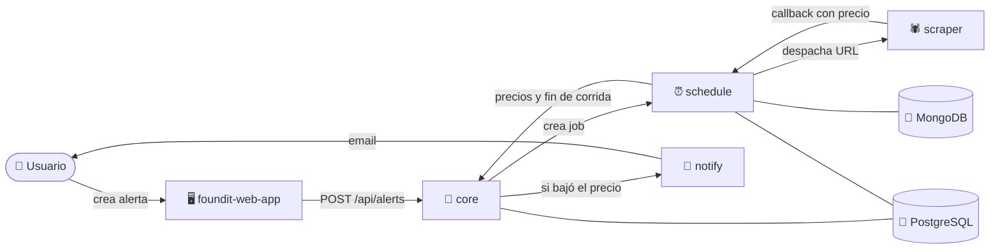

# 🔎 I Found It

**Compra cuando el precio baja.**

---

Sistema **académico** que vigila el precio de productos en tiendas online, guarda su **historial por sitio** y avisa por **email a los suscritos** cuando aparece una bajada de precio real, apoyándose en datos y no en el marketing de la tienda.

Este repositorio (`architecture`) es la **fuente de verdad del diseño**: requerimientos, arquitectura, modelo de datos, decisiones e historias de usuario. El código vive en repositorios aparte ([ver abajo](#-repositorios)).

> **Estado:** 🛠️ Implementación del ejercicio universitario en curso. CU-02 (alta de alerta) está implementado y probado de punta a punta; CU-03 y CU-04 (programar y capturar el precio) se están integrando. El resto de casos de uso tiene historia de usuario escrita y preguntas abiertas por decidir.

## 🧭 Cómo trabajamos: docs-as-code

La documentación se trata **como código** (*docs-as-code*):

- Todo es **Markdown, Mermaid y SQL** dentro del repositorio, junto a las decisiones que lo justifican.
- Se **versiona en git** y cada cambio entra por **pull request** con revisión humana, igual que el código.
- Cada requerimiento, decisión y criterio tiene un **ID estable** (`CU-NN`, `DEC-NN`, `ADR-NNNN`, `US-NN-MM-ACn`, `TC-NN-NN`) que enlaza historia, prueba y código.
- Las decisiones importantes quedan como **ADR**; lo que aún no se decide queda como **pregunta abierta**, nunca como suposición.
- Los agentes de IA leen y escriben esta documentación con las mismas reglas: lo que proponen es un borrador hasta que una persona lo aprueba.

El mapa de carpetas y qué agente lee cada una está en [`docs/README.md`](docs/README.md).

## 🎓 Alcance del ejercicio universitario

Versión **local** y acotada del proyecto completo:

- **Casos de uso:** CU-02 a CU-08, CU-10 y CU-11. Se omiten CU-01 (sesión) y CU-09 (supervisión).
- **Sin login ni roles:** hay un usuario fijo configurado por entorno.
- **Solo COP** y **solo URL directa** (el modo por palabra clave queda para después).
- Detalle y decisiones (`DEC-*`) en [`requirements.md`](docs/requirements/requirements.md).

## 💡 ¿Qué es esto?

Tres conceptos que no hay que confundir (detalle en [Visión y objetivos](docs/00-context/vision-goals.md)):

| Concepto | Qué es |
|----------|--------|
| 🔔 **Alerta** | Un proceso: scraping de los sitios que ofrecen el producto + notificación. Corre sola, **2 veces al día** en segundo plano. Es inmutable una vez creada. |
| 📧 **Suscripción** | Un correo suscrito a una alerta para recibir sus avisos; cada correo puede darse de baja. |
| 📈 **Histórico de precios** | Evolución del precio en el tiempo y entre sitios, para saber cuándo ofrece su mejor precio. |

## ⚙️ Cómo funciona

1. El usuario crea una **alerta** con una o varias URLs de producto y los correos que recibirán el aviso (`core`).
2. `core` pide a `schedule` un **job de captura**: la primera corrida sale de inmediato y luego corre **2 veces al día** dentro de las franjas horarias, en hora de Bogotá.
3. En cada corrida, `schedule` despacha cada URL al **`scraper`**, que extrae el precio con una cascada de estrategias (JSON-LD/schema.org, microdata, navegador, XHR) y devuelve el resultado por callback.
4. Cada chequeo se guarda como una fila del historial (`alert_snapshot`, en COP); el resultado crudo de cada intento queda en MongoDB.
5. Al terminar la corrida se **analiza la alerta**: si el mejor precio bajó frente al último análisis, `notify` envía un **email** a cada suscripción activa.

Secuencia completa en [Flujo de scraping](docs/architecture/scraping-flow.md).

## 📦 Repositorios

Organización **polyrepo**: cada pieza en su propio repositorio, sin paquetes compartidos.

| Repositorio | Pieza | Qué hace | Guía de arranque |
|-------------|-------|----------|------------------|
| [`architecture`](https://github.com/vida-I-found-it/architecture) | — | Diseño, requerimientos e historias (este repo) | — |
| [`core-service`](https://github.com/vida-I-found-it/core-service) | `core` | API pública: alertas, suscripciones, precios y análisis | [core](docs/guides/core.md) |
| [`schedule-service`](https://github.com/vida-I-found-it/schedule-service) | `schedule` | Jobs de captura, franjas horarias y despacho al scraper | [schedule](docs/guides/schedule.md) |
| [`scraper-service`](https://github.com/vida-I-found-it/scraper-service) | `scraper` | Extracción del precio de una URL con su cascada de estrategias | [scraper](docs/guides/scraper.md) |
| [`notify-service`](https://github.com/vida-I-found-it/notify-service) | `notify` | Envío de correos con plantillas | [notify](docs/guides/notify.md) |
| [`foundit-web-app`](https://github.com/vida-I-found-it/foundit-web-app) | frontend | Landing y board de la aplicación (React) | [frontend](docs/guides/frontend.md) |

En local, todos los repositorios viven como carpetas hermanas de este.

## 📚 Documentación

Todo vive en [`docs/`](docs/README.md). Lectura sugerida:

| Tema | Documento | Contenido |
|------|-----------|-----------|
| Contexto | [Visión y objetivos](docs/00-context/vision-goals.md) | Problema, glosario, módulos y no-objetivos |
| Contexto | [Entregable 01](docs/00-context/deliverable01.md) | Documento de entrega del ejercicio |
| Requerimientos | [Requerimientos del ejercicio](docs/requirements/requirements.md) | Casos de uso, reglas y decisiones `DEC-*` vigentes |
| Requerimientos | [Historias de usuario](docs/requirements/user-stories/README.md) | Criterios de aceptación y guía de implementación por repositorio |
| Arquitectura | [Arquitectura](docs/architecture/architecture.md) y [arquitectura general](docs/architecture/general-architecture.md) | Piezas, comunicación, configuración y despliegue |
| Arquitectura | [Flujo de scraping](docs/architecture/scraping-flow.md) | Una corrida de alerta, de punta a punta |
| Arquitectura | [ADR](docs/architecture/adr/README.md) | Decisiones de arquitectura con su porqué |
| Datos | [Modelo de datos](docs/data/data-model.md) y [scripts](docs/data/scripts/README.md) | Diagrama ER, PostgreSQL por esquema y MongoDB |
| Pruebas | [Estrategia](docs/testing/strategy.md) y [trazabilidad](docs/testing/traceability.md) | Niveles de prueba y matriz criterio → caso de prueba |
| Herramientas | [Stack tecnológico](docs/tools/tech-stack.md) | Tecnologías y por qué |
| Contexto | [Pendientes](docs/00-context/pending.md), [roadmap](docs/00-context/roadmap.md) y [consideraciones legales](docs/00-context/legal-considerations.md) | Lo que falta decidir, fases y política de scraping |
| Historia | [Requerimientos originales](docs/requirements/original-requirements.md) y [preguntas de Alcance 1](docs/00-context/scope-1-questions.md) | Versión del proyecto completo, antes del recorte del ejercicio |

Las reglas para trabajar con IA en este proyecto están en [`CLAUDE.md`](CLAUDE.md) (se copia a cada repositorio).

## 🤖 Agentes de Claude Code

Este repo trae agentes especializados en `.claude/agents/` (ficha completa y roster en [`.claude/rules/claude-config-guide.md`](.claude/rules/claude-config-guide.md)). No son un comando aparte: se piden en el chat y Claude Code los ejecuta como subagente, con su propio contexto, herramientas y modelo.

| Agente | Para qué | Cómo invocarlo |
|--------|----------|-----------------|
| **`architect`** | Analiza un componente o una decisión y propone mejoras de arquitectura —más rápida, abierta, segura, flexible y confiable—, con lenguaje técnico y opinión propia. Generalista y **portable** a cualquier repo. | *"Usa el agente architect para revisar/evaluar `<alcance concreto>`."* |
| `security-reviewer` | Busca brechas de seguridad en un diff o configuración (solo lectura). | *"Lanza security-reviewer sobre `<archivos/diff>`."* |
| `qa` | Escribe/ejecuta tests y valida criterios de aceptación. | *"Que qa valide `<requerimiento>`."* |
| `requirements-analyst` | Convierte un requerimiento en historia de usuario y criterios de aceptación; señala ambigüedades sin inventar reglas de negocio. | *"Usa requirements-analyst para `<ID>`."* |
| `technical-writer` | Corrige deriva entre documentos (índices, enlaces, IDs, estados). | *"Que technical-writer deje al día `<cambio>`."* |
| `devops` | Dockerfiles, CI/CD y secretos. No despliega; pide tu autorización antes de borrar o usar privilegios. | *"Usa devops para `<requerimiento INF-*>`."* |
| `dba` | Revisa y mejora modelos de datos (relacionales y no relacionales): integridad, ciclo de vida, espacio y velocidad. No ejecuta nada contra una BD. | *"Usa dba para revisar `<schema/tabla>`."* |
| `backend-developer` | Implementa un requerimiento de backend (API, workers, migraciones) con tests y verificación; propone patrones y arquitectura. | *"Usa backend-developer para `<ID>`."* |
| `frontend-developer` | Implementa pantallas y flujos con accesibilidad, estados de carga/error e i18n, y los prueba en el navegador. | *"Usa frontend-developer para `<ID>`."* |

Con `architect`, dale un alcance concreto (un componente, un ADR, una pregunta de los [pendientes](docs/00-context/pending.md)) — no le pidas "revisa toda la arquitectura" de una vez. Propone con un ADR en estado **🟡 Propuesta** cuando amerita; nunca aplica un cambio a una decisión ya cerrada sin que el humano lo apruebe.

**Nombres de los agentes.** Los identificadores están en inglés (coinciden con el nombre del archivo en `.claude/agents/` y con el campo `name`). Si encuentras un nombre antiguo en un chat o documento viejo, esta es la equivalencia:

| Nombre actual | Nombre anterior | Modelo |
|---------------|-----------------|--------|
| `architect` | `arquitecto` | Sonnet 5.5 |
| `security-reviewer` | `revisor-seguridad` | Sonnet 5.5 |
| `requirements-analyst` | `analista-requerimientos` | Sonnet 5.5 |
| `backend-developer` | `backend-developer-ia` | Sonnet 5.5 |
| `frontend-developer` | `frontend-developer-ia` | Sonnet 5.5 |
| `technical-writer` | `documentador` | Haiku |
| `dba` | `dba` *(sin cambio)* | Sonnet 5.5 |
| `devops` | `devops` *(sin cambio)* | Sonnet 5.5 |
| `qa` | `qa` *(sin cambio)* | Haiku |

Todos corren con `effort: medium`. El modelo está fijado en el campo `model:` de cada agente (`claude-sonnet-5-5` y `claude-haiku-5-5`).

> Si acabas de crear o editar un agente, abre `/hooks` (o reinicia la sesión) para que Claude Code lo cargue.

## ✅ Decisiones vigentes

- **Backend:** Python 3.12+ · FastAPI · SQLAlchemy · httpx · Playwright (en el scraper). El esquema de cada base sale de los scripts SQL de [`docs/data/scripts`](docs/data/scripts/README.md).
- **Programación de corridas:** el motor de `schedule` guarda `next_run_at` en PostgreSQL y los workers toman lo vencido con `FOR UPDATE SKIP LOCKED`; sin cola externa.
- **Datos:** PostgreSQL 16 con un esquema y un rol por pieza, sin claves foráneas entre esquemas; MongoDB para resultados crudos e intentos.
- **Frontend:** React + Vite + TypeScript + Tailwind, en español con textos centralizados para i18n.
- **Organización:** **polyrepo**, contenedores con Docker, todo local en esta versión.
- **Email:** SMTP con plantillas versionadas en `notify`.

> Si algo cambia, se actualiza aquí y en el documento correspondiente.

---
*Proyecto en construcción — la documentación evoluciona con cada nuevo requerimiento.*
