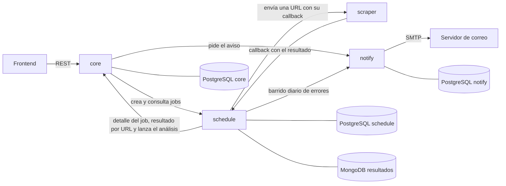
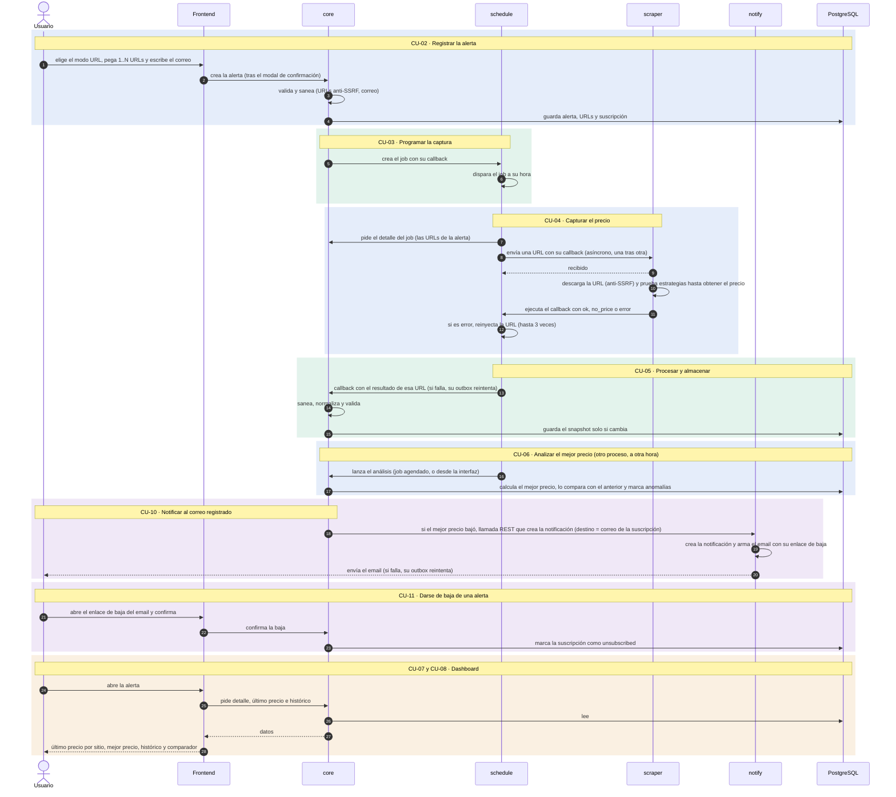

# Arquitectura · Seguimiento diario del precio de un producto por scraping

> **Alcance: solo el ejercicio.** Describe únicamente la arquitectura que necesitan los casos de uso que se van a recrear (CU-02..CU-08, CU-10, CU-11). El diseño completo del proyecto vive en [`general-architecture.md`](general-architecture.md). Es normal que ambos repitan secciones; en unas semanas se unificarán en una sola arquitectura.

El sistema vigila el precio de un producto en varias tiendas. El usuario registra las páginas y un correo; el sistema las scrapea de forma programada, guarda y analiza el historial, lo muestra en un dashboard y avisa por correo cuando baja el mejor precio. Se construye como cuatro piezas independientes más un frontend, que se comunican por REST.

## Tabla de contenido

1. [Piezas](#piezas)
2. [Vista de componentes](#vista-de-componentes)
3. [Flujo por casos de uso](#flujo-por-casos-de-uso)
4. [Comunicación entre piezas](#comunicación-entre-piezas)
5. [Decisiones de arquitectura](#decisiones-de-arquitectura)
6. [Atributos de calidad](#atributos-de-calidad)

---

## Piezas

| Pieza | Responsabilidad | Persistencia | API |
|---|---|---|---|
| **Frontend** | Pantallas de alta de alerta, lista, dashboard y baja, y el botón que lanza el análisis | Ninguna | Consume la de `core` |
| **`core`** | Alertas, suscripciones, precios, análisis y pedido de aviso | PostgreSQL | Pública y entre piezas |
| **`schedule`** | Motor de jobs genérico: agenda, dispara, envía las URLs al scraper una a una, reintenta y entrega cada resultado; corre el barrido diario de errores | PostgreSQL y MongoDB | Solo entre piezas |
| **`scraper`** | Descarga las URLs y extrae el precio | Ninguna | Solo entre piezas: `schedule` le envía el trabajo |
| **`notify`** | Arma y envía el email, y reintenta si falla | PostgreSQL | Solo entre piezas |

## Vista de componentes

## Flujo por casos de uso

Cada recuadro es un caso de uso.

## Comunicación entre piezas

| De → a | Operación y ruta | Para qué |
|---|---|---|
| Frontend → `core` | `POST /api/alerts` | Crear la alerta con sus URLs y su correo |
| Frontend → `core` | `GET /api/alert-modes` | Saber qué modos de creación están habilitados |
| Frontend → `core` | `GET /api/alerts` | Listar las alertas |
| Frontend → `core` | `GET /api/alerts/{alert_id}` | Ver el detalle y el último precio por sitio |
| Frontend → `core` | `GET /api/alerts/{alert_id}/price-history` | Histórico y comparador |
| Frontend → `core` | `POST /api/subscriptions/{subscription_id}/unsubscribe` | Darse de baja |
| `core` → `schedule` | `POST /schedule/internal/jobs` | Crear el job de la alerta |
| `core` → `schedule` | `GET /schedule/internal/jobs/{job_id}` | Consultar un job |
| `schedule` → `scraper` | `POST /scraper/internal/jobs` | Enviar una URL con su callback |
| `scraper` → `schedule` | `POST /schedule/internal/results` | Callback: entregar el resultado (en el ejercicio, el destino configurado) |
| `schedule` → `core` | `GET /api/internal/job-detail` | Obtener las URLs de la alerta |
| `schedule` → `core` | `POST /api/internal/prices` | Entregar el resultado de una URL (`ok`, `no_price` o `error`) |
| `core` → `notify` | `POST /notify/notifications` | Pedir el aviso por correo |
| `schedule` → `notify` | `POST /notify/notifications` | Barrido diario: un solo correo al administrador con los errores del día (mismo endpoint que el de `core`) |
| Frontend → `core` | `POST /api/analysis` | Lanzar el análisis a mano (EJ-5) |
| `schedule` → `core` | `POST /api/internal/analysis` | Lanzar el análisis agendado (EJ-5) |
| docker-compose → cada pieza | `GET /api/health` · `GET /schedule/health` · `GET /scraper/health` · `GET /notify/health` | Healthcheck: la pieza está viva y alcanza sus dependencias (EJ-4). Sin datos de negocio, sin autenticación, no se publican fuera de la red interna |

## Decisiones de arquitectura

- **REST con JSON** entre todas las piezas, y un contrato Swagger (OpenAPI) por pieza que expone endpoints.
- **Cada pieza es dueña de sus datos:** su propia base, sin claves foráneas hacia otra pieza; se enlazan solo por identificadores.
- **`schedule` envía el trabajo al scraper y este responde por un callback configurable** ([ADR-0004](adr/0004-schedule-dispatches-work-to-scraper.md)): el scraper responde «recibido», trabaja en segundo plano y al terminar ejecuta el callback. En el ejercicio el callback apunta a `schedule`, que reenvía a `core`; así el scraper no llama a `core`. Solo es alcanzable desde la red interna. `schedule` envía **una URL a la vez** y cada resultado (`ok`, `no_price` o `error`) llega a `core` de inmediato.
- **Scraping y análisis son procesos separados, a horas distintas** (DEC-25): el scraping guarda snapshots; el análisis (desde la interfaz o por un job agendado) calcula el mejor precio y decide los avisos. Por defecto 2 capturas y 2 análisis al día, parametrizable.
- **Cada pieza reintenta lo suyo:** el scraper **no reintenta** (una pasada por URL). `schedule` administra los reintentos del scraper: reinyecta solo las URLs con `error` (hasta 3 veces, 10–15 min) y reintenta el envío del trabajo (backoff exponencial); lo agotado queda `failed` y se avisa en el **barrido diario de errores**, que pide un solo correo a `notify`. `notify` reintenta el envío del email con su cola. `core` reintenta la llamada a `notify` con el mismo identificador de transacción.
- **Idempotencia por llaves únicas:** repetir una corrida, un callback o un aviso no duplica datos.
- **Estrategias reemplazables:** la forma de crear una alerta, la extracción del precio y el canal de notificación van detrás de interfaces, para cambiarlos sin tocar el resto.
- **Sin autenticación ni autorización:** la versión corre solo en local, sin sesión ni token entre piezas. El control es la red: el scraper no publica su puerto fuera de la red interna, y el destino de su callback es una lista blanca de backends registrados (en el ejercicio, solo `schedule`).
- **Scraping sin eludir protecciones:** si una tienda no permite scrapear, ese sitio queda sin precio.

## Atributos de calidad

| Atributo | Cómo se logra |
|---|---|
| Seguridad | Las URLs se validan contra direcciones peligrosas al crear la alerta y en cada descarga; todo texto se sanea; lo scrapeado se trata como dato; el correo se muestra enmascarado |
| Confiabilidad | Reintentos por pieza; una URL que falla no frena a las demás; un fallo al avisar no revierte el análisis |
| Mantenibilidad | Piezas desacopladas, servicios detrás de interfaces, un repositorio por entidad y migraciones por pieza; el mismo identificador de transacción acompaña una corrida en todas las piezas y en los logs, para diagnosticar fallos |
| Rendimiento | Solo se guarda un snapshot cuando el precio o el stock cambian; la captura ocurre en segundo plano, no dentro de una petición; bloqueos de fila acotados y sin consultas repetidas |
