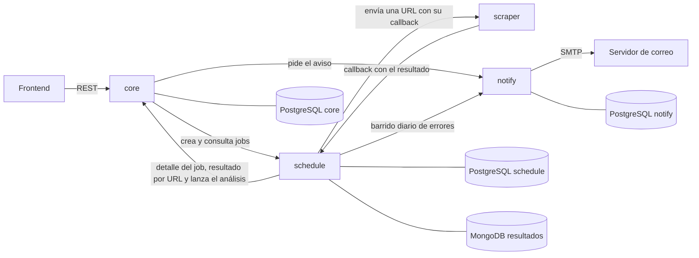
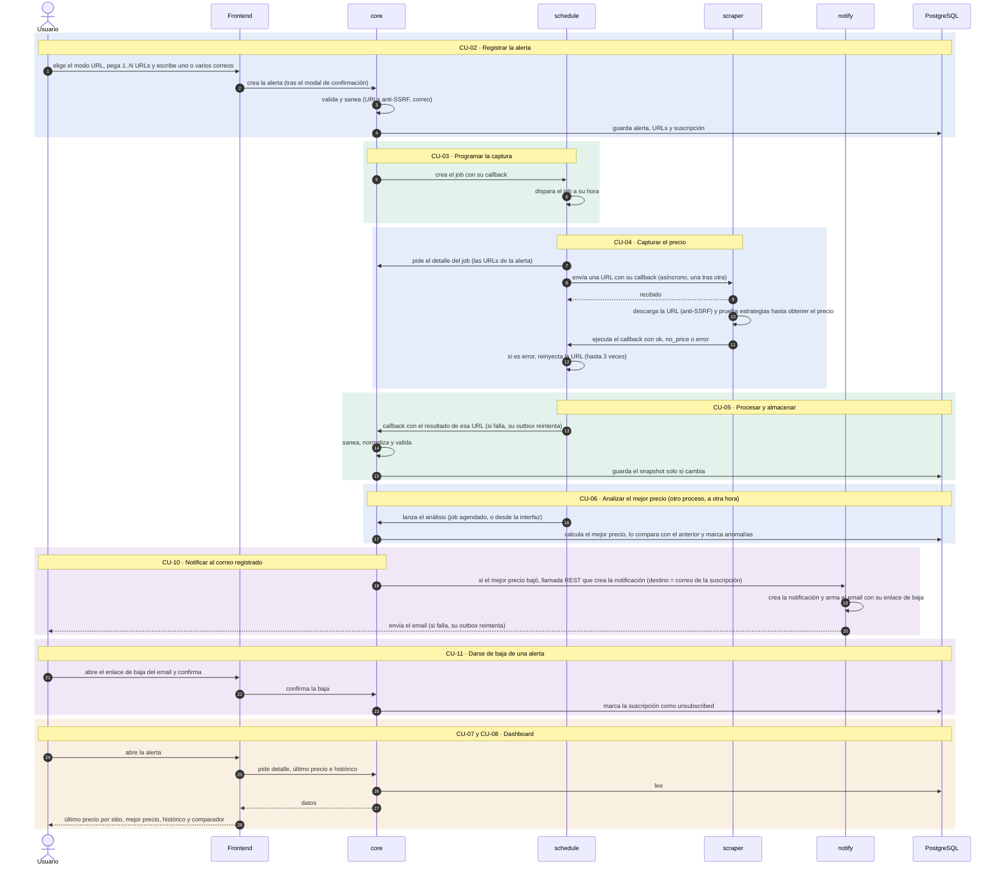
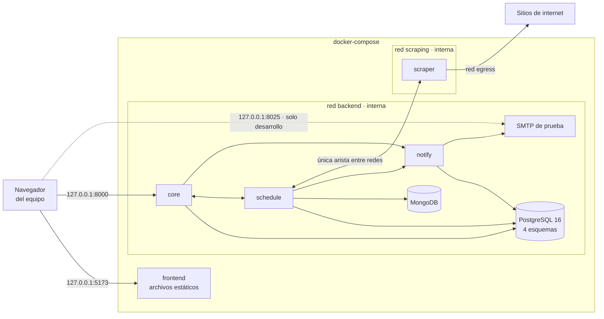

# Arquitectura · Seguimiento diario del precio de un producto por scraping

> **Alcance: solo el ejercicio.** Describe únicamente la arquitectura que necesitan los casos de uso que se van a recrear (CU-02..CU-08, CU-10, CU-11). El diseño completo del proyecto vive en [`general-architecture.md`](general-architecture.md). Es normal que ambos repitan secciones; en unas semanas se unificarán en una sola arquitectura.

El sistema vigila el precio de un producto en varias tiendas. El usuario registra las páginas y un correo; el sistema las scrapea de forma programada, guarda y analiza el historial, lo muestra en un dashboard y avisa por correo cuando baja el mejor precio. Se construye como cuatro piezas independientes más un frontend, que se comunican por REST.

## Tabla de contenido

1. [Piezas](#piezas)
2. [Vista de componentes](#vista-de-componentes)
3. [Flujo por casos de uso](#flujo-por-casos-de-uso)
4. [Comunicación entre piezas](#comunicación-entre-piezas)
5. [Vista de despliegue](#vista-de-despliegue)
6. [Decisiones de arquitectura](#decisiones-de-arquitectura)
7. [Atributos de calidad](#atributos-de-calidad)

---

## Piezas

| Pieza | Responsabilidad | Persistencia | API |
|---|---|---|---|
| **Frontend** | Pantallas de alta de alerta, lista, dashboard y baja, y el botón que lanza el análisis | Ninguna | Consume la de `core` |
| **`core`** | Alertas, suscripciones, precios, análisis y pedido de aviso | PostgreSQL | Pública y entre piezas |
| **`schedule`** | Motor de jobs genérico: agenda, dispara, envía las URLs al scraper una a una, reintenta y entrega cada resultado; corre el barrido diario de errores | PostgreSQL y MongoDB | Solo entre piezas |
| **`scraper`** | Descarga las URLs y extrae el precio | Ninguna | Solo entre piezas: `schedule` le envía el trabajo |
| **`notify`** | Arma y envía el email, y reintenta si falla | PostgreSQL | Solo entre piezas |

## Vista de componentes

## Flujo por casos de uso

Cada recuadro es un caso de uso.

## Comunicación entre piezas

| De → a | Operación y ruta | Para qué |
|---|---|---|
| Frontend → `core` | `POST /api/alerts` | Crear la alerta con sus URLs y su correo |
| Frontend → `core` | `GET /api/alert-modes` | Saber qué modos de creación están habilitados |
| Frontend → `core` | `GET /api/alerts` | Listar las alertas |
| Frontend → `core` | `GET /api/alerts/{alert_id}` | Ver el detalle y el último precio por sitio |
| Frontend → `core` | `GET /api/alerts/{alert_id}/price-history` | Histórico y comparador |
| Frontend → `core` | `POST /api/subscriptions/{subscription_id}/unsubscribe` | Darse de baja |
| `core` → `schedule` | `POST /schedule/internal/jobs` | Crear el job de la alerta |
| `core` → `schedule` | `GET /schedule/internal/jobs/{job_id}` | Consultar un job |
| `schedule` → `scraper` | `POST /scraper/internal/jobs` | Enviar una URL con su callback |
| `scraper` → `schedule` | `POST /schedule/internal/results` | Callback: entregar el resultado (en el ejercicio, el destino configurado) |
| `schedule` → `core` | `GET /api/internal/job-detail` | Obtener las URLs de la alerta |
| `schedule` → `core` | `POST /api/internal/prices` | Entregar el resultado de una URL (`ok`, `no_price` o `error`) |
| `core` → `notify` | `POST /notify/notifications` | Pedir el aviso por correo |
| `schedule` → `notify` | `POST /notify/notifications` | Barrido diario: un solo correo al administrador con los errores del día (mismo endpoint que el de `core`) |
| Frontend → `core` | `POST /api/analysis` | Lanzar el análisis a mano (EJ-5) |
| `schedule` → `core` | `POST /api/internal/analysis` | Lanzar el análisis agendado (EJ-5) |
| docker-compose → cada pieza | `GET /api/health` · `GET /schedule/health` · `GET /scraper/health` · `GET /notify/health` | Healthcheck: la pieza está viva y alcanza sus dependencias (EJ-4). Sin datos de negocio, sin autenticación, no se publican fuera de la red interna |

## Vista de despliegue

> **Estado: borrador.** Es arc42 §7 para el ejercicio. Los puertos, las versiones de imagen y los límites de recursos marcados con 💡 son propuestas sin medir ni aprobar. Todavía no existe el `docker-compose.yml`: esta vista dice cómo debe armarse.

El ejercicio corre **solo en local**, con docker-compose, en un único equipo. No hay nube, gateway ni autenticación entre piezas (el control es la red, [ADR-0004](adr/0004-schedule-dispatches-work-to-scraper.md)).

### Piezas desplegadas

| Contenedor | Qué es | Redes | Puerto publicado | Depende de (sano) |
|---|---|---|---|---|
| `frontend` | Archivos estáticos de React + Vite (build), servidos por un servidor web mínimo | `web` | 💡 `127.0.0.1:5173` | — (el navegador llama a `core`) |
| `core` | FastAPI | `backend` y `web` | 💡 `127.0.0.1:8000` | PostgreSQL, `schedule`, `notify` |
| `schedule` | FastAPI + planificador | `backend` y `scraping` | ninguno | PostgreSQL, MongoDB |
| `notify` | FastAPI + worker del outbox | `backend` | ninguno | PostgreSQL, SMTP de prueba |
| `scraper` | FastAPI + httpx + Playwright (Chromium). Escucha en `0.0.0.0:8001` dentro del contenedor, sin publicar; **imagen Docker aún pendiente** (README del scraper) | `scraping` y `egress` | ninguno | — |
| PostgreSQL | **1 instancia, `postgres:16`**, esquemas `core`, `schedule` y `notify` (más `auth`, sin uso en el ejercicio) | `backend` | ninguno | — |
| MongoDB | Solo lo usa `schedule` (`job_execution_result`, con TTL de 90 días) | `backend` | ninguno | — |
| SMTP de prueba | Servidor de correo desechable; **ningún correo sale a internet** | `backend` (y `web` solo en desarrollo, por su interfaz) | 💡 `127.0.0.1:8025` solo su interfaz web | — |

- **No hay Redis**: `schedule` envía el trabajo por HTTP (ADR-0004).
- **Las imágenes** se fijan por versión (nunca `latest`) y las oficiales. La herramienta concreta del SMTP de prueba está por decidir (la candidata es Mailpit); instalar o descargar una imagen nueva requiere tu aprobación.

### Redes y qué se publica

| Red | Quién está | Salida a internet | Para qué |
|---|---|---|---|
| `web` | `frontend`, `core` y, solo en desarrollo, el SMTP de prueba | Sin ruta de salida útil (no la necesitan) | Es la única red desde la que se **publican** puertos al equipo: Docker no publica puertos de una red `internal`. El `frontend` no llama a nada; es el navegador quien llama a `core` |
| `backend` | `core`, `schedule`, `notify`, PostgreSQL, MongoDB, SMTP de prueba | No (`internal`) | Todo el tráfico entre piezas y con las bases |
| `scraping` | `schedule` y `scraper` | No (`internal`) | Que `schedule` envíe la URL y reciba el callback |
| `egress` | `scraper` | Sí | Que el scraper llegue a las tiendas |

- **El scraper no comparte red con `core`, `notify` ni las bases.** Aunque un sitio lo redirija o un DNS lo engañe, no tiene ruta de red hacia ellos: es una capa más sobre la validación anti-SSRF (SCR-18), que se mantiene. Esto cubre el riesgo S3 del informe de arquitectura.
- **A verificar al armar el compose:** que Docker publique solo desde `web` y que `core` siga alcanzando a `schedule`, `notify` y PostgreSQL por `backend`.
- **Solo se publican puertos en `127.0.0.1`** y únicamente los de `frontend` y `core` (más la interfaz web del SMTP de prueba en desarrollo). Ninguna base ni `schedule`, `notify` o `scraper` es alcanzable desde fuera de docker-compose.
- **Contenedores sin privilegios:** usuario no root, `cap_drop: ALL`, `no-new-privileges` y sistema de archivos de solo lectura donde la imagen lo permita (Playwright puede exigir excepciones, a verificar).

### Datos y arranque

- **Una sola base PostgreSQL, un rol por servicio.** `provision-roles.sql` crea los esquemas y los roles una vez, como administrador; después cada pieza aplica su propio `schema.sql` con **su** rol ([`data/scripts`](../data/scripts/)). Ninguna pieza usa credenciales del administrador.
- **Volúmenes:** en desarrollo, volúmenes con nombre para PostgreSQL y MongoDB (se reinician con `docker compose down -v`). En pruebas automáticas, `tmpfs` o volumen anónimo y contraseñas generadas al vuelo.
- **Orden de arranque:**
  1. PostgreSQL y MongoDB, hasta quedar sanos.
  2. Aprovisionamiento de roles y esquemas (una sola vez).
  3. Migraciones y semillas de cada pieza (INF-4): el canal y la plantilla de `notify` (EJ-3), los tipos de ejecución de `schedule`, y los jobs agendados del análisis y del barrido diario.
  4. `notify`, `schedule` y `scraper`; luego `core`; al final `frontend`.
  5. Cada paso espera al anterior con `depends_on: condition: service_healthy`.

### Salud

Cada pieza expone su `GET /<prefijo>/health` (EJ-4) y docker-compose lo usa como *healthcheck*, ejecutado dentro del contenedor, sin publicar nada. 💡 Intervalo de 10 s, 3 fallos para marcarla enferma. Responde 200 si la pieza está viva y alcanza sus dependencias, y 503 si no.

### Configuración

Todo llega por variables de entorno (INF-3), con un `.env.example` **sin valores reales** por pieza; los secretos se generan al vuelo y no se commitean.

| Grupo | Variables (nombres propuestos) | Dónde |
|---|---|---|
| Conexión a datos | URL de PostgreSQL con el rol de su servicio; URL de MongoDB | `core`, `schedule`, `notify` |
| Reintentos, plazos, concurrencia y horas | `SCHEDULE_*` y `SCRAPER_*` (lista y defectos en el [ADR-0004](adr/0004-schedule-dispatches-work-to-scraper.md)) | `schedule`, `scraper` |
| Destinos de callback | `SCHEDULE_CALLBACK_ALLOWLIST`, `SCRAPER_CALLBACK_ALLOWLIST` | `schedule`, `scraper` |
| Correo | Servidor SMTP de prueba; `ADMIN_ALERT_EMAIL` | `notify`, `schedule` |
| Usuario fijo y baja | UUID del usuario fijo (`created_by`, `app_user_id`); secreto del HMAC del enlace de baja (DEC-13) | `core`, `notify` |
| Navegador | Orígenes permitidos (CORS) | `core` |

### Recursos 💡

Propuesta sin medir: `scraper` 1 GB de memoria y 1 CPU (Playwright); las demás piezas 256 MB cada una; límite de procesos por contenedor. Se ajustan midiendo con los fixtures.

### Fuera de esta vista
Cloudflare, Worker Gateway, `auth`, JWT y despliegue en la nube pertenecen al proyecto completo ([`general-architecture.md`](general-architecture.md)). El ejercicio no los usa.

## Decisiones de arquitectura

- **REST con JSON** entre todas las piezas, y un contrato Swagger (OpenAPI) por pieza que expone endpoints.
- **Cada pieza es dueña de sus datos:** su propia base, sin claves foráneas hacia otra pieza; se enlazan solo por identificadores.
- **`schedule` envía el trabajo al scraper y este responde por un callback configurable** ([ADR-0004](adr/0004-schedule-dispatches-work-to-scraper.md)): el scraper responde «recibido», trabaja en segundo plano y al terminar ejecuta el callback. En el ejercicio el callback apunta a `schedule`, que reenvía a `core`; así el scraper no llama a `core`. Solo es alcanzable desde la red interna. `schedule` envía **una URL a la vez** y cada resultado (`ok`, `no_price` o `error`) llega a `core` de inmediato.
- **Scraping y análisis son procesos separados, a horas distintas** (DEC-25): el scraping guarda snapshots; el análisis (desde la interfaz o por un job agendado) calcula el mejor precio y decide los avisos. Por defecto 2 capturas y 2 análisis al día, parametrizable.
- **Cada pieza reintenta lo suyo:** el scraper **no reintenta** (una pasada por URL). `schedule` administra los reintentos del scraper: reinyecta solo las URLs con `error` (hasta 3 veces, 10–15 min) y reintenta el envío del trabajo (backoff exponencial); lo agotado queda `failed` y se avisa en el **barrido diario de errores**, que pide un solo correo a `notify`. `notify` reintenta el envío del email con su cola. `core` reintenta la llamada a `notify` con el mismo identificador de transacción.
- **Idempotencia por llaves únicas:** repetir una corrida, un callback o un aviso no duplica datos.
- **Estrategias reemplazables:** la forma de crear una alerta, la extracción del precio, la detección de caídas anómalas ([ADR-0005](adr/0005-anomaly-detection-as-strategy.md)) y el canal de notificación van detrás de interfaces, para cambiarlos sin tocar el resto.
- **Sin autenticación ni autorización:** la versión corre solo en local, sin sesión ni token entre piezas. El control es la red: el scraper no publica su puerto fuera de la red interna, y el destino de su callback es una lista blanca de backends registrados (en el ejercicio, solo `schedule`).
- **Scraping sin eludir protecciones:** si una tienda no permite scrapear, ese sitio queda sin precio.

## Atributos de calidad

> **Estado: borrador (arc42 §10).** Cada objetivo es medible y trae cómo se verifica. ✅ marca lo que ya sale de un documento del proyecto; 💡 marca una cifra o una regla **propuesta, sin medir ni aprobar**. Es un ejercicio local, así que no se fija un SLA de disponibilidad.

### Prioridades

1. **Seguridad y privacidad:** se scrapean URLs que da un usuario y se guarda un correo (dato personal).
2. **Confiabilidad y exactitud de los datos:** un precio mal guardado, repetido o perdido hace que el aviso sea falso o no llegue.
3. **Trazabilidad y mantenibilidad:** el flujo cruza cuatro piezas y debe poder diagnosticarse.
4. Rendimiento: importa poco a esta escala (corre en local); se mide para no degradarlo.

### Escenarios medibles

| ID | Atributo | Escenario | Medida y objetivo | Cómo se verifica | Estado |
|---|---|---|---|---|---|
| QS-01 | Seguridad | Se crea una alerta con una URL a una IP privada, loopback, `link-local`, un esquema no permitido, una redirección o un DNS que resuelve a una IP privada | **100 %** de los casos del conjunto se rechazan; ninguno llega a la red interna | Pruebas unitarias con ese conjunto y una de integración en el scraper (SCR-18, EV-01) | ✅ |
| QS-02 | Seguridad | Se recorre el flujo completo con un correo de prueba | **0** apariciones del correo completo en logs, respuestas de la API y pantallas | Búsqueda en los logs de una corrida E2E y revisión de las respuestas (RNF-4) | ✅ |
| QS-03 | Seguridad | Desde el contenedor del scraper se intenta llegar a `core`, `notify`, PostgreSQL y MongoDB | **0** rutas de red; solo alcanza a `schedule` y a internet | Prueba de conectividad sobre el docker-compose (vista de despliegue) | 💡 |
| QS-04 | Seguridad | Un trabajo trae un callback cuyo destino no está en la lista blanca | **100 %** rechazados con 400, sin seguir redirecciones | Prueba de integración del scraper y de `schedule` (ADR-0004) | ✅ |
| QS-05 | Seguridad | Un sitio devuelve un título con HTML o `<script>` | **0** cargas ejecutadas en la UI; el dato se guarda saneado | Fixtures con HTML hostil y prueba E2E (R6) | ✅ |
| QS-06 | Confiabilidad | El mismo resultado, callback o llamada de aviso se repite 5 veces | **0** snapshots duplicados y **0** avisos duplicados | Prueba de integración repetida con la misma llave (R7, EV-22) | ✅ |
| QS-07 | Confiabilidad | En una alerta de 5 URLs, una falla | Las otras **4** se guardan (100 %); la fallida queda `no_price` o `error` | E2E con un fixture que falla (R1) | ✅ |
| QS-08 | Confiabilidad | El scraper está caído al enviar una URL | **3** reintentos con espera de 1, 2 y 4 min; ejecución `failed` en **≤ 8 min**; aparece en el barrido de las 23:00; **0** ejecuciones perdidas en silencio | Prueba con el scraper detenido y el reloj inyectado (EV-26, ADR-0004) | ✅ cifras del ADR |
| QS-09 | Confiabilidad | Un sitio falla dos veces con `error` y responde a la tercera | Resultado `ok` al 3.er intento y **1** snapshot | Fixture que falla N veces y luego responde (SCR-8) | ✅ |
| QS-10 | Confiabilidad | `notify` no responde cuando `core` pide el aviso | El snapshot y el mejor precio **se mantienen** (0 reversiones); `core` reintenta 3 veces con el mismo `transaction_id` | Prueba con `notify` detenido (DEC-12, CU-10) | ✅ |
| QS-11 | Confiabilidad | El análisis ve que el mejor precio bajó | Exactamente **1** correo por suscripción activa; **0** si es la primera vez o si la suscripción está dada de baja | Prueba E2E con el SMTP de prueba (DEC-6, CU-10) | ✅ |
| QS-12 | Confiabilidad | `schedule` se reinicia a mitad de una corrida | Toda ejecución `running` vencida vuelve a la cola o pasa a `error` en **≤ 2 min** tras el plazo del callback; **0** ejecuciones huérfanas | Prueba que mata el contenedor y revisa `job_execution` (EV-19) | 💡 |
| QS-13 | Rendimiento | Se crea una alerta con 10 URLs | Respuesta de `core` en **≤ 1 s** (p95); la captura va en segundo plano | Prueba de carga ligera en local | 💡 |
| QS-14 | Rendimiento | Se abre el dashboard de una alerta con 10 URLs y 180 días de histórico | Respuesta de `core` en **≤ 500 ms** (p95) | Datos sembrados y medición en local | 💡 |
| QS-15 | Rendimiento | `core` recibe el resultado de una URL | Guardado del snapshot en **≤ 1 s** (p95), sin bloquear a las demás alertas | Medición con carga ligera | 💡 |
| QS-16 | Rendimiento | Una pasada de 10 URLs | **≤ 15 min** en el peor caso (10 × 90 s); con 3 reintentos, **≤ 1 h** | Medición con los fixtures de las 4 estrategias (ADR-0004); el callback trae `started_at` y `duration_ms` por URL | ✅ cifras del ADR |
| QS-17 | Trazabilidad | Dado un `transaction_id`, se reconstruye lo ocurrido con una URL | **100 %** de las líneas de log de `core`, `schedule` y `notify` llevan ese `transaction_id`; las del `scraper` llevan su `scraper_id`, que `schedule` enlaza con el `transaction_id` (`job_execution.SCRAPER_ID`). Se ve envío, resultado y snapshot | Prueba E2E que recoge los logs (INF-5) | ✅ |
| QS-18 | Mantenibilidad | Se cambia un reintento, un plazo, una hora o un destino de callback | **0** cambios de código: solo variables de entorno | Revisión del código y prueba con otros valores (INF-3, ADR-0004) | ✅ |

### Cómo se logra

| Atributo | Cómo se logra |
|---|---|
| Seguridad | Las URLs se validan contra direcciones peligrosas al crear la alerta y en cada descarga; todo texto se sanea; lo scrapeado se trata como dato; el correo se muestra enmascarado |
| Confiabilidad | Reintentos por pieza; una URL que falla no frena a las demás; un fallo al avisar no revierte el análisis |
| Mantenibilidad | Piezas desacopladas, servicios detrás de interfaces, un repositorio por entidad y migraciones por pieza; el mismo identificador de transacción acompaña una corrida en todas las piezas y en los logs, para diagnosticar fallos |
| Rendimiento | Solo se guarda un snapshot cuando el precio cambia; la captura ocurre en segundo plano, no dentro de una petición; bloqueos de fila acotados y sin consultas repetidas |
