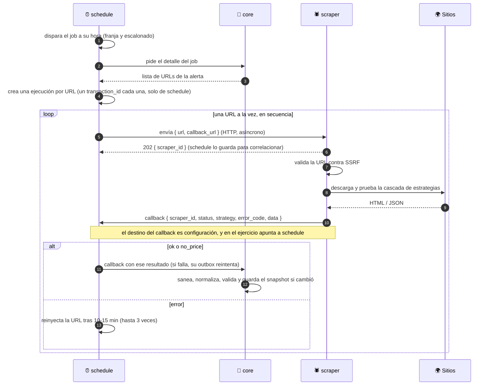
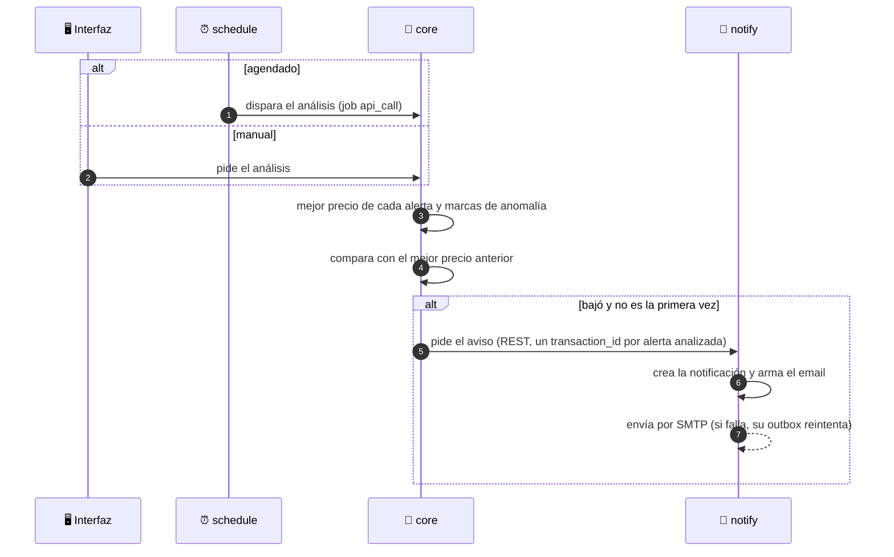
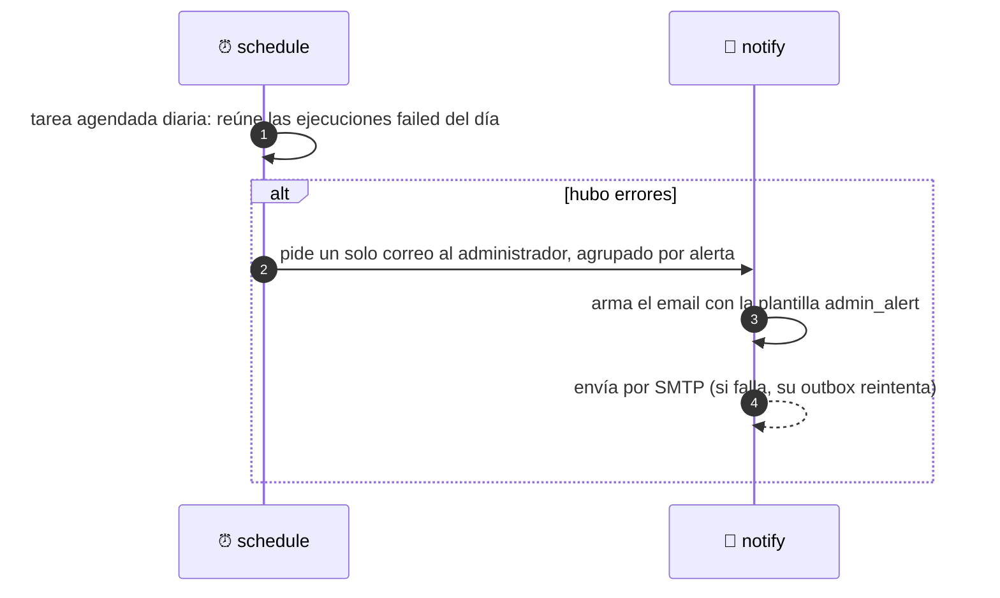
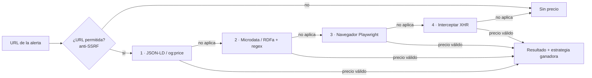
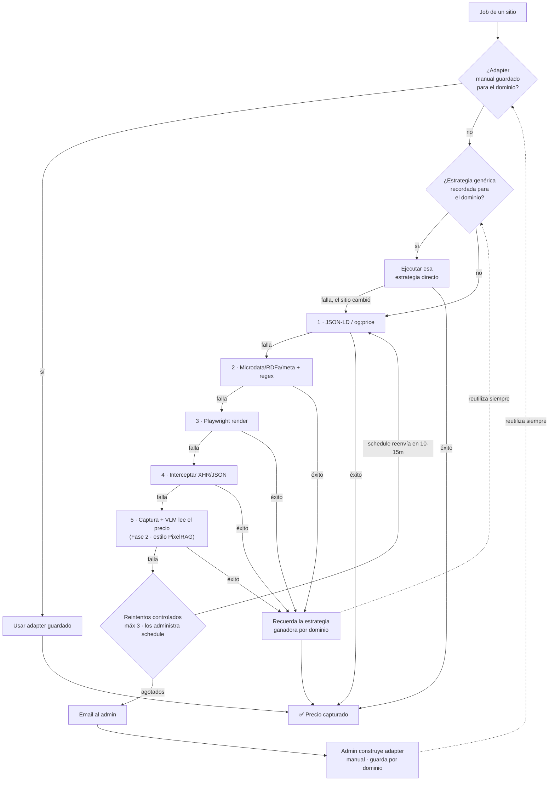
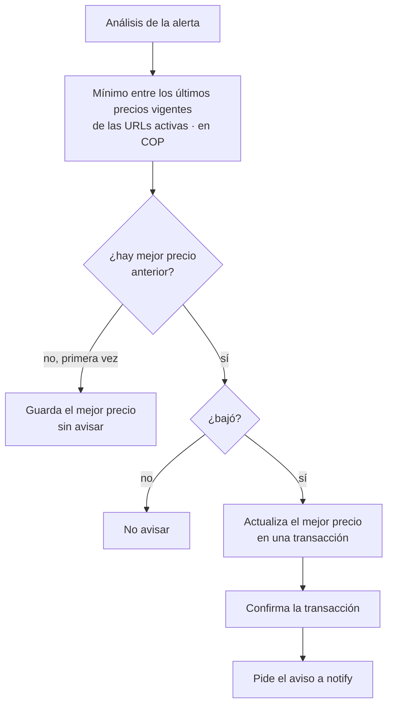

# Flujo de scraping (corrida de una alerta)

> **Alcance: común al ejercicio y al proyecto completo.** El flujo de scraping es el mismo en ambos y es uno de los pilares del proyecto; por eso vive en un único documento. Donde algo solo aplica a uno de los dos, se marca **(ejercicio)** o **(solo proyecto)**.

> Consolidado con la [arquitectura](general-architecture.md), el [modelo de datos](../data/data-model.md) y los [requerimientos](../requirements/requirements.md). Cada alerta **activa** se captura **2 veces al día** dentro de franjas horarias configurables (por defecto 04:00–06:00 y 18:00–20:00), en segundo plano y escalonada, y se **analiza** otras 2 veces al día, un tiempo después de cada captura (parametrizable, puede reducirse a 1 y 1). Cada URL es una unidad de trabajo con su propio `transaction_id`.

## Tabla de contenido

- [Quién hace qué](#quién-hace-qué)
- [Diagrama de secuencia](#diagrama-de-secuencia)
- [La cascada de extracción](#la-cascada-de-extracción)
- [Lo que pasa después del scraper (en `core`)](#lo-que-pasa-después-del-scraper-en-core)
- [Motor de decisión: el «mejor precio»](#motor-de-decisión-el-mejor-precio)
- [Manejo de eventos](#manejo-de-eventos)
- [Idempotencia y trazabilidad](#idempotencia-y-trazabilidad)
- [Qué se persiste y dónde](#qué-se-persiste-y-dónde)
- [Pendientes y límites conocidos](#pendientes-y-límites-conocidos)

## Quién hace qué

| Pieza | Papel |
|-------|-------|
| `schedule` | Dispara el job a su hora, pide a `core` el detalle (la lista de URLs), crea una ejecución por URL y las **envía al scraper una tras otra**, esperando el callback de cada una. Recibe `ok`, `no_price` o `error`: entrega `ok` y `no_price` a `core` de inmediato y **reinyecta** el `error` (hasta 3 veces, 10–15 min). Administra también los reintentos del envío (backoff exponencial) y corre el **barrido diario de errores**, que pide a `notify` un correo al administrador ([ADR-0004](adr/0004-schedule-dispatches-work-to-scraper.md)) |
| `scraper` | Sin estado y sin base de datos. Recibe **una URL** (responde «recibido» y sigue en segundo plano), descarga, extrae el precio **en una sola pasada (sin reintentos ni esperas propios)** y **ejecuta el callback** con `ok`, `no_price` o `error`. El destino del callback es configuración (lista blanca); en el ejercicio es `schedule`, así que no llama a `core` (SCR-20) |
| `core` | Da el detalle del job (las URLs). Al recibir un resultado lo sanea, normaliza y valida y **guarda el snapshot** (CU-05). Aparte, el **análisis** (CU-06 y CU-10) calcula el mejor precio y decide los avisos |
| `notify` | Crea la notificación, arma el email y reintenta el envío si falla. Envía los avisos de precio que pide `core` y el correo del barrido diario que pide `schedule` |

## Diagrama de secuencia

Dos procesos distintos que corren a horas distintas: el **scraping** guarda datos y el **análisis** decide los avisos.

### 1 · Scraping (una URL a la vez)

### 2 · Análisis (a otra hora)

### 3 · Barrido diario de errores

> Los pasos de `core` y `notify` son los casos de uso CU-05, CU-06 y CU-10. Aquí solo se muestran para ver el recorrido completo; su detalle y sus criterios de aceptación están en los [requerimientos](../requirements/requirements.md).

## La cascada de extracción

Por **cada URL** de la alerta, el scraper la valida y prueba una cadena de estrategias, de la más barata a la más pesada, hasta obtener un precio válido. Cada estrategia es una forma distinta de leer el precio de una página; ninguna conoce a las demás.

### Recorrido

**(ejercicio)** Cuatro estrategias HTTP y de navegador, en una sola pasada (los reintentos por sitio los administra `schedule`, ver «Reintentos y resultado por URL»):

**(solo proyecto)** El recorrido completo suma el adapter manual por dominio, la estrategia recordada y la lectura por VLM:

### Las estrategias

> Los nombres de la columna `strategy` son los del callback del scraper (su [README](https://github.com/vida-I-found-it/scraper-service#readme) manda sobre este detalle).

| # | `strategy` | Qué lee | Cuándo «no aplica» | Herramienta | Req. | Alcance |
|---|------------|---------|--------------------|-------------|------|---------|
| 0 | `custom:<nombre>` | Selectores escritos a mano para un dominio (coincidencia exacta de host); va primero y, con `fallback=True` (por defecto), si no halla precio siguen las genéricas | No hay custom para el dominio, o no halla precio | Lo que necesite | SCR-11 (mecanismo) | Mecanismo implementado, **sin customs concretas** |
| 1 | `structured_data` | JSON-LD de `schema.org` (`Product` → `offers`, u `Offer`; tolera comentarios, saltos de línea y comas de más) y Open Graph (`product:price:amount`, `og:price:amount`, `product:sale_price:amount`) del HTML descargado | La página no trae esos datos, o traen un precio vacío o no numérico | httpx · selectolax | SCR-3 | Ejercicio |
| 2 | `microdata_regex` | Microdata, RDFa y, como último recurso, regex sobre el JSON embebido y el texto visible (`$`, `COP`, `USD`) | Ninguna fuente devuelve un precio. La regex tiene *timeout* de 1 s sobre los primeros 2 MB (anti-ReDoS) | httpx · selectolax · regex | SCR-9 | Ejercicio |
| 3 | `browser` | Los mismos lectores de la 1 y la 2 (sin regex) sobre el DOM ya renderizado, para precios que inyecta JavaScript | El precio no aparece ni tras renderizar | Playwright (Chromium) · selectolax | SCR-4 | Ejercicio |
| 4 | `xhr` | El JSON de las llamadas internas (XHR/fetch) capturadas **durante el mismo render**: toma la primera clave de precio válida (`price`, `salePrice`, `sellingPrice`…) | La página no hace esa llamada o su respuesta no trae precio | Playwright (intercepción) | SCR-10 | Ejercicio |

**Una sola descarga y un solo render por URL:** todas las estrategias leen de una misma `Page`; el HTML se descarga una vez con httpx y se renderiza una vez con Chromium solo si alguna lo pide. Un error de descarga también se guarda: si recibe un 403, la estrategia 2 recibe el mismo error sin volver a pedir la página.

**Datos del producto.** Además del precio, todas las estrategias intentan traer `list_price`, `price_valid_until`, `currency`, `in_stock`, `title`, `brand`, `sku`, `gtin`, `mpn` e `images`; todo es opcional. El precio y la promoción salen **solo de la fuente ganadora** y el resto se completa con las demás fuentes de la misma página, sin peticiones nuevas. `list_price` solo se envía si es mayor que `price`. Las imágenes quedan absolutas, `http`/`https`, sin repetidos, máximo 10, y **no se descargan** (vienen del sitio: quien las use las trata como no confiables). Los textos se recortan a 500 caracteres. El precio viaja **crudo** y `core` lo normaliza.
| 5 | **Captura + VLM** | Una captura de pantalla de la página renderizada, leída por un modelo de visión | El modelo no encuentra un precio | Playwright + modelo de visión (de pago) | — | Proyecto, Fase 2 |
| A0 | **Adapter manual por dominio** | Reglas guardadas por un admin para ese dominio | — (si existe, se usa primero) | Constructor de adapters | SCR-11/12 | Proyecto |
| A1 | **Estrategia recordada** | Salta directo a la estrategia que ganó antes en ese dominio | La estrategia recordada falla (el sitio cambió): se corre la cascada completa | — | candidato (D35) | Proyecto |

### Contrato de una estrategia

- Es una interfaz (`ExtractionStrategy`, patrón Strategy en cadena): recibe la página de una URL y responde con **un resultado o con «no aplica»**.
- Un resultado es válido solo si trae un **precio numérico positivo**. Un resultado sin precio cuenta como «no aplica».
- Agregar una estrategia es una clase nueva y una línea de configuración, sin tocar las demás.

### Reglas de la cascada

- **Orden configurable** (`SCRAPER_STRATEGY_ORDER`, sin tocar código); por defecto 1 → 2 → 3 → 4, de la más barata a la más pesada. La custom del dominio, si existe, va antes.
- **Corte en la primera que acierta:** las siguientes no se ejecutan.
- **Lo más ligero primero:** Playwright solo se lanza si las estrategias HTTP no bastaron, es decir, cuando el precio se inyecta por JavaScript y no hay datos estructurados aprovechables.
- **Resultado:** incluye la **estrategia ganadora**, para logs y pruebas.

### Salvaguardas

- **Anti-SSRF en cada descarga y en cada redirección (SCR-18, R3):** el fetcher es la autoridad. Dentro del navegador de Playwright se bloquea toda petición a destinos no permitidos.
- **Playwright ejecuta JavaScript de terceros:** corre en un contenedor aislado, sin secretos ni acceso a la red interna. Lo que devuelve es dato no confiable y se sanea (RNF-6).
- **Sin eludir protecciones:** ante un 403, captcha o un `robots.txt` que lo prohíba, no se fuerza nada; se respeta la [política legal](../00-context/legal-considerations.md). Un 403 o captcha **no corta** la cascada (un captcha que bloquea a httpx todavía le deja su turno a Playwright); si al final no hubo precio, el resultado es el del primer fallo (`blocked_403` o `blocked_captcha`). `blocked_ssrf` sí corta siempre.
- **Regex con *timeout*** para evitar ReDoS.

### Reintentos y resultado por URL

Cada URL termina en uno de tres estados ([ADR-0004](adr/0004-schedule-dispatches-work-to-scraper.md)):

| Estado | Qué significa | Reintento |
|--------|---------------|-----------|
| `ok` | Precio válido, con la estrategia ganadora | No hace falta |
| `no_price` | **Definitivo.** `error_code`: `not_found` (sin precio), `gone` (producto retirado), `login_required` (exige sesión o la URL final es una ruta de login), `http_4xx`, `blocked_ssrf`, `blocked_403`, `blocked_captcha` | **No se reintenta** |
| `error` | Sin respuesta fiable. `error_code`: `timeout`, `network`, `http_5xx`, `http_429`, `internal` (excepción del scraper) | **Sí**: lo reinyecta `schedule`, hasta 3 veces (parametrizable, SCR-8) con espera de 10–15 min |

- **El scraper no reintenta.** Hace una pasada por URL y devuelve el estado con lo que logró. Los reintentos los administra `schedule` y reenvía **únicamente esa URL**.
- Al agotar los reintentos de un `error`, la ejecución queda `failed`, se entrega `error` a `core` (queda el log con el `transaction_id`, sin snapshot) y entra en el barrido diario de errores.
- `no_price` también llega a `core` y queda registrado, sin snapshot: la UI lo muestra como «sin precio» (DEC-17).
- Una URL que falla **no frena a las demás** de la alerta: cada una es una ejecución independiente.
- **(solo proyecto)** Al agotarse, además se guarda la captura cruda (`raw_capture`) y se avisa al admin para que construya un adapter (SCR-13). **(solo proyecto)** Respeta `robots.txt` y un límite de tasa por dominio (SCR-5, SCR-6).

### Extensiones del proyecto

> **`A1`/`LEARN` (candidato a pendiente, sin ID todavía):** hoy el **único** aprendizaje persistido es el adapter manual (`A0`/`BUILD`) — SCR-12 es explícito en que es "sin IA en Fase 1". Un dominio que solo logra extraer vía `C3`/`C4` nunca "aprende" nada: cada corrida repite `C1`→`C2` desde cero antes de llegar otra vez al paso que de verdad funciona. `A1`/`LEARN` cierra ese hueco con algo mucho más barato que un adapter completo: solo recuerda **cuál paso genérico ganó** la última vez (el dato ya existe, agregado, en `site_stats_daily.by_strategy` — [modelo de datos](../data/data-model.md)) para saltar directo a él, con reintento sobre la cascada completa (`JUMP -->|falla|`) si el sitio cambió y la estrategia recordada deja de servir. **No tiene prioridad ni Fase asignada aún** — falta decidirlo y, si se aprueba, darle un ID (candidato: `SCR-21`) y un lugar donde persistirlo (reusar `site_stats_daily` vs. un campo nuevo).
>
> **`C5` es Fase 2**, y concreta lo que antes era una nota genérica ("extractor con IA, #5"): en vez de que una IA lea el **HTML** (texto), lee una **captura de pantalla** de la página ya renderizada por Playwright en `C3`/`C4` — mismo principio detrás de PixelRAG (retrieval-augmented generation sobre *screenshots*, en vez de texto parseado), aplicado aquí a una sola página ya conocida, sin el componente de *retrieval* sobre un corpus (eso es lo que PixelRAG resuelve y este caso no necesita). Ventaja sobre leer HTML: no lo engaña la ofuscación de clases/CSS que sí dificulta el parseo de texto. Costo a tener presente: una llamada **de pago** a un modelo de visión por cada sitio que agote `C1`-`C4`. El constructor de adapters sigue con su propia asistencia de IA aparte (evaluar API de Claude), sin cambios.

## Lo que pasa después del scraper (en `core`)

Son dos procesos separados que corren a horas distintas y no se solapan. El primero **guarda** datos; el segundo **decide**.

### Al llegar el resultado de una URL (CU-05)

Todos son pasos de `core`, no del scraper:

| Paso | Qué hace | Regla |
|------|----------|-------|
| 1 · Sanear | Limpia título y metadatos (trim, sin caracteres de control, Unicode NFC) | R6 |
| 2 · Normalizar | Precio numérico, moneda, stock y título | PRO-1 |
| 3 · Validar | Descarta precio ≤ 0, páginas de error y moneda distinta de COP **(ejercicio)** | R5 |
| 4 · Guardar | Inserta el snapshot **solo si** cambió el precio; actualiza el último chequeo | R7 |

Aquí **no se calcula el mejor precio ni se avisa**.

### El análisis (CU-06 y CU-10)

Es otro proceso de `core`, a otra hora, que se lanza **desde la interfaz de usuario** o por un **job agendado** en `schedule`. Por defecto corre 2 veces al día, cada una un tiempo después de una captura (parametrizable, puede ser 1 y 1). Hace, por alerta:

| Paso | Qué hace | Regla |
|------|----------|-------|
| 5 · Marcar | El análisis evalúa cada snapshot nuevo con la estrategia de anomalía activa y guarda el veredicto en `price_anomaly`; la caída sospechosa no se descarta | R9 · ADR-0005 |
| 6 · Decidir | Recalcula el mejor precio con los últimos snapshots (sección siguiente) | PRO-6 |
| 7 · Avisar | Si el mejor precio bajó y no es la primera vez, pide el aviso a `notify` | NOT-3 |

> **Antes de los pasos:** al iniciar, el análisis reintenta crear en `schedule` el job de las alertas con `schedule_job_id` nulo, con la llave `alert-<id>` (DEC-15).

> **(solo proyecto)** Con sitios en otras monedas se convierte USD→COP con la tasa del día (se guarda en la base de `core`). El ejercicio solo trabaja en COP (DEC-23).

## Motor de decisión: el «mejor precio»

> **Regla (DEC-6, DEC-16, DEC-22):** el mejor precio de una alerta es el **mínimo vigente** entre los últimos precios de sus URLs activas; **el stock no se tiene en cuenta por ahora** (DEC-22). Se avisa cuando baja respecto del anterior. La primera vez no hay contra qué comparar y **no avisa**; el análisis es quien decide cuándo se avisa. Si el precio sube y vuelve a bajar, avisa otra vez. El aviso se pide **después** de confirmar la transacción y usa un `transaction_id` por alerta analizada. La estrategia va detrás de una interfaz (patrón Strategy), reemplazable. El dashboard muestra el último precio por sitio al día, pero el mejor precio puede estar atrasado hasta el siguiente análisis.

## Manejo de eventos

Qué ocurre cuando algo se sale del camino feliz. Cada evento tiene un ID (`EV-NN`) y dice qué pasa y en qué estado queda. El catálogo **crece**: cada vez que aparezca un caso nuevo se agrega una fila, sin reordenar las demás.

**Estado de la definición**

| Marca | Significa |
|-------|-----------|
| ✅ **Definido** | Está decidido en los requerimientos, las decisiones o la arquitectura; se indica la fuente |
| 💡 **Propuesta** | Es lo que se recomienda hacer, pero **no está aprobado** ni escrito en los requerimientos |
| ❓ **Por definir** | No hay decisión y falta una propuesta o una respuesta de producto |

### Políticas y permisos del sitio

| ID | Evento | Qué pasa | Estado |
|----|--------|----------|--------|
| EV-01 | La URL apunta a una red interna, un esquema no permitido o una IP privada (también por redirección) | Se rechaza al crear la alerta; si llega al scraper, se rechaza de nuevo en cada descarga y redirección, también dentro de Playwright. La URL queda `no_price · blocked_ssrf` | ✅ R3, SCR-18 |
| EV-02 | El sitio **no permite** scrapear (términos de servicio o `robots.txt`) | **No se fuerza ni se evade.** Ejercicio: el sitio queda sin precio. Proyecto: se respeta `robots.txt` (SCR-5) y el sitio se deja fuera. Quién detecta que un sitio está vetado y si se marca el dominio para no reintentarlo **no está definido** | ✅ política (ver [legal](../00-context/legal-considerations.md)) · ❓ detección y marca |
| EV-03 | El sitio bloquea: 403, 429 o captcha | No se fuerzan ni se resuelven captchas, ni se insiste con un 403: queda `no_price` (`blocked_403` o `blocked_captcha`), aunque antes la cascada deja que las demás estrategias lo intenten. Un 429 (límite de tasa) cuenta como `error` y se reintenta con la espera de 10–15 min. Proyecto: además baja la frecuencia. Si un `Retry-After` manda sobre esa espera **no está definido** | ✅ no forzar · ❓ uso de `Retry-After` |
| EV-04 | El sitio responde pero el precio exige iniciar sesión | Se trata como «no aplica» en todas las estrategias: solo se leen datos públicos. Queda `no_price · login_required` | ✅ README del scraper |

### Fallos de extracción

| ID | Evento | Qué pasa | Estado |
|----|--------|----------|--------|
| EV-05 | El sitio no responde: timeout, error de red o 5xx | Las estrategias no obtienen respuesta y el scraper devuelve `error` (`timeout`, `network` o `http_5xx`). `schedule` reinyecta **solo esa URL**, hasta 3 veces (parametrizable), con espera de 10–15 min. Si se agota, la ejecución queda `failed`, se entrega `error` a `core` y entra en el barrido diario | ✅ SCR-8, R4 |
| EV-06 | Una estrategia no encuentra el precio | Responde «no aplica» y pasa a la siguiente. La primera que acierta corta la cascada | ✅ EJ-2 |
| EV-07 | Las 4 estrategias fallan con la página respondiendo bien | El scraper devuelve `no_price · not_found`: es definitivo y **no se reintenta**. Proyecto: además se guarda la captura cruda y se avisa al admin para que construya un adapter (SCR-13) | ✅ SCR-8 · SCR-13 solo proyecto |
| EV-08 | El sitio cambió su estructura y una estrategia que antes funcionaba deja de servir | La cascada sigue con las siguientes. Proyecto: si falla la estrategia recordada (A1), se corre la cascada completa | ✅ cascada · A1 candidata (D35) |
| EV-09 | Una URL falla y las demás de la alerta no | Las demás siguen; la fallida queda `no_price` | ✅ CU-04 |
| EV-10 | **Todas** las URLs de la alerta quedan sin precio en una corrida | No se guarda snapshot ni se avisa. El dashboard muestra «sin datos recientes» pasadas 24 h desde el último chequeo exitoso | DEC-17 ✅ |
| EV-11 | El precio llega pero el HTML es una página de error | Se descarta, no se guarda | ✅ R5 |

### Calidad del dato

| ID | Evento | Qué pasa | Estado |
|----|--------|----------|--------|
| EV-12 | Precio ≤ 0 o no numérico | `core` lo descarta; no contamina el historial | ✅ R5 |
| EV-13 | Moneda distinta de COP | Se descarta y no se guarda (ejercicio). Proyecto: se convierte con la tasa del día | ✅ DEC-23 |
| EV-14 | Caída sospechosa de precio | Se **guarda y se marca** como anómala; no se descarta. El umbral lo da una estrategia intercambiable (comparación con otros productos) | ✅ R9 · DEC-18 ✅ |
| EV-15 | La URL no tiene stock | Su precio sigue contando para el mejor precio: el análisis ignora el stock por ahora | ✅ DEC-22 |
| EV-16 | El sitio no informa el stock | Se guarda nulo; no se asume ningún valor | ✅ DEC-21 |

### Caída de piezas

| ID | Evento | Qué pasa | Estado |
|----|--------|----------|--------|
| EV-17 | **El scraper está en pie, pero un sitio lo rompe** por un error técnico (por ejemplo, se cuelga o lanza una excepción al procesarlo). No es lo mismo que EV-05: aquí falla el propio scraper, no solo la respuesta del sitio | No llega el callback dentro del plazo (por URL) o llega `error`. Se trata como `error` de esa URL: `schedule` la reinyecta hasta 3 veces. Agotados, la ejecución queda `failed` y entra en el **barrido diario de errores**, que pide **un solo correo** al administrador (`schedule` llama a `notify`). La idempotencia del snapshot evita duplicar datos (R7) | ✅ decisión del equipo · ADR-0004 |
| EV-18 | El scraper termina pero **no logra ejecutar el callback** (el destino no responde) | El scraper no tiene estado: si no puede entregar, el resultado se pierde. Desde `schedule` se ve como un callback que no llega (EV-17). Si el scraper reintenta el callback antes de rendirse **no está definido** | ❓ |
| EV-19 | `schedule` cae y no dispara jobs a su hora | No se pierde nada: las alertas viven en `core`. La infraestructura lo reinicia y, al volver, `schedule` **toma el trabajo que no hizo**. El tope de 2 corridas al día (R2) sigue vigente | ✅ decisión del equipo |
| EV-20 | `core` no responde cuando `schedule` pide el detalle del job | El job no se pierde: queda pendiente y se retoma cuando `core` vuelve. Cómo se espera (reintentos o reinicio de la infraestructura) y si se avisa al administrador no está decidido | 💡 pendiente de confirmar |
| EV-21 | `core` no responde al callback con los precios | El outbox de `schedule` reintenta la entrega; el estado del callback es independiente del estado del trabajo | ✅ `job_callback_outbox` |
| EV-22 | La corrida o el callback llegan dos veces | No se duplica nada: el snapshot se inserta solo si cambió el precio | ✅ R7, SCR-7 |
| EV-23 | Falla crear el job en `schedule` después de guardar la alerta | La alerta queda creada con `schedule_job_id` nulo («sin schedule»); `core` reintenta al inicio de cada análisis con la misma llave, sin duplicar | ✅ criterio CU-03 · DEC-15 ✅ |
| EV-26 | **Los pods del scraper no están disponibles** (problema de infraestructura): no hay ningún scraper corriendo y no responde absolutamente nada | `schedule` recibe un 404, un 500 o un *timeout* al enviar la URL. Reintenta con backoff exponencial hasta *n* veces; agotados, la ejecución queda `failed`. Mientras tanto el **trabajo queda bloqueado**: las URLs pendientes siguen en cola y se retoman cuando el scraper vuelve. El barrido diario lo avisa al administrador. Qué pasa con las corridas acumuladas al volver, dado el tope de 2 al día, no está definido | ✅ decisión del equipo · ADR-0004 · ❓ corridas acumuladas |
| EV-27 | **`schedule` no puede llegar hasta el scraper**: por red, por una caída o porque simplemente no está accesible | Desde `schedule` no se distingue de EV-26: el envío falla y se aplica el mismo tratamiento (backoff exponencial, ejecución `failed`, aviso en el barrido diario y trabajo bloqueado) | ✅ ADR-0004 |

#### Cómo se detecta un scraper no disponible

Como `schedule` es quien envía el trabajo, una caída se nota en el propio envío: un 404, un 500 o un *timeout*. No hace falta una señal de vida aparte. Si se quiere, la infraestructura puede vigilarlo además con una ruta de salud, pero el flujo no la necesita. La decisión completa y su seguridad están en el [ADR-0004](adr/0004-schedule-dispatches-work-to-scraper.md).

### Tiempo y límites

| ID | Evento | Qué pasa | Estado |
|----|--------|----------|--------|
| EV-24 | Se llega al tope de 2 corridas al día | No se dispara otra, aunque sea una recuperación. La corrida inicial al crear la alerta cuenta dentro del tope | ✅ R2, SCH-6 |
| EV-25 | Una corrida cae fuera de las franjas horarias | No corre hasta la siguiente franja (por defecto 04:00–06:00 y 18:00–20:00) | ✅ SCH-7 |
| EV-28 | El análisis corre cuando aún hay URLs pendientes de reintento | Usa los últimos snapshots disponibles; lo que se resuelva después entra en el siguiente análisis | ✅ por diseño (scraping y análisis son procesos separados) |
| EV-29 | El barrido diario no encuentra errores | No envía correo (evita ruido) | ✅ ADR-0004 |
| EV-30 | El análisis falla o no se lanza a su hora | No se pierde nada: los snapshots siguen guardados y el siguiente análisis los toma. Si el job de análisis queda `failed`, entra en el barrido diario | 💡 pendiente de confirmar |

## Idempotencia y trazabilidad

- El snapshot se inserta **solo si cambia** el precio respecto al último (R7). Se bloquea la fila de `alert_url` mientras se compara, así que repetir una corrida o un callback no duplica datos (SCR-7). Ver [modelo de datos](../data/data-model.md).
- Los snapshots son **solo de añadir**: el historial nunca se sobrescribe.
- Un reintento reenvía solo la URL con `error` (lo decide `schedule`); las ya resueltas no se reprocesan. Cada resultado se identifica por `transaction_id` (uno por URL) e intento, y `schedule` procesa a lo más uno por intento.
- Todo se correlaciona por `transaction_id`, que viaja entre `core`, `schedule` y `notify` y está en sus logs. **El scraper no lo conoce:** sus logs JSON llevan `scraper_id`, y `schedule` guarda el enlace `SCRAPER_ID` ↔ `transaction_id`. OpenTelemetry y Sentry están **pendientes** también en el scraper (hoy solo logs JSON); en el ejercicio basta con los logs.

## Qué se persiste y dónde

| Pieza | PostgreSQL | MongoDB |
|-------|-----------|---------|
| `scraper` | Nada | Nada |
| `schedule` | `job_execution` (una por URL: estado, intento y callback) y `job_callback_outbox` | `job_execution_result`: un documento por ejecución (una URL) con `scraper_id`, estado (`ok`/`no_price`/`error`), estrategia ganadora, `error_code`, `started_at`, `duration_ms` y los `data` del scraper: precio crudo, precio de lista, vigencia, moneda, stock, título, marca, SKU, GTIN, MPN e imágenes (DEC-19). TTL de 90 días |
| `core` | `price_snapshot` (por cambio, con precio de lista y vigencia), último precio, último chequeo y **todos los últimos datos del scraper** (título, marca, SKU, GTIN, MPN, imágenes…) en `alert_url`, y mejor precio en `alert` | **(solo proyecto)** `exchange_rate` |
| `notify` | `notification` y `notification_outbox` | **(solo proyecto)** `notification_log` (su utilidad está en revisión, D18) |

## Pendientes y límites conocidos

- **Eventos por definir (❓) y propuestas (💡):** ver el catálogo de [manejo de eventos](#manejo-de-eventos). Los que más condicionan el diseño son EV-18 y EV-20.
- **Valores y parámetros ([ADR-0004](adr/0004-schedule-dispatches-work-to-scraper.md)):** reintentos, plazos, concurrencia y horas ya tienen un valor por defecto y son **variables de entorno** (sección «Parámetros» del ADR). Son estimaciones sin medir; se ajustan con los fixtures.
- **Barrido diario y aviso al administrador:** falta escribir la plantilla `admin_alert` en `notify` y sembrarla (EJ-3). Un día sin errores no envía correo (EV-29).
- **D15:** dónde se persiste el detalle por etapa (`job_state`, `raw_capture`) tras genericizar `schedule`. Hoy `schedule` solo conserva el resultado genérico de la corrida; ver [pendientes](../00-context/pending.md).
