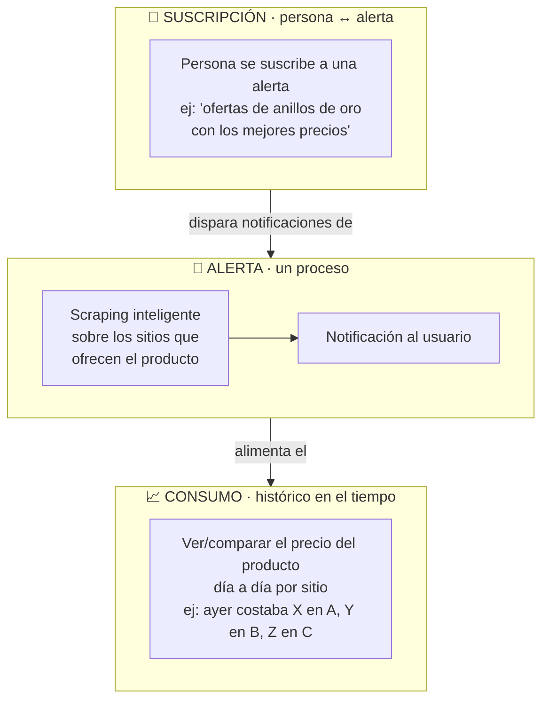
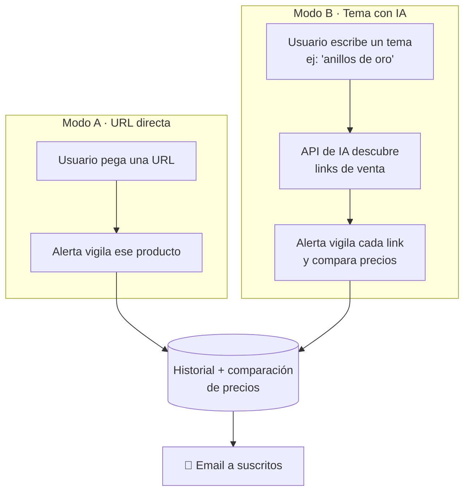
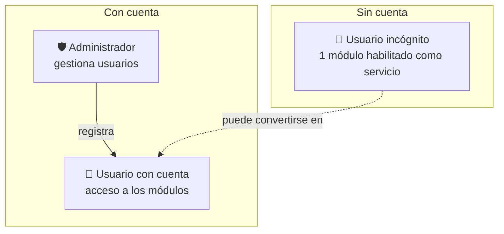
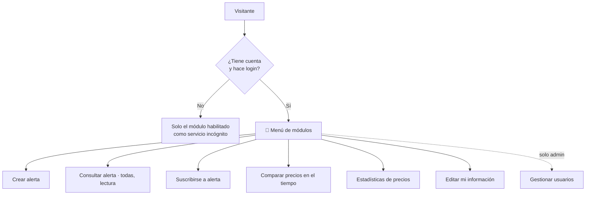
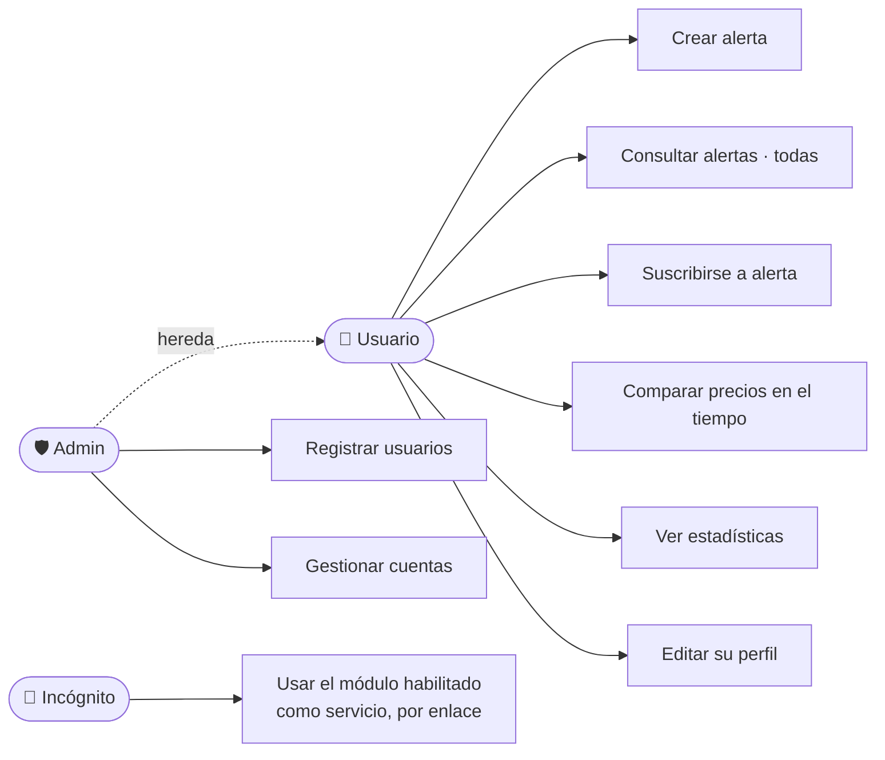

# 01 · Visión y objetivos

## Problema

Los precios en tiendas online cambian constantemente (varias veces al día en algunos casos). Detectar **cuándo un producto está en su mejor precio** o **cuándo aparece una oferta real** de forma manual es inviable: hay que revisar muchos sitios, y una "oferta" a veces es solo un precio inflado previamente.

Además, muchas veces **ni siquiera sabemos en qué sitios** se vende lo que buscamos. Queremos poder partir de un simple tema ("anillos de oro", "iPad Pro M4") y que el sistema descubra dónde comprarlo y siga su precio en el tiempo.

## Visión

Un sistema **académico** que vigila automáticamente productos o servicios —ya sea por **URL directa** o por **tema descubierto con IA**—, guarda el **historial de precios** por sitio, permite **comparar en una línea de tiempo**, y avisa por **email a los suscritos** cuando aparece una oportunidad real, apoyándose en datos y no en el marketing de la tienda.

---

## 🧭 Glosario / modelo conceptual (¡tenerlo muy presente!)

Tres conceptos distintos que no hay que confundir:

### 🔔 Alerta
Es un **proceso**, no un dato estático. Se compone de dos cosas:
1. **Hacer scraping** sobre los sitios que ofrecen el producto/servicio.
2. **Notificar** al usuario las novedades encontradas.

> Requiere que construyamos **algoritmos de scraping inteligentes** capaces de rastrear precios **sin importar el producto** que se quiera monitorear (no un scraper hardcodeado por sitio para todo). Este es el corazón técnico del proyecto.

Cada alerta **corre automáticamente cada día**.

### 📧 Suscripción
Es cuando **una persona se suscribe a una alerta específica** para recibir sus novedades por email.
Ejemplo: *"quiero recibir ofertas de anillos de oro con los mejores precios"*.
Relación **persona ↔ alerta**.

### 📈 Consumo *(nombre a mejorar)*
Es la vista de **histórico/comparación de precios en una línea de tiempo**: cuánto costaba el producto **ayer** en las páginas X, Y, Z, para ver **cuándo ofrece su mejor precio**.
> El nombre "consumo" no es claro; nombres candidatos: **Histórico de precios**, **Comparador de precios**, **Línea de tiempo de precios**. *(a decidir)*

---

## Los dos modos de monitoreo

| Modo | Entrada | Qué hace | Estado |
|------|---------|----------|--------|
| **A · URL directa** | Una URL que el usuario copia y pega | Vigila ese producto concreto | Listo para definir adapter |
| **B · Tema con IA** | Un texto/tema (ej. "anillos de oro") | Llama a una **API de IA (por definir, preferible custom/gratuita)** que devuelve los links actuales con info y precios; luego los vigila y compara | ⚠️ API de IA **por definir** |

## Roles del sistema

| Rol | Acceso | Puede hacer |
|-----|--------|-------------|
| **Administrador** | Total | Todo lo del usuario **+ registrar y gestionar cuentas**. Único que da de alta cuentas. |
| **Usuario con cuenta** | Menú y módulos | Crear alertas, consultar **todas** las alertas (sin editar las ajenas), suscribirse, comparar precios, ver estadísticas, editar su perfil. |
| **Usuario incógnito** | 1 módulo puntual | Se le **habilita un módulo concreto como "servicio"** sin necesidad de cuenta (ej. *consultar/gestionar una suscripción* vía enlace). |

> **Visibilidad de alertas:** un usuario con cuenta **ve todas las alertas del sistema**, pero **solo puede editar las suyas** (las ajenas son de solo lectura).

> **Registro cerrado a propósito:** el sistema es **100% académico**. Para que terceros no se beneficien, **solo el administrador puede crear cuentas**. No hay auto-registro público.

## Autenticación y acceso

- **Login** con usuario/contraseña.
- **Recuperar contraseña** (flujo por email).
- **Sin auto-registro:** las cuentas las crea únicamente el administrador.
- **Menú de módulos:** visible y accesible **solo** para usuarios con cuenta autenticados.
- El usuario incógnito **no** ve el menú; solo accede al **módulo habilitado como servicio** vía enlace directo.

## Módulos del sistema

Accesibles desde el menú, **solo para usuarios con cuenta** (salvo el que se habilite como servicio incógnito):

| Módulo | Descripción |
|--------|-------------|
| **Crear alerta** | Alta de una alerta por URL directa o por tema IA. Define qué se vigila. |
| **Consultar alerta** | Ver **todas** las alertas del sistema y sus novedades. Editar solo las propias. |
| **Suscribirse a una alerta** | Asociar correos para recibir por email las novedades de esa alerta. |
| **Comparar precios en el tiempo** *(antes "consumos")* | Comparar el precio de un producto concreto en una **línea de tiempo** (mes/año) y **entre los distintos sitios** que lo ofertan, para ver cuándo da su mejor precio. |
| **Estadísticas de precios del producto** | Gráficas y métricas: evolución, mínimo/máximo, promedio, mejor momento. |
| **Modificar mi información** | El usuario edita sus propios datos de perfil. |
| **Gestionar usuarios** *(solo admin)* | Registrar y administrar las cuentas del sistema. |

> **Cada alerta corre a diario** de forma automática: hace scraping de los sitios y notifica a los suscritos las novedades del producto o servicio.

## Objetivos

1. **Roles y acceso controlado:** administrador, usuario con cuenta y usuario incógnito.
2. **Autenticación:** login, recuperar contraseña y **registro solo por administrador**.
3. **Dos modos de alta de alertas:** por URL directa y por tema descubierto con IA.
4. **Scraping inteligente y genérico** — rastrear precios sin importar el producto.
5. **Descubrimiento de links con IA** — dado un tema, obtener las URLs actuales donde comprar/comparar.
6. **Ejecución diaria automática** de cada alerta (scraping + notificación).
7. **Historial y comparación de precios** en línea de tiempo y entre sitios.
8. **Estadísticas** de precios por producto.
9. **Suscripción y notificación por email** con plantilla, a los correos suscritos a cada alerta.
10. **Extensibilidad** — agregar sitios, módulos y canales sin reescribir el core.

## No-objetivos (por ahora)

- ❌ Auto-registro público de usuarios (registro cerrado, solo admin).
- ❌ Comprar automáticamente / interactuar con el checkout.
- ❌ Saltarse CAPTCHAs o medidas anti-bot de forma agresiva.
- ❌ Scraping masivo de catálogos completos.
- ❌ Otros canales de notificación además de email (Telegram/Slack para después).
- ❌ Revender o redistribuir los datos.

## Decisiones tomadas

| Tema | Decisión |
|------|----------|
| **Roles** | Administrador · Usuario con cuenta · Usuario incógnito |
| **Registro** | **Solo el administrador** crea cuentas (sistema académico) |
| **Auth** | Login + recuperar contraseña |
| **Menú/módulos** | Solo para usuarios con cuenta autenticados |
| **Visibilidad de alertas** | Todos ven todas; editar solo las propias |
| **Usuario incógnito** | Se le habilita **un módulo** concreto como servicio (sin cuenta) |
| **Conceptos** | Alerta (proceso) · Suscripción (persona↔alerta) · Consumo→histórico de precios |
| **Modos de monitoreo** | URL directa **+** búsqueda por tema con IA |
| **Descubrimiento IA** | API de modelo de IA (por definir; preferible custom/gratuita) |
| **Moneda** | COP o USD (multi-moneda desde el diseño) |
| **Notificación** | Email con plantilla, a los suscritos a cada alerta |
| **Backend** | Python |
| **Frontend** | React (PWA), componentes modernos, robustos y ligeros |

## Métricas de éxito

| Métrica | Meta inicial |
|---------|--------------|
| Alertas activas | 10–50 (fase 1) |
| Frecuencia de ejecución | 1×/día por alerta |
| Fiabilidad de la corrida diaria | > 95% de éxito por alerta |
| Precisión del descubrimiento IA | ≥ 70% de links útiles por tema |
| Latencia de notificación email | < 1 h tras detectar el cambio |

## Casos de uso por rol

## Preguntas abiertas

- **¿Qué API de IA** usamos para el descubrimiento de links? *(bloqueante para el Modo B)* — candidatas gratuitas: OpenRouter, Groq, o búsqueda web + LLM.
- **¿Qué nombre** le damos a "Consumo"? (Histórico de precios / Comparador / Línea de tiempo).
- **¿Qué módulo** se expone al usuario incógnito en la fase 1?
- ¿El descubrimiento de links corre **cada día** o solo al alta del tema (y se re-descubre cada N días)?
- ¿Región/mercado objetivo? (afecta qué sitios devuelve la IA y el parsing de moneda).
