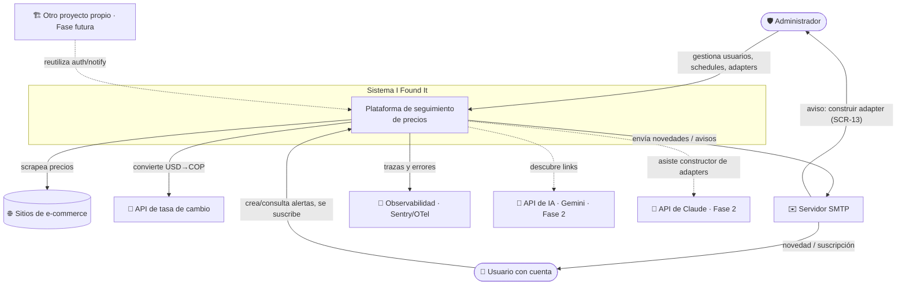
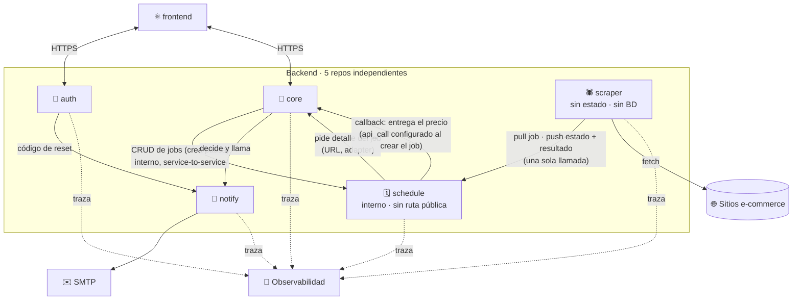
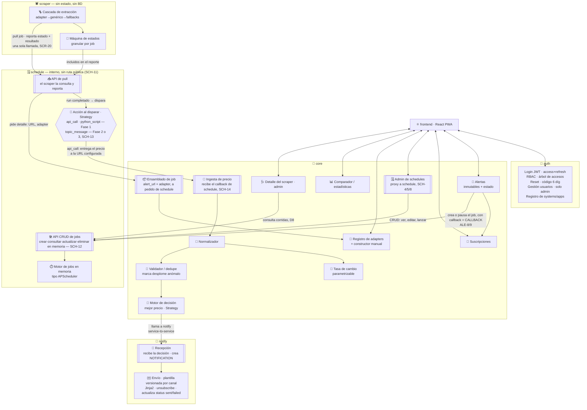
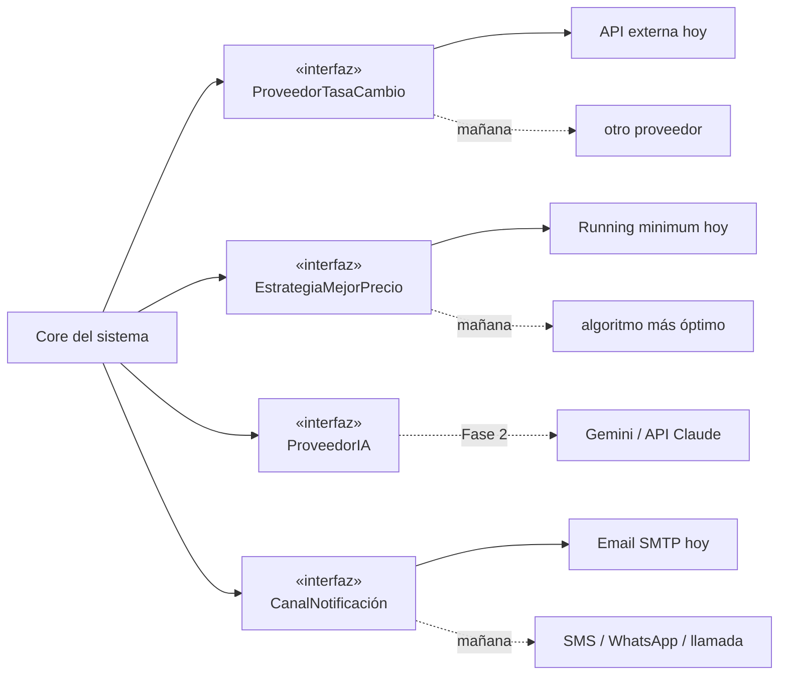
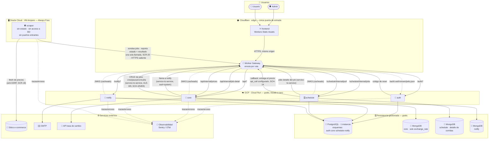
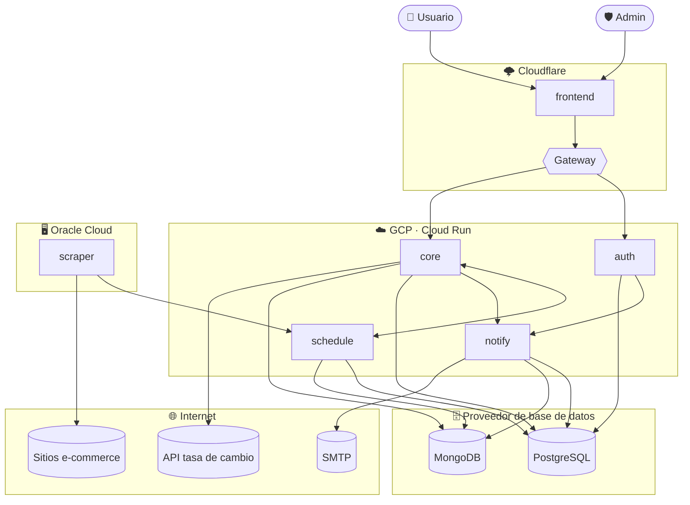

# 02 · Arquitectura

> Consolidado con el [Alcance 1](08-alcance-1-preguntas.md), los [requerimientos](deliverables/requerimientos.md), el [modelo de datos](03-modelo-datos.md) y el [flujo diario](05-flujo-scraping.md). Refleja roles/RBAC, ejecución background con cola+workers, la **cascada de scraping con adapters aprendidos**, la máquina de estados del job, persistencia políglota, observabilidad y despliegue polyrepo portable a la nube.

## Tabla de contenido

- [Principios de diseño](#principios-de-diseño)
- [Diagrama de contexto (C4 · nivel 1)](#diagrama-de-contexto-c4--nivel-1)
- [Diagrama de contenedores (C4 · nivel 2)](#diagrama-de-contenedores-c4--nivel-2)
- [Diagrama de componentes (C4 · nivel 3)](#diagrama-de-componentes-c4--nivel-3)
- [La cascada de scraping (el "cerebro")](#la-cascada-de-scraping-el-cerebro)
- [Responsabilidad de cada componente](#responsabilidad-de-cada-componente)
  - [Persistencia por servicio](#persistencia-por-servicio)
- [Módulos desacoplados (puntos de extensión)](#módulos-desacoplados-puntos-de-extensión)
- [Persistencia políglota](#persistencia-políglota)
- [Concerns transversales](#concerns-transversales)
- [Vista de despliegue (servicios desacoplados · Cloudflare + GCP + Oracle)](#vista-de-despliegue-servicios-desacoplados--cloudflare--gcp--oracle)
  - [Vista mínima](#vista-mínima)
- [Comunicación entre piezas](#comunicación-entre-piezas)
  - [Usuario ↔ Frontend](#usuario--frontend)
  - [Frontend ↔ Backend](#frontend--backend)
  - [Backend ↔ Backend (service-to-service)](#backend--backend-service-to-service)
  - [Backend → Servicios externos](#backend--servicios-externos)
  - [Transversal](#transversal)

## Principios de diseño

- **Modular y desacoplado:** las piezas que cambiarán —proveedor de IA, tasa de cambio, estrategia de "mejor precio", canal de notificación— viven **tras una interfaz**, reemplazables sin tocar el core.
- **Scraping en background, no en el request:** el trabajo pesado corre en el **scraper**, orquestado por **`schedule`** vía *pull* dentro de ventanas horarias — detalle de cola/workers en el [doc 04](04-stack-tecnologico.md).
- **Scraping que aprende:** extractor genérico (JSON-LD/schema.org) + cascada de fallbacks; los sitios difíciles obtienen un **adapter guardado por dominio** que se **reutiliza** (sin re-trabajo).
- **Observable de punta a punta:** cada corrida lleva un `transactionId` que atraviesa los 5 servicios de backend y sus logs; máquina de estados granular por job.
- **6 repos independientes, portables, sin lock-in** ([ADR-0001](adr/0001-estructura-repos-servicios.md)): cada uno empaquetado en contenedores + config por entorno (12-factor). Las mismas imágenes corren local (docker-compose) y en producción (Cloudflare/GCP/Oracle).
- **Cloudflare como única puerta de entrada:** ningún servicio expone su origen directamente — todo el tráfico, de usuarios y entre servicios, pasa por el Gateway o la red de Cloudflare (ver [Vista de despliegue](#vista-de-despliegue-servicios-desacoplados--cloudflare--gcp--oracle)).
- **Aislamiento de datos por servicio, no por conveniencia:** cada repo es dueño de su propio esquema/base, con sus propios roles de BD y **sin FK ni permisos** sobre el de otro servicio; la integridad entre servicios la garantiza quien escribe, no la base de datos (ver [doc 03](03-modelo-datos.md) y [docs/deliverables/db](deliverables/db/README.md)).
- **Superficie de ataque mínima en el scraper:** sin estado, sin credenciales de negocio y **sin puertos entrantes** — solo hace *pull* de trabajo y reporta resultados hacia afuera.
- **Idempotente y append-only:** las corridas se reintentan sin duplicar ni corromper el historial; el precio se guarda **solo cuando cambia**.
- **Almacenamiento mínimo:** cada dato vive en el almacén que menos cuesta según su ciclo de vida; lo voluminoso o efímero va a NoSQL con **TTL y compresión** (ver [doc 03](03-modelo-datos.md)).

## Diagrama de contexto (C4 · nivel 1)

> Nivel 1: personas y **sistemas externos**, sin entrar en los repos/servicios internos (eso es el [diagrama de contenedores](#diagrama-de-contenedores-c4--nivel-2)). Por eso **no** aparece aquí Cloudflare ni ningún detalle de despliegue — es infraestructura, no un sistema externo con el que el negocio interactúe.

> **`Otro proyecto propio`** representa el motivo por el que `auth` y `notify` se diseñaron como piezas reutilizables ([ADR-0001](adr/0001-estructura-repos-servicios.md)): hoy nadie más los consume, pero la relación existe como razón de diseño desde ya.
>
> **Ya no hay suscriptores sin cuenta** (decidido 2026-09-30): se retiró el rol incógnito, `notify.notification` exige `app_user_id` y `core.subscription.created_by` pasó a ser obligatorio (D13) — todo destino de una notificación es un "Usuario con cuenta" real, sin excepción. Queda un cabo suelto (D16 del [doc 09](09-pendientes.md)): `subscription.email` (SUB-1) todavía permite suscribir un correo distinto al de la cuenta. `notify` recibe `app_user_id` **y** un `destination` que pone quien lo llama, así que `core` podría pasar ese otro correo como `destination`; sigue sin decidirse si esa función se mantiene.

## Diagrama de contenedores (C4 · nivel 2)

> Las **5 piezas de backend** que se construyen ([ADR-0001](adr/0001-estructura-repos-servicios.md)) — cada una su propio repo, su propio deployable y su propia base/esquema. El detalle interno de cada una está en el [diagrama de componentes](#diagrama-de-componentes-c4--nivel-3), más abajo.

## Diagrama de componentes (C4 · nivel 3)

> Solo las piezas **de nuestro dominio** y con las que **interactúan entre sí** — sin bases de datos (ya están en ["Persistencia por servicio"](#persistencia-por-servicio) y en el [doc 03](03-modelo-datos.md)) ni servicios externos como SMTP u Observabilidad (ya están en ["Comunicación entre piezas"](#comunicación-entre-piezas) y en la [Vista de despliegue](#vista-de-despliegue-servicios-desacoplados--cloudflare--gcp--oracle)). Cada `subgraph` de servicio es un **repo y un deployable distinto**; las flechas que cruzan un `subgraph` son llamadas de red (HTTP), no llamadas de función.

> **`schedule` es exclusivamente interno** (SCH-11): no tiene ruta pública en el Gateway, y el admin lo gestiona desde el frontend **a través de `core`** (`SCHEDPROXY`), nunca directo.
>
> **El scraper nunca llama a `core`** (SCR-20, 2026-09-30): entrega su resultado a `schedule` en la misma llamada donde reporta el estado del *run*. Al completarse, `schedule` dispara la acción `api_call` configurada — que es la que finalmente llama a `CALLBACK` en `core`. `schedule` nunca tiene el dato de "cómo llamar a core" *hardcodeado*: viaja como configuración del job (SCH-14), así queda desacoplado de verdad.
>
> **Cuatro llamadas entre servicios que antes eran una sola tabla** ([ADR-0001](adr/0001-estructura-repos-servicios.md)): `ALERT → JOBAPI` (crea/pausa el job, ALE-8/9), `RUNAPI → JOBBUILD` (pide el detalle al hacer *pull*), `ACTION → CALLBACK` (entrega el precio, resuelve cómo `core` se entera) y `HEALTH → JOBAPI` (consulta corridas, D8).
>
> **`notify` tiene dos pasos, no uno** (2026-09-30): `INTAKE` (Recepción) es quien recibe la llamada de `DEC` y crea la fila `NOTIFICATION` — es **la notificación que se debe enviar**. `SEND` es quien la toma, arma el mensaje con la plantilla de su canal y lo entrega (SMTP en Fase 1). Antes el diagrama los mezclaba en un solo nodo ("Envío"), lo que escondía que nadie tenía modelado el paso de creación. El nodo se llamaba `OUTBOX`; se renombró porque en el [doc 03](03-modelo-datos.md#d-notify-notificaciones) `notification_outbox` es otra cosa: la cola de reintento.
>
> **Una tabla con estado, más una cola de reintento** (reemplaza el modelo de "tres tablas" del 2026-09-30): `NOTIFICATION` lleva su propio `status` (`pending`\|`sent`\|`failed`) y, según el caso, `sent_at`, `provider`, `attempts` y `last_error`; `notification_sent` se fusionó en ella porque nunca mutaba. Si `SEND` falla, inserta/actualiza `NOTIFICATION_OUTBOX` — cola de reintento **activo** (`next_retry_at`, `FOR UPDATE SKIP LOCKED`) que se borra al resolverse. `notify` además es genérico y multicanal: `CHANNEL` (catálogo abierto) y `TEMPLATE` (versionada) viven en el mismo esquema. Detalle en [doc 03](03-modelo-datos.md#d-notify-notificaciones). El mecanismo exacto de `INTAKE → SEND` (en el mismo proceso o con una cola interna) sigue sin decidir — ver [doc 09](09-pendientes.md), D12.

## La cascada de scraping (el "cerebro")

```mermaid
graph TD
    START[Job de un sitio] --> A0{¿Adapter<br/>guardado para<br/>el dominio?}
    A0 -->|sí| USE[Usar adapter guardado]
    A0 -->|no| C1[1 · JSON-LD / og:price]
    C1 -->|falla| C2[2 · Microdata/RDFa/meta + regex]
    C2 -->|falla| C3[3 · Playwright render]
    C3 -->|falla| C4[4 · Interceptar XHR/JSON]
    C4 -->|falla| RT{Reintentos<br/>controlados<br/>máx 3}
    RT -->|reintenta 10-15m| C1
    RT -->|agotados| N7[7 · Email al admin]
    N7 --> BUILD[Admin construye adapter<br/>manual · guarda por dominio]
    BUILD -.reutiliza siempre.-> A0
    USE --> OK[✅ Precio capturado]
    C1 & C2 & C3 & C4 -->|éxito| OK
```

> **Fase 2:** entre el paso 4 y el aviso al admin se sumará el **extractor con IA** (#5), y el constructor de adapters tendrá **asistencia de IA** (evaluar API de Claude).

## Responsabilidad de cada componente

| Servicio | Componente | Responsabilidad |
|----------|------------|-----------------|
| `frontend` | **React PWA** | Menú/módulos para usuarios con cuenta. Español, i18n listo. Sin acceso anónimo. |
| `auth` | **Auth** | Login con access token (~15 min) + refresh (~7 días, rotación/revocación); publica el JWKS que validan `core`/`notify`. |
| `auth` | **RBAC** | Roles/permisos dinámicos, **propios de cada `system`**; un usuario tiene **un rol por `system`** ([ADR-0003](adr/0003-alcance-por-system-en-auth.md)). Arma en login el **árbol de accesos** (guardado, `permission.parent_id`) del `system` solicitado. Semilla de `ifoundit`: roles `ADMIN` y `USER` y 19 permisos en MAYÚSCULAS; el prefijo `RULE_` marca una regla de servicio ([doc 03](03-modelo-datos.md#catálogo-de-permisos-de-ifoundit-semilla)). Cada system tiene su `SUPER_ADMIN`, dueño solo de ese system, con todos sus permisos presentes y futuros; los systems nuevos se registran con `register-system.sql`, que lo crea. |
| `auth` | **Reset contraseña** | Código de 6 dígitos por email, válido 15 min + throttle 15 min (llama a `notify` para el envío). |
| `auth` | **Gestión de usuarios** | Alta/gestión **solo admin**; admin sembrado por seed. |
| `auth` | **Registro de systems** | Identifica qué sistema/app llama (`aud=system`) y es dueño de sus roles y permisos; base de la reutilización futura de `auth`/`notify` en otros proyectos. |
| `core` | **Servicio de Alertas** | Crear (URL, 1..N) **inmutables** con `estado`; consultar todas (lectura); pausar/reactivar. |
| `core` | **Suscripciones** | Persona↔alerta por email; unsubscribe por enlace. |
| `core` | **Registro de adapters** | Guarda adapters por dominio; constructor manual del admin; reutilización. |
| `core` | **Ensamblado de job** | A pedido de `schedule`, arma el detalle del job (URL, dominio, adapter) para un `alert_id` dado. |
| `core` | **Ingesta de precio (callback)** | Recibe la llamada `api_call` que `schedule` dispara al completar un *run* (SCH-14); es la única puerta de entrada del precio hacia el Normalizador. |
| `schedule` | **Scheduling** | Motor de jobs **genérico**, reutilizable por cualquier `system`: cada `job` lleva su cron, su `execution_type` (catálogo abierto), un `payload` opaco y un callback. `core` crea el job de scraping de cada alerta (2×/día por defecto); admin ve/edita/lanza y ve progreso; dueño de `job`, `job_script` y `job_execution`. |
| `schedule` | **API de jobs (pull + CRUD)** | El scraper la consulta para tomar trabajo pendiente; `schedule` —no el scraper— le pide el detalle a `core` y se lo entrega. El scraper le reporta, **en una sola llamada**, el estado del *run* y el resultado (SCR-20); `core` usa la misma API para crear/pausar/consultar jobs (SCH-12). |
| `schedule` | **Motor de acciones (Strategy)** | Al completar un *run*, dispara la acción configurada al crear el job (`api_call`/`python_script`); nunca conoce el dominio de negocio de quien la configuró (SCH-13/14). |
| `core` | **Normalizador** | Formato canónico: precio, moneda, stock, título, metadata. |
| `core` | **Tasa de cambio** | Tarea liviana; convierte USD→COP; guarda tasa+fecha en su propia NoSQL (~1 doc/día); parametrizable. |
| `core` | **Validador / dedupe** | Descarta lo inválido (≤0, HTML error); **marca** desplomes anómalos (no los descarta). |
| `core` | **Motor de decisión** | "Mejor precio móvil" **global** de la alerta; **Strategy** reemplazable; detecta el aviso y le pasa los datos de la decisión a `notify` (la `notification` ya no la crea `core` — ver sección D del [doc 03](03-modelo-datos.md#d-notify-notificaciones)). |
| `core` | **Comparador / estadísticas** | Histórico y comparación **por sitio** en el tiempo. |
| `core` | **Detalle del scraper (admin)** | Adapters rotos y tasa de éxito son suyos; las **últimas corridas** las pide por API a `schedule` (D8). |
| `scraper` | **Cascada de extracción** | Adapter guardado → JSON-LD → microdata/regex → Playwright → XHR; reintentos controlados; robots.txt + rate limit. Sin estado, sin BD, **nunca llama a `core`** (SCR-20). |
| `scraper` | **Máquina de estados** | Registra **cada etapa del job con su hora**; va incluida en el mismo reporte que le hace a `schedule` y alimenta la vista de progreso. Dónde se persiste ese detalle por etapa tras genericizar `schedule` está pendiente (D15 del [doc 09](09-pendientes.md)); `schedule` solo conserva el resultado genérico de la corrida (`job_execution_result`, TTL 90 días). |
| `notify` | **Recepción (INTAKE)** | Recibe la llamada de quien origina el aviso (`core`, `auth`) con `transaction_id`, `app_user_id`, canal, `destination`, plantilla y `payload` (opaco), y **crea** la fila `notification` (PostgreSQL, movida desde `core` el 2026-09-30) con `status = pending` — es la notificación **que se debe enviar**. Genérica y multicanal: no conoce ningún concepto de `core`. Reutilizable por otros proyectos (`system`). |
| `notify` | **Envío (SEND)** | Toma una `notification`, arma el mensaje con la **plantilla versionada de su canal** (`template`; en email, Jinja2 con marca de anomalía y enlace de baja) y lo entrega (SMTP en Fase 1; el catálogo `channel` admite SMS/WhatsApp/llamada sin migración). Si tiene éxito, actualiza `notification` (`status = sent`, `sent_at`, `provider`); si falla, inserta/actualiza `notification_outbox` (cola de reintento) y, al agotar los intentos, deja `status = failed`. Archiva lo enviado (sin HTML ni PII) en su propia NoSQL (`notification_log`; su utilidad está en revisión, D18). |
| todos | **Observabilidad** | `transactionId` end-to-end; trazas/errores (OpenTelemetry + Sentry). |

### Persistencia por servicio

> **PostgreSQL es UNA sola instancia** con **cuatro esquemas**, uno por servicio, cada uno con sus propios roles (migraciones y servicio) y sin permisos sobre el de los demás (no hay 4 bases físicas separadas — más realista con un proveedor gratuito que solo da una base por proyecto). MongoDB sí es una base separada por servicio, porque ahí el aislamiento natural es la base. Detalle y scripts en [docs/deliverables/db](deliverables/db/README.md).

| Servicio | Store | Qué guarda |
|----------|-------|-----------|
| `auth` | PostgreSQL, esquema `auth` | RBAC, `person`/`app_user`, `refresh_token`, `password_reset`, `audit_log`, `system`. |
| `core` | PostgreSQL, esquema `core` | Alertas, urls (con último precio), etiquetas, `price_snapshot` **por cambio** (particionado), suscripciones, adapters, estadísticas diarias por sitio. |
| `core` | MongoDB (base propia) | Solo `exchange_rate`. |
| `schedule` | PostgreSQL, esquema `schedule` | `execution_type` (catálogo), `job` (tarea configurada), `job_script` (código serverless), `job_execution` (corridas, con `callback_status`) y `job_callback_outbox` (reintento activo del callback). |
| `schedule` | MongoDB (base propia) | Solo `job_execution_result` — resultado de una corrida, forma libre según `execution_type`, **con TTL 90 días y compresión zstd**. El detalle específico de scraping (`job_state`, `raw_capture`, …) ya no vive aquí (2026-10-01); su nuevo hogar está pendiente (D15). |
| `notify` | PostgreSQL, esquema `notify` | `channel` y `template` (catálogos), `notification` (con `status`) y `notification_outbox` (reintento activo) — `notification` movida desde `core` (2026-09-30). |
| `notify` | MongoDB (base propia) | `notification_log` (archivo de lo enviado, sin HTML ni PII; su utilidad está en revisión, D18) — TTL 180 días. |

> Ningún esquema/base tiene FK ni permisos sobre el de otro servicio — detalle completo en el [doc 03 · Modelo de datos](03-modelo-datos.md).

## Módulos desacoplados (puntos de extensión)

> `Core del sistema` es el repo **`core`** específicamente (no un concepto que abarque los 6 repos): estas 4 interfaces son código interno suyo. `CanalNotificación` hoy significa "llamar por HTTP al servicio `notify`", no una llamada en el mismo proceso — ver [doc 04](04-stack-tecnologico.md#interfaces-reemplazables-contratos). Del lado de `notify`, agregar un canal es un `INSERT` en el catálogo `channel` (más su `template`), no una migración.

## Persistencia políglota

> Por qué **PostgreSQL** para lo transaccional y **MongoDB** para lo voluminoso/efímero: relaciones fuertes y consistencia en el primero; alto volumen de escritura, esquema flexible y **solo consulta** en el segundo (mantiene cada PostgreSQL liviano y acotado). El reparto **por servicio** (quién es dueño de qué base, sin FK entre servicios) está en la tabla ["Persistencia por servicio"](#persistencia-por-servicio) de la sección anterior, y el detalle de entidades y colecciones en el [doc 03 · Modelo de datos](03-modelo-datos.md).

## Concerns transversales

- **🧼 Saneamiento de datos (DoD crítico):** **todo dato se limpia y normaliza antes de persistir** (trim, sin caracteres de control/invisibles, Unicode NFC, precios→numérico, fechas→UTC). Autoridad en BE; el **Normalizador** lo aplica a lo scrapeado y la **validación de entrada** a lo del usuario. Objetivo: análisis congruente (RNF-6).
- **Observabilidad:** `transactionId` generado por corrida/request, propagado entre los 5 servicios de backend (cabecera HTTP en cada llamada); OpenTelemetry (vendor-neutral) + Sentry free en prod.
- **Seguridad (dev):** SAST (Bandit/Semgrep), escaneo de dependencias (pip-audit/Trivy), secretos (Gitleaks), Dependabot; corren en CI de cada repo.
- **Calidad:** lint + tipos + tests unitarios + **E2E (Playwright)**; *quality gates* en CI.
- **Auditoría:** actor + acción + timestamp de operaciones sensibles.

## Vista de despliegue (servicios desacoplados · Cloudflare + GCP + Oracle)

> **Reemplaza** la vista anterior de "polyrepo en una sola VM" (INF-1/INF-15). Cada pieza es su **propio repo y servicio**, con presupuesto $0: **Cloudflare** es la única puerta de entrada; **GCP Cloud Run** aloja los servicios sin estado; la **VM Ampere de Oracle** aloja **únicamente** el scraper (por ser el más pesado en recursos); las bases de datos van en un proveedor gestionado gratuito. Decisión y alternativas evaluadas: ver [ADR-0001](adr/0001-estructura-repos-servicios.md).

**Cómo leerlo:**

- **Cloudflare es la única puerta.** Ningún origen (Cloud Run ni la VM de Oracle) se llama directo; todo pasa por el Worker Gateway o por la red de Cloudflare.
- **El scraper solo hace llamadas salientes, y nunca a `core`** (SCR-20). Sondea a `schedule` por trabajo y le reporta —en la misma llamada— el estado y el resultado; la VM de Oracle **no necesita ningún puerto entrante abierto**, lo que reduce su superficie de ataque a casi cero. `schedule` es quien reenvía el precio a `core`.
- **`schedule` no tiene ninguna ruta pública** (SCH-11): sus rutas bajo `/schedule/internal/*` solo aceptan JWT de servicio (`aud=system`), nunca un token de usuario. El admin lo gestiona desde el frontend, pero la llamada real es `core` la que habla con `schedule`.
- **La validación de JWT vive en cada servicio** (no en el Gateway): `auth` publica su JWKS y `core`/`schedule`/`notify` lo cachean y validan localmente. El Gateway solo enruta y aplica límite de tasa.
- **Una sola base PostgreSQL, aislada por esquema y rol** — no por FK: `core` referencia usuarios de `auth` solo por `uuid` y guarda el `run_id` de `schedule.job_execution` solo por valor; `schedule` y `notify` son genéricos y ya no referencian nada de `core` — solo `auth` (`system` por código, usuarios por `uuid`) y un `transaction_id` de correlación opaco. Detalle en [docs/deliverables/db](deliverables/db/README.md).
- **El callback de `schedule` a `core` es configuración, no un conocimiento fijo** (SCH-14): la URL a la que llamar viaja como parte del job creado por `core`, así que `schedule` puede reutilizarse por otro sistema sin tocarle el código.

### Vista mínima

> La misma foto, sin rutas ni etiquetas: solo las piezas, la **red/proveedor** a la que pertenecen y cómo se relacionan. **El Gateway solo enruta tráfico de navegador** (`auth`, `core`); `schedule` y `notify` se alcanzan por llamada directa entre servicios, nunca desde el Gateway.

> **`notify` también vive en PostgreSQL desde el 2026-09-30:** su esquema aloja `channel`, `template`, `notification` (movida desde `core`, ahora con estado propio) y `notification_outbox` (cola de reintento) — ver [doc 03](03-modelo-datos.md#d-notify-notificaciones); su archivo de envíos (`notification_log`) sigue en Mongo. Por eso ahora tiene flecha hacia `PG` y hacia `MG`, igual que `auth`/`core`/`schedule`.

## Comunicación entre piezas

> Protocolo elegido: **REST sobre HTTPS con JSON**, en todas partes (frontend↔backend y backend↔backend). Se evaluaron gRPC, GraphQL y SOAP: gRPC exige un cliente `gRPC-Web` en el navegador (peso de bundle, doble sistema de contratos junto al OpenAPI ya elegido) sin beneficio para nuestro volumen; GraphQL se reconsidera si el comparador/estadísticas (VIS-3/VIS-4) necesitan consultas muy flexibles; SOAP se descarta sin ambigüedad. Todas las filas pasan primero por el **Worker Gateway de Cloudflare**, salvo la fila de Usuario↔Frontend; no se repite en cada una.

### Usuario ↔ Frontend

| Origen | Destino | Qué comunica | Protocolo | Tecnología |
|---|---|---|---|---|
| Admin / Usuario | `frontend` | Navegación de la SPA | HTTPS | Cloudflare Workers Static Assets |

### Frontend ↔ Backend

| Origen | Destino | Qué comunica | Ruta | Protocolo | Tecnología / Auth |
|---|---|---|---|---|---|
| `frontend` | `auth` | Login, reset, gestión de usuarios | `/auth/*` | REST/HTTPS+JSON | FastAPI (OpenAPI) · JWT de usuario |
| `frontend` | `core` | Alertas, suscripciones, adapters, comparador, panel de scraper, y schedules (vía `SCHEDPROXY`) | `/api/*` | REST/HTTPS+JSON | FastAPI (OpenAPI) · JWT de usuario. El frontend **nunca** llega directo a `schedule` (SCH-11) |

### Backend ↔ Backend (service-to-service)

| Origen | Destino | Qué comunica | Ruta | Protocolo | Tecnología / Auth |
|---|---|---|---|---|---|
| `core` | `schedule` | CRUD de jobs: crea/pausa/consulta (ALE-8/9, SCH-4/5/8/9/12, D8) — la consulta incluye la **etapa actual** del *run* en curso, nunca un tiempo estimado¹ | `/schedule/internal/jobs` | REST/HTTPS+JSON | JWT de servicio (`aud=system`) |
| `schedule` | `core` | Pide el detalle del job (URL, adapter) al hacer *pull* | `/api/internal/job-detail` | REST/HTTPS+JSON | JWT de servicio |
| `scraper` | `schedule` | *Pull* de trabajo + reporta estado y resultado — **una sola llamada** (SCR-20) | `/schedule/internal/pull` | REST/HTTPS+JSON (polling) | JWT de servicio |
| `schedule` | `core` | Callback: entrega el precio, en la URL de `api_call` configurada al crear el job (SCH-14) | `/api/internal/prices` | REST/HTTPS+JSON | JWT de servicio |
| `core` | `notify` | Entrega los datos de la decisión (mejor precio: `transaction_id`, `app_user_id`, canal, `destination`, plantilla y `payload`) para que `notify` cree su propia `notification` y la envíe (`notification` vive en `notify`, no en `core`, desde 2026-09-30) | `/notify/*` | REST/HTTPS+JSON | JWT de servicio |
| `auth` | `notify` | Pide el envío del código de reset | `/notify/*` | REST/HTTPS+JSON | JWT de servicio |
| `core` / `schedule` / `notify` | `auth` | Descarga y cachea el JWKS (valida JWT localmente) | `/auth/.well-known/jwks.json` | REST/HTTPS+JSON | Sin credencial (endpoint público de claves) |

> ¹ No es posible calcular cuánto falta ni "a qué velocidad va" un job de scraping (depende del sitio, de si cae en fallback Playwright, de reintentos) — lo único observable es la etapa actual (`job_state`, SCR-16). Cómo llega esa etapa hasta el navegador sigue sin decidir — ver [doc 09](09-pendientes.md), D11.

### Backend → Servicios externos

| Origen | Destino | Qué comunica | Protocolo | Tecnología |
|---|---|---|---|---|
| `scraper` | Sitios e-commerce | Extrae el precio (cascada) | HTTP(S) | httpx (HTTP-first) / Playwright — validado anti-SSRF (SCR-18) |
| `core` | API de tasa de cambio | Convierte USD→COP | REST/HTTPS | Cliente HTTP; proveedor aún por definir (doc04) |
| `notify` | Servidor SMTP | Envía el correo | SMTP | aiosmtplib |

### Transversal

| Origen | Destino | Qué comunica | Protocolo | Tecnología |
|---|---|---|---|---|
| Los 5 servicios de backend | Observabilidad | Trazas y errores, con `transactionId` | OTLP / HTTPS | OpenTelemetry + Sentry SDK |

