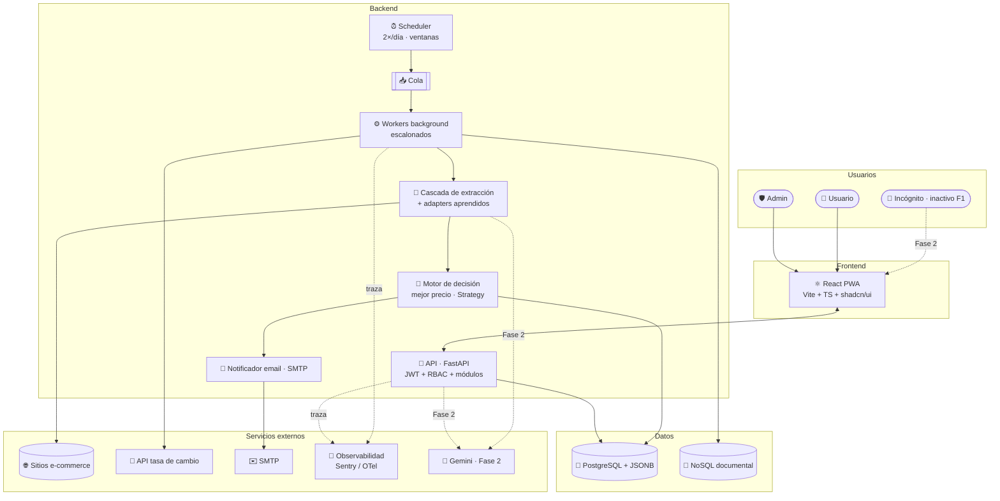
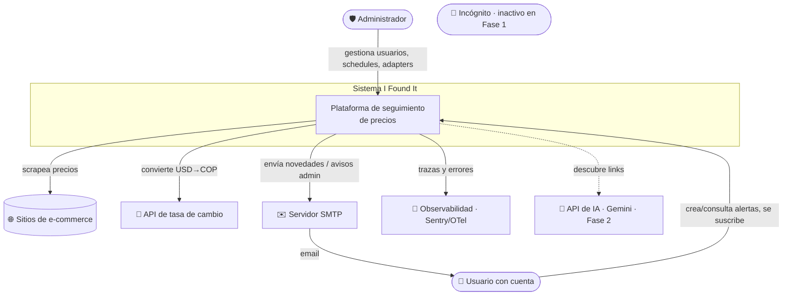
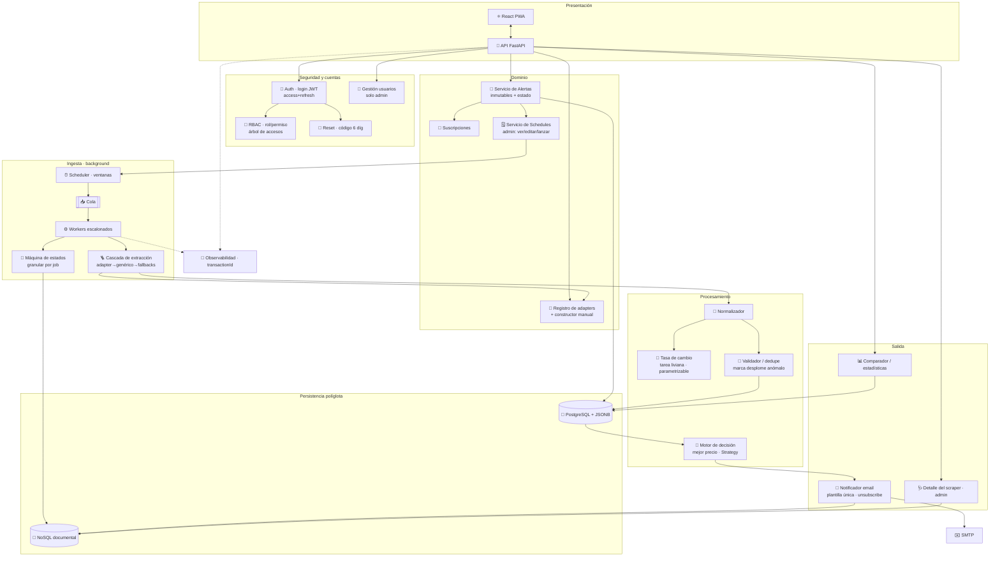
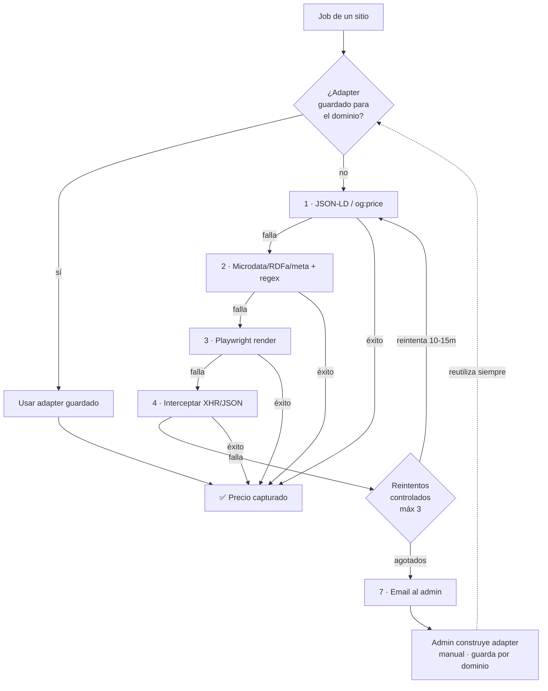
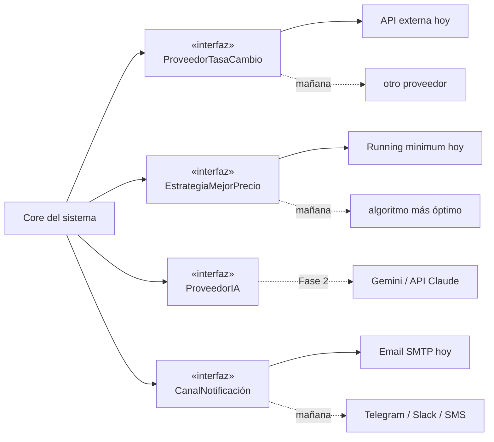
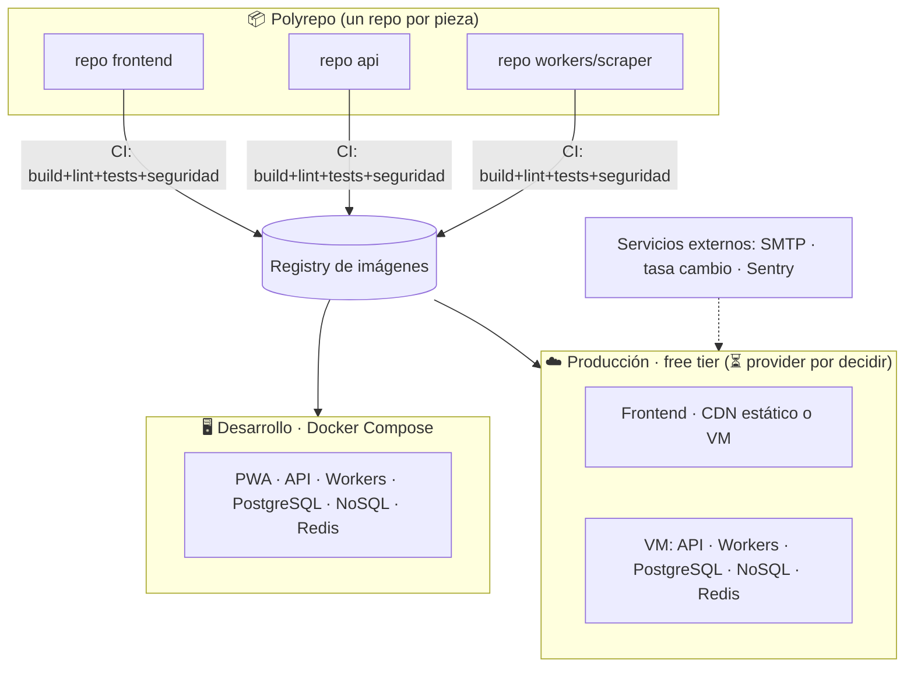

# 02 · Arquitectura

> Consolidado con el [Alcance 1](08-alcance-1-preguntas.md) y los [requerimientos](deliverables/requerimientos.md). Refleja roles/RBAC, ejecución background con cola+workers, la **cascada de scraping con adapters aprendidos**, la máquina de estados del job, persistencia políglota, observabilidad y despliegue polyrepo portable a la nube.

## Principios de diseño

- **Modular y desacoplado:** las piezas que cambiarán —proveedor de IA, tasa de cambio, estrategia de "mejor precio", canal de notificación— viven **tras una interfaz**, reemplazables sin tocar el core.
- **Scraping en background, no en el request:** el trabajo pesado corre en **workers** alimentados por una **cola**, **escalonados** en ventanas horarias.
- **Scraping que aprende:** extractor genérico (JSON-LD/schema.org) + cascada de fallbacks; los sitios difíciles obtienen un **adapter guardado por dominio** que se **reutiliza** (sin re-trabajo).
- **Observable de punta a punta:** cada corrida lleva un `transactionId` que atraviesa API, workers y logs; máquina de estados granular por job.
- **Polyrepo, portable, sin lock-in:** cada componente en su repo, empaquetado en contenedores + config por entorno (12-factor). Corre igual local que en free tier.
- **Idempotente y append-only:** las corridas se reintentan sin duplicar ni corromper el historial.

## Vista general (de un vistazo)

## Diagrama de contexto (C4 · nivel 1)

## Diagrama de componentes (C4 · nivel 2)

## La cascada de scraping (el "cerebro")

> **Fase 2:** entre el paso 4 y el aviso al admin se sumará el **extractor con IA** (#5), y el constructor de adapters tendrá **asistencia de IA** (evaluar API de Claude).

## Responsabilidad de cada componente

| Componente | Responsabilidad |
|------------|-----------------|
| **React PWA** | Menú/módulos para usuarios con cuenta. Español, i18n listo. (Incógnito inactivo en Fase 1.) |
| **API (FastAPI)** | Expone módulos; valida JWT; aplica RBAC; orquesta el dominio. |
| **Auth** | Login con access token (~15 min) + refresh (~7 días, rotación/revocación). |
| **RBAC** | Roles/permisos dinámicos; arma el **árbol de accesos** en login. 3 roles sembrados (incógnito inactivo). |
| **Reset contraseña** | Código de 6 dígitos por email, válido 15 min + throttle 15 min. |
| **Gestión de usuarios** | Alta/gestión **solo admin**; admin sembrado por seed. |
| **Servicio de Alertas** | Crear (URL, 1..N) **inmutables** con `estado`; consultar todas (lectura); pausar/reactivar. |
| **Suscripciones** | Persona↔alerta por email; unsubscribe por enlace. |
| **Servicio de Schedules** | Schedule por alerta (2×/día por defecto); admin ve/edita/lanza y ve progreso. |
| **Registro de adapters** | Guarda adapters por dominio; constructor manual del admin; reutilización. |
| **Scheduler + Cola + Workers** | Encolan y ejecutan corridas en **background escalonado** dentro de ventanas (04–06 / 18–20, env). |
| **Cascada de extracción** | Adapter guardado → JSON-LD → microdata/regex → Playwright → XHR; reintentos controlados; robots.txt + rate limit. |
| **Máquina de estados** | Registra **cada etapa del job con su hora** (NoSQL); alimenta la vista de progreso. |
| **Normalizador** | Formato canónico: precio, moneda, stock, título, metadata. |
| **Tasa de cambio** | Tarea liviana; convierte USD→COP; guarda tasa+fecha en NoSQL; parametrizable. |
| **Validador / dedupe** | Descarta lo inválido (≤0, HTML error); **marca** desplomes anómalos (no los descarta). |
| **Motor de decisión** | "Mejor precio móvil" **global** de la alerta; **Strategy** reemplazable; dispara email. |
| **Notificador** | Email SMTP, plantilla única (con marca de anomalía y enlace de baja); registra en NoSQL. |
| **Comparador / estadísticas** | Histórico y comparación **por sitio** en el tiempo. |
| **Detalle del scraper (admin)** | Adapters rotos, tasa de éxito, sitios sin precio, últimas corridas. |
| **Observabilidad** | `transactionId` end-to-end; trazas/errores (OpenTelemetry + Sentry). |
| **PostgreSQL** | Transaccional: RBAC, usuarios, alertas, urls, schedules, snapshots, suscripciones, adapters. |
| **NoSQL** | Documental (solo consulta): estados del job, resúmenes de corrida, capturas crudas, log de notificaciones, tasa de cambio. |

## Módulos desacoplados (puntos de extensión)

## Persistencia políglota

| Store | Qué guarda | Por qué |
|-------|-----------|---------|
| **PostgreSQL (+ JSONB)** | RBAC, usuarios, alertas, urls, etiquetas, schedules, `price_snapshot` (append-only), suscripciones, adapters | Relaciones fuertes, consistencia, series temporales; JSONB para metadata de captura |
| **NoSQL** (documental) | `job_estado`, `corrida_resumen`, `captura_cruda` (solo fallo), `notificacion_log`, `tasa_cambio` | Alto volumen de escritura, esquema flexible, **solo consulta**; mantiene PostgreSQL liviano |

> Detalle de entidades y colecciones en el [doc 03 · Modelo de datos](03-modelo-datos.md).

## Concerns transversales

- **🧼 Saneamiento de datos (DoD crítico):** **todo dato se limpia y normaliza antes de persistir** (trim, sin caracteres de control/invisibles, Unicode NFC, precios→numérico, fechas→UTC). Autoridad en BE; el **Normalizador** lo aplica a lo scrapeado y la **validación de entrada** a lo del usuario. Objetivo: análisis congruente (RNF-6).
- **Observabilidad:** `transactionId` generado por corrida/request, propagado por API y workers; OpenTelemetry (vendor-neutral) + Sentry free en prod.
- **Seguridad (dev):** SAST (Bandit/Semgrep), escaneo de dependencias (pip-audit/Trivy), secretos (Gitleaks), Dependabot; corren en CI de cada repo.
- **Calidad:** lint + tipos + tests unitarios + **E2E (Playwright)**; *quality gates* en CI.
- **Auditoría:** actor + acción + timestamp de operaciones sensibles.

## Vista de despliegue (polyrepo · local → nube)

> **Mismas imágenes** local y prod; solo cambia la config por entorno. **INF-15**: frontend en CDN estático o servido por la VM; backend + datos + cola en una VM free tier (Oracle/GCP). **Provider y host del frontend: decisión pendiente.**

## Notas

- La **cola** es Redis + un runner de tareas ligero — se detalla en el [doc 04](04-stack-tecnologico.md).
- El **flujo diario** paso a paso está en el [doc 05](05-flujo-scraping.md).
- El **modelo de datos** (entidades y colecciones) en el [doc 03](03-modelo-datos.md).
