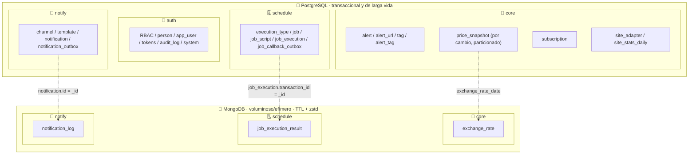
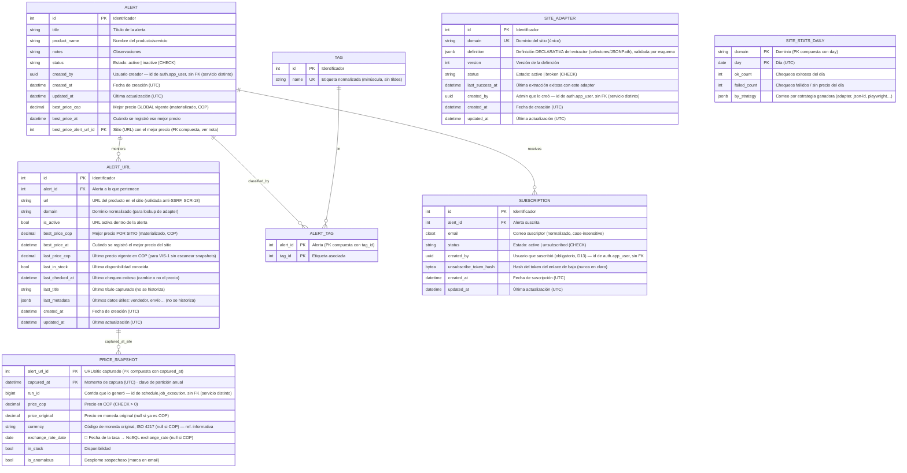
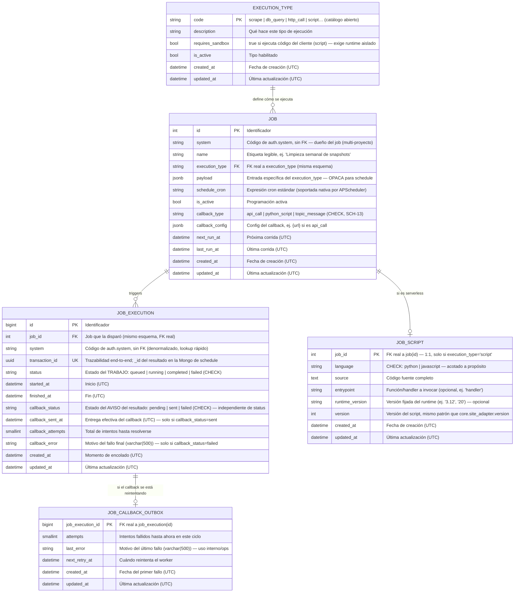
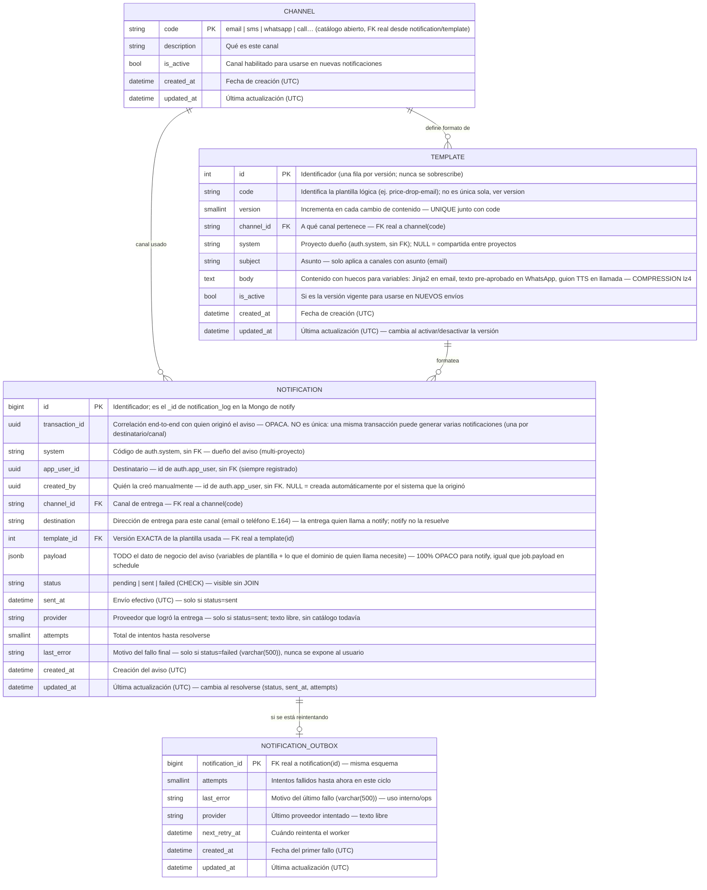

# 03 · Modelo de datos

> Consolidado con el [Alcance 1](08-alcance-1-preguntas.md) y los [requerimientos](deliverables/requerimientos.md). Persistencia **políglota**: PostgreSQL (relacional + JSONB) para lo transaccional y de larga vida, y **MongoDB** (documental) para lo voluminoso, efímero o de solo consulta.
>
> **Convenciones:** nombres en **inglés**, `snake_case`; PK `id` (salvo clave natural); FK `<entidad>_id`; booleanos `is_*`; fechas `*_at` en **UTC** (`timestamptz`). Comentarios de cada campo **en español**. Cada colección NoSQL se alcanza desde el modelo relacional mediante un **puente por id compartido**, documentado dentro de la sección de su propio esquema. Este documento (diagramas ER y prosa) sigue en minúscula; los **scripts ejecutables** de [docs/deliverables/db](deliverables/db/README.md) escriben el mismo `snake_case` en **mayúsculas** (`SCREAMING_SNAKE_CASE`) como estilo visual — PostgreSQL pliega igual a minúsculas los identificadores sin comillas, así que el objeto real en el catálogo no cambia.
>
> **Una sección por esquema ([ADR-0001](adr/0001-estructura-repos-servicios.md)):** cada sección lettered de este documento es **un solo esquema/servicio**, con sus tablas PostgreSQL, su base MongoDB (si tiene) y los puentes entre ambas. En PostgreSQL es **una sola instancia con 4 esquemas** (no bases separadas): **`auth`** (sección A), **`core`** (sección B), **`schedule`** (sección C) y **`notify`** (sección D). En MongoDB hay una base por servicio: `core`, `schedule` y `notify` (`auth` no tiene). Ningún esquema/base tiene FK ni permisos sobre el de otro — ver [docs/deliverables/db](deliverables/db/README.md). Un campo que apunta a otro servicio (p. ej. `created_by` hacia un usuario) es un **`uuid` de solo referencia, sin FK real** — la integridad no la garantiza la base de datos sino el servicio que la escribe.

## Tabla de contenido

- [Principios](#principios)
- [Reparto de la persistencia](#reparto-de-la-persistencia)
- [A) auth (Identidad y RBAC)](#a-auth-identidad-y-rbac)
  - [Catálogo de permisos de `ifoundit` (semilla)](#catálogo-de-permisos-de-ifoundit-semilla)
  - [SUPER_ADMIN: dueño de su system](#super_admin-dueño-de-su-system)
- [B) core (Alertas, precios y suscripciones)](#b-core-alertas-precios-y-suscripciones)
  - [Cómo funciona el snapshot "por cambio"](#cómo-funciona-el-snapshot-por-cambio)
- [C) schedule (Motor de jobs genérico)](#c-schedule-motor-de-jobs-genérico)
- [D) notify (Notificaciones)](#d-notify-notificaciones)
- [Retención (resumen)](#retención-resumen)
- [Estimación de almacenamiento (supuestos, a validar)](#estimación-de-almacenamiento-supuestos-a-validar)
- [Decisiones de diseño (registradas)](#decisiones-de-diseño-registradas)
- [Restricciones de integridad (CHECK / UNIQUE)](#restricciones-de-integridad-check--unique)
- [Índices](#índices)
- [Pendientes / a validar](#pendientes--a-validar)

## Principios

- **🧼 Datos limpios (DoD crítico):** **todo dato se persiste saneado y normalizado** (sin espacios sobrantes, sin caracteres de control/invisibles, Unicode NFC, precios numéricos, fechas en UTC, emails/etiquetas normalizados). Ningún registro entra "sucio" → el análisis es congruente (RNF-6).
- **💾 Almacenamiento mínimo (criterio de diseño):** el espacio es una restricción del proyecto. Reglas:
  1. **Guardar solo lo que aporta valor:** no duplicar lo derivable ni repetir lo que no cambia (los snapshots se guardan **por cambio**, no por corrida).
  2. **Cada dato en el almacén que menos cuesta según su ciclo de vida:** larga vida y valor de negocio → PostgreSQL compacto; **voluminoso, efímero o de solo consulta → MongoDB con TTL y compresión**.
  3. **Tipos angostos y fijos** (`int`, `uuid`, `timestamptz`, `bool`, `date` en vez de texto), **sin id sustituto donde hay clave natural**, columnas de 8 bytes primero (menos *padding*).
  4. **Índices justos:** cada índice ocupa espacio y frena escrituras; solo se crea con una consulta real que lo justifique (`EXPLAIN`).
  5. **Toda tabla/colección de log declara su retención** (TTL o partición). Nada crece sin tope.
  6. **Medir antes de micro-optimizar:** las cifras de este doc son **estimaciones con supuestos declarados**; se validan con datos reales.
- **Append-only por cambio para precios:** se inserta un snapshot **solo cuando cambia el precio o el stock** respecto al último; nunca se sobrescribe. Cada chequeo (cambie o no) actualiza `alert_url.last_checked_at`.
- **Políglota por rol:** PostgreSQL para relaciones/consistencia; **MongoDB** para documentos de alto volumen, con TTL y solo lectura.
- **Puente relacional → NoSQL por id compartido:** el `_id` del documento **es** el id de la fila relacional (sin columnas puente extra); para ver el **detalle** de algo cuyo grano vive en NoSQL, se parte de la fila relacional y se usa su id — el relacional queda liviano y el detalle voluminoso queda en documentos con TTL. Cada puente vive documentado dentro de la sección de su propio esquema y es siempre interno a un servicio.
- **Correlación por `transaction_id`** (`uuid`): todo lo de una corrida comparte el mismo id de trazabilidad.
- **Valores controlados sin catálogo:** `currency` como código (tabla informativa); `gender` y los estados con **CHECK/enum** → sin FK innecesarias.
- **Timestamps:** toda **entidad mutable** lleva `created_at` **+** `updated_at` (UTC); las tablas **append-only/log** (`price_snapshot`, `audit_log`) solo llevan su timestamp de evento. **No llevan `created_at`/`updated_at`** las tablas que no son entidades mutables: las de unión (`role_permission`, `alert_tag`), las informativas o catálogos inmutables (`currency`, `tag`), el agregado por día `site_stats_daily` (su `day` es su timestamp) y el estado de seguridad efímero (`refresh_token`, `password_reset`: solo `created_at`/`requested_at` y `expires_at`). **Los escribe siempre el backend**, de forma explícita en cada `INSERT` y `UPDATE`; no hay triggers de timestamps en la base (los únicos triggers son los de `SUPER_ADMIN`, ver la sección A; el `DEFAULT now()` es solo una red de seguridad del `INSERT`).

## Reparto de la persistencia



> Agrupado **por servicio dentro de cada motor** (no solo por rol relacional/documental), para que se vea de un vistazo la regla de ["aislamiento de datos por servicio"](02-arquitectura.md#principios-de-diseño): cada bloque es un esquema (PostgreSQL) o una base (MongoDB) con su propio rol, **sin FK hacia el bloque de otro servicio**. Las tres flechas punteadas son puentes internos a un mismo servicio. La vista **física** (qué corre en qué host/servicio) está en el [doc 02 · vista de despliegue](02-arquitectura.md#vista-de-despliegue-servicios-desacoplados--cloudflare--gcp--oracle).

---

## A) auth (Identidad y RBAC)

> **Servicio dueño: `auth`.** Ninguna entidad de esta sección se comparte por FK con `core`/`schedule`/`notify`; se referencia solo por `uuid` o por el código de `system`. `auth` no tiene base MongoDB.
>
> **Persona vs Usuario:** `person` guarda los **datos de la persona** (identidad/PII); `user` guarda la **cuenta** (credenciales). Relación **1:1**. PK **UUID** generado en ambas.
>
> **Cuenta global, acceso y rol por `system`** ([ADR-0003](adr/0003-alcance-por-system-en-auth.md)): una persona tiene **una sola cuenta** (email único global) y puede estar en varios `system`; `user_system_role` le da **un rol por `system`** (PK `(user_id, system_code)`). Los roles y los permisos pertenecen a un `system`, y las **FK compuestas** `(id, system_code)` impiden asignar un rol, o un permiso, de otro `system`. El **árbol de accesos se guarda**: `permission.parent_id` apunta al padre (mismo `system`, `NULL` = raíz) y `sort_order` ordena a los hermanos; la base solo impide el auto-padre, los ciclos largos los valida el servicio.
>
> **`birth_date` tiene una finalidad declarada:** verificar que el usuario cumple la edad mínima vigente para ver el contenido de una alerta, y solo se usa para eso (principio de finalidad de la Ley 1581). Falta definir la restricción de edad por alerta — [doc 09](09-pendientes.md), D20.
>
> **Saneamiento también en la base** (no solo en el servicio): los nombres exigen sin espacios sobrantes, Unicode NFC, 1–100 caracteres y sin caracteres de control ni invisibles (zero-width, separadores y espacios Unicode como NBSP o el ideográfico); `birth_date` entre 1900 y hace 18 años (**no se permiten menores de edad**); `phone` en formato E.164; `email` con forma `x@y`, sin espacios ni invisibles y hasta 254 caracteres; el `code` de `system` en minúscula (`^[a-z][a-z0-9_.-]{0,62}$`) y los de `role`/`permission` en MAYÚSCULAS (`^[A-Z][A-Z0-9_]{0,62}$`); y los hashes con su tamaño exacto. Del hash de contraseña la base solo valida que no esté vacío ni exceda 255: el algoritmo (argon2/bcrypt) lo valida el servicio.
>
> **Anonimización (Habeas Data, D21):** `person.anonymized_at` marca a una persona anonimizada. Una `CHECK` obliga a que la persona esté **completa** (nombre, apellido y fecha de nacimiento) o **anonimizada** (sin ningún dato personal). `anonymize_user(user_id)` lo aplica de forma atómica e idempotente: borra los datos personales, deja el email como `anonymized-<id>@anonymized.invalid` y el hash como `!` (inutilizable), desactiva la cuenta y elimina sus accesos, tokens y reset; conserva las filas y los ids, y `audit_log` no tiene datos personales (`entity_id` es un id, nunca un email). El alcance exacto lo confirma el asesor legal. Cada anonimización registra además **un evento** en `anonymization_event` (solo ids y los systems a los que pertenecía el usuario, sin datos personales): es lo que los demás servicios consumen para anonimizar sus propias copias del dato personal: cada uno corre su propio job de madrugada (cada 30 min entre las 02:00 y las 04:00, hora de Bogotá), lee los eventos de hace más de 30 min y lleva su marca de agua en su propia tabla `pii_sync_state` ([doc 09](09-pendientes.md), D30; AUTH-21).
>
> **`gender` es un `CHECK`, sin tabla ni FK:** `person.gender` guarda directamente el código (`H`, `M`) y la restricción documenta los valores válidos; es opcional (`NULL`).

```mermaid
erDiagram
    PERSON ||--|| APP_USER : "es cuenta de"
    SYSTEM ||--o{ ROLE : "es dueño de"
    SYSTEM ||--o{ PERMISSION : "es dueño de"
    PERMISSION ||--o{ PERMISSION : "padre de"
    ROLE ||--o{ ROLE_PERMISSION : has
    PERMISSION ||--o{ ROLE_PERMISSION : in
    APP_USER ||--o{ USER_SYSTEM_ROLE : "accede a"
    ROLE ||--o{ USER_SYSTEM_ROLE : "se asigna en"
    USER_SYSTEM_ROLE ||--o{ REFRESH_TOKEN : "emite refresh para"
    APP_USER ||--o| PASSWORD_RESET : requests
    APP_USER ||--o{ AUDIT_LOG : performs
    APP_USER ||--o| ANONYMIZATION_EVENT : "se anonimiza"

    PERSON {
        uuid id PK "Identificador (UUID generado)"
        string first_name "Nombres (NULL solo si está anonimizada)"
        string last_name "Apellidos (NULL solo si está anonimizada)"
        date birth_date "Fecha de nacimiento (mayor de 18 años) — finalidad: verificar la edad mínima para ver una alerta"
        string gender "Código de género (H/M) — CHECK, opcional"
        string phone "Teléfono E.164 (opcional)"
        datetime anonymized_at "Momento de la anonimización (NULL = persona activa) — Habeas Data, D21"
        datetime created_at "Fecha de creación (UTC)"
        datetime updated_at "Última actualización (UTC)"
    }
    APP_USER {
        uuid id PK "Identificador de cuenta (UUID generado)"
        uuid person_id FK "Persona asociada (1:1, UNIQUE)"
        citext email UK "Correo (único, case-insensitive, normalizado)"
        string password_hash "Hash de contraseña (argon2/bcrypt)"
        bool is_active "Cuenta habilitada (global, en todos los system)"
        bool must_change_password "La clave actual la conoce quien la entregó: se obliga a cambiarla en el primer acceso"
        datetime created_at "Fecha de creación (UTC)"
        datetime updated_at "Última actualización (UTC)"
    }
    ROLE {
        smallint id PK "Identificador (identity; UNIQUE con system_code, destino de FK compuestas)"
        string system_code FK "System dueño del rol"
        string code "ADMIN | USER (MAYÚSCULAS) — UNIQUE junto con system_code"
        string name_es "Nombre visible del rol"
        bool is_active "Rol habilitado"
        string description "Descripción del rol"
        datetime created_at "Fecha de creación (UTC)"
        datetime updated_at "Última actualización (UTC)"
    }
    PERMISSION {
        smallint id PK "Identificador (identity; UNIQUE con system_code, destino de FK compuestas)"
        string system_code FK "System dueño del permiso"
        string code "Clave del permiso en MAYÚSCULAS (ej. CREATE_ALERT); prefijo RULE_ = regla de servicio — UNIQUE junto con system_code"
        smallint parent_id FK "Nodo padre en el árbol de accesos (NULL = raíz; mismo system, FK compuesta)"
        smallint sort_order "Orden entre hermanos"
        string description "Qué habilita el permiso"
        datetime created_at "Fecha de creación (UTC)"
        datetime updated_at "Última actualización (UTC)"
    }
    ROLE_PERMISSION {
        smallint role_id PK "Rol (PK compuesta con permission_id)"
        smallint permission_id PK "Permiso concedido al rol"
        string system_code FK "System de ambos; las FK compuestas garantizan que coinciden"
    }
    USER_SYSTEM_ROLE {
        uuid user_id PK "Usuario (PK compuesta con system_code: un solo rol por system)"
        string system_code PK "System al que accede"
        smallint role_id FK "Rol que tiene en ese system (FK compuesta con system_code)"
        datetime created_at "Fecha de asignación (UTC)"
        datetime updated_at "Última actualización (UTC) — p. ej. cambio de rol"
    }
    SYSTEM {
        string code PK "Sistema/app dueño (ej. 'ifoundit') — referenciado sin FK desde schedule.system/notification.system"
        string name "Nombre visible"
        bool is_active "Sistema habilitado"
        datetime created_at "Fecha de creación (UTC)"
        datetime updated_at "Última actualización (UTC)"
    }
    REFRESH_TOKEN {
        uuid id PK "Identificador (UUID)"
        uuid user_id FK "Usuario dueño del token (FK compuesta con system_code a user_system_role, ON DELETE CASCADE)"
        string system_code FK "System para el que se emitió; el refresh solo sirve ahí"
        uuid family_id "Cadena de rotación (detecta reutilización de un token ya rotado)"
        uuid replaced_by "Token que lo sustituyó al rotar (NULL si no se rotó)"
        bytea token_hash UK "Hash (SHA-256, 32 bytes) del refresh token"
        datetime expires_at "Expira (~7 días)"
        datetime revoked_at "Revocación (NULL = vigente): rotación, logout, cambio de rol o desactivación, reutilización detectada"
        datetime created_at "Fecha de emisión (UTC)"
    }
    PASSWORD_RESET {
        uuid user_id PK "Usuario (una sola fila por usuario; se sobrescribe al re-solicitar)"
        bytea code_hash "HMAC-SHA256 (32 bytes) del código de 6 dígitos con pepper del entorno — nunca el código en claro"
        datetime expires_at "Expira (15 min)"
        bool is_used "Ya utilizado"
        smallint attempts "Verificaciones fallidas (CHECK ≤ 5); al llegar al tope el código se invalida"
        datetime requested_at "Momento de solicitud (throttle 15 min)"
    }
    AUDIT_LOG {
        bigint id PK "Identificador (identity; 8 bytes y orden de inserción)"
        uuid actor_user_id FK "Quién ejecutó la acción"
        string action "Acción realizada"
        string entity "Entidad afectada"
        string entity_id "Id de la entidad afectada"
        uuid transaction_id "Correlación con la solicitud/corrida (opcional)"
        datetime occurred_at "Cuándo ocurrió (UTC)"
    }
    ANONYMIZATION_EVENT {
        bigint id PK "Identificador (identity); cada servicio guarda su marca de agua local"
        uuid user_id FK "Usuario anonimizado (UNIQUE: un solo evento por usuario)"
        text_array system_codes "Systems a los que pertenecía al anonimizarse (para que cada system filtre)"
        datetime occurred_at "Cuándo ocurrió (UTC)"
    }
```



> **Notas de seguridad y espacio:** `password_reset` guarda **una fila por usuario** (el throttle solo necesita la última solicitud). Un código de 6 dígitos tiene solo 10⁶ combinaciones, así que no basta un hash simple: `code_hash` es un **HMAC-SHA256 con un secreto (pepper) del entorno**, nunca guardado en la base, y `attempts` limita las verificaciones fallidas (tope 5; al llegar, el código se invalida y hay que pedir otro). Al completar un reset se **revocan todos los `refresh_token` del usuario**. Un job diario **purga** `refresh_token` solo por `expires_at` — nunca por `revoked_at` ni `replaced_by`: un token rotado o revocado debe seguir existiendo hasta expirar, porque es lo que permite detectar su reutilización. Si se presenta un `refresh_token` ya rotado (`replaced_by` no nulo) se **revoca toda la familia** (`family_id`).
>
> **Contratos para el backend** (la base no los impone; el servicio los cumple):
> - **Rotación atómica del refresh:** en una transacción, `UPDATE refresh_token SET revoked_at = now(), replaced_by = <hijo> WHERE token_hash = $1 AND revoked_at IS NULL AND expires_at > now() RETURNING …`, y solo si afecta una fila se inserta el hijo (el índice único parcial lo respalda). Presentar un token ya revocado por rotación es una reutilización: se revoca la familia (`UPDATE … WHERE family_id = $1 AND revoked_at IS NULL`). El **tope absoluto de sesión** y la **ventana de gracia** para refrescos simultáneos están pendientes ([doc 09](09-pendientes.md), D24).
> - **Revocar al desactivar o cambiar de rol:** en la misma transacción del cambio, `UPDATE refresh_token SET revoked_at = now() WHERE user_id = $1 [AND system_code = $2] AND revoked_at IS NULL`; la rotación lee `app_user` con `FOR SHARE` y verifica `is_active` y `role.is_active` antes de emitir. El cambio de rol de un usuario es siempre un `UPDATE … SET role_id`, nunca borrar e insertar: borrar su acceso elimina en cascada sus refresh y se perdería la detección de reutilización. El access token ya emitido sigue válido hasta ~15 min.
> - **Último `SUPER_ADMIN` de un system:** antes de desactivar, bajar de rol, quitarle el acceso, anonimizar, desactivar el rol o quitarle permisos a un `SUPER_ADMIN`, bloquear ese system (`SELECT … FROM system WHERE code = $1 FOR UPDATE`) y comprobar que quede al menos otro `SUPER_ADMIN` activo con su rol activo; sin el bloqueo, dos que se desactivan a la vez dejan el system sin dueño. `anonymize_user()` ya lo hace por su cuenta.
> - **Reset:** el throttle y cada intento son atómicos: `INSERT … ON CONFLICT (user_id) DO UPDATE … WHERE requested_at <= now() - interval '15 minutes' RETURNING …` (sin fila = en throttle) y `UPDATE … SET attempts = attempts + 1 WHERE attempts < 5 AND NOT is_used AND expires_at > now()`; si el `UPDATE` no afecta ninguna fila, el código está agotado, vencido o usado y se trata como inválido (el `CHECK attempts <= 5` es solo la red de seguridad de la base). La respuesta es **siempre la misma**, exista o no el email, y sin hora concreta de espera (AUTH-5): no revela qué cuentas existen; los tiempos de respuesta también deben ser comparables.
> - **Usuarios anonimizados:** nunca se les asigna rol. La base ya impide reactivarlos: una `CHECK` prohíbe una cuenta activa con email `@anonymized.invalid`, dominio reservado que no puede ser un correo real.
> - **Auditoría:** `audit_log` solo registra acciones de usuarios autenticados, no logins fallidos (decidido 2026-10-08); el servicio solo puede `INSERT` y `SELECT` (nunca `UPDATE` ni `DELETE`); la purga por retención (12 meses) la hace `purge_audit_log()` (`SECURITY DEFINER`, sin parámetros, `EXECUTE` solo para el servicio), llamada por un job diario.
> - **Login y reset:** el login se rechaza si el `system` está inactivo; pedir un reset para una cuenta inactiva o anonimizada no hace nada y responde igual que para cualquier otro email.

### Catálogo de permisos de `ifoundit` (semilla)

> **Convención:** los `code` de rol y de permiso van en **MAYÚSCULAS con guion bajo** (`^[A-Z][A-Z0-9_]{0,62}$`); el `code` de `system` va en minúscula (`ifoundit`) porque viaja como `aud` del JWT. El prefijo **`RULE_`** identifica una **regla de servicio**: no es una pantalla del menú sino un alcance que el servicio consulta (hoy, pausar alertas ajenas); el frontend no la dibuja. La semilla por defecto vive en [`seed-default.sql`](deliverables/db/auth/seed-default.sql) (idempotente), aparte de `schema.sql`, que es solo estructura: así `auth` se reutiliza en otros proyectos con su propia semilla.
>
> **Árbol:** `VIEW_MENU` es la raíz; los módulos del menú cuelgan de ella y las acciones, de su módulo. **Un permiso solo vale si el rol tiene concedidos todos sus ancestros**: lo valida el backend al armar el árbol del login (la base no lo impone). Lo que **no** es un permiso: la baja por el enlace del email (SUB-3) va con un token, y las llamadas entre servicios usan tokens de servicio (`aud=system`).

> **Catálogo base de `auth`:** 7 de los 19 permisos son funciones que `auth` ofrece a **todo** system: `VIEW_MENU`, `EDIT_OWN_PROFILE`, `VIEW_USERS`, `CREATE_USER`, `EDIT_USER`, `DEACTIVATE_USER` y `MANAGE_ROLES`. Los siembra [`register-system.sql`](deliverables/db/auth/register-system.sql) al registrar cualquier system (si un `code` ya existe, se respeta) y el trigger se los concede a su `SUPER_ADMIN`. Los otros 12 son propios de `ifoundit` y los siembra `seed-default.sql`. Los módulos base van al final del menú (`sort_order` 90 o más). Los roles `ADMIN` y `USER` y qué permisos reciben siguen siendo decisión de cada proyecto.

```text
VIEW_MENU                        ver el menú (todo usuario con cuenta)
├─ CREATE_ALERT                  módulo Crear alerta
├─ VIEW_ALERTS                   módulo Consultar alerta (lista y detalle)
│   └─ PAUSE_ALERT               pausar/reactivar las propias
│       └─ RULE_PAUSE_ANY_ALERT  regla de servicio: también las de otros
├─ SUBSCRIBE_ALERT               módulo Suscribirse a una alerta
├─ VIEW_PRICE_COMPARATOR         histórico y comparador por sitio
├─ VIEW_PRICE_STATS              estadísticas de precios
├─ EDIT_OWN_PROFILE              modificar mi información
├─ VIEW_USERS                    módulo Gestionar usuarios
│   ├─ CREATE_USER
│   ├─ EDIT_USER                 incluye asignar el rol del system
│   └─ DEACTIVATE_USER
├─ MANAGE_ROLES                  crear roles y asignarles permisos
├─ VIEW_SCHEDULES                administración de schedules y su progreso
│   ├─ EDIT_SCHEDULE
│   └─ RUN_SCHEDULE              lanzamiento manual
└─ VIEW_SCRAPER_PANEL            panel técnico del scraper
    └─ MANAGE_ADAPTERS           constructor de adapters
```

| Permiso | Habilita | Requerimiento | `ADMIN` | `USER` |
|---|---|---|:-:|:-:|
| `VIEW_MENU` | Ver el menú de módulos | FE-3 | ✅ | ✅ |
| `CREATE_ALERT` | Crear alertas | ALE-2, ALE-6 | ✅ | ✅ |
| `VIEW_ALERTS` | Consultar alertas (lista y detalle) | ALE-5, VIS-1 | ✅ | ✅ |
| `PAUSE_ALERT` | Pausar y reactivar las alertas propias | ALE-9 | ✅ | ✅ |
| `RULE_PAUSE_ANY_ALERT` | **Regla de servicio:** pausar y reactivar alertas de otros | ALE-9 | ✅ | — |
| `SUBSCRIBE_ALERT` | Suscribirse a una alerta | SUB-2 | ✅ | ✅ |
| `VIEW_PRICE_COMPARATOR` | Histórico y comparador por sitio | VIS-2, VIS-3 | ✅ | ✅ |
| `VIEW_PRICE_STATS` | Estadísticas de precios | VIS-4 | ✅ | ✅ |
| `EDIT_OWN_PROFILE` | Modificar mi información | USR-4 | ✅ | ✅ |
| `VIEW_USERS` | Módulo de gestión de usuarios | USR-2 | ✅ | — |
| `CREATE_USER` | Crear cuentas | USR-3 | ✅ | — |
| `EDIT_USER` | Editar cuentas y asignar el rol del system | USR-3 | ✅ | — |
| `DEACTIVATE_USER` | Desactivar cuentas | USR-3 | ✅ | — |
| `MANAGE_ROLES` | Crear roles y asignarles permisos | AUTH-10, USR-6 | ✅ | — |
| `VIEW_SCHEDULES` | Ver schedules y su progreso | SCH-4, SCH-9 | ✅ | — |
| `EDIT_SCHEDULE` | Editar frecuencia, hora y pausar | SCH-5 | ✅ | — |
| `RUN_SCHEDULE` | Lanzar un schedule manualmente | SCH-8 | ✅ | — |
| `VIEW_SCRAPER_PANEL` | Panel técnico del scraper | SCR-17 | ✅ | — |
| `MANAGE_ADAPTERS` | Constructor de adapters | SCR-12 | ✅ | — |

> **Fuera del catálogo a propósito:** ver `audit_log` (no hay requerimiento de pantalla), ver el contenido crudo del scraper (su hogar sigue pendiente, [doc 09](09-pendientes.md) D15) y anonimizar una cuenta (su permiso se define con la política legal, D21).

### SUPER_ADMIN: dueño de su system

> **Quién es:** el rol **vital de cada system**: tiene **todos los permisos de ese system, presentes y futuros** (incluidas las reglas `RULE_*`). Es un rol más del modelo, sin banderas especiales en `app_user`, y **no interviene en los demás systems** que usen el modelo: el `SUPER_ADMIN` de `ifoundit` no tiene ningún poder en otro system.
>
> **Cómo nace:** un system nuevo se agrega **con un script SQL**, no desde la aplicación: [`register-system.sql`](deliverables/db/auth/register-system.sql) (se corre con `auth_migrator`) registra el system y **crea por defecto su `SUPER_ADMIN`**. Es idempotente, y la semilla por defecto ([`seed-default.sql`](deliverables/db/auth/seed-default.sql)) lo usa para `ifoundit`, donde además deja consignados `ADMIN`, `USER` y el catálogo de permisos. El mismo script crea la **primera cuenta `SUPER_ADMIN`** (persona + cuenta + `user_system_role`) a partir de variables de entorno que traen **solo el hash** de la clave, nunca la clave en claro, y la deja con `must_change_password = true` (AUTH-1, AUTH-20); si ya existe una cuenta con ese email, la reutiliza sin tocar su contraseña. Procedimiento en el [README de db](deliverables/db/README.md).
>
> **Tres triggers lo mantienen** (los únicos de `auth`; los timestamps no usan triggers, los escribe el backend):
> 1. **Todo permiso nuevo** (o regla `RULE_*` nueva) se concede solo al `SUPER_ADMIN` de su system. Un `ADMIN` o un `USER` no lo reciben: sus permisos se asignan a mano.
> 2. **Su rol no se borra, renombra ni desactiva.** Sí se puede cambiar su nombre visible.
> 3. **No se le quitan permisos.** Borrar un permiso sí borra su concesión (`ON DELETE CASCADE`).
>
> **Invariante:** ningún system puede quedarse sin un `SUPER_ADMIN` activo. `anonymize_user()` lo exige en la base y el backend toma el mismo lock para los demás cambios (ver los contratos de arriba). Es la cuenta más poderosa: pocas, muy protegidas y no para el uso diario ([doc 09](09-pendientes.md), D27).

---

## B) core (Alertas, precios y suscripciones)

> **Servicio dueño: `core`.** `APP_USER` **no** aparece en este diagrama: vive en la base de `auth`, un servicio distinto. `ALERT.created_by`, `SITE_ADAPTER.created_by` y `SUBSCRIPTION.created_by` guardan ese `uuid` sin FK. **`JOB`/`JOB_EXECUTION` no viven aquí:** son de `schedule` — ver [sección C](#c-schedule-motor-de-jobs-genérico). **`NOTIFICATION`/`NOTIFICATION_OUTBOX` tampoco:** son de `notify` — ver [sección D](#d-notify-notificaciones).
>
> **`currency` es tabla informativa, sin FK:** ISO 4217 (`COP`, `USD`, `EUR`, …); `price_snapshot.currency` guarda directamente el código (solo si ≠ COP).



> **Integridad de "mejor precio":** `alert.best_price_alert_url_id` usa **FK compuesta** `(id de la alerta, best_price_alert_url_id) → alert_url(alert_id, id)` para garantizar que la URL pertenece a esa misma alerta y evitar la referencia circular ingenua. El motor de decisión actualiza `best_price_*` **en la misma transacción** que inserta el snapshot, con la fila de `alert_url` bloqueada (`FOR UPDATE`).
>
> **`site_stats_daily`** es un agregado diminuto (1 fila por dominio y día, con *upsert*) que permite la tasa de éxito por sitio a largo plazo (SCR-17) aunque el detalle de cada corrida ya haya expirado por TTL.
>
> **`site_adapter.definition`** es **declarativa** (selectores/JSONPath): nunca código ejecutable ni `eval`; las regex llevan timeout (anti-ReDoS).

### Cómo funciona el snapshot "por cambio"

- **PK natural `(alert_url_id, captured_at)`**: sin id sustituto y **sin índice adicional** (la PK sirve para series temporales y comparador). Incluye la clave de partición, requisito de PostgreSQL para PK/UNIQUE en tablas particionadas.
- **Idempotencia por diseño (SCR-7):** en una transacción, el worker bloquea la fila de `alert_url`, compara el precio/stock capturado con `last_price_cop`/`last_in_stock` e inserta **solo si difiere**. Un reintento de la misma corrida encuentra el mismo valor y no inserta. Reemplaza al antiguo `capture_hash` y a la clave única por corrida.
- **Todo chequeo exitoso** actualiza `alert_url.last_checked_at` (y `last_title`/`last_metadata`), así el gráfico (VIS-2/VIS-3) reconstruye la línea de tiempo como **función escalonada**: el precio vale hasta el siguiente cambio o hasta `last_checked_at`.
- **Chequeos fallidos / sin precio:** no generan snapshot; quedan solo en `site_stats_daily` (agregado permanente) y en el resultado de la corrida (`job_execution_result`, con TTL, en `schedule`).
- **Sin `title`, `metadata`, `transaction_id`, `capture_hash` ni `exchange_rate` en el snapshot:** título y metadata viven solo en su último valor (`alert_url`); el `transaction_id` se obtiene vía `run_id`; la tasa se deriva (`price_cop / price_original`) o se consulta por `exchange_rate_date`.
- **Particionado anual por `captured_at`:** la retención, si se necesita, es un `DROP` de partición (libera espacio al instante, sin *vacuum*). Un job crea la partición del año siguiente.

### MongoDB de `core`

| Colección | Contenido (documento) | Puente | Retención | Requerimiento |
|-----------|------------------------|--------|-----------|---------------|
| **exchange_rate** | Histórico de tasa: `date` (día UTC, sin hora), `pair` (USD/COP), `rate`, `captured_at` (momento exacto de la consulta), `source`; ~1 documento/día | `date` + `pair` ↔ `price_snapshot.exchange_rate_date` | Sin TTL (volumen ínfimo) | PRO-3 |

---

## C) schedule (Motor de jobs genérico)

> **Servicio dueño: `schedule`** — repo propio ([ADR-0001](adr/0001-estructura-repos-servicios.md)). `JOB` **no conoce ningún concepto de `core`**: es un motor de tareas programadas de propósito general, reutilizable por cualquier `system`. Lo único que sabe de su contenido es lo que el propio `execution_type` interpreta; `payload` es **opaco** para `schedule`.
>
> **Dos ideas, dos tablas:** `JOB` es la tarea **configurada** (cómo se ejecuta, con qué entrada, cuándo, a quién avisar); `JOB_EXECUTION` es **una corrida**, con su propio `status` (trabajo) y su `callback_status` (si se logró avisar el resultado) — dos estados independientes en la misma fila. `JOB_CALLBACK_OUTBOX` es aparte, solo como cola de reintento **activo** — ver el detalle debajo del diagrama.
>
> **`execution_type` es catálogo abierto, con FK real** (a diferencia de `currency`, tabla informativa sin FK): agregar un tipo nuevo es un `INSERT`, no una migración. `requires_sandbox` marca los tipos que ejecutan código del cliente (hoy solo `script`) — el sandbox de ejecución en sí **no está diseñado todavía**.
>
> **`JOB_SCRIPT` es la tarea serverless:** 1:1 con `JOB`, solo existe si `execution_type = 'script'`. `language` va acotado por **CHECK** a propósito — ampliar el lenguaje soportado es una decisión de seguridad explícita (migración), no un `INSERT` libre como `execution_type`.
>
> **Pendientes:** sandbox de ejecución serverless (D14) y nuevo hogar del detalle de scraping (D15) — ver [doc 09](09-pendientes.md).



> `callback_status` es un estado **independiente** de `status`: un job puede terminar `completed` y su callback seguir fallando, o viceversa. `job_callback_outbox` está aparte porque **sí** se reescribe en cada reintento — mantenerla angosta evita reescribir la fila ancha de `job_execution` por cada intento fallido. Al resolverse (éxito o agotado), el resultado se escribe en `job_execution` y la fila de `job_callback_outbox` se borra: si existe, se sigue reintentando (mismo patrón que `notification_outbox`, ver [D) notify](#d-notify-notificaciones)).

### MongoDB de `schedule`

> Una sola colección genérica, de forma libre según el `execution_type` del job (opaca para `schedule`, igual que `payload` en PostgreSQL). El detalle específico de scraping (progreso por sitio, HTML crudo para adapters, precio extraído) **no tiene hogar todavía** — ver [doc 09](09-pendientes.md), D15.

| Colección | Contenido (documento) | Puente | Retención | Requerimiento |
|-----------|------------------------|--------|-----------|---------------|
| **job_execution_result** | Resultado/detalle de **una corrida**, forma libre según `execution_type` (filas afectadas de un `db_query`, stdout de un `script`, resultado crudo de un `scrape`…) | `_id` = `job_execution.transaction_id` (UUID binario) | **TTL 90 días** | SCR-14 · SCR-20 |

---

## D) notify (Notificaciones)

> **Servicio dueño: `notify`.** La notificación es el dato que `notify` posee de punta a punta (por eso vive aquí y no en `core`). `notify` es **genérico y multicanal**: no conoce ningún concepto de `core` (sin `alert_id`, `run_id` ni precios). De "para qué es" un aviso solo sabe `transaction_id` (correlación **opaca** con quien lo originó) y `payload` (dato de negocio **opaco**, mismo patrón que `job.payload` en `schedule`). Por eso soporta cualquier canal:
> - **`channel`** — catálogo **abierto**, con FK real (igual que `execution_type` en `schedule`): agregar un canal nuevo es un `INSERT`, no una migración. Fase 1 solo siembra `'email'`.
> - **`template`** — contenido **versionado** por canal (nunca se sobrescribe; mismo patrón que `site_adapter.version`/`job_script.version`): un email necesita asunto + cuerpo con huecos para variables; un SMS o un WhatsApp (que además exige plantillas *pre-aprobadas* por el proveedor), un texto corto; una llamada, un guion para texto-a-voz. `notification.template_id` fija la **versión exacta** usada, así el historial no cambia si la plantilla se edita después.
> - **`notification.destination`** — la dirección de entrega para ese canal (email o teléfono E.164). La resuelve y entrega **quien llama** a `notify` (`core`/`auth`); `notify` nunca la busca por su cuenta, consistente con que no tiene FK hacia `auth`.
> - **`notification.payload`** — datos de la plantilla + cualquier dato de negocio que el llamador necesite conservar (en I Found It: `alert_id`, `run_id`, precio disparador…) — **100 % opaco** para `notify`. Se guarda **al crear** la notificación, no al enviarla: así el primer intento y cada reintento leen exactamente lo mismo.
>
> **`status` vive en `notification`** (`pending`\|`sent`\|`failed`), junto con `sent_at`/`provider`/`attempts`/`last_error` — todos **nulos** salvo los que apliquen según el `status` —, para saber si algo se entregó con un `SELECT` directo, sin `JOIN`.
>
> **Por qué `notification_outbox` está aparte:** el outbox **se reescribe en cada reintento** (`attempts`, `last_error`, `next_retry_at`). Si esas columnas vivieran en `notification`, cada reintento reescribiría la fila **completa**, incluido `payload` (potencialmente pesado): PostgreSQL crea una versión nueva de toda la fila en cada `UPDATE` (MVCC), lo que desperdicia escritura y deja más basura para `VACUUM`. Con el outbox angosto y aparte, lo que se reescribe muchas veces es una fila pequeña, y `notification` se escribe **una sola vez** al crearse y, como mucho, **una más** al resolverse (éxito o fallo definitivo).
>
> **Cómo se lee el estado:** si `notification.status = 'pending'` y **no** hay fila en `notification_outbox`, todavía no se intentó entregar. Si hay fila, se está reintentando ahora mismo (ahí vive el detalle vivo: cuántos intentos van, cuándo es el próximo). Al resolverse —por éxito o por agotar los intentos— el worker escribe el resultado final en `notification` (`status`, más `sent_at`/`provider` si fue éxito o `last_error` si fue fallo, y `attempts` en ambos casos) y **borra** la fila de `notification_outbox`. Por eso el outbox no necesita un `is_exhausted`: si la fila existe, se sigue reintentando.
>
> **Amarrada a `app_user_id` + `system`, no a `subscription_id`:** toda funcionalidad exige usuario registrado. `app_user_id` (`auth.app_user`, sin FK) es obligatorio. `system` identifica qué proyecto es dueño del aviso, igual que en `schedule`, y hace a `notify` reutilizable sin conocer el dominio de negocio de quien lo llama.
>
> **`created_by`:** quién creó la notificación **a mano** (`auth.app_user`, sin FK) — **NULL** es el caso normal (la creó el sistema automáticamente, p. ej. el motor de decisión de `core`); un valor indica una acción humana (reenvío, prueba de un admin).
>
> **`provider`** (en `notification`/`notification_outbox`): qué proveedor entregó o intentó el envío — texto libre, **sin catálogo normalizado todavía** (pendiente en el [doc 09](09-pendientes.md)). Las credenciales de cada proveedor **nunca** van en esta base — variables de entorno, igual que el SMTP de hoy. `last_error` queda acotado a `varchar(500)`: no ahorra espacio frente a `text` (Postgres los guarda igual), pero evita que un *stack trace* completo quede guardado por accidente.
>
> **Consecuencia de que `notification` viva en `notify`:** el motor de decisión de `core` no puede insertar el aviso en la misma transacción donde actualiza `best_price_*`. `core` le pasa a `notify` los datos de la decisión (`transaction_id`, `app_user_id`, `channel`, `destination`, `template`, `payload`) y es `notify` quien crea su propia fila — falta definir el contrato exacto de esa llamada y cómo se confirma que el aviso quedó encolado, ver [doc 09](09-pendientes.md), D6 y D12.



> `transaction_id`, `app_user_id` y `created_by` (en `NOTIFICATION`) son valores de solo referencia hacia `auth`/quien originó el aviso, **sin FK** — mismo patrón que `JOB`/`JOB_EXECUTION` en la [sección C](#c-schedule-motor-de-jobs-genérico). `channel_id`, `template_id` y `notification_outbox.notification_id` sí llevan **FK real**: las cuatro tablas viven en el mismo esquema (`notify`).

### MongoDB de `notify`

| Colección | Contenido (documento) | Puente | Retención | Requerimiento |
|-----------|------------------------|--------|-----------|---------------|
| **notification_log** | **Sin HTML:** archivo de lo efectivamente enviado, sin PII (no se guarda `destination`) | `_id` = `notification.id` (misma base: `notify`) | **TTL 180 días** | NOT-4 · I27 |

> **En revisión (D18):** `notification.payload` y `template_id` ya permiten re-renderizar un aviso, así que esta colección podría quedar solo como archivo de auditoría o eliminarse — ver [doc 09](09-pendientes.md).

---

## Retención (resumen)

> Valores **aprobados**; el mecanismo (TTL/partición/purga) queda definido desde el diseño y se puede ajustar con datos reales.

| Dato | Almacén | Mecanismo | Retención |
|------|---------|-----------|-----------|
| `job_execution_result` | MongoDB | TTL | 90 días |
| `notification_log` | MongoDB | TTL | 180 días |
| `notification` resuelta (`status` sent/failed) / `notification_outbox` (filas) | PostgreSQL | purga programada | 180 días (alineado con el log) |
| `refresh_token` / `password_reset` | PostgreSQL | purga diaria por `expires_at` (nunca por revocación) | al expirar |
| `audit_log` | PostgreSQL | purga diaria con `purge_audit_log()` (índice BRIN por `occurred_at`) | 12 meses |
| `anonymization_event` | PostgreSQL | sin purga (una fila por usuario anonimizado, sin datos personales) | indefinida |
| `price_snapshot` | PostgreSQL | partición anual (`DROP`) o *rollup* diario | sin purga inicial (es compacto); decidir con datos reales |
| `site_stats_daily`, `exchange_rate` | PG / MongoDB | — | sin purga (volumen ínfimo) |

## Estimación de almacenamiento (supuestos, a validar)

> **Supuestos:** 10.000 alertas × 3 URLs × 2 chequeos/día = 60.000 chequeos/día ≈ **22 M/año**. Los tamaños por fila son **teóricos**; se validan con `pg_total_relation_size` / `pg_column_size` y `db.stats()` sobre datos reales.

| Concepto | Antes | Ahora |
|----------|-------|-------|
| Fila de `price_snapshot` (heap + índices) | ~450 B (id, `transaction_id` texto, título, JSONB, hash, 3 índices) | **~100 B** (PK natural, sin título/metadata/hash) |
| Filas por año | 22 M (una por chequeo) | **2–7 M** si el precio cambia en el 10–30 % de los chequeos *(supuesto)* |
| `price_snapshot` por año | **~10 GB** | **~0,2–0,7 GB** |
| `job_execution_result` (90 d) | — | *por estimar* (forma libre según `execution_type`; sin supuestos todavía) |

## Decisiones de diseño (registradas)

> Retención y semántica de "mejor precio" **aprobadas**. **"Mejor precio"** = **mínimo vigente** entre los últimos precios de los sitios activos (mejor precio móvil, PRO-6); el mínimo **histórico** se recalcula desde los snapshots.

| Tema | Decisión |
|------|----------|
| **Secciones por esquema** | Cada sección lettered (A–D) es un solo esquema/servicio, con sus tablas PostgreSQL, su Mongo y sus puentes |
| **`schedule` genérico** | `job`/`job_execution`/`job_script`, sin ningún concepto de `core`; entrada por `system` + `execution_type` (catálogo abierto, FK real) + `payload` (opaco). `job_execution.transaction_id` es también el `_id` de `job_execution_result` |
| **Serverless** | `execution_type='script'` soporta código Python/JavaScript (`job_script`), con `language` acotado por `CHECK` a propósito — ampliarlo exige migración, no es un `INSERT` libre como `execution_type` |
| **Callback de jobs** | `job_execution.callback_status` (pending\|sent\|failed, independiente de su propio `status` de ejecución) + `job_callback_outbox` como cola de reintento **activo** |
| **Etiquetas** | Tabla normalizada `tag` + `alert_tag` |
| **Referencia sin FK** | `currency` (COP/USD/…) como **tabla informativa**; `gender` (H/M) como **CHECK** sin tabla; en ambos casos se guarda el **código** en la tabla de negocio |
| **Estados** | **Código directo con CHECK/enum** (sin FK); `execution_type` es la excepción deliberada: catálogo con FK real porque está pensado para crecer |
| **Persona vs Usuario** | `person` (PII) separado de `user` (cuenta), relación 1:1 |
| **PK de person/user** | **UUID** generado |
| **Mejor precio** | Materializado **global** en `alert` **y por sitio** en `alert_url`, con FK compuesta y actualizado en la misma transacción que el snapshot |
| **Último precio por sitio** | Materializado en `alert_url` (`last_*`) para VIS-1 sin escanear snapshots |
| **Snapshots** | **Por cambio**, PK natural `(alert_url_id, captured_at)`, partición anual, sin título/metadata/hash; idempotencia por bloqueo de fila + comparación con el último valor |
| **Detalle de scraping** | Sin hogar todavía: `schedule` es genérico y no lo guarda (progreso por sitio, HTML crudo para adapters, precio extraído); candidato natural es la Mongo de `core` — pendiente, ver [doc 09](09-pendientes.md), D15 |
| **Notificaciones** | Cuatro tablas en `notify`, genéricas y multicanal: `channel` (catálogo abierto), `template` (versionado), `notification` (configurada **y** resuelta — `status`, `sent_at`, `provider`, `attempts`, `last_error`) y `notification_outbox` (cola de reintento **activo**, se borra al resolverse). Sin ningún concepto de `core`: solo `transaction_id` (correlación opaca) y `payload` (opaco); amarrada a `app_user_id` (obligatorio) + `system`, no a `subscription_id`; `UNIQUE (transaction_id, app_user_id, channel_id)` |
| **Puentes NoSQL** | Por **id compartido** (`_id` = id relacional); sin columnas `*_doc_id` |
| **Nombres/idioma** | Tablas y campos en **inglés**; comentarios en **español** |
| **Motor NoSQL** | ✅ **MongoDB** (confirmado; ver [doc 04 · stack](04-stack-tecnologico.md)), para lo voluminoso/efímero, con TTL y `zstd` |
| **Timestamps** | Entidades mutables con `created_at` + `updated_at`; tablas append-only/log solo su timestamp de evento |
| **Seguridad de tokens** | `refresh_token` con `family_id`/`replaced_by` (revoca la familia si se reutiliza uno rotado); `unsubscribe_token` y códigos de reset **solo como hash** |
| **Adapters** | `definition` **declarativa** y validada por esquema; nunca código ejecutable |
| **Propiedad de datos** | Una base por servicio (`auth`/`core`/`schedule`/`notify`); **sin FK entre servicios** — un campo como `created_by` es un `uuid` de referencia, no una FK. Ver [ADR-0001](adr/0001-estructura-repos-servicios.md) |

## Restricciones de integridad (CHECK / UNIQUE)

- `price_snapshot.price_cop > 0` · CHECK en cada columna `status` (sin tabla catálogo) y en `job_script.language`/`job.callback_type`.
- Emails con `citext` (único y case-insensitive) · `person_id` UNIQUE en `app_user` · `role (system_code, code)` y `permission (system_code, code)` UNIQUE · `user_system_role (user_id, system_code)` PK (un solo rol por `system`) · `password_reset.attempts` ≤ 5 · `person.gender` IN (`H`, `M`) · `person`: completa **o** anonimizada (`CHECK`), nombres saneados, `birth_date` entre 1900 y hace 18 años, `phone` E.164 · `app_user.email` con forma válida · `code` de `system` en minúscula y de `role`/`permission` en MAYÚSCULAS · `refresh_token.token_hash` y `password_reset.code_hash` de 32 bytes · `app_user`: una cuenta `@anonymized.invalid` no puede estar activa · `audit_log`: `action`, `entity` y `entity_id` de 1 a 100 caracteres · `refresh_token`: `replaced_by` exige `revoked_at` (un token rotado siempre está revocado) · `anonymization_event`: un solo evento por usuario.
- `subscription (alert_id, email)` UNIQUE · `notification (transaction_id, app_user_id, channel_id)` UNIQUE · `template (code, version)` UNIQUE · `site_adapter (domain)` UNIQUE · `job_execution (transaction_id)` UNIQUE.
- Importes en `NUMERIC(14,2)`; fechas en `timestamptz` (UTC).

## Índices

> Solo los que una consulta real justifica (`EXPLAIN`). PostgreSQL **no** indexa las FK automáticamente.

- `price_snapshot`: **solo la PK** `(alert_url_id, captured_at)`. Sin índices por `run_id` ni `transaction_id` (no se consulta por ahí; se navega job_execution → MongoDB).
- `job_execution (job_id, started_at)` — historial de corridas por job · `job_execution (status) WHERE status IN ('queued','running')` (parcial) — detectar corridas atascadas · `job_execution (system)`.
- `alert_url (alert_id)` y `alert_url (domain)` — lookup de adapter.
- `job (next_run_at) WHERE is_active` (parcial) — el scheduler toma lo vencido con `FOR UPDATE SKIP LOCKED` (sin doble encolado con varias instancias) · `job (system)`.
- `job_callback_outbox (next_retry_at)` — mismo patrón que `notification_outbox`; sin `WHERE`, la tabla ya solo contiene lo que está activamente en reintento.
- `job_execution (id) WHERE callback_status = 'failed'` (parcial) — panel de salud, D8.
- `notification (app_user_id)` · `notification (system)` · `notification (id) WHERE status = 'failed'` (parcial) — ver notificaciones fallidas sin escanear todo · `template (code) WHERE is_active` (parcial) — lookup de la versión vigente · `notification_outbox (next_retry_at)` — el worker de reintento toma lo vencido con `FOR UPDATE SKIP LOCKED`; sin `WHERE`, mismo motivo que en `job_callback_outbox`.
- `refresh_token (user_id, system_code)` — revocar por usuario o por `system` · `refresh_token (family_id) WHERE revoked_at IS NULL` (UNIQUE, parcial) — un solo token vivo por familia, rotación atómica · `refresh_token (expires_at)` — purga diaria · `audit_log (actor_user_id, occurred_at)` · `audit_log (occurred_at)` BRIN — purga por retención.
- Tabla informativa (`currency`): `code` UK.

## Pendientes / a validar

> Todos los pendientes de este documento están consolidados en el [doc 09 · Pendientes](09-pendientes.md), bloque B (proveedor de BD, necesidad de Redis, medición con datos reales, backups, umbral de `is_anomalous`), D12 (entrega confiable `core` → `notify` tras mover el outbox), D14 (sandbox de ejecución para jobs serverless) y D15 (nuevo hogar del detalle de scraping tras genericizar `schedule`). D9 y D13 ya están resueltos.
