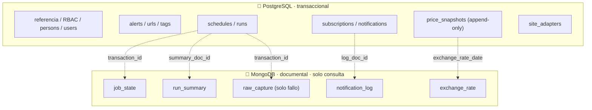
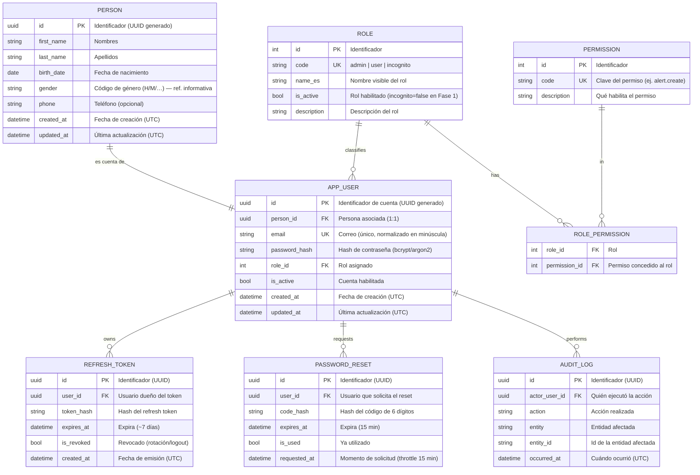
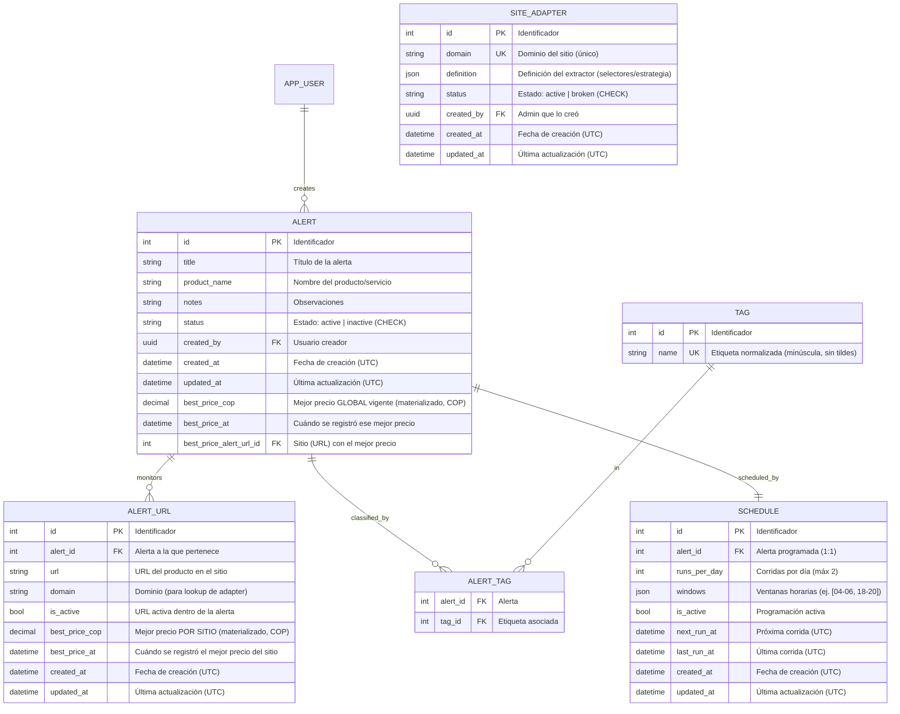
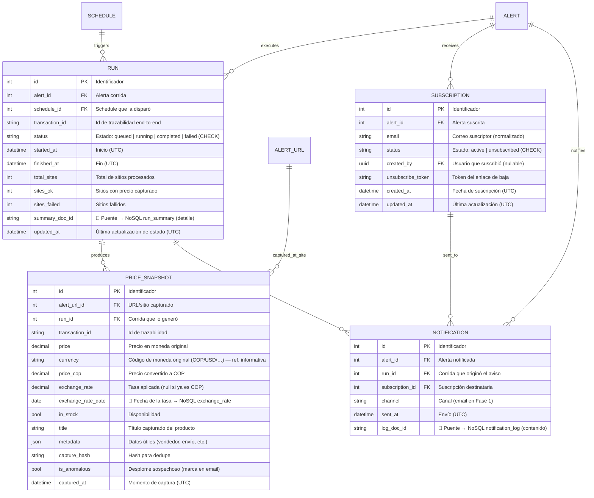

# 03 · Modelo de datos

> Consolidado con el [Alcance 1](08-alcance-1-preguntas.md) y los [requerimientos](deliverables/requerimientos.md). Persistencia **políglota**: PostgreSQL (relacional + JSONB) para lo transaccional, y **MongoDB** (documental) para logs/telemetría de solo consulta.
>
> **Convenciones:** nombres en **inglés**, `snake_case`; PK `id`; FK `<entidad>_id`; booleanos `is_*`; fechas `*_at` en **UTC**. Comentarios de cada campo **en español**. Cada colección NoSQL se alcanza desde el modelo relacional mediante un **puente** (`*_doc_id` / `transaction_id`).

## Principios

- **🧼 Datos limpios (DoD crítico):** **todo dato se persiste saneado y normalizado** (sin espacios sobrantes, sin caracteres de control/invisibles, Unicode NFC, precios numéricos, fechas en UTC, emails/etiquetas normalizados). Ningún registro entra "sucio" → el análisis es congruente (RNF-6).
- **Append-only para precios:** cada corrida inserta snapshots nuevos; nunca se sobrescribe.
- **Políglota por rol:** PostgreSQL para relaciones/consistencia; **MongoDB** para documentos de alto volumen y solo lectura.
- **Puente relacional → NoSQL:** las tablas guardan la referencia al documento para navegar al detalle.
- **Correlación por `transaction_id`:** todo lo de una corrida comparte el mismo id de trazabilidad.
- **Valores controlados sin catálogo:** `gender`/`currency` como código (tablas informativas) y estados con **CHECK/enum** → sin FK innecesarias.
- **Timestamps:** toda **entidad mutable** lleva `created_at` **+** `updated_at` (UTC); las tablas **append-only/log** (`price_snapshot`, `audit_log`, `notification`, `refresh_token`, `password_reset`) solo llevan su timestamp de evento.

## Reparto de la persistencia

---

## A) Valores de referencia y estados

> **`gender` y `currency` NO son FK.** Son **tablas informativas** que documentan los códigos válidos; en las tablas de negocio se guarda directamente el **código mínimo representativo**.

### Tablas informativas (referencia, sin FK)

| Tabla informativa | Código (lo que se guarda) | Se usa en |
|-------------------|---------------------------|-----------|
| `gender` | `H`, `M`, … | `person.gender` |
| `currency` | `COP`, `USD`, `EUR`, … (ISO 4217) | `price_snapshot.currency` |

### Estados por código (CHECK/enum, sin FK)

> Los estados se guardan como **código** en la propia tabla, validados por **CHECK/enum** — **sin** tabla catálogo ni FK.

| Campo | Códigos válidos |
|-------|-----------------|
| `alert.status` | `active`, `inactive` |
| `subscription.status` | `active`, `unsubscribed` |
| `run.status` | `queued`, `running`, `completed`, `failed` |
| `site_adapter.status` | `active`, `broken` |

## B) Seguridad y cuentas (RBAC + Auth)

> **Persona vs Usuario:** `person` guarda los **datos de la persona** (identidad/PII); `user` guarda la **cuenta** (credenciales, rol). Relación **1:1**. PK **UUID** generado en ambas.

## C) Alertas, etiquetas, schedules y adapters

## D) Corridas, snapshots, suscripciones y notificaciones (con puentes a NoSQL)

### Puentes relacional → NoSQL

| Tabla relacional | Campo puente | Colección NoSQL |
|------------------|--------------|-----------------|
| `run` | `summary_doc_id` / `transaction_id` | `run_summary`, `job_state`, `raw_capture` |
| `notification` | `log_doc_id` | `notification_log` |
| `price_snapshot` | `exchange_rate_date` | `exchange_rate` |

> Regla: para ver el **detalle** de algo cuyo grano vive en NoSQL, se parte de la fila relacional y se sigue su campo puente. Así el relacional queda liviano y el detalle voluminoso queda en documentos.

---

## E) MongoDB · colecciones (solo consulta)

| Colección | Contenido (documento) | Clave/puente | Requerimiento |
|-----------|----------------------|--------------|---------------|
| **run_summary** | Resumen de corrida: sitios ok/fallidos, duración, nº snapshots | `_id` = `run.summary_doc_id`; `transaction_id` | SCR-14 |
| **job_state** | Máquina de estados granular por sitio: `[{state, at}]`, estado actual | `transaction_id` + `alert_url_id` | SCR-16 · SCH-9 |
| **raw_capture** | HTML/JSON crudo **solo en fallo total**; insumo del constructor de adapters | `transaction_id` + `domain` | SCR-15 · SCR-12 |
| **notification_log** | Contenido del email enviado por suscriptor | `_id` = `notification.log_doc_id` | NOT-4 · I27 |
| **exchange_rate** | Histórico de tasa: `pair` (USD/COP), `rate`, `captured_at`, `source` | `date` ↔ `price_snapshot.exchange_rate_date` | PRO-3 |

## Decisiones de diseño (registradas)

| Tema | Decisión |
|------|----------|
| **Tabla `run`** | ✅ Sí, en PostgreSQL, con puente `summary_doc_id` al detalle NoSQL |
| **Etiquetas** | Tabla normalizada `tag` + `alert_tag` |
| **Referencia sin FK** | `gender` (H/M/…) y `currency` (COP/USD/…) como **tablas informativas**; se guarda el **código** en la tabla de negocio |
| **Estados** | **Código directo con CHECK/enum** (sin FK): `alert.status`, `subscription.status`, `run.status`, `site_adapter.status` |
| **Persona vs Usuario** | `person` (PII) separado de `user` (cuenta), relación 1:1 |
| **PK de person/user** | **UUID** generado |
| **Mejor precio** | Materializado **global** en `alert` **y por sitio** en `alert_url` |
| **Nombres/idioma** | Tablas y campos en **inglés**; comentarios en **español** |
| **Puentes** | Cada colección NoSQL se alcanza desde el relacional por `*_doc_id` / `transaction_id` |
| **Motor NoSQL** | ✅ **MongoDB** (confirmado; se refleja en el [doc 04 · stack](04-stack-tecnologico.md)) |
| **Timestamps** | Entidades mutables con `created_at` + `updated_at`; tablas append-only/log solo su timestamp de evento |

## Índices sugeridos

- `price_snapshot (alert_url_id, captured_at)` — series temporales y comparador por sitio.
- `price_snapshot (run_id)` y `price_snapshot (transaction_id)` — correlación con la corrida.
- `run (alert_id, started_at)` — historial de corridas por alerta.
- `alert_url (domain)` — lookup de adapter.
- `subscription (alert_id, email)` UK — evitar duplicados.
- `site_adapter (domain)` UK.
- Tablas informativas (`gender`, `currency`): `code` UK. Estados: **CHECK** en cada columna `status` (sin índice de catálogo).

## Pendientes / a validar

- Definir umbral exacto de `is_anomalous` con el motor de decisión.
- Política de retención/purga del histórico y de las colecciones NoSQL (fase futura).
