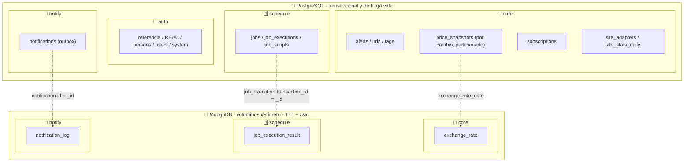
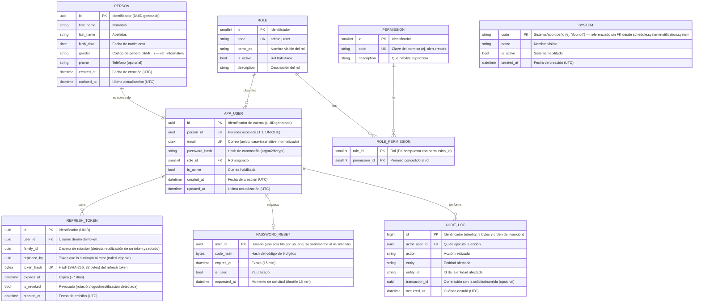
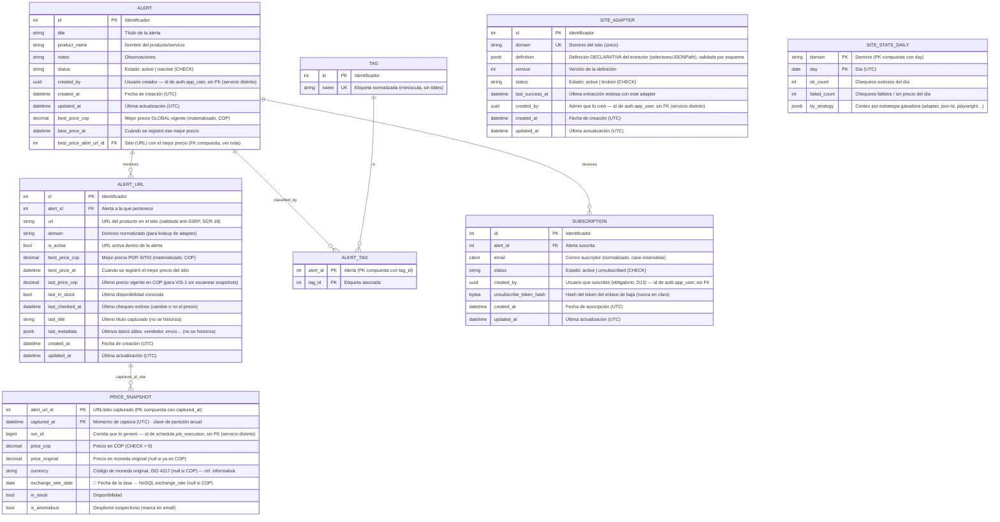
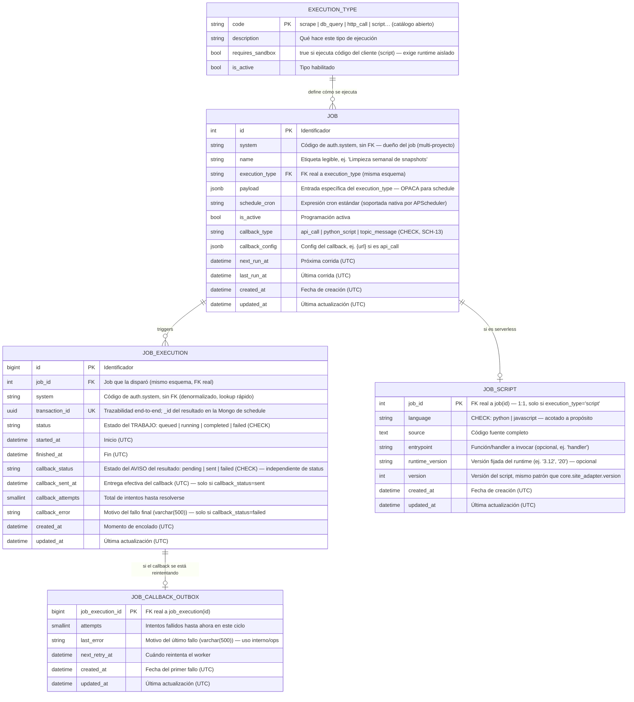
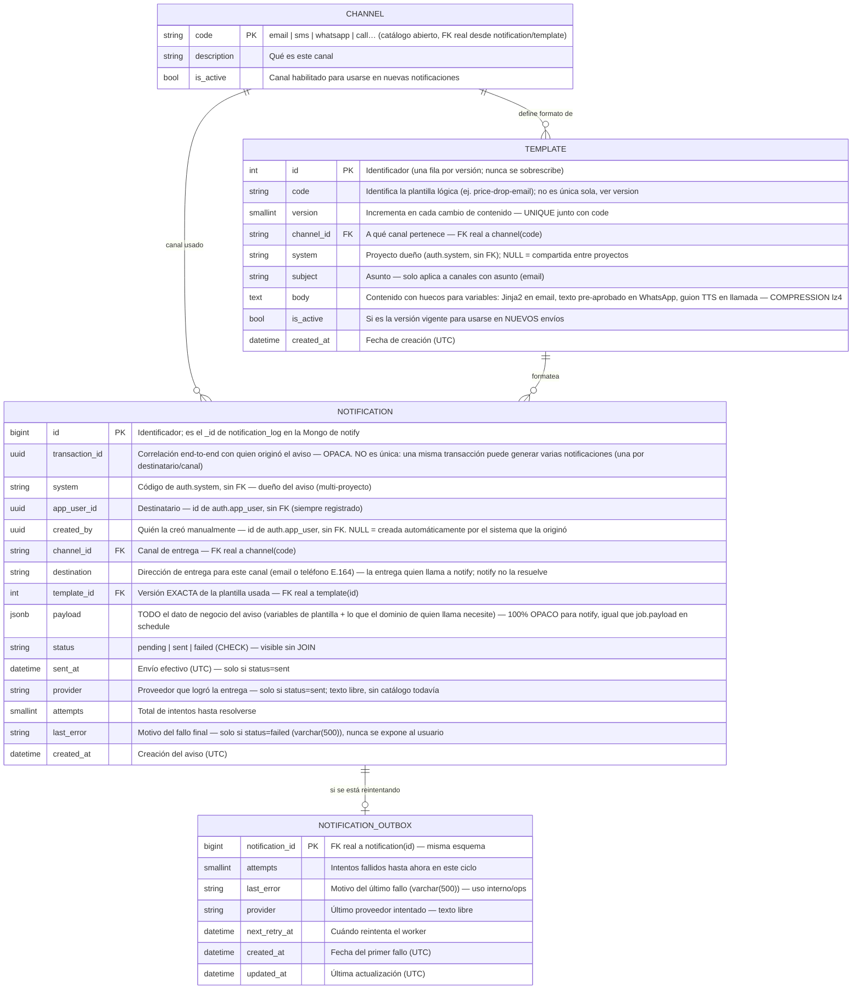

# 03 · Modelo de datos

> Consolidado con el [Alcance 1](08-alcance-1-preguntas.md) y los [requerimientos](deliverables/requerimientos.md). Persistencia **políglota**: PostgreSQL (relacional + JSONB) para lo transaccional y de larga vida, y **MongoDB** (documental) para lo voluminoso, efímero o de solo consulta.
>
> **Convenciones:** nombres en **inglés**, `snake_case`; PK `id` (salvo clave natural); FK `<entidad>_id`; booleanos `is_*`; fechas `*_at` en **UTC** (`timestamptz`). Comentarios de cada campo **en español**. Cada colección NoSQL se alcanza desde el modelo relacional mediante un **puente por id compartido**, documentado dentro de la sección de su propio esquema. Este documento (diagramas ER y prosa) sigue en minúscula; los **scripts ejecutables** de [docs/deliverables/db](deliverables/db/README.md) escriben el mismo `snake_case` en **mayúsculas** (`SCREAMING_SNAKE_CASE`) como estilo visual — PostgreSQL pliega igual a minúsculas los identificadores sin comillas, así que el objeto real en el catálogo no cambia.
>
> **Una sección por esquema ([ADR-0001](adr/0001-estructura-repos-servicios.md)):** cada sección lettered de este documento es **un solo esquema/servicio**, con sus tablas PostgreSQL, su base MongoDB (si tiene) y los puentes entre ambas. En PostgreSQL es **una sola instancia con 4 esquemas** (no bases separadas): **`auth`** (sección A), **`core`** (sección B), **`schedule`** (sección C) y **`notify`** (sección D). En MongoDB hay una base por servicio: `core`, `schedule` y `notify` (`auth` no tiene). Ningún esquema/base tiene FK ni permisos sobre el de otro — ver [docs/deliverables/db](deliverables/db/README.md). Un campo que antes era FK hacia otro servicio (p. ej. `created_by` apuntando a un usuario) pasa a ser un **`uuid` de solo referencia, sin FK real** — la integridad no la garantiza la base de datos sino el servicio que la escribe.

## Tabla de contenido

- [Principios](#principios)
- [Reparto de la persistencia](#reparto-de-la-persistencia)
- [A) auth (Identidad y RBAC)](#a-auth-identidad-y-rbac)
- [B) core (Alertas, precios y suscripciones)](#b-core-alertas-precios-y-suscripciones)
  - [Cómo funciona el snapshot "por cambio"](#cómo-funciona-el-snapshot-por-cambio)
- [C) schedule (Motor de jobs genérico)](#c-schedule-motor-de-jobs-genérico)
- [D) notify (Notificaciones)](#d-notify-notificaciones)
- [Retención (resumen)](#retención-resumen)
- [Estimación de almacenamiento (supuestos, a validar)](#estimación-de-almacenamiento-supuestos-a-validar)
- [Decisiones de diseño (registradas)](#decisiones-de-diseño-registradas)
- [Restricciones de integridad (CHECK / UNIQUE)](#restricciones-de-integridad-check--unique)
- [Índices](#índices)
- [Pendientes / a validar](#pendientes--a-validar)

## Principios

- **🧼 Datos limpios (DoD crítico):** **todo dato se persiste saneado y normalizado** (sin espacios sobrantes, sin caracteres de control/invisibles, Unicode NFC, precios numéricos, fechas en UTC, emails/etiquetas normalizados). Ningún registro entra "sucio" → el análisis es congruente (RNF-6).
- **💾 Almacenamiento mínimo (criterio de diseño):** el espacio es una restricción del proyecto. Reglas:
  1. **Guardar solo lo que aporta valor:** no duplicar lo derivable ni repetir lo que no cambia (los snapshots se guardan **por cambio**, no por corrida).
  2. **Cada dato en el almacén que menos cuesta según su ciclo de vida:** larga vida y valor de negocio → PostgreSQL compacto; **voluminoso, efímero o de solo consulta → MongoDB con TTL y compresión**.
  3. **Tipos angostos y fijos** (`int`, `uuid`, `timestamptz`, `bool`, `date` en vez de texto), **sin id sustituto donde hay clave natural**, columnas de 8 bytes primero (menos *padding*).
  4. **Índices justos:** cada índice ocupa espacio y frena escrituras; solo se crea con una consulta real que lo justifique (`EXPLAIN`).
  5. **Toda tabla/colección de log declara su retención** (TTL o partición). Nada crece sin tope.
  6. **Medir antes de micro-optimizar:** las cifras de este doc son **estimaciones con supuestos declarados**; se validan con datos reales.
- **Append-only por cambio para precios:** se inserta un snapshot **solo cuando cambia el precio o el stock** respecto al último; nunca se sobrescribe. Cada chequeo (cambie o no) actualiza `alert_url.last_checked_at`.
- **Políglota por rol:** PostgreSQL para relaciones/consistencia; **MongoDB** para documentos de alto volumen, con TTL y solo lectura.
- **Puente relacional → NoSQL por id compartido:** el `_id` del documento **es** el id de la fila relacional (sin columnas puente extra); para ver el **detalle** de algo cuyo grano vive en NoSQL, se parte de la fila relacional y se usa su id — el relacional queda liviano y el detalle voluminoso queda en documentos con TTL. Cada puente vive documentado dentro de la sección de su propio esquema (ya no cruza de un servicio a otro: el último que cruzaba, `notification → notification_log`, quedó interno a `notify` el 2026-09-30).
- **Correlación por `transaction_id`** (`uuid`): todo lo de una corrida comparte el mismo id de trazabilidad.
- **Valores controlados sin catálogo:** `gender`/`currency` como código (tablas informativas) y estados con **CHECK/enum** → sin FK innecesarias.
- **Timestamps:** toda **entidad mutable** lleva `created_at` **+** `updated_at` (UTC); las tablas **append-only/log** (`price_snapshot`, `audit_log`, `refresh_token`) solo llevan su timestamp de evento.

## Reparto de la persistencia

> Agrupado **por servicio dentro de cada motor** (no solo por rol relacional/documental), para que se vea de un vistazo la regla de ["aislamiento de datos por servicio"](02-arquitectura.md#principios-de-diseño): cada bloque es un esquema (PostgreSQL) o una base (MongoDB) con su propio rol, **sin FK hacia el bloque de otro servicio**. `schedule` es ahora un motor de jobs genérico (ver [C) schedule](#c-schedule-motor-de-jobs-genérico), rediseño 2026-10-01): ya no tiene ningún concepto de `core` — `job_execution_result` reemplaza a las cuatro colecciones específicas de scraping que tenía antes.
>
> **`notify` también ganó tablas reales en PostgreSQL** (`A7`) el mismo 2026-09-30: `notification` (el outbox) se movió desde `core`, porque la notificación — no la alerta ni la suscripción — es el dato que `notify` posee de punta a punta. Con ese cambio, **ya no queda ninguna flecha que cruce de un servicio a otro** en este diagrama: `A7 → B4` es interno a `notify`, igual que todo lo de `schedule` lo es a `schedule`. Detalle y consecuencias del movimiento en [D) notify](#d-notify-notificaciones). La vista **física** (qué corre en qué host/servicio) está en el [doc 02 · vista de despliegue](02-arquitectura.md#vista-de-despliegue-servicios-desacoplados--cloudflare--gcp--oracle).

---

## A) auth (Identidad y RBAC)

> **Servicio dueño: `auth`.** Ninguna entidad de esta sección se comparte por FK con `core`/`schedule`/`notify`; se referencia solo por `uuid` o por el código de `system`. `auth` no tiene base MongoDB.
>
> **Persona vs Usuario:** `person` guarda los **datos de la persona** (identidad/PII); `user` guarda la **cuenta** (credenciales, rol). Relación **1:1**. PK **UUID** generado en ambas.
>
> **`gender` es tabla informativa, sin FK:** documenta los códigos válidos (`H`, `M`, …); `person.gender` guarda directamente el código.

> **Notas de seguridad y espacio:** `password_reset` guarda **una fila por usuario** (el throttle solo necesita la última solicitud). Un job diario **purga** `refresh_token` expirados/revocados. Si se presenta un `refresh_token` ya rotado (`replaced_by` no nulo) se **revoca toda la familia** (`family_id`).

---

## B) core (Alertas, precios y suscripciones)

> **Servicio dueño: `core`.** `APP_USER` **no** aparece en este diagrama: vive en la base de `auth`, un servicio distinto. `ALERT.created_by`, `SITE_ADAPTER.created_by` y `SUBSCRIPTION.created_by` guardan ese `uuid` sin FK. **`JOB`/`JOB_EXECUTION` no viven aquí:** son de `schedule` — ver [sección C](#c-schedule-motor-de-jobs-genérico). **`NOTIFICATION`/`NOTIFICATION_SENT`/`NOTIFICATION_OUTBOX` tampoco:** son de `notify` desde el 2026-09-30 — ver [sección D](#d-notify-notificaciones).
>
> **`currency` es tabla informativa, sin FK:** ISO 4217 (`COP`, `USD`, `EUR`, …); `price_snapshot.currency` guarda directamente el código (solo si ≠ COP).

> **Integridad de "mejor precio":** `alert.best_price_alert_url_id` usa **FK compuesta** `(id de la alerta, best_price_alert_url_id) → alert_url(alert_id, id)` para garantizar que la URL pertenece a esa misma alerta y evitar la referencia circular ingenua. El motor de decisión actualiza `best_price_*` **en la misma transacción** que inserta el snapshot, con la fila de `alert_url` bloqueada (`FOR UPDATE`).
>
> **`site_stats_daily`** es un agregado diminuto (1 fila por dominio y día, con *upsert*) que permite la tasa de éxito por sitio a largo plazo (SCR-17) aunque el detalle por sitio de `run_summary` ya haya expirado por TTL.
>
> **`site_adapter.definition`** es **declarativa** (selectores/JSONPath): nunca código ejecutable ni `eval`; las regex llevan timeout (anti-ReDoS).

### Cómo funciona el snapshot "por cambio"

- **PK natural `(alert_url_id, captured_at)`**: sin id sustituto y **sin índice adicional** (la PK sirve para series temporales y comparador). Incluye la clave de partición, requisito de PostgreSQL para PK/UNIQUE en tablas particionadas.
- **Idempotencia por diseño (SCR-7):** en una transacción, el worker bloquea la fila de `alert_url`, compara el precio/stock capturado con `last_price_cop`/`last_in_stock` e inserta **solo si difiere**. Un reintento de la misma corrida encuentra el mismo valor y no inserta. Reemplaza al antiguo `capture_hash` y a la clave única por corrida.
- **Todo chequeo exitoso** actualiza `alert_url.last_checked_at` (y `last_title`/`last_metadata`), así el gráfico (VIS-2/VIS-3) reconstruye la línea de tiempo como **función escalonada**: el precio vale hasta el siguiente cambio o hasta `last_checked_at`.
- **Chequeos fallidos / sin precio:** no generan snapshot; quedan en `run_summary` (detalle, con TTL, en `schedule`) y en `site_stats_daily` (agregado permanente).
- **Sin `title`, `metadata`, `transaction_id`, `capture_hash` ni `exchange_rate` en el snapshot:** título y metadata viven solo en su último valor (`alert_url`); el `transaction_id` se obtiene vía `run_id`; la tasa se deriva (`price_cop / price_original`) o se consulta por `exchange_rate_date`.
- **Particionado anual por `captured_at`:** la retención, si se necesita, es un `DROP` de partición (libera espacio al instante, sin *vacuum*). Un job crea la partición del año siguiente.

### MongoDB de `core`

| Colección | Contenido (documento) | Puente | Retención | Requerimiento |
|-----------|------------------------|--------|-----------|---------------|
| **exchange_rate** | Histórico de tasa: `date` (día UTC, sin hora), `pair` (USD/COP), `rate`, `captured_at` (momento exacto de la consulta), `source`; ~1 documento/día | `date` + `pair` ↔ `price_snapshot.exchange_rate_date` | Sin TTL (volumen ínfimo) | PRO-3 |

---

## C) schedule (Motor de jobs genérico)

> **Servicio dueño: `schedule`** — repo propio ([ADR-0001](adr/0001-estructura-repos-servicios.md)). **Rediseño genérico (2026-10-01, resuelve D9):** `SCHEDULE`/`RUN` (atados a `alert_id`) desaparecen. `JOB` ya **no conoce ningún concepto de `core`** — es un motor de tareas programadas de propósito general, reutilizable por cualquier `system`. Lo único que sabe de su contenido es lo que el propio `execution_type` interpreta; `payload` es **opaco** para `schedule`.
>
> **Dos ideas, dos tablas** (mismo principio que ya aplicamos en [D) notify](#d-notify-notificaciones)): `JOB` es la tarea **configurada** (cómo se ejecuta, con qué entrada, cuándo, a quién avisar); `JOB_EXECUTION` es **una corrida**, con su propio `status` (trabajo) y su `callback_status` (si se logró avisar el resultado) — dos estados independientes en la misma fila (2026-10-0X: `job_callback_sent` se fusionó aquí, nunca mutaba). `JOB_CALLBACK_OUTBOX` sigue aparte, pero solo como cola de reintento **activo** — ver el detalle debajo del diagrama.
>
> **`execution_type` es catálogo abierto, con FK real** (a diferencia de `gender`/`currency`): agregar un tipo nuevo es un `INSERT`, no una migración. `requires_sandbox` marca los tipos que ejecutan código del cliente (hoy solo `script`) — el sandbox de ejecución en sí **no está diseñado todavía**.
>
> **`JOB_SCRIPT` es la tarea serverless** (2026-10-01): 1:1 con `JOB`, solo existe si `execution_type = 'script'`. `language` va acotado por **CHECK** a propósito — ampliar el lenguaje soportado es una decisión de seguridad explícita (migración), no un `INSERT` libre como `execution_type`.
>
> **Pendientes:** ver [doc 09](09-pendientes.md) — D9 (reconciliación con el doc 02, resuelta aquí) y el sandbox de ejecución serverless (sin ID asignado todavía, se discute aparte).

> `job_execution` absorbe lo que antes era `job_callback_sent` (2026-10-0X): esa tabla nunca mutaba (una fila, escrita una sola vez al entregarse), así que separarla no ahorraba nada — y escondía si el callback se entregó detrás de un `JOIN`. `callback_status` es un estado **independiente** de `status`: un job puede terminar `completed` y su callback seguir fallando, o viceversa. `job_callback_outbox` sigue aparte porque **sí** se reescribe en cada reintento — mantenerla angosta evita reescribir la fila ancha de `job_execution` por cada intento fallido. Al resolverse (éxito o agotado), el resultado se escribe en `job_execution` y la fila de `job_callback_outbox` se borra — sin `is_exhausted`: si existe, se sigue reintentando. Mismo giro aplicado a la vez en [`notify`](#d-notify-notificaciones) (`notification`/`notification_outbox`).

### MongoDB de `schedule`

> **Rediseño genérico (2026-10-01):** `job_state`, `run_summary` y `scrape_result` (con granularidad "por sitio", `alert_url_id`) y `raw_capture` (HTML crudo para el constructor de adapters) **dejaron de existir aquí** — eran detalle específico de scraping, y `schedule` ya no conoce ese dominio. En su lugar, una sola colección genérica, de forma libre según el `execution_type` del job (opaca para `schedule`, igual que `payload` en PostgreSQL).
>
> **Pendiente, no resuelto aquí:** el detalle específico de scraping que antes vivía en esas cuatro colecciones (progreso por sitio, HTML crudo para adapters, precio extraído) necesita un nuevo dueño — candidato natural: la Mongo de `core`, que es quien de verdad conoce "sitios" y "adapters". No se decide en este cambio; ver [doc 09](09-pendientes.md).

| Colección | Contenido (documento) | Puente | Retención | Requerimiento |
|-----------|------------------------|--------|-----------|---------------|
| **job_execution_result** | Resultado/detalle de **una corrida**, forma libre según `execution_type` (filas afectadas de un `db_query`, stdout de un `script`, resultado crudo de un `scrape`…) | `_id` = `job_execution.transaction_id` (UUID binario) | **TTL 90 días** | SCR-14 · SCR-20 |

---

## D) notify (Notificaciones)

> **Servicio dueño: `notify`** (movido desde `core` el 2026-09-30: la notificación es el dato que `notify` posee de punta a punta, no `core`).
>
> **Rediseño genérico y multicanal (2026-10-0X):** `notify` deja de conocer **cualquier** concepto de `core` — sin `alert_id`, sin `run_id`, sin `trigger_alert_url_id`/`trigger_price_cop`. Mismo giro que ya tomó `schedule` con `JOB`/`JOB_EXECUTION` ([sección C](#c-schedule-motor-de-jobs-genérico), D9): lo único que sabe de "para qué es" un aviso es `transaction_id` (correlación **opaca** con quien lo originó) y `payload` (dato de negocio, **opaco**, mismo patrón que `job.payload`). Esto también deja el modelo listo para **cualquier canal** (email, SMS, WhatsApp, llamada), no solo el de Fase 1:
> - **`channel`** — catálogo **abierto**, con FK real (igual que `execution_type` en `schedule`): agregar un canal nuevo es un `INSERT`, no una migración. Fase 1 solo siembra `'email'`.
> - **`template`** — contenido **versionado** por canal (nunca se sobrescribe; mismo patrón que `site_adapter.version`/`job_script.version`): un email necesita asunto + cuerpo con huecos para variables; un SMS o un WhatsApp (que además exige plantillas *pre-aprobadas* por el proveedor), un texto corto; una llamada, un guion para texto-a-voz. `notification.template_id` fija la **versión exacta** usada, así el historial no cambia si la plantilla se edita después.
> - **`notification.destination`** — la dirección de entrega para ese canal (email o teléfono E.164). La resuelve y entrega **quien llama** a `notify` (`core`/`auth`); `notify` nunca la busca por su cuenta, consistente con que no tiene FK hacia `auth`.
> - **`notification.payload`** — datos de la plantilla + cualquier dato de negocio que el llamador necesite conservar (en I Found It: `alert_id`, `run_id`, precio disparador…) — **100 % opaco** para `notify`.
>
> **`notification` lleva su propio `status` y se queda sin `notification_sent` (2026-10-0X):** antes había una tabla aparte solo para el log de éxito (`notification_sent`) — pero esa tabla **nunca mutaba** (una fila, escrita una sola vez, nunca actualizada). No había ningún motivo de espacio o rendimiento para separarla, y tenerla aparte **escondía el estado**: para saber si algo se entregó había que hacer `JOIN`, no un `SELECT` directo. Se fusiona de vuelta en `notification`, que ahora lleva `status` (`pending`\|`sent`\|`failed`), y además `sent_at`/`provider`/`attempts`/`last_error` — todos **nulos** salvo los que apliquen según el `status`.
>
> **Por qué `notification_outbox` sí sigue aparte:** a diferencia del log de éxito, el outbox **se reescribe en cada reintento** (`attempts`, `last_error`, `next_retry_at` cambian cada vez que falla). Si esas columnas vivieran en `notification`, cada reintento reescribiría la fila **completa**, incluido `payload` (potencialmente pesado) — Postgres crea una versión nueva de toda la fila en cada `UPDATE` (MVCC), así que repetir eso por cada intento fallido desperdicia escritura y deja más basura para `VACUUM`. Mantener el outbox angosto y aparte significa que lo que se reescribe muchas veces es una fila pequeña, y la fila ancha (`notification`, con su `payload`) se escribe **una sola vez** al crearse y, como mucho, **una vez más** al resolverse (éxito o fallo definitivo). Es más eficiente en espacio y en I/O que fusionarlo también, no menos.
>
> **Cómo se lee el estado, sin inventar un tercer lugar:** si `notification.status = 'pending'` y **no** hay fila en `notification_outbox`, todavía no se intentó entregar. Si hay fila en `notification_outbox`, se está reintentando ahora mismo (ahí vive el detalle vivo: cuántos intentos van, cuándo es el próximo). Cuando se resuelve —por éxito o por agotar los intentos— el worker escribe el resultado final en `notification` (`status`/`sent_at`/`provider` si fue éxito; `status`/`last_error` si fue fallo definitivo, más `attempts` en ambos casos) y **borra** la fila de `notification_outbox`. Por eso el outbox ya no necesita un `is_exhausted`: si la fila existe, se sigue reintentando; si no existe, el resultado está en `notification.status`.
>
> **Por qué `payload` vive en `notification` desde que se crea, no solo si el envío tiene éxito:** si solo quedara al resolverse, una notificación que falla en el **primer** intento no tendría con qué reintentarse desde `notification_outbox`. Guardarlo de forma atómica con la creación corrige eso: el primer intento y cada reintento leen exactamente lo mismo.
>
> **Amarrada a `app_user_id` + `system`, no a `subscription_id`** (2026-09-30): se retiró el rol incógnito y toda funcionalidad exige usuario registrado. `app_user_id` (`auth.app_user`, sin FK) es obligatorio. `system` identifica qué proyecto es dueño del aviso, igual que en `schedule`, y hace a `notify` reutilizable sin conocer el dominio de negocio de quien lo llama.
>
> **`created_by`** (nuevo): quién creó la notificación **a mano** (`auth.app_user`, sin FK) — **NULL** es el caso normal (la creó el sistema automáticamente, p. ej. el motor de decisión de `core`); un valor indica una acción humana (reenvío, prueba de un admin).
>
> **Consecuencia de que `notification` viva en `notify`, no en `core`:** el motor de decisión de `core` ya **no** puede insertar el aviso en la misma transacción donde actualiza `best_price_*`. `core` le pasa a `notify` los datos de la decisión (ya genéricos: `transaction_id`, `app_user_id`, `channel`, `destination`, `template`, `payload`) y es `notify` quien crea su propia fila `notification` — falta definir el contrato exacto de esa llamada y cómo se confirma que el aviso quedó encolado, ver [doc 09](09-pendientes.md), D6 y D12.
>
> **D13 resuelto (2026-09-30):** `core.subscription.created_by` pasó a ser **obligatorio** — toda suscripción exige cuenta. `app_user_id` en `notification` es ese mismo valor. Queda un cabo suelto: `subscription.email` puede seguir siendo distinto al correo de la cuenta (SUB-1), pero `notify` ya no recibe ningún email directamente — solo lo que el llamador ponga en `destination` — así que si se quiere soportar "avisar a un correo distinto al de la cuenta", `core` simplemente pasaría ese otro correo como `destination` al llamar a `notify`; sigue sin decidirse si esa función se mantiene.
>
> **Cuatro tablas, cuatro responsabilidades (2026-10-0X), todas en el mismo esquema — con FK real entre ellas:**
> - **`channel`** — catálogo de canales soportados.
> - **`template`** — contenido versionado de cada canal.
> - **`notification`** — la notificación, configurada **y** resuelta: qué se debe enviar, con qué, y en qué quedó.
> - **`notification_outbox`** — cola de reintento **activo**: solo lo que se está reintentando ahora mismo.
>
> **`provider`** (nuevo, en `notification`/`notification_outbox`): qué proveedor entregó o intentó el envío — texto libre, **sin catálogo normalizado todavía** (se gana ese catálogo el día que haya 2+ proveedores reales para el mismo canal; mientras tanto sería una tabla sin necesidad real). Las credenciales de cada proveedor **nunca** van en esta base — variables de entorno, igual que el SMTP de hoy. `last_error` queda acotado a `varchar(500)`: no ahorra espacio por sí solo frente a `text` (Postgres los guarda igual), pero evita que un *stack trace* completo quede guardado por accidente.
>
> **Mismo giro, a la vez, en `schedule`:** `job_execution` absorbió a `job_callback_sent` igual que `notification` absorbió a `notification_sent` (gana `callback_status`/`callback_sent_at`/`callback_attempts`/`callback_error`, prefijados para no mezclarse con su propio `status` de ejecución); `job_callback_outbox` se achicó igual que `notification_outbox` (sin `is_exhausted`, borrado al resolverse) — ver [sección C](#c-schedule-motor-de-jobs-genérico).

> `transaction_id`, `app_user_id` y `created_by` (en `NOTIFICATION`) son valores de solo referencia hacia `auth`/quien haya originado el aviso, **sin FK** — mismo patrón que `JOB`/`JOB_EXECUTION` en la [sección C](#c-schedule-motor-de-jobs-genérico). `channel_id`, `template_id` y `notification_outbox.notification_id` sí llevan **FK real**: las cuatro tablas viven en el mismo esquema (`notify`). Si `notification.status` es `pending` y no hay fila en `notification_outbox`, el aviso todavía no se intentó entregar.

### MongoDB de `notify`

| Colección | Contenido (documento) | Puente | Retención | Requerimiento |
|-----------|------------------------|--------|-----------|---------------|
| **notification_log** | **Sin HTML:** archivo de lo efectivamente enviado, sin PII (no se guarda `destination`) | `_id` = `notification.id` (misma base: `notify`, ya no cruza de servicio) | **TTL 180 días** | NOT-4 · I27 |

> **Posible redundancia a revisar (2026-10-0X):** con `payload`/`template_id` ahora en la fila relacional de `NOTIFICATION`, esta colección ya no es la única fuente para "re-renderizar" un aviso — podría quedar solo como archivo de auditoría (o eliminarse). No se decide aquí — ver [doc 09](09-pendientes.md).

---

## Retención (resumen)

> Valores **aprobados**; el mecanismo (TTL/partición/purga) queda definido desde el diseño y se puede ajustar con datos reales.

| Dato | Almacén | Mecanismo | Retención |
|------|---------|-----------|-----------|
| `job_state` | MongoDB | TTL | 30 días |
| `run_summary` | MongoDB | TTL | 90 días |
| `raw_capture` | MongoDB | TTL + tope por dominio | 14 días · 3 por dominio |
| `notification_log` | MongoDB | TTL | 180 días |
| `notification` resuelta (`status` sent/failed) / `notification_outbox` (filas) | PostgreSQL | purga programada | 180 días (alineado con el log) |
| `refresh_token` / `password_reset` | PostgreSQL | purga diaria de expirados | al expirar |
| `audit_log` | PostgreSQL | partición/purga | 12 meses |
| `price_snapshot` | PostgreSQL | partición anual (`DROP`) o *rollup* diario | sin purga inicial (es compacto); decidir con datos reales |
| `site_stats_daily`, `exchange_rate` | PG / MongoDB | — | sin purga (volumen ínfimo) |

## Estimación de almacenamiento (supuestos, a validar)

> **Supuestos:** 10.000 alertas × 3 URLs × 2 chequeos/día = 60.000 chequeos/día ≈ **22 M/año**. Los tamaños por fila son **teóricos**; se validan con `pg_total_relation_size` / `pg_column_size` y `db.stats()` sobre datos reales.

| Concepto | Antes | Ahora |
|----------|-------|-------|
| Fila de `price_snapshot` (heap + índices) | ~450 B (id, `transaction_id` texto, título, JSONB, hash, 3 índices) | **~100 B** (PK natural, sin título/metadata/hash) |
| Filas por año | 22 M (una por chequeo) | **2–7 M** si el precio cambia en el 10–30 % de los chequeos *(supuesto)* |
| `price_snapshot` por año | **~10 GB** | **~0,2–0,7 GB** |
| `job_state` (30 d) | — | ~0,4 GB estable *(sin comprimir; menos con zstd)* |
| `run_summary` (90 d) | — | ~0,4 GB estable *(idem)* |

## Decisiones de diseño (registradas)

> Retención y semántica de "mejor precio" **aprobadas**. **"Mejor precio"** = **mínimo vigente** entre los últimos precios de los sitios activos (mejor precio móvil, PRO-6); el mínimo **histórico** se recalcula desde los snapshots.

| Tema | Decisión |
|------|----------|
| **Secciones por esquema** | Cada sección lettered (A–D) es un solo esquema/servicio, con sus tablas PostgreSQL, su Mongo y sus puentes — reemplaza la organización anterior por tema (A/B/C/C2/D/D2/E) |
| **`schedule` genérico** | ✅ Rediseñado (2026-10-01, resuelve D9): `job`/`job_execution`/`job_script` reemplazan a `schedule`/`run`, sin ningún concepto de `core`; entrada por `system` + `execution_type` (catálogo abierto, FK real) + `payload` (opaco). `job_execution.transaction_id` es también el `_id` de `job_execution_result` |
| **Serverless** | `execution_type='script'` soporta código Python/JavaScript (`job_script`), con `language` acotado por `CHECK` a propósito — ampliarlo exige migración, no es un `INSERT` libre como `execution_type` |
| **Callback de jobs** | `job_execution.callback_status` (pending\|sent\|failed, independiente de su propio `status` de ejecución) + `job_callback_outbox` como cola de reintento **activo** — `job_callback_sent` se fusionó en `job_execution` (2026-10-0X: nunca mutaba, no había motivo de espacio para separarla) |
| **Etiquetas** | Tabla normalizada `tag` + `alert_tag` |
| **Referencia sin FK** | `gender` (H/M/…) y `currency` (COP/USD/…) como **tablas informativas**; se guarda el **código** en la tabla de negocio |
| **Estados** | **Código directo con CHECK/enum** (sin FK); `execution_type` es la excepción deliberada: catálogo con FK real porque está pensado para crecer |
| **Persona vs Usuario** | `person` (PII) separado de `user` (cuenta), relación 1:1 |
| **PK de person/user** | **UUID** generado |
| **Mejor precio** | Materializado **global** en `alert` **y por sitio** en `alert_url`, con FK compuesta y actualizado en la misma transacción que el snapshot |
| **Último precio por sitio** | Materializado en `alert_url` (`last_*`) para VIS-1 sin escanear snapshots |
| **Snapshots** | **Por cambio**, PK natural `(alert_url_id, captured_at)`, partición anual, sin título/metadata/hash; idempotencia por bloqueo de fila + comparación con el último valor |
| **Detalle de scraping** | Sin hogar todavía (2026-10-01): `job_state`/`raw_capture`/`scrape_result` se retiraron de `schedule` al volverse genérico; candidato natural es la Mongo de `core` — pendiente, ver [doc 09](09-pendientes.md) |
| **Notificaciones** | Cuatro tablas en `notify` (movidas desde `core`, 2026-09-30; genéricas, multicanal y con estado propio desde 2026-10-0X): `channel` (catálogo abierto), `template` (versionado), `notification` (configurada **y** resuelta — `status`, `sent_at`, `provider`, `attempts`, `last_error`; `notification_sent` se fusionó aquí, nunca mutaba) y `notification_outbox` (cola de reintento **activo**, sin `is_exhausted`: se borra al resolverse) — **sin ningún concepto de `core`** (sin `alert_id`/`run_id`/`trigger_*`, mismo giro que `schedule` en D9) — solo `transaction_id` (correlación opaca) y `payload` (opaco); amarrada a `app_user_id` (obligatorio) + `system`, no a `subscription_id`; `UNIQUE (transaction_id, app_user_id, channel_id)` |
| **Puentes NoSQL** | Por **id compartido** (`_id` = id relacional); sin columnas `*_doc_id` |
| **Nombres/idioma** | Tablas y campos en **inglés**; comentarios en **español** |
| **Motor NoSQL** | ✅ **MongoDB** (confirmado; ver [doc 04 · stack](04-stack-tecnologico.md)), para lo voluminoso/efímero, con TTL y `zstd` |
| **Timestamps** | Entidades mutables con `created_at` + `updated_at`; tablas append-only/log solo su timestamp de evento |
| **Seguridad de tokens** | `refresh_token` con `family_id`/`replaced_by` (revoca la familia si se reutiliza uno rotado); `unsubscribe_token` y códigos de reset **solo como hash** |
| **Adapters** | `definition` **declarativa** y validada por esquema; nunca código ejecutable |
| **Propiedad de datos** | Una base por servicio (`auth`/`core`/`schedule`/`notify`); **sin FK entre servicios** — un campo como `created_by` es un `uuid` de referencia, no una FK. Ver [ADR-0001](adr/0001-estructura-repos-servicios.md) |

## Restricciones de integridad (CHECK / UNIQUE)

- `price_snapshot.price_cop > 0` · CHECK en cada columna `status` (sin tabla catálogo) y en `job_script.language`/`job.callback_type`.
- Emails con `citext` (único y case-insensitive) · `person_id` UNIQUE en `app_user`.
- `subscription (alert_id, email)` UNIQUE · `notification (transaction_id, app_user_id, channel_id)` UNIQUE · `template (code, version)` UNIQUE · `site_adapter (domain)` UNIQUE · `job_execution (transaction_id)` UNIQUE.
- Importes en `NUMERIC(14,2)`; fechas en `timestamptz` (UTC).

## Índices

> Solo los que una consulta real justifica (`EXPLAIN`). PostgreSQL **no** indexa las FK automáticamente.

- `price_snapshot`: **solo la PK** `(alert_url_id, captured_at)`. Sin índices por `run_id` ni `transaction_id` (no se consulta por ahí; se navega job_execution → MongoDB).
- `job_execution (job_id, started_at)` — historial de corridas por job · `job_execution (status) WHERE status IN ('queued','running')` (parcial) — detectar corridas atascadas · `job_execution (system)`.
- `alert_url (alert_id)` y `alert_url (domain)` — lookup de adapter.
- `job (next_run_at) WHERE is_active` (parcial) — el scheduler toma lo vencido con `FOR UPDATE SKIP LOCKED` (sin doble encolado con varias instancias) · `job (system)`.
- `job_callback_outbox (next_retry_at)` — mismo patrón que `notification_outbox`; sin `WHERE`, la tabla ya solo contiene lo que está activamente en reintento.
- `job_execution (id) WHERE callback_status = 'failed'` (parcial) — panel de salud, D8.
- `notification (app_user_id)` · `notification (system)` · `notification (id) WHERE status = 'failed'` (parcial) — ver notificaciones fallidas sin escanear todo · `template (code) WHERE is_active` (parcial) — lookup de la versión vigente · `notification_outbox (next_retry_at)` — el worker de reintento toma lo vencido con `FOR UPDATE SKIP LOCKED`; sin `WHERE`, mismo motivo que en `job_callback_outbox`.
- `refresh_token (user_id)` · `audit_log (actor_user_id, occurred_at)`.
- Tablas informativas (`gender`, `currency`): `code` UK.

## Pendientes / a validar

> Todos los pendientes de este documento están consolidados en el [doc 09 · Pendientes](09-pendientes.md), bloque B (proveedor de BD, necesidad de Redis, medición con datos reales, backups, umbral de `is_anomalous`), D12 (entrega confiable `core` → `notify` tras mover el outbox), D14 (sandbox de ejecución para jobs serverless) y D15 (nuevo hogar del detalle de scraping tras genericizar `schedule`). D9 y D13 ya están resueltos.
