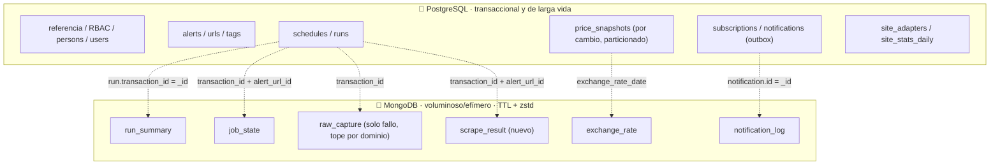
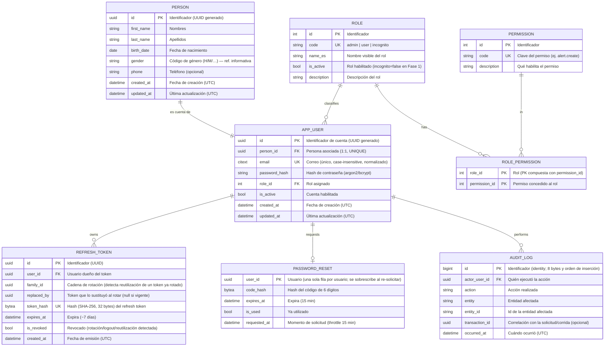
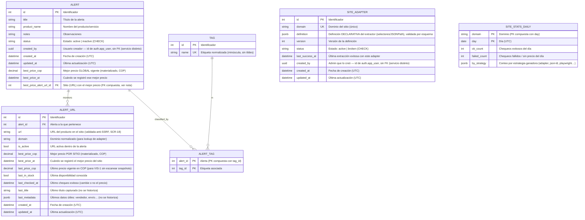
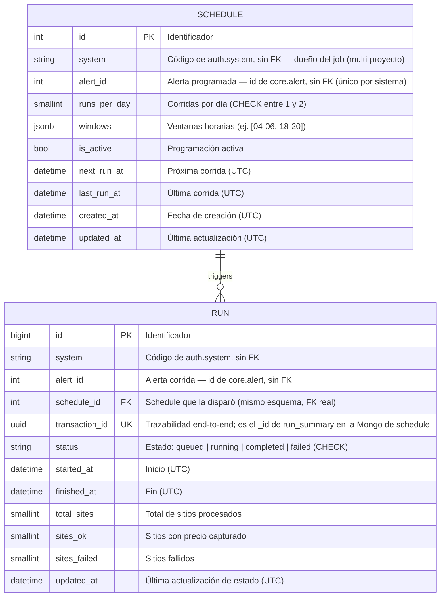
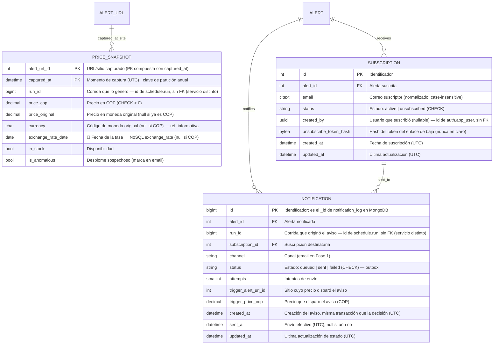

# 03 · Modelo de datos

> Consolidado con el [Alcance 1](08-alcance-1-preguntas.md) y los [requerimientos](deliverables/requerimientos.md). Persistencia **políglota**: PostgreSQL (relacional + JSONB) para lo transaccional y de larga vida, y **MongoDB** (documental) para lo voluminoso, efímero o de solo consulta.
>
> **Convenciones:** nombres en **inglés**, `snake_case`; PK `id` (salvo clave natural); FK `<entidad>_id`; booleanos `is_*`; fechas `*_at` en **UTC** (`timestamptz`). Comentarios de cada campo **en español**. Cada colección NoSQL se alcanza desde el modelo relacional mediante un **puente por id compartido** (ver [Puentes](#puentes-relacional--nosql)).
>
> **Propiedad por servicio ([ADR-0001](adr/0001-estructura-repos-servicios.md)):** cada sección de este documento es de **un solo servicio** — se indica al inicio de cada una. En PostgreSQL es **una sola instancia con 4 esquemas** (no bases separadas): **`auth`** (sección B), **`core`** (secciones C y D), **`schedule`** (sección C2) y `notify` (esquema reservado, sin tablas hoy). En MongoDB hay una base por servicio: `core` (solo `exchange_rate`), `schedule` (detalle de corridas — mayor parte de la sección E) y `notify` (`notification_log`). Ningún esquema/base tiene FK ni permisos sobre el de otro — ver [docs/deliverables/db](deliverables/db/README.md). Un campo que antes era FK hacia otro servicio (p. ej. `created_by` apuntando a un usuario) pasa a ser un **`uuid` de solo referencia, sin FK real** — la integridad no la garantiza la base de datos sino el servicio que la escribe.

## Principios

- **🧼 Datos limpios (DoD crítico):** **todo dato se persiste saneado y normalizado** (sin espacios sobrantes, sin caracteres de control/invisibles, Unicode NFC, precios numéricos, fechas en UTC, emails/etiquetas normalizados). Ningún registro entra "sucio" → el análisis es congruente (RNF-6).
- **💾 Almacenamiento mínimo (criterio de diseño):** el espacio es una restricción del proyecto. Reglas:
  1. **Guardar solo lo que aporta valor:** no duplicar lo derivable ni repetir lo que no cambia (los snapshots se guardan **por cambio**, no por corrida).
  2. **Cada dato en el almacén que menos cuesta según su ciclo de vida:** larga vida y valor de negocio → PostgreSQL compacto; **voluminoso, efímero o de solo consulta → MongoDB con TTL y compresión**.
  3. **Tipos angostos y fijos** (`int`, `uuid`, `timestamptz`, `bool`, `date` en vez de texto), **sin id sustituto donde hay clave natural**, columnas de 8 bytes primero (menos *padding*).
  4. **Índices justos:** cada índice ocupa espacio y frena escrituras; solo se crea con una consulta real que lo justifique (`EXPLAIN`).
  5. **Toda tabla/colección de log declara su retención** (TTL o partición). Nada crece sin tope.
  6. **Medir antes de micro-optimizar:** las cifras de este doc son **estimaciones con supuestos declarados**; se validan con datos reales.
- **Append-only por cambio para precios:** se inserta un snapshot **solo cuando cambia el precio o el stock** respecto al último; nunca se sobrescribe. Cada chequeo (cambie o no) actualiza `alert_url.last_checked_at`.
- **Políglota por rol:** PostgreSQL para relaciones/consistencia; **MongoDB** para documentos de alto volumen, con TTL y solo lectura.
- **Puente relacional → NoSQL por id compartido:** el `_id` del documento **es** el id de la fila relacional (sin columnas puente extra).
- **Correlación por `transaction_id`** (`uuid`): todo lo de una corrida comparte el mismo id de trazabilidad.
- **Valores controlados sin catálogo:** `gender`/`currency` como código (tablas informativas) y estados con **CHECK/enum** → sin FK innecesarias.
- **Timestamps:** toda **entidad mutable** lleva `created_at` **+** `updated_at` (UTC); las tablas **append-only/log** (`price_snapshot`, `audit_log`, `refresh_token`) solo llevan su timestamp de evento.

## Reparto de la persistencia

> Este diagrama agrupa **por rol** (relacional vs. documental), no por servicio: A1/parte de B viven en `auth`; **A3 (`schedules`/`runs`) vive en `schedule`, y también B1/B2/B3/B6** (`job_state`, `run_summary`, `raw_capture`, `scrape_result`) — todo detalle de una corrida es de `schedule`, no de `core` (movido 2026-09-30, ver [C2](#c2-scheduling-servicio-schedule)); A2, A4–A6, B5 viven en `core`; `notification_log` (B4) vive en `notify`. La vista **física** (qué corre en qué host/servicio) está en el [doc 02 · vista de despliegue](02-arquitectura.md#vista-de-despliegue-servicios-desacoplados--cloudflare--gcp--oracle).

---

## A) Valores de referencia y estados

> **`gender` y `currency` NO son FK.** Son **tablas informativas** que documentan los códigos válidos; en las tablas de negocio se guarda directamente el **código mínimo representativo**.

### Tablas informativas (referencia, sin FK)

| Tabla informativa | Servicio | Código (lo que se guarda) | Se usa en |
|-------------------|----------|---------------------------|-----------|
| `gender` | `auth` | `H`, `M`, … | `person.gender` |
| `currency` | `core` | `COP`, `USD`, `EUR`, … (ISO 4217) | `price_snapshot.currency` (solo si ≠ COP) |

### Estados por código (CHECK/enum, sin FK)

> Los estados se guardan como **código** en la propia tabla, validados por **CHECK/enum** — **sin** tabla catálogo ni FK.

| Campo | Servicio | Códigos válidos |
|-------|----------|-----------------|
| `alert.status` | `core` | `active`, `inactive` |
| `subscription.status` | `core` | `active`, `unsubscribed` |
| `run.status` | `schedule` | `queued`, `running`, `completed`, `failed` |
| `site_adapter.status` | `core` | `active`, `broken` |
| `notification.status` | `core` | `queued`, `sent`, `failed` |

## B) Seguridad y cuentas (RBAC + Auth)

> **Servicio dueño: `auth`.** Ninguna entidad de esta sección se comparte por FK con `core` ni `notify`; se referencia solo por `uuid`.
>
> **Persona vs Usuario:** `person` guarda los **datos de la persona** (identidad/PII); `user` guarda la **cuenta** (credenciales, rol). Relación **1:1**. PK **UUID** generado en ambas.

> **Notas de seguridad y espacio:** `password_reset` guarda **una fila por usuario** (el throttle solo necesita la última solicitud). Un job diario **purga** `refresh_token` expirados/revocados. Si se presenta un `refresh_token` ya rotado (`replaced_by` no nulo) se **revoca toda la familia** (`family_id`).

## C) Alertas, etiquetas, schedules y adapters

> **Servicio dueño: `core`.** `APP_USER` **no** aparece en este diagrama: vive en la base de `auth`, un servicio distinto. `ALERT.created_by` y `SITE_ADAPTER.created_by` guardan ese `uuid` sin FK (ver nota de propiedad al inicio del doc). **`SCHEDULE` tampoco vive aquí:** desde que `schedule` es repo/servicio propio ([ADR-0001](adr/0001-estructura-repos-servicios.md)), su tabla vive en el esquema `schedule` — se documenta abajo con su propia nota, no en la sección de `core`.

> **Integridad de "mejor precio":** `alert.best_price_alert_url_id` usa **FK compuesta** `(id de la alerta, best_price_alert_url_id) → alert_url(alert_id, id)` para garantizar que la URL pertenece a esa misma alerta y evitar la referencia circular ingenua. El motor de decisión actualiza `best_price_*` **en la misma transacción** que inserta el snapshot, con la fila de `alert_url` bloqueada (`FOR UPDATE`).
>
> **`site_stats_daily`** es un agregado diminuto (1 fila por dominio y día, con *upsert*) que permite la tasa de éxito por sitio a largo plazo (SCR-17) aunque el detalle por sitio de `run_summary` ya haya expirado por TTL.
>
> **`site_adapter.definition`** es **declarativa** (selectores/JSONPath): nunca código ejecutable ni `eval`; las regex llevan timeout (anti-ReDoS).

## C2) Scheduling (servicio `schedule`)

> **Servicio dueño: `schedule`** — repo propio ([ADR-0001](adr/0001-estructura-repos-servicios.md)), no `core`. `alert_id` es un `int` de solo valor hacia `core.alert`, **sin FK** (mismo tratamiento que `created_by` hacia `auth.app_user`); `schedule_id` en `RUN` sí es una FK real, porque ambas tablas viven en el mismo esquema. Se agrega **`system`** (código de `auth.system`, sin FK) para que `schedule` sea reutilizable por otros proyectos, igual que `auth`/`notify` — la unicidad de `schedule` pasa a ser **por sistema** (`UNIQUE(system, alert_id)`), no global.
>
> **`schedule` también tiene su propia MongoDB** (2026-09-30): `job_state`, `run_summary`, `raw_capture` y `scrape_result` (nueva) son detalle de una corrida (`run`), así que se mudaron aquí desde la Mongo de `core` — ver [sección E](#e-mongodb--colecciones-solo-consulta-con-ttl).
>
> **Pendiente:** ver [doc 09](09-pendientes.md), D9 — este esquema y la API genérica de jobs del [doc 02](02-arquitectura.md#diagrama-de-componentes-c4--nivel-3) aún no están reconciliados.

## D) Snapshots, suscripciones y notificaciones (con puentes a NoSQL)

> **Servicio dueño: `core`**, incluida la tabla `notification` (es el **outbox** que escribe el motor de decisión). Su documento de detalle, `notification_log`, ya **no** vive en la base de `core`: lo escribe **`notify`** en su propia MongoDB — es el único puente de este documento que **cruza de servicio** (ver nota bajo la tabla de puentes). **`RUN` tampoco vive aquí:** es de `schedule` — ver [C2) Scheduling](#c2-scheduling-servicio-schedule). `PRICE_SNAPSHOT.run_id` y `NOTIFICATION.run_id` guardan ese id **sin FK** (servicio distinto).

### Cómo funciona el snapshot "por cambio"

- **PK natural `(alert_url_id, captured_at)`**: sin id sustituto y **sin índice adicional** (la PK sirve para series temporales y comparador). Incluye la clave de partición, requisito de PostgreSQL para PK/UNIQUE en tablas particionadas.
- **Idempotencia por diseño (SCR-7):** en una transacción, el worker bloquea la fila de `alert_url`, compara el precio/stock capturado con `last_price_cop`/`last_in_stock` e inserta **solo si difiere**. Un reintento de la misma corrida encuentra el mismo valor y no inserta. Reemplaza al antiguo `capture_hash` y a la clave única por corrida.
- **Todo chequeo exitoso** actualiza `alert_url.last_checked_at` (y `last_title`/`last_metadata`), así el gráfico (VIS-2/VIS-3) reconstruye la línea de tiempo como **función escalonada**: el precio vale hasta el siguiente cambio o hasta `last_checked_at`.
- **Chequeos fallidos / sin precio:** no generan snapshot; quedan en `run_summary` (detalle, con TTL) y en `site_stats_daily` (agregado permanente).
- **Sin `title`, `metadata`, `transaction_id`, `capture_hash` ni `exchange_rate` en el snapshot:** título y metadata viven solo en su último valor (`alert_url`); el `transaction_id` se obtiene vía `run_id`; la tasa se deriva (`price_cop / price_original`) o se consulta por `exchange_rate_date`.
- **Particionado anual por `captured_at`:** la retención, si se necesita, es un `DROP` de partición (libera espacio al instante, sin *vacuum*). Un job crea la partición del año siguiente.

### Puentes relacional → NoSQL

> El puente es el **id compartido**: el `_id` del documento coincide con un id de la fila relacional, sin columnas ni índices extra.

| Tabla relacional | Id compartido | Colección NoSQL |
|------------------|---------------|-----------------|
| `run` | `run.transaction_id` = `_id` | `run_summary` (misma base: `schedule`) |
| `run` | `transaction_id` + `alert_url_id` = `_id` | `job_state` (misma base: `schedule`) |
| `run` | `transaction_id` + `alert_url_id` = `_id` | `scrape_result` (misma base: `schedule`) |
| `run` / dominio | `transaction_id` + `domain` | `raw_capture` (misma base: `schedule`) |
| `notification` | `notification.id` = `_id` | `notification_log` (⚠️ en `notify`, servicio distinto) |
| `price_snapshot` | `exchange_rate_date` (+ par de monedas) | `exchange_rate` |

> Regla: para ver el **detalle** de algo cuyo grano vive en NoSQL, se parte de la fila relacional y se usa su id. Así el relacional queda liviano y el detalle voluminoso queda en documentos con TTL.
>
> **Puente entre servicios (`notification` → `notification_log`):** desde que `run_summary`/`job_state`/`raw_capture`/`scrape_result` se mudaron a la base de `schedule` (2026-09-30), son **internas a `schedule`** (misma base física, `run` ya vivía ahí). El único puente que sigue cruzando de servicio es este: `core` le pasa `notification.id` a `notify` al pedirle el envío, y `notify` escribe su documento con ese mismo id. Mecanismo exacto de la llamada: ver [doc 09](09-pendientes.md), D6.

---

## E) MongoDB · colecciones (solo consulta, con TTL)

> **Compresión:** colecciones con `zstd` (`blockCompressor`, soportado desde MongoDB 4.2). Los nombres de campo se dejan legibles: la compresión absorbe su repetición.

| Colección | Servicio | Contenido (documento) | `_id` / puente | Retención | Requerimiento |
|-----------|----------|----------------------|----------------|-----------|---------------|
| **run_summary** | `schedule` | Resumen de corrida y **detalle por sitio**: `sites: [{alert_url_id, ok, strategy, attempts, error_code}]`, duración, nº de snapshots | `_id` = `run.transaction_id` (UUID binario) | **TTL 90 días** | SCR-14 |
| **job_state** | `schedule` | Máquina de estados granular por sitio: `states: [[code, offset_ms]…]` (**código numérico** del enum `JobState` y **desfase en ms** desde el inicio, no timestamps completos) + estado actual | `_id` = `{transaction_id, alert_url_id}` | **TTL 30 días** | SCR-16 · SCH-9 |
| **raw_capture** | `schedule` | HTML/JSON crudo **solo en fallo total**, **comprimido** y **depurado** (se descartan `<style>`, SVG inline e imágenes base64; se conserva JSON-LD/scripts de datos); insumo del constructor de adapters | `_id` ObjectId; `transaction_id` + `domain` | **TTL 14 días** y **máx. 3 por dominio** (al llegar la 4.ª se borra la más antigua) | SCR-15 · SCR-12 |
| **scrape_result** *(nuevo)* | `schedule` | Resultado crudo del scraper por sitio (precio original, moneda, stock, título, metadata), **comprimido**; `delivered` marca si ya se llamó el callback de `core` (SCH-14) | `_id` = `{transaction_id, alert_url_id}` | **TTL 30 días** | SCR-20 |
| **notification_log** | `notify` | **Sin HTML:** `{subscription_id, template, template_version, ctx}` con los datos mínimos para **re-renderizar** el email a demanda; no se guarda el correo (PII) | `_id` = `notification.id` | **TTL 180 días** | NOT-4 · I27 |
| **exchange_rate** | `core` | Histórico de tasa: `pair` (USD/COP), `rate`, `captured_at`, `source`; ~1 documento/día | `date` + `pair` ↔ `price_snapshot.exchange_rate_date` | Sin TTL (volumen ínfimo) | PRO-3 |

> **Seguridad:** el HTML de `raw_capture` es **dato no confiable**: el constructor de adapters (SCR-12) debe mostrarlo como texto o en un `iframe` con `sandbox`, nunca inyectarlo como HTML.
>
> **`scrape_result` es el puente entre el scraper y `core`**, pero no por lectura: el scraper la escribe (vía `schedule`, que no tiene acceso a BD el scraper — ver [doc 02](02-arquitectura.md)) y `schedule` reenvía su contenido a `core` llamando al `api_call` configurado en el job (SCH-14). `core` nunca lee esta colección.

## Retención (resumen)

> Valores **aprobados**; el mecanismo (TTL/partición/purga) queda definido desde el diseño y se puede ajustar con datos reales.

| Dato | Almacén | Mecanismo | Retención |
|------|---------|-----------|-----------|
| `job_state` | MongoDB | TTL | 30 días |
| `run_summary` | MongoDB | TTL | 90 días |
| `raw_capture` | MongoDB | TTL + tope por dominio | 14 días · 3 por dominio |
| `notification_log` | MongoDB | TTL | 180 días |
| `notification` (fila) | PostgreSQL | purga programada | 180 días (alineado con el log) |
| `refresh_token` / `password_reset` | PostgreSQL | purga diaria de expirados | al expirar |
| `audit_log` | PostgreSQL | partición/purga | 12 meses |
| `price_snapshot` | PostgreSQL | partición anual (`DROP`) o *rollup* diario | sin purga inicial (es compacto); decidir con datos reales |
| `site_stats_daily`, `exchange_rate` | PG / MongoDB | — | sin purga (volumen ínfimo) |

## Estimación de almacenamiento (supuestos, a validar)

> **Supuestos:** 10.000 alertas × 3 URLs × 2 chequeos/día = 60.000 chequeos/día ≈ **22 M/año**. Los tamaños por fila son **teóricos**; se validan con `pg_total_relation_size` / `pg_column_size` y `db.stats()` sobre datos reales.

| Concepto | Antes | Ahora |
|----------|-------|-------|
| Fila de `price_snapshot` (heap + índices) | ~450 B (id, `transaction_id` texto, título, JSONB, hash, 3 índices) | **~100 B** (PK natural, sin título/metadata/hash) |
| Filas por año | 22 M (una por chequeo) | **2–7 M** si el precio cambia en el 10–30 % de los chequeos *(supuesto)* |
| `price_snapshot` por año | **~10 GB** | **~0,2–0,7 GB** |
| `job_state` (30 d) | — | ~0,4 GB estable *(sin comprimir; menos con zstd)* |
| `run_summary` (90 d) | — | ~0,4 GB estable *(idem)* |

## Decisiones de diseño (registradas)

> Retención y semántica de "mejor precio" **aprobadas**. **"Mejor precio"** = **mínimo vigente** entre los últimos precios de los sitios activos (mejor precio móvil, PRO-6); el mínimo **histórico** se recalcula desde los snapshots.

| Tema | Decisión |
|------|----------|
| **Tabla `run`** | ✅ Sí, en PostgreSQL. `id` `bigint`; `transaction_id` `uuid` que es también el `_id` de `run_summary` |
| **Etiquetas** | Tabla normalizada `tag` + `alert_tag` |
| **Referencia sin FK** | `gender` (H/M/…) y `currency` (COP/USD/…) como **tablas informativas**; se guarda el **código** en la tabla de negocio |
| **Estados** | **Código directo con CHECK/enum** (sin FK) |
| **Persona vs Usuario** | `person` (PII) separado de `user` (cuenta), relación 1:1 |
| **PK de person/user** | **UUID** generado |
| **Mejor precio** | Materializado **global** en `alert` **y por sitio** en `alert_url`, con FK compuesta y actualizado en la misma transacción que el snapshot |
| **Último precio por sitio** | Materializado en `alert_url` (`last_*`) para VIS-1 sin escanear snapshots |
| **Snapshots** | **Por cambio**, PK natural `(alert_url_id, captured_at)`, partición anual, sin título/metadata/hash; idempotencia por bloqueo de fila + comparación con el último valor |
| **Detalle por sitio de la corrida** | En `run_summary` (MongoDB, TTL 90 d) + agregado permanente `site_stats_daily` (PostgreSQL). **No** hay tabla `run_site` |
| **Notificaciones** | `notification` como **outbox** transaccional (`queued → sent/failed`), `UNIQUE (run_id, subscription_id)`; contenido mínimo en `notification_log` (sin HTML) |
| **Puentes NoSQL** | Por **id compartido** (`_id` = id relacional); sin columnas `*_doc_id` |
| **Nombres/idioma** | Tablas y campos en **inglés**; comentarios en **español** |
| **Motor NoSQL** | ✅ **MongoDB** (confirmado; ver [doc 04 · stack](04-stack-tecnologico.md)), para lo voluminoso/efímero, con TTL y `zstd` |
| **Timestamps** | Entidades mutables con `created_at` + `updated_at`; tablas append-only/log solo su timestamp de evento |
| **Seguridad de tokens** | `refresh_token` con `family_id`/`replaced_by` (revoca la familia si se reutiliza uno rotado); `unsubscribe_token` y códigos de reset **solo como hash** |
| **Adapters** | `definition` **declarativa** y validada por esquema; nunca código ejecutable |
| **Propiedad de datos** | Una base por servicio (`auth`/`core`/`notify`); **sin FK entre servicios** — un campo como `created_by` es un `uuid` de referencia, no una FK. Ver [ADR-0001](adr/0001-estructura-repos-servicios.md) |

## Restricciones de integridad (CHECK / UNIQUE)

- `price_snapshot.price_cop > 0` · `schedule.runs_per_day BETWEEN 1 AND 2` (SCH-6) · CHECK en cada columna `status` (sin tabla catálogo).
- Emails con `citext` (único y case-insensitive) · `person_id` UNIQUE en `app_user` · `(system, alert_id)` UNIQUE en `schedule.schedule`.
- `subscription (alert_id, email)` UNIQUE · `notification (run_id, subscription_id)` UNIQUE · `site_adapter (domain)` UNIQUE · `run (transaction_id)` UNIQUE.
- Importes en `NUMERIC(14,2)`; fechas en `timestamptz` (UTC).

## Índices

> Solo los que una consulta real justifica (`EXPLAIN`). PostgreSQL **no** indexa las FK automáticamente.

- `price_snapshot`: **solo la PK** `(alert_url_id, captured_at)`. Sin índices por `run_id` ni `transaction_id` (no se consulta por ahí; se navega run → MongoDB).
- `run (alert_id, started_at)` — historial de corridas por alerta · `run (status) WHERE status IN ('queued','running')` (parcial) — detectar corridas atascadas.
- `alert_url (alert_id)` y `alert_url (domain)` — lookup de adapter.
- `schedule (next_run_at) WHERE is_active` (parcial) — el scheduler toma lo vencido con `FOR UPDATE SKIP LOCKED` (sin doble encolado con varias instancias).
- `notification (status) WHERE status = 'queued'` (parcial) · `notification (subscription_id)`.
- `refresh_token (user_id)` · `audit_log (actor_user_id, occurred_at)`.
- Tablas informativas (`gender`, `currency`): `code` UK.

## Pendientes / a validar

> Todos los pendientes de este documento están consolidados en el [doc 09 · Pendientes](09-pendientes.md), bloque B (proveedor de BD, necesidad de Redis, medición con datos reales, backups, umbral de `is_anomalous`) y D9 (esquema de `schedule` vs. API genérica de jobs).
