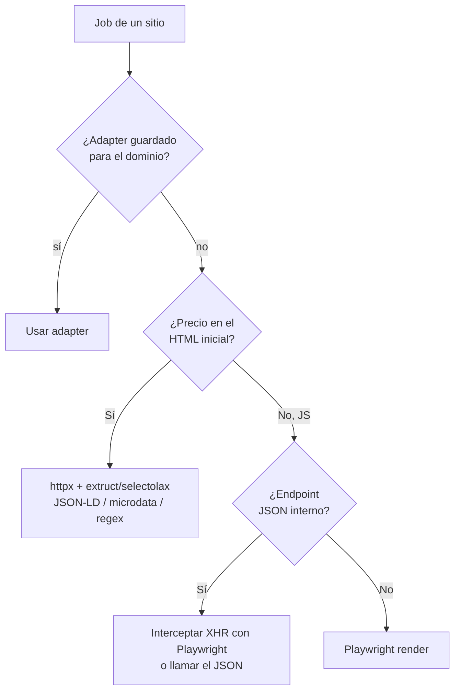
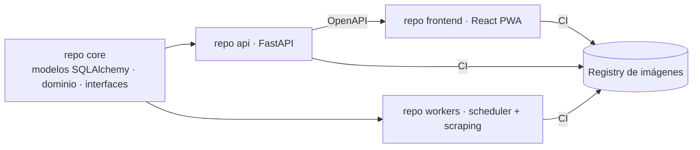

# 04 · Stack tecnológico

> Consolidado con el [Alcance 1](08-alcance-1-preguntas.md), la [arquitectura](02-arquitectura.md), el [modelo de datos](03-modelo-datos.md) y los [requerimientos](deliverables/requerimientos.md). Backend **Python**, frontend **React**, persistencia **políglota** (PostgreSQL + MongoDB), ejecución **background** con Redis, despliegue **polyrepo** portable a la nube. Todo detrás de interfaces reemplazables.

## Stack por capa

### Backend (API + workers)

| Capa | Tecnología | Por qué |
|------|-----------|---------|
| Lenguaje | **Python 3.12+** | Ecosistema de scraping/datos más rico. |
| API | **FastAPI** | Async, tipado, OpenAPI automático (contrato para el frontend). |
| Auth | **JWT** (access + refresh) · **argon2/bcrypt** | Access ~15 min + refresh ~7 días con rotación/revocación. |
| HTTP simple | **httpx** | Cliente async, HTTP/2 — la vía por defecto (HTTP-first). |
| Navegador headless | **Playwright** | Fallback cuando el precio requiere JS; también intercepta XHR/JSON interno. |
| Datos estructurados | **extruct** / **selectolax** / **BeautifulSoup** | Extrae JSON-LD / schema.org / microdata / `og:price` sin scraper por sitio. |
| robots.txt + rate limit | **Protego** + **aiolimiter** | Respeta `robots.txt`/`Crawl-delay` y controla la tasa por dominio (SCR-5/6). |
| Parseo precio/moneda | **price-parser** + **Babel** | Extrae precio numérico y normaliza moneda por locale (PRO-1, multi-moneda). |
| Cola / workers | **Redis** + **Arq** (async) *(alt. RQ / Celery)* | Scraping en background escalonado; reintentos. |
| Scheduler | **APScheduler** | Encola corridas en ventanas horarias (04–06 / 18–20, env). |
| ORM relacional / migraciones | **SQLAlchemy 2 + Alembic** | Modelo versionado y migrable (PostgreSQL). |
| Acceso MongoDB | **Motor** (async) / **Beanie** (ODM) | Cliente/ODM para las colecciones documentales. |
| Plantillas email | **Jinja2** + **aiosmtplib** | Plantilla única de novedad; envío SMTP. |
| Saneamiento de datos | **unicodedata (NFC)** + normalizadores propios | RNF-6/DoD: limpia y normaliza **todo** dato antes de persistir. |
| Config | **pydantic-settings + .env** | Config tipada por entorno (12-factor). |

### Datos

| Store | Tecnología | Uso |
|-------|-----------|-----|
| Relacional | **PostgreSQL 16** (+ JSONB) | Transaccional: RBAC, usuarios, alertas, urls, schedules, `price_snapshot`, suscripciones, adapters. |
| Documental | **MongoDB** | Solo consulta: `job_state`, `run_summary`, `raw_capture`, `notification_log`, `exchange_rate`. |
| Cola / caché | **Redis** | Backend de la cola de trabajos. |

### Frontend (PWA)

| Capa | Tecnología | Por qué |
|------|-----------|---------|
| Base | **React + Vite + TypeScript** | Moderno, rápido, tipado. |
| UI | **shadcn/ui** (+ Tailwind) | Componentes robustos y ligeros. |
| Datos/servidor | **TanStack Query** | Cache y sincronización con la API. |
| Formularios/validación | **react-hook-form + zod** | Wizards de alerta; validación de UX (BE es la autoridad). |
| Gráficos | **Recharts** | Comparador de precios por sitio en el tiempo (VIS-3). |
| Ruteo | **React Router** | Navegación + guards por rol. |
| i18n | **react-i18next** | Español activo; andamiaje listo para inglés. |
| PWA | **vite-plugin-pwa** | Instalable (progresivo, fases futuras). |

### Calidad, seguridad y observabilidad

| Área | Tecnología |
|------|-----------|
| Lint/tipos (BE) | **ruff + mypy** |
| Lint/tipos (FE) | **eslint + prettier + tsc** |
| Tests unitarios | **pytest + respx/vcr** (BE) · **vitest** (FE) |
| **E2E** | **Playwright** |
| Seguridad | **Bandit/Semgrep** (SAST) · **pip-audit / npm audit / Trivy** (deps e imágenes) · **Gitleaks** (secretos) · **Dependabot** |
| Observabilidad | **OpenTelemetry** (vendor-neutral) + **Sentry** (free) · `transactionId` end-to-end |
| Contenedores | **Docker + docker-compose** |
| Servido frontend / proxy | **nginx** (sirve el build del frontend y/o reverse proxy en la VM) |
| Secretos | **Doppler** / secret manager del CI (nunca en el repo — INF-13) |
| CI/CD | **GitHub Actions** por repo (quality gates) |

### IA (Fase 2)

| Uso | Tecnología |
|-----|-----------|
| Descubrimiento de links (Modo B) | **Google Gemini** (+ búsqueda) |
| Constructor de adapters asistido | **API de Claude** *(a evaluar)* |

## Decisión clave: ¿HTTP simple o navegador headless?



**Regla:** usar lo más ligero que funcione. Playwright solo cuando el precio se inyecta por JS y no hay JSON aprovechable. (Cascada completa en [doc 02](02-arquitectura.md#la-cascada-de-scraping-el-cerebro).)

## Organización polyrepo

Cada pieza en **su propio repositorio** (INF-1). Contratos compartidos para evitar drift:



| Repo | Contenido |
|------|-----------|
| **core** | Paquete compartido: modelos SQLAlchemy, contratos de dominio, interfaces reemplazables. Consumido por `api` y `workers`. |
| **api** | FastAPI: auth/RBAC, endpoints de alertas/suscripciones/schedules, sirve datos al frontend. |
| **workers** | Scheduler + consumidores de la cola: cascada de scraping, procesamiento, motor de decisión, notificador. |
| **frontend** | React PWA; consume la API vía el contrato **OpenAPI**. |

> El **contrato frontend↔api** es el OpenAPI generado por FastAPI; el **contrato api↔workers** es el paquete `core` (modelos e interfaces).

## Estructura interna (repos backend)

```
core/                         # paquete compartido
├── models/                   # SQLAlchemy (PostgreSQL)
├── domain/                   # entidades y reglas de dominio
├── interfaces/               # contratos reemplazables (ver abajo)
└── settings.py               # pydantic-settings

api/
├── routers/                  # auth, alerts, subscriptions, schedules, admin
├── security/                 # JWT, RBAC, árbol de accesos
└── main.py

workers/
├── scheduler/                # APScheduler → encola corridas
├── fetch/                    # httpx + Playwright
├── extract/                  # cascada: adapter → JSON-LD → microdata → XHR
├── process/                  # normalizador, tasa de cambio, validador
├── decide/                   # motor "mejor precio móvil" (Strategy)
├── notify/                   # email SMTP (Jinja2)
└── telemetry/                # job_state → MongoDB, transactionId
```

## Interfaces reemplazables (contratos)

Las cuatro piezas que van a cambiar viven tras una interfaz en `core/interfaces/`:

```python
class ExchangeRateProvider(Protocol):
    def get_rate(self, base: str, quote: str) -> Decimal: ...   # USD→COP

class BestPriceStrategy(Protocol):
    def evaluate(self, alert_id: str, snapshots: list[Snapshot]) -> Decision: ...

class AIProvider(Protocol):            # Fase 2
    def discover_links(self, topic: str) -> list[str]: ...

class NotificationChannel(Protocol):
    def send(self, to: str, template: str, ctx: dict) -> None: ...  # email hoy
```

Y la cascada de extracción como estrategias encadenadas:

```python
class ExtractionStrategy(Protocol):
    name: str
    def try_extract(self, ctx: FetchContext) -> PriceResult | None: ...
    # None = no pudo → pasa a la siguiente estrategia
```

> Agregar un fallback nuevo = una `ExtractionStrategy` más en la cadena. Un **adapter guardado** (`site_adapter`) es la estrategia que se prueba primero para su dominio.

## Pendientes

- Confirmar runner de cola concreto (**Arq** recomendado por ser async; RQ/Celery alternativas).
- Proveedor de tasa de cambio concreto (ej. `exchangerate.host`) — parametrizable.
- Cerrar decisión de despliegue (provider VM / host frontend) — ver [INF-15](deliverables/requerimientos.md).
