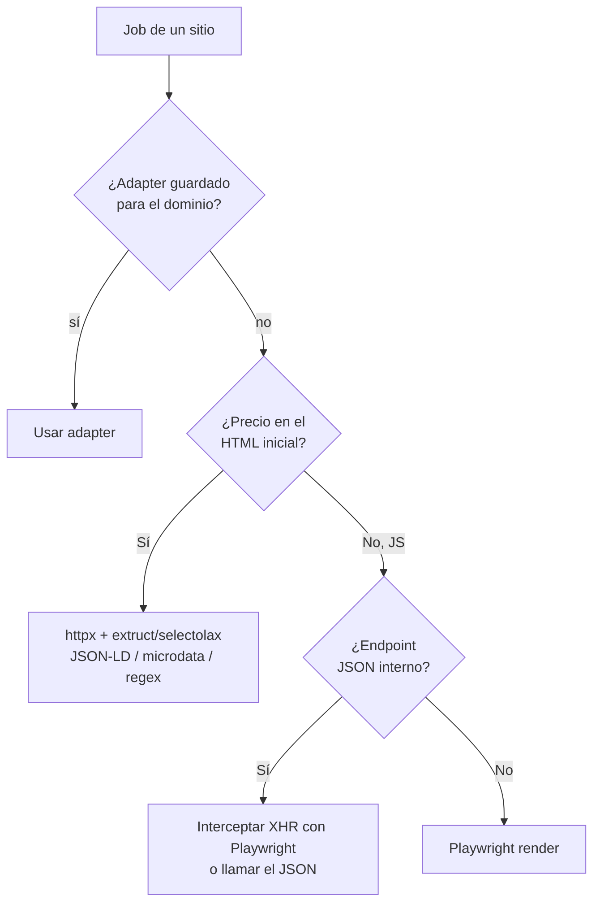
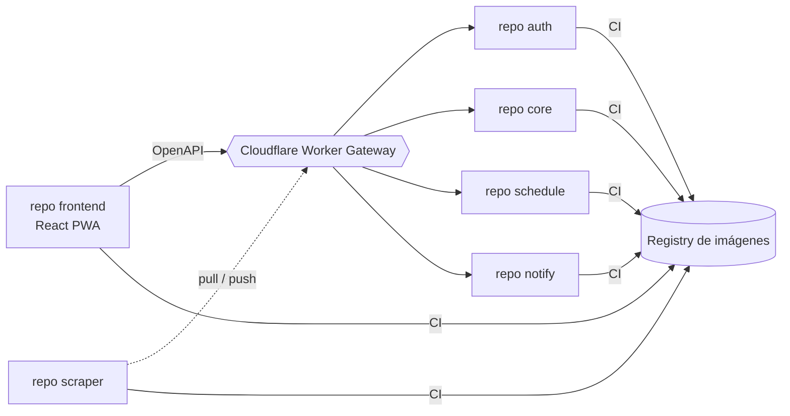

# 04 · Stack tecnológico

> Consolidado con el [Alcance 1](08-alcance-1-preguntas.md), la [arquitectura](02-arquitectura.md), el [modelo de datos](03-modelo-datos.md) y los [requerimientos](deliverables/requerimientos.md). Backend **Python**, frontend **React**, persistencia **políglota** (PostgreSQL + MongoDB), ejecución **background** con Redis (a confirmar, ver [doc 09](09-pendientes.md) B2), despliegue en **6 repos independientes** ([ADR-0001](adr/0001-estructura-repos-servicios.md)) portables a la nube. Todo detrás de interfaces reemplazables.

## Tabla de contenido

- [Stack por capa](#stack-por-capa)
  - [Backend (API + workers)](#backend-api--workers)
  - [Datos](#datos)
  - [Frontend (PWA)](#frontend-pwa)
  - [Calidad, seguridad y observabilidad](#calidad-seguridad-y-observabilidad)
  - [IA (Fase 2)](#ia-fase-2)
- [Decisión clave: ¿HTTP simple o navegador headless?](#decisión-clave-http-simple-o-navegador-headless)
- [Organización de repos](#organización-de-repos)
- [Estructura interna (por repo)](#estructura-interna-por-repo)
- [Interfaces reemplazables (contratos)](#interfaces-reemplazables-contratos)
- [Actualidad: cómo construyen software las grandes empresas](#actualidad-cómo-construyen-software-las-grandes-empresas)
  - [Cómo leer esta sección](#cómo-leer-esta-sección)
  - [Qué hace cada empresa](#qué-hace-cada-empresa)
  - [Patrones que se repiten](#patrones-que-se-repiten)
  - [Formas de trabajo](#formas-de-trabajo)
  - [Metodología y prototipado](#metodología-y-prototipado)
  - [Patrones de diseño: qué dice la evidencia](#patrones-de-diseño-qué-dice-la-evidencia)
  - [Construcción asistida por IA (harnesses propios)](#construcción-asistida-por-ia-harnesses-propios)
  - [Harnesses: tamaño y complejidad](#harnesses-tamaño-y-complejidad)
  - [Los contrapesos: cuando volvieron atrás](#los-contrapesos-cuando-volvieron-atrás)
  - [Qué significa para I Found It](#qué-significa-para-i-found-it)
  - [Lagunas por verificar](#lagunas-por-verificar)
- [Pendientes](#pendientes)

## Stack por capa

### Backend (API + workers)

| Capa | Tecnología | Por qué |
|------|-----------|---------|
| Lenguaje | **Python 3.12+** | Ecosistema de scraping/datos más rico. |
| API | **FastAPI** | Async, tipado, OpenAPI automático (contrato para el frontend). |
| Auth | **JWT** (access + refresh) · **argon2/bcrypt** | Access ~15 min + refresh ~7 días con rotación/revocación. |
| HTTP simple | **httpx** | Cliente async, HTTP/2 — la vía por defecto (HTTP-first). |
| Navegador headless | **Playwright** | Fallback cuando el precio requiere JS; también intercepta XHR/JSON interno. |
| Datos estructurados | **extruct** / **selectolax** / **BeautifulSoup** | Extrae JSON-LD / schema.org / microdata / `og:price` sin scraper por sitio. |
| robots.txt + rate limit | **Protego** + **aiolimiter** | Respeta `robots.txt`/`Crawl-delay` y controla la tasa por dominio (SCR-5/6). |
| Parseo precio/moneda | **price-parser** + **Babel** | Extrae precio numérico y normaliza moneda por locale (PRO-1, multi-moneda). |
| Cola / workers | **Redis** + **Arq** (async) *(alt. RQ / Celery)* | Scraping en background escalonado; reintentos. **A confirmar:** con el scraper haciendo *pull* sobre `schedule`, puede que ya no haga falta Redis — [doc 09](09-pendientes.md) B2. |
| Scheduler | **APScheduler** (repo `schedule`) | Encola corridas en ventanas horarias (04–06 / 18–20, env). |
| ORM relacional / migraciones | **SQLAlchemy 2 + Alembic** | Modelo versionado y migrable (PostgreSQL). |
| Acceso MongoDB | **Motor** (async) / **Beanie** (ODM) | Cliente/ODM para las colecciones documentales. |
| Plantillas email | **Jinja2** + **aiosmtplib** | Plantilla única de novedad; envío SMTP. |
| Saneamiento de datos | **unicodedata (NFC)** + normalizadores propios | RNF-6/DoD: limpia y normaliza **todo** dato antes de persistir. |
| Config | **pydantic-settings + .env** | Config tipada por entorno (12-factor). |

### Datos

| Store | Tecnología | Uso |
|-------|-----------|-----|
| Relacional | **PostgreSQL 16** (+ JSONB) | **1 sola instancia, 4 esquemas** (`auth`, `core`, `schedule`, `notify`), dos roles por esquema (migraciones y servicio) sin permisos sobre el de los demás — ver [docs/deliverables/db](deliverables/db/README.md). Guarda RBAC, usuarios, alertas, urls, `price_snapshot` (por cambio, partición anual), suscripciones, `notification` (outbox), adapters, `site_stats_daily`, `schedule`/`run`. Extensión `citext` para emails. |
| Documental | **MongoDB** (compresión **zstd**, índices **TTL**) | Solo consulta, voluminoso/efímero: `job_state`, `run_summary`, `raw_capture`, `notification_log`, `exchange_rate`. Retenciones en [doc 03](03-modelo-datos.md#retención-resumen). |
| Cola / caché | **Redis** | Backend de la cola de trabajos. |

### Frontend (PWA)

| Capa | Tecnología | Por qué |
|------|-----------|---------|
| Base | **React + Vite + TypeScript** | Moderno, rápido, tipado. |
| UI | **shadcn/ui** (+ Tailwind) | Componentes robustos y ligeros. |
| Datos/servidor | **TanStack Query** | Cache y sincronización con la API. |
| Formularios/validación | **react-hook-form + zod** | Wizards de alerta; validación de UX (BE es la autoridad). |
| Gráficos | **Recharts** | Comparador de precios por sitio en el tiempo (VIS-3). |
| Ruteo | **React Router** | Navegación + guards por rol. |
| i18n | **react-i18next** | Español activo; andamiaje listo para inglés. |
| PWA | **vite-plugin-pwa** | Instalable (progresivo, fases futuras). |

### Calidad, seguridad y observabilidad

| Área | Tecnología |
|------|-----------|
| Lint/tipos (BE) | **ruff + mypy** |
| Lint/tipos (FE) | **eslint + prettier + tsc** |
| Tests unitarios | **pytest + respx/vcr** (BE) · **vitest** (FE) |
| **E2E** | **Playwright** |
| Seguridad | **Bandit/Semgrep** (SAST) · **pip-audit / npm audit / Trivy** (deps e imágenes) · **Gitleaks** (secretos) · **Dependabot** |
| Observabilidad | **OpenTelemetry** (vendor-neutral) + **Sentry** (free) · `transactionId` end-to-end |
| Contenedores | **Docker + docker-compose** (local) |
| Frontend / gateway | **Cloudflare Workers Static Assets** (frontend) + **Worker Gateway** (única puerta de entrada a `auth`/`core`/`schedule`/`notify`) — ver [doc 02](02-arquitectura.md#vista-de-despliegue-servicios-desacoplados--cloudflare--gcp--oracle). Ya **no** hay nginx/Caddy: se descartó al elegir Cloudflare como gateway. |
| Secretos | **Doppler** / secret manager del CI (nunca en el repo — INF-13) |
| CI/CD | **GitHub Actions** por repo (quality gates) |

### IA (Fase 2)

| Uso | Tecnología |
|-----|-----------|
| Descubrimiento de links (Modo B) | **Google Gemini** (+ búsqueda) |
| Constructor de adapters asistido | **API de Claude** *(a evaluar)* |

## Decisión clave: ¿HTTP simple o navegador headless?



**Regla:** usar lo más ligero que funcione. Playwright solo cuando el precio se inyecta por JS y no hay JSON aprovechable. (Cascada completa en [doc 02](02-arquitectura.md#la-cascada-de-scraping-el-cerebro).)

## Organización de repos

**Seis repos independientes** ([ADR-0001](adr/0001-estructura-repos-servicios.md)), sin paquete compartido entre ellos — cada uno con su propio esquema de BD (o base, en el caso de Mongo) y sin FK/import cruzando esa frontera:



| Repo | Contenido |
|------|-----------|
| **frontend** | React PWA; consume `auth`/`core`/`schedule` vía el contrato **OpenAPI** de cada uno, todo detrás del Gateway. |
| **auth** | FastAPI: login/JWT, RBAC, reset, gestión de usuarios, `system` (multi-proyecto). Publica su JWKS. |
| **core** | FastAPI: alertas, suscripciones, adapters, normalizador, tasa de cambio, validador, motor de decisión. Ensambla el detalle del job a pedido de `schedule`. |
| **schedule** | FastAPI + APScheduler: `schedule`/`run`, ventanas horarias, y la API de *pull* que consulta el scraper. |
| **notify** | FastAPI: outbox transaccional (`notification`, movido desde `core` el 2026-09-30), plantillas (Jinja2), envío SMTP, `notification_log`. Reutilizable por otros proyectos. |
| **scraper** | Sin FastAPI ni BD: cliente que hace *pull* sobre `schedule`, ejecuta la cascada de extracción (httpx/Playwright) y le reporta a `schedule` — nunca a `core` (SCR-20). |

> No hay un contrato "api↔workers" como en versiones anteriores de este doc: cada repo expone su **propio OpenAPI**, y las llamadas entre servicios (`schedule`→`core`, `core`→`notify`) son HTTP normales, validadas por JWT de servicio (`aud=system`).

## Estructura interna (por repo)

```
auth/
├── routers/                  # login, reset, users, systems
├── security/                 # JWT (emisión + JWKS), RBAC, árbol de accesos
├── models/                   # SQLAlchemy — esquema `auth`
└── main.py

core/
├── routers/                  # alerts, subscriptions, adapters, jobs (ensamblado)
├── domain/                   # normalizador, tasa de cambio, validador
├── decide/                   # motor "mejor precio móvil" (Strategy)
├── models/                   # SQLAlchemy — esquema `core`
├── interfaces/                # contratos reemplazables (ver abajo)
└── main.py

schedule/
├── routers/                  # admin (ver/editar/lanzar) + pull del scraper
├── scheduler/                # APScheduler → decide qué run crear
├── models/                   # SQLAlchemy — esquema `schedule`
└── main.py

notify/
├── routers/                  # envío (llamado por core/auth)
├── templates/                # Jinja2 · plantilla única
└── main.py

scraper/
├── fetch/                    # httpx + Playwright
├── extract/                  # cascada: adapter → JSON-LD → microdata → XHR
├── ssrf_guard/               # validación de URL (SCR-18)
└── poll/                     # cliente de pull hacia `schedule`/`core`
```

## Interfaces reemplazables (contratos)

Las cuatro piezas que van a cambiar viven tras una interfaz **dentro del repo `core`** (`core/interfaces/`) — ya no es un paquete compartido entre repos, sino código interno de `core` (no hay un tercer consumidor que lo justifique, [ADR-0001](adr/0001-estructura-repos-servicios.md)). `NotificationChannel` hoy significa "llamar por HTTP al servicio `notify`", no una llamada en el mismo proceso:

```python
class ExchangeRateProvider(Protocol):
    def get_rate(self, base: str, quote: str) -> Decimal: ...   # USD→COP

class BestPriceStrategy(Protocol):
    def evaluate(self, alert_id: str, snapshots: list[Snapshot]) -> Decision: ...

class AIProvider(Protocol):            # Fase 2
    def discover_links(self, topic: str) -> list[str]: ...

class NotificationChannel(Protocol):
    def send(self, to: str, template: str, ctx: dict) -> None: ...  # email hoy
```

Y la cascada de extracción como estrategias encadenadas:

```python
class ExtractionStrategy(Protocol):
    name: str
    def try_extract(self, ctx: FetchContext) -> PriceResult | None: ...
    # None = no pudo → pasa a la siguiente estrategia
```

> Agregar un fallback nuevo = una `ExtractionStrategy` más en la cadena. Un **adapter guardado** (`site_adapter`) es la estrategia que se prueba primero para su dominio.

## Actualidad: cómo construyen software las grandes empresas

> Investigación del 2026-11-03 para fundamentar los análisis de arquitectura. **Es un insumo, no una decisión:** nada de aquí cambia por sí solo lo ya cerrado en los [ADR](adr/); cualquier cambio se propone con su propio ADR.

### Cómo leer esta sección

- Casi todas las fuentes son **secundarias** (charlas resumidas, blogs, notas de lectura). Marcamos la confianza: **Alta** = fuente primaria de la empresa o paper; **Media** = charla o resumen fiable; **Baja** = blog sin respaldo primario, dato por verificar.
- Las cifras de las empresas (porcentajes de código con IA, ahorros de costo) son **declaraciones públicas** y se miden de forma distinta en cada una; no son comparables entre sí.
- Lo que no se encontró está en [Lagunas por verificar](#lagunas-por-verificar); no se rellena de memoria.

### Qué hace cada empresa

| Empresa | Estrategia / patrón | Para qué lo usan | Fuente (confianza) |
|---------|---------------------|------------------|--------------------|
| **Netflix** | **GraphQL Federation** con *Domain Graph Services* (DGS): el gateway dejó de ser un cuello de botella de un solo equipo y cada equipo de dominio expone su parte del grafo. Backends estandarizados sobre Spring Boot personalizado (seguridad, observabilidad, service mesh, gRPC, config dinámica, reintentos). | Que el gateway no se convierta en un monolito mantenido por un solo equipo. | [InfoQ 2020](https://www.infoq.com/news/2020/12/netflix-graphql-federation) (Media); el estado en 2025 **no está verificado** |
| **Netflix** | **Resiliencia adaptativa:** de *Hystrix* (circuit breaker, bulkheads y límites fijos) a **límites de concurrencia adaptativos** inspirados en control de congestión TCP, con *load shedding*; validado con **chaos engineering**. Los límites fijos eran difíciles de afinar en un sistema que cambia. | Proteger a cada instancia y a sus dependencias bajo sobrecarga. | [Netflix TechBlog](https://netflixtechblog.medium.com/performance-under-load-3e6fa9a60581), [Hystrix](https://github.com/Netflix/Hystrix/wiki/Architecture) (Alta) |
| **Netflix** | **"Paved road":** herramientas centrales bien integradas (descubrimiento, monitoreo, incidentes, logging, seguridad, builds y despliegues) que **no son obligatorias**; el equipo puede salirse. Cultura de libertad con responsabilidad. | Que los equipos se enfoquen en su negocio sin imponer lenguaje ni framework. | [Dianne Marsh, slides](https://www.slideshare.net/diannemarsh/the-paved-road-at-netflix) (Media) |
| **Uber** | **DOMA** (*Domain-Oriented Microservice Architecture*): microservicios agrupados en **dominios**, dominios en **capas** (la capa decide qué dependencias se permiten), cada dominio con un **gateway** como entrada única y **puntos de extensión** definidos. Nació por el coste de depurar entre ~2.200 microservicios (hasta ~50 servicios de 12 equipos para hallar una causa raíz). | Bajar la complejidad total conservando la flexibilidad de los microservicios. | [Uber Engineering](https://www.uber.com/blog/microservice-architecture/) (Alta) |
| **Uber** | **Failover diferenciado por criticidad:** deja el modelo uniforme "cada región absorbe el 100 %" (capacidad 2×, media flota ociosa) por **SLA escalonados** y tráfico de cada ciudad a una sola región. | Reducir el costo de la redundancia sin perder disponibilidad donde importa. | [Paper UFA (arXiv, 2026)](https://arxiv.org/pdf/2603.07345) (Alta) |
| **Google** | **Monorepo** (Piper) con **desarrollo en el tronco** (*trunk-based*, ramas raras) y herramientas para **cambios a gran escala** (*Large-Scale Changes*, con una herramienta interna llamada Rosie). **SRE:** SLO, presupuesto de error (*error budget*) y congelar lanzamientos al agotarlo. **Ley de Hyrum:** con suficientes usuarios, alguien depende de todo comportamiento observable. | Que miles de ingenieros cambien código común y que la fiabilidad regule el ritmo de entrega. | [Libro SWE at Google](https://abseil.io/resources/swe-book/html/toc.html), [Tenets of SRE](https://oreilly.com/ideas/tenets-of-sre) (Media); la cifra de ~60.000 cambios diarios es **Baja** |
| **Amazon / AWS** | **Equipos pequeños con propiedad completa** ("two-pizza") y el **mandato de API** (los servicios solo se hablan por interfaces definidas, sin BD compartida). **Builders' Library:** *shuffle sharding*, *static stability*, **arquitectura basada en celdas** (aislar el radio de impacto) y separar **plano de control** de **plano de datos**. | Aislar fallos y escalar equipos y servicios por separado. | [Builders' Library](https://aws.amazon.com/about-aws/whats-new/2019/12/introducing-amazon-builders-library) (Alta); mandato/two-pizza (Baja: sin memo original) |
| **Microsoft** | Catálogo público de **patrones cloud** (Azure Architecture Center) alineado a los pilares del Well-Architected: *Claim Check*, *Valet Key*, *Choreography*, *Geode*, etc. | Vocabulario común y guías por patrón. | [Azure Architecture Center](https://learn.microsoft.com/azure/architecture/patterns/) (Alta como catálogo; no se leyó la lista completa) |
| **Shopify** | **Monolito modular** ("Componentization"): un solo despliegue con **fronteras entre componentes** por dominio de negocio, no por capa MVC. Los componentes tienen dueño, lo que reparte tareas globales como actualizar Rails. | Modularidad sin multiplicar unidades de despliegue. | [Shopify Engineering](https://shopify.engineering/deconstructing-monolith-designing-software-maximizes-developer-productivity) (Alta) |
| **Airbnb** | Migración de Rails ("Monorail") a **SOA**, no a microservicios puros, para no crear "otro monolito" en un servicio. **Dual-read:** comparar el servicio nuevo con el comportamiento actual antes de pasar las escrituras. Capas de dependencia (un servicio alto llama a uno bajo, nunca al revés). | Migrar sin big-bang y con pruebas de equivalencia. | [InfoQ, charla](https://infoq.com/presentations/airbnb-soa-migration) (Media) |
| **Stripe** | **Idempotency keys** en todo `POST` (reintentos seguros tras respuestas perdidas; ventana de 24 h en v1 y 30 días en v2) y **versionado por fecha**: cuenta fijada a la versión de su primera petición, con el costo de mantener versiones viejas aislado. | API como producto con compatibilidad hacia atrás. | [Docs de Stripe](https://docs.stripe.com/api-v2-overview?lang=java) (Alta para idempotencia); versionado: relatos de terceros (Media) |
| **Spotify** | **Golden paths** recomendados (no obligatorios) y **Backstage** como portal interno de desarrolladores (hoy proyecto CNCF) con plantillas de software y docs-as-code. | Menos decisiones y menos fragmentación. | [Spotify Engineering](https://engineering.atspotify.com/2020/8/how-we-use-golden-paths-to-solve-fragmentation-in-our-software-ecosystem) (Alta) |
| **Meta** | Monorepo con **Buck2** (build en Rust, ejecución remota). **Revisión de código con IA:** RADAR automatiza la aprobación de cambios de riesgo bajo y medio; MetaMateCR propone correcciones a comentarios de revisión. | Absorber un volumen de cambios que crece más rápido que la revisión humana. | [Resumen de RADAR](https://www.themoonlight.io/en/review/automating-low-risk-code-review-at-meta-radar-risk-calibration-and-review-efficiency), [arXiv](https://aitopics.org/doc/arxivorg:93609E35) (Media); Sapling sin fuente primaria |

### Patrones que se repiten

| Patrón | Quién lo usa | Idea en una línea |
|--------|--------------|-------------------|
| **Fronteras por dominio, no por capa técnica** | Uber (DOMA), Shopify, Airbnb | El código se agrupa por capacidad de negocio; cada dominio expone una entrada única y puntos de extensión. |
| **Regla de dependencias entre capas** | Uber, Airbnb | Lo de arriba puede llamar a lo de abajo, nunca al revés; evita ciclos y radio de impacto impredecible. |
| **Aislamiento del radio de impacto** | Amazon (celdas, *shuffle sharding*), Netflix (bulkheads, límites de concurrencia) | Un fallo afecta a una porción acotada de usuarios o de recursos. |
| **Resiliencia adaptativa y *load shedding*** | Netflix | Rechazar el exceso pronto y de forma automática mantiene baja la latencia; los límites fijos se desfasan. |
| **Idempotencia y reintentos seguros** | Stripe, Amazon | Toda operación que cambia estado se puede reintentar sin duplicar efectos. |
| **Contrato de API como producto y compatibilidad** | Stripe, Netflix (federación), Google (Hyrum) | Los consumidores dependen de lo observable; versionar y aislar comportamiento viejo a costo fijo. |
| **Migración incremental con equivalencia** | Airbnb (dual-read), patrón *strangler* | Comparar contra el sistema actual antes de conmutar. |
| **Plataforma interna con "camino pavimentado"** | Netflix, Spotify | Herramientas buenas y opcionales que hacen fácil lo correcto. |
| **Propiedad de equipo de extremo a extremo** | Amazon, Shopify | Un equipo es dueño del componente, su operación y su evolución. |

### Formas de trabajo

- **Medir la entrega con DORA:** frecuencia de despliegue, tiempo de entrega de cambios, tasa de fallos de cambio y tiempo de recuperación. El informe 2024 relaciona la ingeniería de plataformas con mejor productividad, con matices en la estabilidad de entrega. Fuente: [Google Cloud, informe DORA 2024](https://cloud.google.com/blog/products/devops-sre/announcing-the-2024-dora-report) (Media; la lista de métricas varía entre fuentes).
- **SLO y presupuesto de error** para decidir cuándo frenar funcionalidades (Google SRE).
- **Cambios en el tronco, integración continua y cambios a gran escala automatizados** (Google); *stacked diffs* en Meta.
- **Gobernanza sin burocracia:** gremios de arquitectura (Shopify, ~400 miembros), ADR y caminos recomendados no obligatorios (Netflix, Spotify).
- **Pruebas de resiliencia deliberadas:** inyección de latencia y *chaos engineering* sobre circuit breakers y límites (Netflix).

### Metodología y prototipado

En las fuentes encontradas no aparece un marco ágil común (Scrum, Kanban); lo que se repite es **escribir antes de construir** y **validar barato antes de invertir**.

| Práctica | Quién | Qué es | Fuente (confianza) |
|----------|-------|--------|--------------------|
| **Working Backwards: PR/FAQ y memo de 6 páginas** | Amazon | Antes de construir se escribe un comunicado de prensa ficticio del producto ya lanzado, más preguntas frecuentes (~6 páginas en prosa, sin diapositivas). Las reuniones empiezan con **lectura silenciosa**. Muchas ideas mueren en esta etapa, lo que evita construir lo que el cliente no valoraría. | Libro *Working Backwards*; resúmenes: [Commoncog](https://commoncog.com/product-development-iterated-taste/) (Media) |
| **Design docs** | Google | Documento informal de 3–20 páginas antes de programar: enfoque, decisiones y **trade-offs**, con poco o nada de código; los **prototipos** se citan como evidencia de que el diseño es construible. Revisión temprana de seguridad y privacidad; se omite si no hay ambigüedad real. | [Malte Ubl, "Design Docs at Google"](https://www.industrialempathy.com/posts/design-docs-at-google/) (Media: blog de un ingeniero, no publicación oficial) |
| **RFC → proceso de planificación por niveles** | Uber | Nació hacia 2012–13 (formato DUCK, luego RFC): aprobadores, resumen, cambios de arquitectura, SLA, dependencias, pruebas de carga, multi-datacenter. Con más de 2.000 ingenieros generó fricción y se rehízo como un proceso escalonado según el impacto, con herramienta buscable. | [Pragmatic Engineer](https://blog.pragmaticengineer.com/rfcs-and-design-docs/) (Media; describe hasta ~2019) |
| **Design Sprint (5 días)** | Google Ventures (nació con Jake Knapp en Google) | Lunes mapear, martes bocetar, miércoles decidir, jueves **prototipar**, viernes **probar con usuarios**. Documentado en el libro *Sprint* (2016). | [Google Design](https://design.google/library/design-sprints), [CIO](https://www.cio.com/article/3532248/what-is-a-design-sprint-a-5-day-plan-for-improving-products-and-services.html) (Media; las fechas de origen varían entre fuentes) |
| **Hack Week → camino pavimentado** | Spotify | El primer *golden path* (tutorial de backend) salió de un proyecto de Hack Week. | [Spotify Engineering](https://engineering.atspotify.com/2020/8/how-we-use-golden-paths-to-solve-fragmentation-in-our-software-ecosystem) (Alta) |
| **Desarrollo guiado por especificaciones (spec-driven)** | Amazon (Kiro) | Prompt → **requisitos** (historias con criterios en notación EARS) → **diseño** (flujos, interfaces, esquema) → **tareas** secuenciadas y trazadas a los requisitos. Un análisis independiente advierte que la spec puede divergir del código si no se actualiza. | [SD Times](https://sdtimes.com/ai/amazon-launches-spec-driven-ai-ide-kiro/) (Media) |
| **Migrar con comparación** | Airbnb | *Dual-read* antes de pasar las escrituras (ver tabla anterior). | [InfoQ](https://infoq.com/presentations/airbnb-soa-migration) (Media) |

**Un mito corregido:** el "modelo Spotify" (squads, tribus, capítulos, gremios) fue en gran medida una **aspiración**, nunca un sistema completamente implantado, y Spotify no lo usa tal cual; críticas de ex-empleados lo documentan. Fuente: [Jeremiah Lee, "Failed #SquadGoals"](https://www.jeremiahlee.com/posts/failed-squad-goals/) (Media). No hay que copiarlo como si fuera práctica vigente.

### Patrones de diseño: qué dice la evidencia

**No se encontró un estudio público de "los patrones de diseño más usados" en Google, Netflix, Uber o Microsoft.** Lo que hay son dos cosas distintas:

1. **Patrones de arquitectura y de sistemas distribuidos** que estas empresas **sí publican** y que ya están en las tablas de arriba: fronteras por dominio, capas con regla de dependencias, celdas y *bulkheads*, *circuit breaker* y límites de concurrencia, idempotencia, *outbox*/sagas, federación de APIs, *strangler*, *dual-read*. Aquí está la señal real de qué priorizan.
2. **Patrones de diseño clásicos (GoF)** de los que solo hay **estudios académicos** sobre código abierto o comercial, no sobre estas empresas:
   - En un estudio de 108 proyectos de código abierto, unos patrones se usan bastante más que otros ([Ampatzoglou et al.](https://sites.uom.gr/a.ampatzoglou/public_html/papers/ampatzoglou2011jss.pdf)).
   - En un producto comercial de ~500.000 líneas de C++, **Observer** y **Singleton** aparecían en las partes complejas, y **Template Method** en simples y complejas ([Vokáč, 2004](https://web-backend.simula.no/sites/default/files/publications/Vokac.2005.2.pdf)).
   - Una encuesta a practicantes sitúa **Singleton** y **Factory Method** como los más conocidos y prácticos, y los de comportamiento como los menos comunes.
   - En cinco proyectos Java, las clases que participan en un patrón eran **más complejas** que las que no: un patrón mal justificado añade complejidad (consistente con la advertencia "Cargo Cult Architecture").
   - **Inyección de dependencias y Strategy** no aparecieron en esta búsqueda; no se afirma nada sobre ellas.

**Lectura:** la evidencia respalda la regla que ya tenemos en `CLAUDE.md`: **usar un patrón cuando resuelve un problema real**, no por adorno. Lo que sí señalan las empresas es dónde los patrones pagan: en las **fronteras** (interfaces reemplazables, extensión, resiliencia), no dentro de cada clase.

### Construcción asistida por IA (harnesses propios)

| Empresa | Qué se sabe | Confianza |
|---------|-------------|-----------|
| **Google** | Reporta que ~75 % del código nuevo lo genera IA (abril de 2026), frente a ~25 % en 2024, con revisión humana; el método de medición no es público. | Media: [TechSpot](https://www.techspot.com/news/112152-google-ai-now-generates-75-new-code-up.html) |
| **Microsoft** | ~20–30 % del código, según su CEO en abril de 2025; no se halló cifra más reciente. | Media: [Entrepreneur](https://www.entrepreneur.com/business-news/ai-is-taking-over-coding-at-microsoft-google-and-meta) |
| **Meta** | Revisión asistida por IA a escala (RADAR, MetaMateCR). Un ensayo de seguridad halló que los revisores tardaron **más de un 5 % más**: la IA puede ralentizar. Metas internas de uso de IA: Baja. | Media |
| **Amazon** | No se encontró información verificable en esta búsqueda. | — |

**Lectura:** el cuello de botella se desplaza de **escribir** a **revisar y verificar**. Eso refuerza las prácticas que ya aplicamos con los agentes: criterios de aceptación previos, tests primero, revisión de seguridad del diff y humano que aprueba antes de mergear.

### Harnesses: tamaño y complejidad

*Harness* = el andamiaje alrededor del modelo: bucle del agente, herramientas, memoria, sandbox, validaciones deterministas y revisión. **No se encontró ninguna cifra pública del tamaño del código de un harness** (líneas, módulos); lo único medible son efectos (PR por semana, cobertura de revisión) y el número de herramientas. El tamaño se infiere por **alcance**:

| Escala | Harness | Qué incluye | Cifras reportadas | Fuente (confianza) |
|--------|---------|-------------|-------------------|--------------------|
| **Pequeño** | Recomendación de **Anthropic** | Empezar con la API directa y **patrones simples y componibles**; distinguir *workflows* (rutas de código predefinidas) de *agentes* (el modelo decide); añadir complejidad solo si mejora el resultado. | — | [Building effective agents](https://www.anthropic.com/research/building-effective-agents) (Alta como fuente; el detalle viene de resúmenes) |
| **Pequeño–medio** | **Google** (Gemini CLI → Antigravity CLI) | Agente de terminal con *skills*, hooks, subagentes y extensiones; reportado como un **binario único compilado** y multiagente. Jules: agente asíncrono en una VM en la nube que abre PR. | Gemini CLI reportado en retirada a favor de Antigravity | [AugmentCode](https://www.augmentcode.com/tools/google-antigravity-vs-gemini-cli), otros blogs (Baja) |
| **Medio** | **GitHub Copilot coding agent** (Microsoft) | Contenedor aislado sobre GitHub Actions, rama `copilot/*`, PR en borrador, MCP (GitHub y Playwright), aprobación humana de los workflows. | ~30–50 solicitudes premium por sesión (estimado) | [ITNEXT](https://itnext.io/github-copilot-coding-agent-the-complete-architecture-behind-agentic-devops-at-enterprise-scale-1f42c1c132aa) (Baja) |
| **Medio** | **Amazon Kiro** y **Q Developer** | Specs de tres fases con *hooks* orientados a eventos. Q Developer migró aplicaciones Java a gran escala. | "Decenas de miles" de apps a Java 17; Amazon estima 4.500 años-desarrollador y 260 M USD/año (declarado por Amazon) | [SD Times](https://sdtimes.com/ai/amazon-launches-spec-driven-ai-ide-kiro/), [AWS Blog](https://aws.amazon.com/blogs/devops/accelerate-application-upgrades-with-amazon-q-developer-agent-for-code-transformation/) (Media) |
| **Medio–grande** | **OpenAI** (Codex, "harness engineering") | El repositorio como sistema de registro (`AGENTS.md`, mapas de arquitectura, planes, documentos de calidad y seguridad), Chrome DevTools Protocol para reproducir bugs, revisión **agente a agente**. | ~1 millón de líneas escritas por agentes en ~5 meses; ejecuciones de más de 6 h | [OpenAI](https://openai.com/index/harness-engineering) (Alta; resumen del buscador, no se leyó completo) |
| **Grande** | **Stripe** (Minions) | Agentes de una pasada (*one-shot*) sobre un fork de Goose; **blueprints** que intercalan pasos deterministas y razonamiento del LLM, con CI limitado a **2 reintentos**; servidor de herramientas MCP compartido (**Toolshed**, ~500 herramientas); revisión humana obligatoria. | ~1.300 PR/semana (feb. 2026) | [InfoQ](https://infoq.com/news/2026/03/stripe-autonomous-coding-agents/), [Port](https://software-factories.port.io/stripe) (Media: no se leyó la fuente de Stripe) |
| **Grande** | **Uber** | Plataforma en capas sobre Michelangelo: **Minion** (agente en segundo plano vía web, Slack o CLI), **MCP Gateway**, **Agent Builder** sin código, CLI **AIFX** y **uReview** (revisión de código multietapa). | uReview analiza >90 % de ~65.000 diffs semanales; 75 % de sus comentarios útiles; ~1.500 h/semana ahorradas (cifras de Uber). Minion ≈ 11 % de los PR: **Baja** | [Uber Engineering](https://www.uber.com/blog/ureview/) (Alta); resto: [ShiftMag](https://shiftmag.dev/how-uber-engineers-use-ai-agents-8617/) (Baja) |
| **Grande (investigación)** | **Meta** (Confucius SDK / CCA) | Orquestador con **memoria de trabajo jerárquica**, notas persistentes entre sesiones, extensiones modulares (edición, shell, búsqueda, tests) y un **meta-agente** que construye y prueba otros agentes. Tres vistas de diseño: del agente, del usuario y del desarrollador. | 54,3 % en SWE-Bench-Pro (45,5 % con Claude 4 Sonnet frente a 42,7 % de SWE-Agent) | [arXiv 2512.10398](https://arxiv.org/pdf/2512.10398) (Alta como paper; cifras vía resúmenes) |

> Stripe y Uber usan nombres parecidos ("Minions" y "Minion"); son **sistemas distintos** y no se deben confundir.

**Rasgos comunes (lo que sí se repite):**
- **Andamiaje determinista alrededor del LLM:** validaciones, límites de reintentos y pasos fijos (blueprints de Stripe) en vez de dejar todo al modelo.
- **Sandbox aislado y humano en el último paso:** el agente abre un PR; una persona lo revisa antes de producción.
- **MCP como protocolo de herramientas**, a veces tras un gateway central (Uber, Stripe).
- **El repositorio como contexto:** `AGENTS.md`, documentos de arquitectura y planes versionados (OpenAI).
- **Especificación antes del código** (Kiro) y **revisión asistida por IA** para absorber el volumen (Meta, Uber).
- **Crecer solo cuando hace falta:** la guía de Anthropic y los binarios únicos frente a las plataformas de Uber o Stripe muestran que la complejidad se paga con escala de organización, no con tamaño del problema.

### Los contrapesos: cuando volvieron atrás

- **Segment** pasó de más de 140 servicios (uno por destino) a un **monolito modular**: el costo operativo y la reutilización de código pesaron más que el aislamiento de fallos. No concluyen que los microservicios sean malos: dependen del caso. Fuente: [InfoQ](https://www.infoq.com/news/2020/04/microservices-back-again/) (Media).
- **Amazon Prime Video** redujo más de un 90 % el costo de infraestructura de un servicio de análisis de calidad de video al reunir sus componentes en un solo proceso, porque la orquestación con Step Functions y el almacenamiento intermedio en S3 eran el cuello de botella. Es **controvertido**: hay quien dice que fue una refactorización de un servicio, no un retorno al monolito. Fuente: [Network World](https://www.networkworld.com/article/3697737/6-lessons-from-the-amazon-prime-video-serverless-vs-monolith-flap.html) (Media).
- **Shopify y Airbnb** muestran el camino intermedio: monolito modular o SOA con capas, y migrar solo cuando seguir en el monolito "dolía".

### Qué significa para I Found It

Insumos para los análisis, no decisiones:

1. **Ya alineado:** las [interfaces reemplazables](#interfaces-reemplazables-contratos) (Strategy/Adapter) equivalen a los puntos de extensión y la capa anticorrupción de DOMA; el outbox y la idempotencia de las corridas siguen el patrón de Stripe y Amazon.
2. **Tensión a evaluar con `architect`:** [ADR-0001](adr/0001-estructura-repos-servicios.md) fija **6 repos independientes**. Los casos de Segment, Shopify y Prime Video sugieren comparar ese costo operativo contra un **monolito modular** para un equipo pequeño. Es un análisis pendiente, no una propuesta de cambio.
3. **Resiliencia del scraping:** circuit breaker y límite de concurrencia **por dominio** (Netflix) y tasa de éxito por sitio como **SLI/SLO** (Google).
4. **Plantilla de repos = "camino pavimentado"** (Spotify, Netflix): el repo plantilla y `devops` cumplen ese papel.
5. **Medición:** adoptar las cuatro métricas DORA en CI desde el primer repo de código.
6. **Verificación de arquitectura automática** (reglas de dependencias entre módulos como tests) para sostener la modificabilidad con el tiempo.
7. **Escribir antes de construir:** nuestro flujo (`requirements-analyst` → `architect` → desarrollo → `qa`) ya equivale al PR/FAQ de Amazon, a los design docs de Google y a la spec de Kiro. Falta un **prototipo barato** antes de comprometerse en lo incierto (p. ej. un adapter contra un fixture antes de cerrar la cascada de extracción).
8. **Nuestros agentes son un harness pequeño con andamiaje determinista:** los hooks (`turn-guard`, `guard-writes`) cumplen el papel de los pasos deterministas de Stripe, y la regla "al tercer fallo se detiene" equivale a su tope de 2 reintentos de CI. Crecer a un gateway MCP o una plataforma como las de Uber o Stripe no se justifica con un equipo pequeño (criterio de Anthropic: complejidad solo si mejora el resultado).
9. **Cuidado con copiar modelos:** ni el "modelo Spotify" ni los microservicios masivos son práctica vigente tal cual; el filtro útil es el contexto (equipo, escala, costo).

### Lagunas por verificar

- Estado actual (2025–2026) de la federación de Netflix y su stack; no se halló fuente primaria reciente.
- Arquitectura **celular de Uber**; solo se halló el paper de failover, no un post de celdas.
- Mandato de API y *two-pizza* de Amazon: sin el memo original (la fuente habitual es el "Platform Rant" de Steve Yegge de 2011).
- Catálogo completo de patrones de Azure y el *engineering playbook* de Microsoft: no se leyeron.
- Sapling de Meta, cifras de Google (cambios diarios) y de IA en Amazon: sin fuente primaria.
- **Tamaño real de los harnesses** (líneas de código, módulos): no hay cifras públicas; solo alcance y efectos.
- Fuentes primarias **no leídas completas**: el ensayo de OpenAI (se usó el resumen del buscador), la publicación de Stripe sobre Minions (solo InfoQ y Port), los posts de Uber sobre Minion y el artículo de Anthropic. No se halló el post de Anthropic sobre harnesses para agentes de larga duración ni nada sobre "Devmate" de Meta.
- Prácticas vigentes de Spotify (más allá de golden paths y Backstage) y de Microsoft (*engineering playbook*, uso interno de agentes).
- Estudio de **patrones GoF más usados en estas empresas**: no existe público; solo estudios académicos sobre otro código.
- Otras potencias aún no investigadas: LinkedIn (Kafka), Cloudflare, Discord y Stripe (infraestructura interna).

## Pendientes

- Verificar con fuentes primarias las lagunas de [Actualidad](#lagunas-por-verificar) antes de apoyar un ADR en ellas.
- Proveedor de tasa de cambio concreto (ej. `exchangerate.host`) — parametrizable.
- Resto de pendientes de este documento (si Redis/Arq sigue haciendo falta, runner de cola concreto, proveedor de BD, despliegue) consolidados en el [doc 09 · Pendientes](09-pendientes.md).
