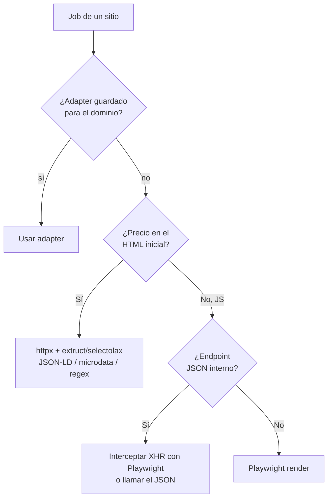
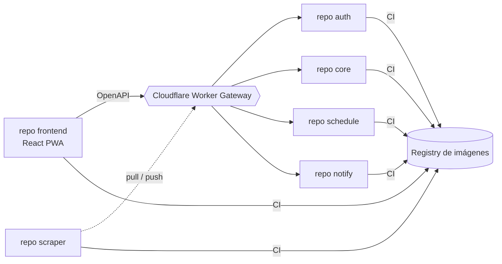

# 04 · Stack tecnológico

> Consolidado con el [Alcance 1](08-alcance-1-preguntas.md), la [arquitectura](02-arquitectura.md), el [modelo de datos](03-modelo-datos.md) y los [requerimientos](deliverables/requerimientos.md). Backend **Python**, frontend **React**, persistencia **políglota** (PostgreSQL + MongoDB), ejecución **background** con Redis (a confirmar, ver [doc 09](09-pendientes.md) B2), despliegue en **6 repos independientes** ([ADR-0001](adr/0001-estructura-repos-servicios.md)) portables a la nube. Todo detrás de interfaces reemplazables.

## Stack por capa

### Backend (API + workers)

| Capa | Tecnología | Por qué |
|------|-----------|---------|
| Lenguaje | **Python 3.12+** | Ecosistema de scraping/datos más rico. |
| API | **FastAPI** | Async, tipado, OpenAPI automático (contrato para el frontend). |
| Auth | **JWT** (access + refresh) · **argon2/bcrypt** | Access ~15 min + refresh ~7 días con rotación/revocación. |
| HTTP simple | **httpx** | Cliente async, HTTP/2 — la vía por defecto (HTTP-first). |
| Navegador headless | **Playwright** | Fallback cuando el precio requiere JS; también intercepta XHR/JSON interno. |
| Datos estructurados | **extruct** / **selectolax** / **BeautifulSoup** | Extrae JSON-LD / schema.org / microdata / `og:price` sin scraper por sitio. |
| robots.txt + rate limit | **Protego** + **aiolimiter** | Respeta `robots.txt`/`Crawl-delay` y controla la tasa por dominio (SCR-5/6). |
| Parseo precio/moneda | **price-parser** + **Babel** | Extrae precio numérico y normaliza moneda por locale (PRO-1, multi-moneda). |
| Cola / workers | **Redis** + **Arq** (async) *(alt. RQ / Celery)* | Scraping en background escalonado; reintentos. **A confirmar:** con el scraper haciendo *pull* sobre `schedule`, puede que ya no haga falta Redis — [doc 09](09-pendientes.md) B2. |
| Scheduler | **APScheduler** (repo `schedule`) | Encola corridas en ventanas horarias (04–06 / 18–20, env). |
| ORM relacional / migraciones | **SQLAlchemy 2 + Alembic** | Modelo versionado y migrable (PostgreSQL). |
| Acceso MongoDB | **Motor** (async) / **Beanie** (ODM) | Cliente/ODM para las colecciones documentales. |
| Plantillas email | **Jinja2** + **aiosmtplib** | Plantilla única de novedad; envío SMTP. |
| Saneamiento de datos | **unicodedata (NFC)** + normalizadores propios | RNF-6/DoD: limpia y normaliza **todo** dato antes de persistir. |
| Config | **pydantic-settings + .env** | Config tipada por entorno (12-factor). |

### Datos

| Store | Tecnología | Uso |
|-------|-----------|-----|
| Relacional | **PostgreSQL 16** (+ JSONB) | **1 sola instancia, 4 esquemas** (`auth`, `core`, `schedule`, `notify`), un rol por esquema sin permisos sobre el de los demás — ver [docs/deliverables/db](deliverables/db/README.md). Guarda RBAC, usuarios, alertas, urls, `price_snapshot` (por cambio, partición anual), suscripciones, `notification` (outbox), adapters, `site_stats_daily`, `schedule`/`run`. Extensión `citext` para emails. |
| Documental | **MongoDB** (compresión **zstd**, índices **TTL**) | Solo consulta, voluminoso/efímero: `job_state`, `run_summary`, `raw_capture`, `notification_log`, `exchange_rate`. Retenciones en [doc 03](03-modelo-datos.md#retención-resumen). |
| Cola / caché | **Redis** | Backend de la cola de trabajos. |

### Frontend (PWA)

| Capa | Tecnología | Por qué |
|------|-----------|---------|
| Base | **React + Vite + TypeScript** | Moderno, rápido, tipado. |
| UI | **shadcn/ui** (+ Tailwind) | Componentes robustos y ligeros. |
| Datos/servidor | **TanStack Query** | Cache y sincronización con la API. |
| Formularios/validación | **react-hook-form + zod** | Wizards de alerta; validación de UX (BE es la autoridad). |
| Gráficos | **Recharts** | Comparador de precios por sitio en el tiempo (VIS-3). |
| Ruteo | **React Router** | Navegación + guards por rol. |
| i18n | **react-i18next** | Español activo; andamiaje listo para inglés. |
| PWA | **vite-plugin-pwa** | Instalable (progresivo, fases futuras). |

### Calidad, seguridad y observabilidad

| Área | Tecnología |
|------|-----------|
| Lint/tipos (BE) | **ruff + mypy** |
| Lint/tipos (FE) | **eslint + prettier + tsc** |
| Tests unitarios | **pytest + respx/vcr** (BE) · **vitest** (FE) |
| **E2E** | **Playwright** |
| Seguridad | **Bandit/Semgrep** (SAST) · **pip-audit / npm audit / Trivy** (deps e imágenes) · **Gitleaks** (secretos) · **Dependabot** |
| Observabilidad | **OpenTelemetry** (vendor-neutral) + **Sentry** (free) · `transactionId` end-to-end |
| Contenedores | **Docker + docker-compose** (local) |
| Frontend / gateway | **Cloudflare Workers Static Assets** (frontend) + **Worker Gateway** (única puerta de entrada a `auth`/`core`/`schedule`/`notify`) — ver [doc 02](02-arquitectura.md#vista-de-despliegue-servicios-desacoplados--cloudflare--gcp--oracle). Ya **no** hay nginx/Caddy: se descartó al elegir Cloudflare como gateway. |
| Secretos | **Doppler** / secret manager del CI (nunca en el repo — INF-13) |
| CI/CD | **GitHub Actions** por repo (quality gates) |

### IA (Fase 2)

| Uso | Tecnología |
|-----|-----------|
| Descubrimiento de links (Modo B) | **Google Gemini** (+ búsqueda) |
| Constructor de adapters asistido | **API de Claude** *(a evaluar)* |

## Decisión clave: ¿HTTP simple o navegador headless?



**Regla:** usar lo más ligero que funcione. Playwright solo cuando el precio se inyecta por JS y no hay JSON aprovechable. (Cascada completa en [doc 02](02-arquitectura.md#la-cascada-de-scraping-el-cerebro).)

## Organización de repos

**Seis repos independientes** ([ADR-0001](adr/0001-estructura-repos-servicios.md)), sin paquete compartido entre ellos — cada uno con su propio esquema de BD (o base, en el caso de Mongo) y sin FK/import cruzando esa frontera:



| Repo | Contenido |
|------|-----------|
| **frontend** | React PWA; consume `auth`/`core`/`schedule` vía el contrato **OpenAPI** de cada uno, todo detrás del Gateway. |
| **auth** | FastAPI: login/JWT, RBAC, reset, gestión de usuarios, `system` (multi-proyecto). Publica su JWKS. |
| **core** | FastAPI: alertas, suscripciones, adapters, normalizador, tasa de cambio, validador, motor de decisión. Ensambla el detalle del job a pedido de `schedule`. |
| **schedule** | FastAPI + APScheduler: `schedule`/`run`, ventanas horarias, y la API de *pull* que consulta el scraper. |
| **notify** | FastAPI: plantillas (Jinja2), envío SMTP, `notification_log`. Reutilizable por otros proyectos. |
| **scraper** | Sin FastAPI ni BD: cliente que hace *pull* sobre `schedule`, ejecuta la cascada de extracción (httpx/Playwright) y reporta a `core`/`schedule`. |

> No hay un contrato "api↔workers" como en versiones anteriores de este doc: cada repo expone su **propio OpenAPI**, y las llamadas entre servicios (`schedule`→`core`, `core`→`notify`) son HTTP normales, validadas por JWT de servicio (`aud=system`).

## Estructura interna (por repo)

```
auth/
├── routers/                  # login, reset, users, systems
├── security/                 # JWT (emisión + JWKS), RBAC, árbol de accesos
├── models/                   # SQLAlchemy — esquema `auth`
└── main.py

core/
├── routers/                  # alerts, subscriptions, adapters, jobs (ensamblado)
├── domain/                   # normalizador, tasa de cambio, validador
├── decide/                   # motor "mejor precio móvil" (Strategy)
├── models/                   # SQLAlchemy — esquema `core`
├── interfaces/                # contratos reemplazables (ver abajo)
└── main.py

schedule/
├── routers/                  # admin (ver/editar/lanzar) + pull del scraper
├── scheduler/                # APScheduler → decide qué run crear
├── models/                   # SQLAlchemy — esquema `schedule`
└── main.py

notify/
├── routers/                  # envío (llamado por core/auth)
├── templates/                # Jinja2 · plantilla única
└── main.py

scraper/
├── fetch/                    # httpx + Playwright
├── extract/                  # cascada: adapter → JSON-LD → microdata → XHR
├── ssrf_guard/               # validación de URL (SCR-18)
└── poll/                     # cliente de pull hacia `schedule`/`core`
```

## Interfaces reemplazables (contratos)

Las cuatro piezas que van a cambiar viven tras una interfaz **dentro del repo `core`** (`core/interfaces/`) — ya no es un paquete compartido entre repos, sino código interno de `core` (no hay un tercer consumidor que lo justifique, [ADR-0001](adr/0001-estructura-repos-servicios.md)). `NotificationChannel` hoy significa "llamar por HTTP al servicio `notify`", no una llamada en el mismo proceso:

```python
class ExchangeRateProvider(Protocol):
    def get_rate(self, base: str, quote: str) -> Decimal: ...   # USD→COP

class BestPriceStrategy(Protocol):
    def evaluate(self, alert_id: str, snapshots: list[Snapshot]) -> Decision: ...

class AIProvider(Protocol):            # Fase 2
    def discover_links(self, topic: str) -> list[str]: ...

class NotificationChannel(Protocol):
    def send(self, to: str, template: str, ctx: dict) -> None: ...  # email hoy
```

Y la cascada de extracción como estrategias encadenadas:

```python
class ExtractionStrategy(Protocol):
    name: str
    def try_extract(self, ctx: FetchContext) -> PriceResult | None: ...
    # None = no pudo → pasa a la siguiente estrategia
```

> Agregar un fallback nuevo = una `ExtractionStrategy` más en la cadena. Un **adapter guardado** (`site_adapter`) es la estrategia que se prueba primero para su dominio.

## Pendientes

- Proveedor de tasa de cambio concreto (ej. `exchangerate.host`) — parametrizable.
- Resto de pendientes de este documento (si Redis/Arq sigue haciendo falta, runner de cola concreto, proveedor de BD, despliegue) consolidados en el [doc 09 · Pendientes](09-pendientes.md).
