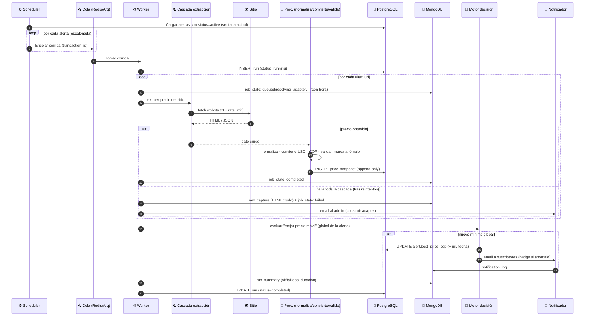
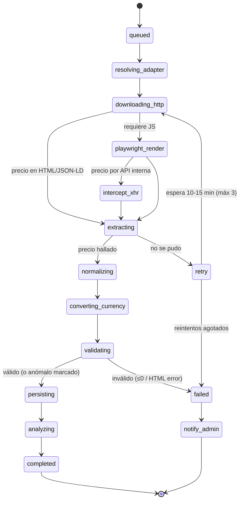
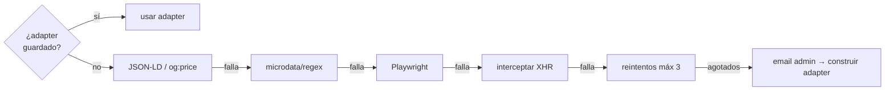
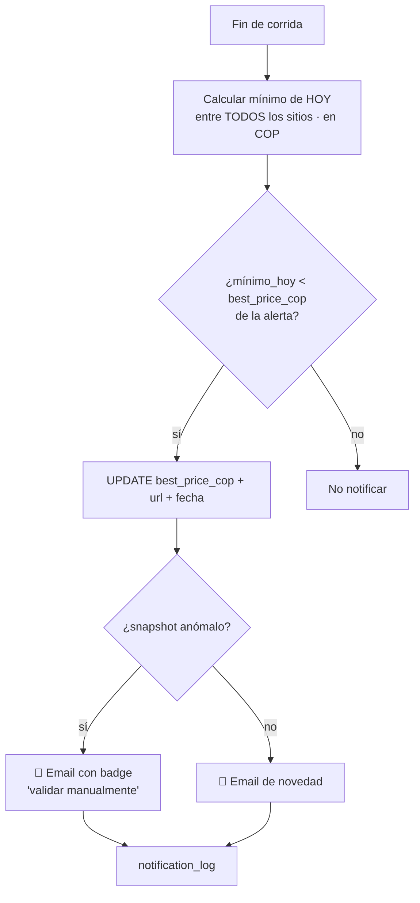

# 05 · Flujo de scraping (corrida de una alerta)

> Consolidado con la [arquitectura](02-arquitectura.md), el [modelo de datos](03-modelo-datos.md) y los [requerimientos](deliverables/requerimientos.md). Cada alerta **activa** se ejecuta **2×/día** en ventanas horarias (04–06 / 18–20, env), en **background escalonado**. Todo lo de una corrida comparte un `transaction_id`.

## Tabla de contenido

- [Diagrama de secuencia](#diagrama-de-secuencia)
- [Máquina de estados del job (por sitio)](#máquina-de-estados-del-job-por-sitio)
- [La cascada de extracción (resumen)](#la-cascada-de-extracción-resumen)
- [Motor de decisión — "mejor precio móvil" (global)](#motor-de-decisión--mejor-precio-móvil-global)
- [Manejo de fallos y buenas prácticas](#manejo-de-fallos-y-buenas-prácticas)
- [Idempotencia y trazabilidad](#idempotencia-y-trazabilidad)
- [Qué se persiste y dónde](#qué-se-persiste-y-dónde)

## Diagrama de secuencia

## Máquina de estados del job (por sitio)

> Cada transición se registra **con su hora** en MongoDB (`job_state`, SCR-16). Cuanto más granular, mejor — alimenta la vista de progreso en tiempo real (SCH-9).

## La cascada de extracción (resumen)

El orden que sigue `EXT` por cada sitio (detalle en [doc 02](02-arquitectura.md#la-cascada-de-scraping-el-cerebro)):

## Motor de decisión — "mejor precio móvil" (global)

> **Regla:** se mantiene un **mejor precio global** por alerta (running minimum). Solo se notifica cuando el mínimo del día **rompe** ese mejor precio, y ese valor pasa a ser el nuevo punto de comparación. La estrategia va detrás de un **patrón Strategy** (reemplazable).

## Manejo de fallos y buenas prácticas

| Situación | Estrategia |
|-----------|-----------|
| Timeout / error de red | Reintentos **controlados**: máx 3 (parametrizable), espera 10–15 min. |
| Falla toda la cascada | Guardar `raw_capture` + **email al admin** → construye adapter (se reutiliza) |
| Bloqueo / 403 / 429 / captcha | **No forzar.** Backoff, bajar frecuencia; respetar la [política legal](07-consideraciones-legales.md). |
| Precio inválido (≤0 / HTML error) | Descartar el snapshot (no contamina el historial). |
| **Desplome anómalo** | **NO se descarta:** se guarda y se **marca** (`is_anomalous`) → badge en el email. |
| Rate limiting | Delay por dominio (aiolimiter) + concurrencia limitada + `Crawl-delay`. |

## Idempotencia y trazabilidad

- El snapshot se inserta **solo si cambia** el precio/stock respecto al último (bloqueo de fila en `alert_url`); evita duplicados sin `capture_hash` (ver [doc 03](03-modelo-datos.md)).
- Snapshots **append-only**: el historial nunca se corrompe.
- Si la corrida se cae, se reintenta sin duplicar (los sitios ya completados no se reprocesan).
- Todo se correlaciona por `transaction_id` (PG ↔ MongoDB) y se observa vía OpenTelemetry/Sentry.

## Qué se persiste y dónde

| Momento | PostgreSQL | MongoDB |
|---------|-----------|---------|
| Inicio/fin de corrida | `run` (status) | `run_summary` |
| Cada etapa del job | — | `job_state` (con hora) |
| Precio capturado | `price_snapshot` (append-only) | — |
| Fallo total de un sitio | — | `raw_capture` |
| Notificación enviada | `notification` | `notification_log` |
| Tasa de cambio del día | — (se referencia en snapshot) | `exchange_rate` |
