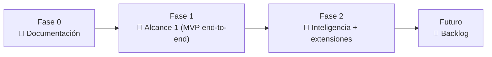

# 06 · Roadmap

> Incremental: cada fase entrega algo funcional y prepara la siguiente. El detalle accionable de la Fase 1 está en [requerimientos.md](deliverables/requerimientos.md).

## Tabla de contenido

- [Fase 0 — Documentación *(casi cerrada)*](#fase-0--documentación-casi-cerrada)
- [Fase 1 — Alcance 1 (MVP funcional de punta a punta)](#fase-1--alcance-1-mvp-funcional-de-punta-a-punta)
- [Fase 2 — Inteligencia y extensiones](#fase-2--inteligencia-y-extensiones)
- [Futuro — Backlog](#futuro--backlog)
- [Principio de evolución](#principio-de-evolución)

## Fase 0 — Documentación *(casi cerrada)*

- [x] Visión y objetivos (01), arquitectura (02), modelo de datos (03), stack (04), flujo (05), legal (07).
- [x] Alcance 1 acotado (08) + requerimientos priorizados con Track y DoD.
- [ ] Cerrar decisión de **despliegue** (provider VM / host frontend — [INF-15](deliverables/requerimientos.md)).
- [ ] Resolver el backlog de [pendientes de arquitectura e infraestructura](09-pendientes.md) (ADR de repos, proveedor de BD, PoC de Oracle, contratos entre servicios).

## Fase 1 — Alcance 1 (MVP funcional de punta a punta)

**Objetivo:** vigilar productos por **URL directa**, correr **2×/día en background**, detectar el **mejor precio** y **avisar por email**. Solo email; sin IA. Detalle e IDs en [requerimientos.md](deliverables/requerimientos.md).

Se construye por **hitos** (los 4 primeros = *core estable*):

- [ ] **Hito 1 · Esqueleto + acceso** — polyrepo, Docker, PostgreSQL+MongoDB, migraciones, **modelo de datos base**, login JWT, **RBAC** (2 roles: admin, usuario), admin sembrado.
- [ ] **Hito 2 · Alerta + scraping** — crear alerta (URL, 1..N, **inmutable**), cascada HTTP-first + extractor genérico, capturar y guardar precio.
- [ ] **Hito 3 · Scheduling background** — schedule por alerta (2×/día, ventanas), cola + workers escalonados, solo alertas activas.
- [ ] **Hito 4 · Ver resultado** — detalle de alerta + precio en la UI. ✅ *core estable.*
- [ ] **Hito 5 · Decisión + email** — tasa de cambio, motor "mejor precio móvil", suscripciones, email SMTP (plantilla única, unsubscribe, badge anómalo), fallbacks de scraping (microdata/XHR/reintentos/aviso admin), módulo de schedules del admin.
- [ ] **Hito 6 · Módulos + pulido** — gestión de usuarios (admin), histórico/comparador por sitio, estadísticas, i18n, seguridad/observabilidad, detalle del scraper.

**Criterios transversales (siempre):** DoD global (datos limpios), saneamiento (RNF-6), CI/CD + escaneos de seguridad, `transactionId`, portabilidad sin lock-in.

## Fase 2 — Inteligencia y extensiones

**Objetivo:** que el sistema descubra dónde comprar y aprenda a scrapear más rápido.

- [ ] **Modo B · descubrimiento con IA (Gemini)** — dado un tema, obtener 10–15 links; refresco cada 7 días.
- [ ] **Extractor automático con IA (#5)** — cuando la cascada genérica falla, IA lee el HTML.
- [ ] **Constructor de adapters asistido por IA** — evaluar **API de Claude** para generar el extractor mucho más rápido.
- [ ] **Módulo "notificaciones enviadas al suscriptor X"** — sobre el `notification_log`.
- [ ] **Validación de "mismo producto"** entre las URLs de una alerta (con IA).
- [ ] **SMS al admin** (además de email) — según costo de pasarela.
- [ ] **Doble opt-in** de suscripción (confirmación por email).

## Futuro — Backlog

- **Precio objetivo** del usuario ("avísame si baja de $X").
- **Notificación "vuelve a stock"** y otras acciones sobre stock/metadata.
- **Otros canales**: Telegram / Slack.
- **Multi-moneda** más allá de USD→COP.
- **Predicción/estacionalidad** de precios; reglas por categoría.
- **PWA offline avanzada**; **i18n inglés** completo.
- **Exportar reportes** (CSV/PDF).
- **Escala y robustez**: particionado/retención del histórico, más workers, panel de salud avanzado, rotación de proxies/user-agents (legítima).

## Principio de evolución

Las piezas que cambiarán (IA, tasa de cambio, estrategia de precio, canal de notificación) viven **tras interfaces** (ver [doc 02](02-arquitectura.md) / [doc 04](04-stack-tecnologico.md)); así cada fase **suma sin reescribir** el core.
