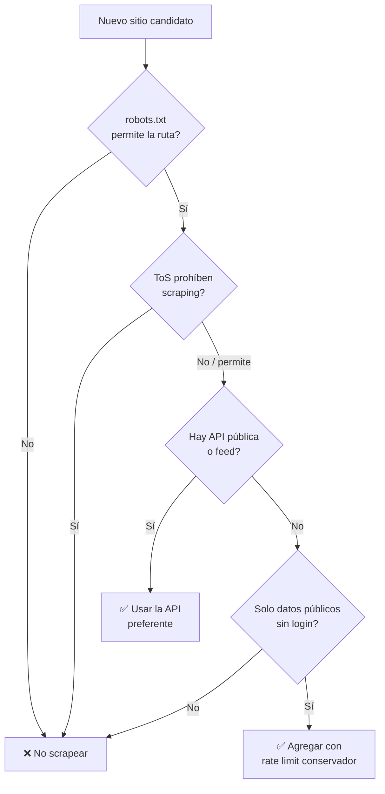

# 07 · Consideraciones legales y éticas

> El scraping tiene matices legales. Esto **no es asesoría legal**, pero sí las buenas prácticas que seguiremos para operar de forma responsable y sostenible.

## Tabla de contenido

- [Principios](#principios)
- [Checklist antes de agregar un sitio nuevo](#checklist-antes-de-agregar-un-sitio-nuevo)
- [Mitigación de riesgos](#mitigación-de-riesgos)
- [Regla de oro](#regla-de-oro)

## Principios

1. **Respetar `robots.txt`** — revisar y respetar las rutas permitidas de cada sitio.
2. **Leer los Términos de Servicio** — algunos sitios prohíben scraping explícitamente. Evaluar caso por caso.
3. **No sobrecargar el servidor** — rate limiting, concurrencia baja, capturas 1×/día. Somos invitados, no una amenaza.
4. **No saltar medidas anti-bot de forma agresiva** — nada de resolver CAPTCHAs ni evadir bloqueos por la fuerza. Si un sitio nos bloquea, reducimos frecuencia o lo excluimos.
5. **Solo datos públicos** — precios y disponibilidad visibles sin login. Nada tras autenticación ni datos personales.
6. **Uso personal / analítico** — seguimiento propio, no redistribución ni reventa de los datos.
7. **Identificarse razonablemente** — user-agent honesto cuando aplique; preferir endpoints/APIs públicas si el sitio las ofrece.

## Checklist antes de agregar un sitio nuevo

## Mitigación de riesgos

| Riesgo | Mitigación |
|--------|-----------|
| Carga excesiva al sitio | 1 captura/día, delays, concurrencia limitada. |
| Bloqueo de IP | Backoff, reducir frecuencia, no insistir. |
| Cambios de estructura | Validación + alerta de "adapter roto". |
| Cuestiones legales | Solo datos públicos, respetar robots/ToS, uso personal. |

## Regla de oro

> Si un sitio deja claro que no quiere ser scrapeado (robots, ToS, bloqueo activo), **no lo forzamos**. Buscamos alternativas legítimas (su API, feeds oficiales) o lo dejamos fuera.
