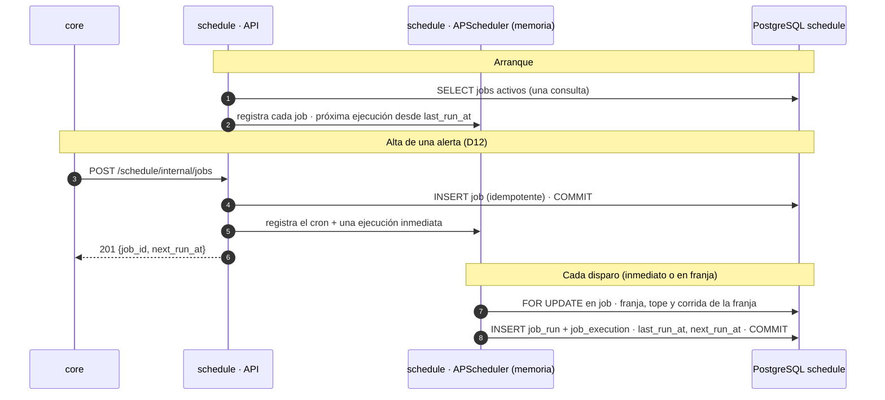

# ADR 0007 · `schedule` dispara los jobs con APScheduler en memoria, cargado desde PostgreSQL al arrancar

- **Estado:** ✅ Aceptada · el usuario la eligió el 2026-11-26 (revisión de CU-03). **Reemplaza la decisión D4 de [CU-03](../../requirements/user-stories/CU-03.md#decisiones-aprobadas-2026-11-24)** (cola en la base con `FOR UPDATE SKIP LOCKED`, sin motor en memoria)
- **Fecha:** 2026-11-26
- **Requerimientos / casos de uso afectados:** SCH-1, SCH-2, SCH-3, SCH-6, SCH-7, SCH-12 · CU-03 (US-03-03, US-03-04), CU-04 (copia de D4) · EV-19, EV-24, EV-25 · QS-12

> **Ampliación (2026-11-26, [CU-03 D14, D15, D19 y D24](../../requirements/user-stories/CU-03.md#decisiones-aprobadas-2026-11-24)):** `schedule` **calcula** `schedule_cron` (el minuto sale de un hash estable de `external_key`) y no lo recibe de `core`. Las URLs ya están en `job.payload`, así que un disparo no depende de `core`. `SCHEDULE_TIMEZONE` es configurable (`America/Bogota`) y la tarea periódica de las colas usa `SCHEDULE_POLL_INTERVAL_SECONDS` = 2, **aprobado** (reemplaza la propuesta del punto 7). Para la memoria, el `payload` (hasta 32 KB) no se carga en APScheduler: solo el id y el cron; se lee de la base al disparar.

> **Ampliación (2026-11-27, [CU-03 D26 a D29](../../requirements/user-stories/CU-03.md#decisiones-aprobadas-2026-11-24)):** el cron de cada job sale de `SCHEDULE_RUN_START_TIMES` (las horas comparten el minuto) más el desfase ((n − 1) × `SCHEDULE_STAGGER_INTERVAL_MINUTES`) mod `SCHEDULE_STAGGER_SPAN_MINUTES`. **Ya no hay franjas:** en los puntos 2 y 4, un disparo perdido se ejecuta una vez si no llegó la siguiente hora programada y el tope lo permite, y se quita la comprobación de franja; la protección contra el doble disparo compara `last_run_at` con la hora programada. No se crea una corrida si la anterior no terminó. APScheduler solo crea corridas; el envío lo limita el número de URLs en proceso.

## Contexto

D4 (2026-11-24) dejó `next_run_at` en PostgreSQL y unos workers que, cada cierto tiempo, toman lo vencido con `FOR UPDATE SKIP LOCKED`. Quedaban sin definir en qué proceso corre ese bucle y cada cuánto revisa la tabla. El stack del proyecto ya nombraba APScheduler para `schedule` ([`tech-stack.md`](../../tools/tech-stack.md)).

Dos hechos hacen simple llevar los disparadores en memoria:

- **Los jobs no cambian después de crearse.** SCH-12 solo permite crear y consultar, y las alertas son inmutables. Lo que hay en memoria solo cambia cuando se crea un job, y eso ocurre en el mismo proceso que lo registra.
- **La tabla `job` ya guarda lo necesario para reconstruir la memoria:** `schedule_cron`, `is_active`, `last_run_at` y `next_run_at`.

## Decisión

1. **La fuente de verdad es la tabla `schedule.job` en PostgreSQL.** APScheduler (planificador asíncrono, almacén en memoria) solo lleva los disparadores. Si la memoria se pierde, se reconstruye desde la tabla.
2. **Al arrancar, antes de aceptar peticiones,** `schedule` lee en una sola consulta los jobs activos y registra cada uno en APScheduler con un disparador cron de su `schedule_cron`, en la zona `America/Bogota` (D5). La próxima ejecución de cada job se calcula **desde su `last_run_at`**:
   - **Sin `last_run_at`** (se cayó antes de su primera corrida): corre de inmediato, como la primera corrida del alta (D3).
   - **Con `last_run_at`:** la próxima es el primer disparo del cron posterior a `last_run_at`. Si ese disparo ya pasó mientras la pieza estaba caída:
     - y su franja **sigue abierta**, corre de inmediato si el tope del día lo permite (EV-19);
     - y su franja **ya cerró**, se salta y queda agendado el siguiente disparo (EV-25).
3. **Alta del job (D12 de CU-03).** `POST /schedule/internal/jobs` guarda el job (idempotente por `(system, external_key)`), confirma la transacción, lo registra en APScheduler y agenda **una ejecución inmediata y única**: la primera corrida, exenta de franja, que cuenta en el tope del día (D3). Responde `201 {job_id, next_run_at}` sin esperar a que esa corrida termine. Con la llave repetida responde `200` y no registra ni lanza nada.
4. **Al disparar,** en una sola transacción:
   1. bloquea la fila del job (`SELECT … FOR UPDATE`);
   2. comprueba que siga activo, que el reloj esté dentro de una franja (salvo la primera corrida), que el día de Bogotá tenga menos de 2 corridas (`job_run.created_at`, R2) y que no haya ya una corrida en la franja actual (por `last_run_at`);
   3. si pasa, crea el `job_run` y sus `job_execution`, y guarda **`last_run_at` = hora del disparo** y `next_run_at` = el siguiente disparo del cron;
   4. si no pasa, no crea nada.

   Esta comprobación impide una corrida doble aunque, por error, corran dos procesos.
5. **Un solo proceso.** `schedule` corre con un solo proceso de aplicación (una réplica, un worker de uvicorn) que contiene la API y APScheduler. Con varios procesos cada uno tendría su propio APScheduler: el punto 4 evita la corrida doble, pero no el trabajo repetido. Escalar a varias réplicas exige otra decisión (elección de líder o almacén compartido).
6. **`last_run_at` es el dato que manda tras un reinicio.** `next_run_at` queda como dato informativo: lo devuelve `GET /schedule/internal/jobs/{job_id}` y sirve para observar, pero el motor no lo lee. Por eso se elimina el índice `IX_JOB_NEXT_RUN`: nadie toma jobs por ese índice, y el arranque lee todos los activos.
7. **Lo demás sigue como cola en la base.** El envío de cada URL al scraper, sus reintentos y la entrega de resultados (`job_execution`, `job_callback_outbox`, ADR-0004, CU-04 y CU-05) siguen tomándose con `FOR UPDATE SKIP LOCKED`. Esas colas las revisa una **tarea periódica del mismo APScheduler**. 💡 Intervalo propuesto: 2 s, sin aprobar; se mide.

## Alternativas descartadas

| Alternativa | Por qué no |
|-------------|------------|
| D4: workers que revisan la tabla cada N s con `FOR UPDATE SKIP LOCKED` | Hay que definir el proceso y el intervalo, y consulta la tabla aunque no haya nada que disparar. El usuario prefirió APScheduler el 2026-11-26 |
| APScheduler con su almacén en base de datos (SQLAlchemy) | Guarda los jobs serializados en una tabla propia: serían dos fuentes (la suya y `job`), y deserializa con `pickle`, un riesgo si alguien escribe en esa tabla |
| Cron del sistema operativo o del contenedor | No conoce franjas, tope diario ni la primera corrida inmediata |

## Consecuencias

- **Positivas:**
  - Disparo puntual al minuto del cron, sin consultas periódicas a `job`.
  - Pocas definiciones nuevas, porque los jobs no cambian.
  - Un reinicio no pierde nada: la memoria se rehace desde `job`, y `last_run_at` decide qué se perdió.
- **Negativas / costo:**
  - Un solo proceso: no escala en horizontal sin otra decisión.
  - Necesita un proceso siempre encendido. Es una restricción para el despliegue, que el [ADR-0002](0002-deployment-and-data-ownership.md) (en revisión aparte) debe tener en cuenta: un servicio que escala a cero no dispara nada mientras está apagado.
  - Según el ADR-0002, el código actual de `schedule` tiene un worker que llama a `engine.tick()` cada 2 s; hay que adaptarlo. No se verificó en el repo.
- **Memoria y arranque (estimación sin medir):** cada job en memoria ocupa del orden de 1–2 KB, unos 10–20 MB con 10.000 jobs, frente a los 256 MB propuestos por contenedor ([`architecture.md`](../architecture.md)). La carga es una sola consulta. **Se mide** antes de cerrar CU-03 con 10.000 jobs (US-03-04-AC12), y el resultado se anota aquí.
- **Riesgos y cómo se mitigan:**
  - **Doble disparo** (dos procesos, o un reinicio a mitad de un disparo): el bloqueo de la fila y la comprobación del punto 4.
  - **Zona horaria:** el disparador cron usa `America/Bogota` (sin horario de verano) y la base guarda todo en UTC (D5).
  - **Disparo perdido mientras el proceso está vivo** (por ejemplo, el event loop bloqueado): APScheduler lo junta en uno solo y el punto 4 decide si corre.
  - **Versión de APScheduler:** se fija al implementar, comprobando cuál es la rama estable; las ramas 3.x y 4.x tienen API distinta.
