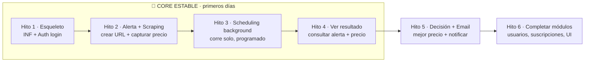

# Requerimientos · Fase 1

> Desglose accionable del [Alcance 1](../08-alcance-1-preguntas.md). Cada requerimiento tiene ID, prioridad y notas. Pensado para **ver resultados en pocos días** priorizando un *vertical slice* funcional.

## Tabla de contenido

- [Leyenda de prioridades](#leyenda-de-prioridades)
- [Leyenda de *Track* (separación de tareas)](#leyenda-de-track-separación-de-tareas)
- [✅ Definition of Done (DoD) — global y obligatorio](#definition-of-done-dod--global-y-obligatorio)
- [0 · Infraestructura y base del proyecto (INF)](#0--infraestructura-y-base-del-proyecto-inf)
- [1 · Autenticación y cuentas (AUTH)](#1--autenticación-y-cuentas-auth)
- [2 · Gestión de usuarios — módulo solo-admin (USR)](#2--gestión-de-usuarios--módulo-solo-admin-usr)
- [3 · Alertas (ALE)](#3--alertas-ale)
- [4 · Programación / scheduling (SCH)](#4--programación--scheduling-sch)
- [5 · Scraping / ingesta (SCR)](#5--scraping--ingesta-scr)
- [6 · Procesamiento y decisión (PRO)](#6--procesamiento-y-decisión-pro)
- [7 · Suscripciones (SUB)](#7--suscripciones-sub)
- [8 · Notificaciones email (NOT)](#8--notificaciones-email-not)
- [9 · Consulta / estadísticas / comparador (VIS)](#9--consulta--estadísticas--comparador-vis)
- [10 · Frontend PWA (FE)](#10--frontend-pwa-fe)
- [11 · No funcionales (RNF)](#11--no-funcionales-rnf)
- [Orden sugerido de construcción (para ver resultados pronto)](#orden-sugerido-de-construcción-para-ver-resultados-pronto)
- [Fuera de alcance de la Fase 1 (para fases futuras)](#fuera-de-alcance-de-la-fase-1-para-fases-futuras)

## Leyenda de prioridades

| Prioridad | Significado |
|-----------|-------------|
| 🔴 **P0** | Crítico. Base del *vertical slice* de punta a punta. **Primeros días.** |
| 🟡 **P1** | Necesario para **cerrar** la Fase 1. |
| 🟢 **P2** | Deseable. Puede diferirse sin romper la fase. |

Estado: `⬜ pendiente` · `🟦 en curso` · `✅ hecho`

## Leyenda de *Track* (separación de tareas)

| Track | Significado |
|-------|-------------|
| 🖥️ **BE** | Backend (API, workers, datos) |
| 🎨 **FE** | Frontend (React PWA) |
| ⚙️ **INFRA** | Infraestructura / DevOps |
| 🔗 **FE+BE** | Requiere ambos coordinados |

> **Todas** las tablas incluyen la columna **Track** para separar tareas de frontend/backend/infra.

---

## ✅ Definition of Done (DoD) — global y obligatorio

> Aplica a **todo** requerimiento. Un ítem **no está "hecho"** hasta cumplir esto:

1. **🧼 Datos limpios (crítico):** **todo dato almacenado queda saneado y normalizado** — sin espacios sobrantes (trim + colapsar internos), sin **caracteres de control/invisibles/no imprimibles**, sin anomalías de formato, Unicode normalizado (NFC), precios parseados a numérico, fechas en **UTC**, emails/etiquetas normalizados. **Objetivo: que el análisis sea siempre congruente.** (Ver [RNF-6](#11--no-funcionales-rnf).)
2. **Validación en dos capas:** FE valida por UX; **BE es la autoridad** (nunca se confía solo en el frontend).
3. **Calidad:** pasa lint + tipos; **tests unitarios** de la funcionalidad y **E2E** de flujos críticos en verde.
4. **Seguridad:** escaneos (INF-9) sin hallazgos críticos; sin secretos en el repo.
5. **Observabilidad:** logs con `transactionId`; errores manejados; estados del job registrados cuando aplique.
6. **Datos/esquema:** si hay cambios de modelo, incluye **migración** (Alembic) y respeta el saneamiento del punto 1.
7. **Documentación mínima** actualizada (endpoint/entidad/flujo tocado).

---

## 0 · Infraestructura y base del proyecto (INF)

| ID | Requerimiento | Prioridad | Track | Estado | Notas |
|----|---------------|-----------|-------|--------|-------|
| INF-1 | **Polyrepo**: cada pieza (frontend, API, workers/scraper…) en **su propio repositorio** | 🔴 P0 | ⚙️ INFRA | ⬜ | No monorepo. Requiere estrategia de contratos/tipos compartidos (OpenAPI / paquete "contracts") |
| INF-2 | `docker-compose` local que orquesta todas las imágenes (API, workers, PostgreSQL, NoSQL, cola) | 🔴 P0 | ⚙️ INFRA | ⬜ | Referencia imágenes de cada repo; mismas imágenes portables a nube |
| INF-3 | Configuración por entorno (12-factor, `.env`, pydantic-settings) | 🔴 P0 | ⚙️ INFRA | ⬜ | Nada hardcodeado; secretos fuera del código |
| INF-4 | **Migraciones de BD versionadas (Alembic)** | 🔴 P0 | 🖥️ BE | ⬜ | Esquema versionado; recrear/upgrade/downgrade reproducible |
| INF-5 | Logging estructurado + manejo de errores central **con `transactionId` (correlation ID) rastreable end-to-end** | 🟡 P1 | 🖥️ BE | ⬜ | Se propaga por API y workers async; base de INF-8 |
| INF-6 | Lint + tipos + tests unitarios (ruff, mypy, pytest / eslint, vitest) | 🟡 P1 | 🔗 FE+BE | ⬜ | Calidad desde el inicio (en ambos stacks) |
| INF-7 | Pipeline reproducible para desplegar a Oracle/GCP free tier | 🟢 P2 | ⚙️ INFRA | ⬜ | Valida portabilidad al final de la fase |
| INF-8 | **Observabilidad/monitoreo** con **plataforma gratis en prod** (OpenTelemetry + Sentry free; Grafana Cloud opc.) | 🟡 P1 | 🖥️ BE | ⬜ | Vendor-neutral (reemplazable). Consume el `transactionId` de INF-5 |
| INF-9 | **Análisis de seguridad / vulnerabilidades** en desarrollo: SAST (Bandit/Semgrep), deps (pip-audit/npm audit + Trivy), secretos (Gitleaks), Dependabot por repo | 🟡 P1 | ⚙️ INFRA | ⬜ | Corre en CI de cada repo |
| INF-10 | **Framework de pruebas E2E robustas** (Playwright; alt. Cypress) | 🟡 P1 | 🔗 FE+BE | ⬜ | Reutiliza Playwright ya presente para scraping |
| INF-11 | **CI por repositorio**: en cada push/PR corre build + lint + tipos + tests + escaneos de seguridad (INF-9) como *quality gates* | 🟡 P1 | ⚙️ INFRA | ⬜ | GitHub Actions (o similar); bloquea merge si falla |
| INF-12 | **CD por repositorio**: build de imagen Docker + publicación a un registry + despliegue a free tier (Oracle/GCP) | 🟢 P2 | ⚙️ INFRA | ⬜ | Automatizado; puede empezar semi-manual y madurar |
| INF-13 | Estrategia de **versionado y tags** de imágenes + gestión de secretos en CI/CD | 🟢 P2 | ⚙️ INFRA | ⬜ | Secretos vía el gestor del CI, nunca en el repo |
| INF-14 | **Modelo de datos base ya definido e implementado** — relacional (PostgreSQL) **y** no relacional (NoSQL) — como prerequisito de los módulos | 🔴 P0 | 🖥️ BE | ⬜ | Entidades núcleo migradas antes de construir features. Ver [doc 03](../03-modelo-datos.md) |
| INF-15 | **Topología de despliegue definida** (dónde vive cada pieza): **Frontend** (PWA) en hosting estático/CDN gratis (Cloudflare Pages / Netlify / Vercel, o servido por nginx en la VM); **Backend** (API + workers) + **PostgreSQL** + **NoSQL** + **Redis (cola)** en **una VM free tier** (Oracle Cloud principal, GCP alterno) vía Docker Compose; **SMTP** y **observabilidad** (Sentry/Grafana) como servicios externos | 🟡 P1 | ⚙️ INFRA | ⬜ | ⏳ **Decisión pendiente** (provider de VM y host del frontend — a revisar). Sin lock-in (INF-2/RNF-2) |

## 1 · Autenticación y cuentas (AUTH)

| ID | Requerimiento | Prioridad | Track | Estado | Notas |
|----|---------------|-----------|-------|--------|-------|
| AUTH-1 | **SUPER_ADMIN sembrado** al instalar o al registrar un system, con las credenciales por entorno | 🔴 P0 | 🖥️ BE | ⬜ | Lo crea `db/auth/register-system.sql`: persona (con fecha de nacimiento real, **mayor de 18 años**) + cuenta + rol `SUPER_ADMIN` de ese system (hoy `ifoundit`), AUTH-19. **La clave no viaja en claro**: el script recibe solo su **hash** por entorno (`SUPER_ADMIN_PASSWORD_HASH`) y deja la cuenta con `must_change_password`. Procedimiento en `db/README.md`. Criterios de aceptación: [criterios](#criterios-de-aceptación--contraseñas) |
| AUTH-2 | Login con usuario/contraseña → **JWT** | 🔴 P0 | 🔗 FE+BE | ⬜ | Contraseñas con hash (bcrypt/argon2). El login indica el `system` y el JWT se emite **para ese system** (AUTH-12). Si `must_change_password` es verdadero, solo permite cambiar la contraseña (AUTH-20) |
| AUTH-3 | Middleware de autorización por **permiso**: en cada endpoint, el backend exige el permiso correspondiente a partir del rol del usuario en el system | 🔴 P0 | 🖥️ BE | ⬜ | Nunca confía en el frontend. Se apoya en AUTH-10 y AUTH-13. Un permiso hijo exige tener concedidos todos sus ancestros; los `RULE_*` se evalúan además sobre los datos (p. ej. alertas propias o ajenas). Cómo llegan los permisos a `core`, `schedule` y `notify` (claim del JWT): pendiente, [doc 09](../09-pendientes.md) D26 |
| AUTH-4 | Reset de contraseña: solicitud → **email con código de 6 dígitos** | 🟡 P1 | 🔗 FE+BE | ⬜ | Depende de NOT-1 (envío email) |
| AUTH-5 | Reset: código **válido 15 min** + **throttle 15 min** entre solicitudes | 🟡 P1 | 🖥️ BE | ⬜ | Respuesta **uniforme**, exista o no el email, y sin hora concreta de espera (revelaría qué cuentas existen): "Si el correo está registrado, te enviaremos un código. Puedes pedir otro cada 15 minutos" |
| AUTH-6 | **Estrategia de tokens**: access **~15 min** (stateless) + refresh **~7 días** con **rotación y revocación** (cookie `httpOnly`) | 🔴 P0 | 🔗 FE+BE | ⬜ | Óptimo para alta demanda: mínima exposición + no golpea BD por request. El refresh es **por `system`** (AUTH-12) y su rotación es atómica (AUTH-14). Política de cookie y CSRF: pendiente, [doc 09](../09-pendientes.md) D25 |
| AUTH-7 | **Complejidad de contraseña** validada al **crear usuario** y al **hacer reset** | 🟡 P1 | 🔗 FE+BE | ⬜ | Longitud mín., mayús/minús/número/símbolo; validación en FE (UX) y BE (autoridad) |
| AUTH-8 | **Registro de auditoría**: quién ejecutó la acción y cuándo | 🟡 P1 | 🖥️ BE | ⬜ | Solo actor + timestamp de la acción; **sin histórico completo** por ahora. **No registra logins fallidos** (decidido 2026-10-08). El servicio solo puede insertar y leer el registro, nunca modificarlo ni borrarlo |
| AUTH-9 | **Logout** + invalidación/expiración de sesión | 🟡 P1 | 🔗 FE+BE | ⬜ | Revoca el refresh token |
| AUTH-10 | **Modelo de datos de roles y permisos (RBAC)** + **árbol de accesos** evaluado en login para validar acceso a cada funcionalidad | 🔴 P0 | 🖥️ BE | ⬜ | **Estructura dinámica y propia de cada `system`** (tablas `role`, `permission`, `role_permission`; [ADR-0003](../adr/0003-alcance-por-system-en-auth.md)). Un usuario tiene **un solo rol por system**. Semilla de `ifoundit` en AUTH-13. UI de gestión de roles: USR-6 (P2) |
| AUTH-11 | Bloqueo/backoff por **intentos fallidos** de login (anti fuerza bruta) | 🟢 P2 · **Opcional** | 🖥️ BE | ⬜ | Nice-to-have; puede no entrar en Fase 1. ⏳ Subirlo a P1 al menos para cuentas administradoras: [doc 09](../09-pendientes.md) D28 |
| AUTH-12 | **Cuenta global con acceso y rol por `system`**: una persona = una sola cuenta (email único); el acceso lo da `user_system_role` (un rol por system). El login indica el `system`; el access token y el refresh se emiten **para ese system** y no sirven en otro | 🔴 P0 | 🔗 FE+BE | ⬜ | [ADR-0003](../adr/0003-alcance-por-system-en-auth.md). Habilita reutilizar `auth` en otros proyectos (ADR-0001). El frontend de I Found It usa siempre `ifoundit` |
| AUTH-13 | **Catálogo RBAC de `ifoundit` (semilla)**: rol `ADMIN` con los 19 permisos y rol `USER` con 8 (y `SUPER_ADMIN` con todos los permisos, AUTH-19); **7 de los 19 son el catálogo base de `auth`** (menú, perfil propio, usuarios y roles) que `register-system.sql` siembra en todo system; códigos en **MAYÚSCULAS**; el prefijo **`RULE_`** marca una **regla de servicio** (alcance sobre los datos), no una pantalla. Árbol: `VIEW_MENU` → módulos → acciones | 🔴 P0 | 🖥️ BE | ⬜ | Catálogo completo con su requerimiento de origen en el [doc 03](../03-modelo-datos.md#catálogo-de-permisos-de-ifoundit-semilla). Los `RULE_*` no se dibujan en el menú. Semilla por defecto en `db/auth/seed-default.sql` (idempotente) |
| AUTH-14 | **Contratos de concurrencia y revocación**: rotación **atómica** del refresh (un solo token vivo por familia); **revocar los refresh** al desactivar a un usuario o cambiarle el rol; **proteger al último `SUPER_ADMIN`** activo de cada system (lock sobre el system antes de contar; también al anonimizar) | 🔴 P0 | 🖥️ BE | ⬜ | Detalle en el doc 03 ("Contratos para el backend"). El cambio de rol es siempre `UPDATE`, nunca borrar e insertar (se perderían los refresh). El access token ya emitido vive hasta ~15 min |
| AUTH-15 | **Endurecimiento del reset**: `code_hash` = HMAC-SHA256 con *pepper* en el gestor de secretos; **máx. 5 intentos fallidos** por código; al completar el reset se **revocan todos los refresh** del usuario; throttle y verificación atómicos | 🟡 P1 | 🖥️ BE | ⬜ | Respuesta uniforme (AUTH-5). Falta un tope diario de solicitudes (límite de tasa en el Gateway) |
| AUTH-16 | **Gestión de las claves de firma JWT y del *pepper***: viven en un gestor de secretos (Doppler o similar), nunca en el repo; `kid` en el JWT y dos claves publicadas a la vez en el JWKS durante la rotación | 🟡 P1 | 🖥️ BE · ⚙️ INFRA | ⏳ **Estrategia de rotación pendiente** | [Doc 09](../09-pendientes.md), D22. Los refresh son opacos: rotar la clave no cierra sesiones |
| AUTH-17 | **Tokens de servicio** (`aud=system`) para las llamadas entre servicios (`core`→`notify`, `auth`→`notify`, `core`↔`schedule`, `scraper`→`schedule`): cómo se emiten y dónde viven sus credenciales | 🔴 P0 | 🖥️ BE | ⏳ **Diseño pendiente** | [Doc 09](../09-pendientes.md), D1; se apoya en SCH-11 |
| AUTH-18 | **Tope absoluto de sesión** y **ventana de gracia** del refresh (dos pestañas que refrescan a la vez no deben revocar la familia de un usuario legítimo) | 🟡 P1 | 🖥️ BE | ⏳ **Por definir** | [Doc 09](../09-pendientes.md), D24. El modelo ya la soporta (`revoked_at`) |
| AUTH-19 | **`SUPER_ADMIN`, dueño de su system**: cada system tiene su rol `SUPER_ADMIN` con **todos los permisos, presentes y futuros** (incluidas las reglas `RULE_*`), que **no interviene en otros systems**. Un system nuevo se registra con un **script SQL** (`db/auth/register-system.sql`) que crea por defecto su `SUPER_ADMIN`, su primera cuenta y el **catálogo base de permisos de `auth`** (7); tres triggers le conceden todo permiso nuevo y le impiden perder permisos o rol. Ningún system queda sin un `SUPER_ADMIN` activo | 🔴 P0 | 🖥️ BE | ⬜ | [ADR-0003](../adr/0003-alcance-por-system-en-auth.md), decisión 5. La app no crea systems. ⏳ Controles reforzados (MFA, número de cuentas): [doc 09](../09-pendientes.md) D27 |
| AUTH-20 | **Cambio de contraseña autenticado y cambio forzado en el primer acceso**: si `must_change_password` es verdadero, el backend solo permite cambiar la contraseña (cumpliendo AUTH-7); al hacerlo apaga el indicador y revoca los demás refresh del usuario | 🔴 P0 | 🔗 FE+BE | ⬜ | Necesario para la primera cuenta `SUPER_ADMIN` (AUTH-1) y para las altas del admin (USR-3). Criterios: [criterios](#criterios-de-aceptación--contraseñas). [Doc 09](../09-pendientes.md), D33 |
| AUTH-21 | **Distribución de la anonimización a los demás servicios**: `anonymize_user()` registra un evento por usuario (`anonymization_event`: solo ids y los systems a los que pertenecía); cada servicio corre su propio job que lee los eventos de hace más de 30 min con `id > su marca de agua`, ejecuta `erase(user_ids)` (idempotente) sobre SUS copias del dato personal y avanza la marca en la misma transacción. El job corre solo de madrugada: cada 30 min entre las 02:00 y las 04:00 (hora de Bogotá). Expone su rezago y alerta si falla | 🟡 P1 | 🖥️ BE | ⏳ **Falta decidir borrar vs anonimizar cada copia** | Mecanismo decidido el 2026-10-19: [Doc 09](../09-pendientes.md), D30; contrato en el [README de db](db/README.md#anonimización-contrato-del-consumidor). Todo system que se registre debe cumplirlo |

## 2 · Gestión de usuarios — módulo solo-admin (USR)

| ID | Requerimiento | Prioridad | Track | Estado | Notas |
|----|---------------|-----------|-------|--------|-------|
| USR-1 | Modelo de usuario: nombres, apellidos, fecha nac., género, email, teléfono (opc.) | 🔴 P0 | 🖥️ BE | ⬜ | + hash de contraseña; el rol lo da el `system` (AUTH-12). **Solo mayores de 18 años** (no se permiten menores; la base lo exige). La fecha de nacimiento tiene una finalidad declarada: verificar la edad mínima para ver una alerta ([doc 09](../09-pendientes.md), D20). Género y teléfono se mantienen por ahora sin finalidad declarada |
| USR-2 | **Módulo de gestión de usuarios accesible SOLO por admin** | 🟡 P1 | 🔗 FE+BE | ⬜ | Con formularios en el sistema. Permiso `VIEW_USERS` (AUTH-13) |
| USR-3 | Crear / editar / desactivar cuentas (admin) | 🟡 P1 | 🔗 FE+BE | ⬜ | No hay auto-registro. Permisos `CREATE_USER`, `EDIT_USER` (incluye asignar el rol del system) y `DEACTIVATE_USER`. Valida mayoría de edad (FE y BE). **No se puede desactivar ni bajar de rol al último admin** y al desactivar se revocan sus sesiones (AUTH-14). ⏳ Cómo recibe el usuario su clave inicial: pendiente ([doc 09](../09-pendientes.md), D23; se define en el [doc 02](../02-arquitectura.md) y en la HU). La cuenta nueva puede marcarse con `must_change_password` (AUTH-20). Criterios: [criterios](#criterios-de-aceptación--contraseñas) |
| USR-4 | Módulo "Modificar mi información" (usuario edita su perfil) | 🟢 P2 | 🔗 FE+BE | ⬜ | Permiso `EDIT_OWN_PROFILE`. Solo edita su propia información; no puede cambiar su rol ni dejar de ser mayor de edad |
| USR-5 | **Anonimizar una cuenta** (supresión de datos personales, Habeas Data): borra los datos personales y las credenciales, desactiva la cuenta y le quita los accesos y las sesiones; conserva los ids y la auditoría | 🟡 P1 | 🔗 FE+BE | ⏳ **Política legal pendiente** | [Doc 09](../09-pendientes.md), D21. Ya existe `anonymize_user()` en la base, que registra un evento por usuario (AUTH-21); falta definir quién la dispara, su permiso y su alcance con asesoría legal |
| USR-6 | **Gestión de roles y permisos**: crear roles del system y asignarles permisos del catálogo | 🟢 P2 | 🔗 FE+BE | ⬜ | Permiso `MANAGE_ROLES`. Pantalla en FE-9. Puede quedar fuera de la Fase 1: mientras tanto el catálogo se siembra (AUTH-13). Al conceder un permiso hijo, el backend exige o añade sus ancestros (si no, queda un permiso muerto) |

### Criterios de aceptación · contraseñas

> Las HU de este repo son las filas de los requerimientos; los criterios de las que tocan la contraseña viven aquí y se enlazan desde la nota de cada una. ⏳ marca lo que depende de un pendiente del [doc 09](../09-pendientes.md).

**AUTH-1 · SUPER_ADMIN sembrado (`register-system.sql`)**
- La contraseña se genera **fuera** del sistema (generador criptográfico o gestor de contraseñas), de **16 caracteres o más** y cumpliendo AUTH-7. No se escribe en el repo, en un archivo ni en el historial del shell.
- Se calcula su **hash argon2id** con los mismos parámetros del backend (bcrypt también se acepta). Solo el **hash** va al gestor de secretos (Doppler o similar) como `SUPER_ADMIN_PASSWORD_HASH`, exportado entre comillas simples. La clave en claro se entrega a la persona por un canal aparte.
- El script **recibe solo el hash**: la clave nunca pasa por SQL, por `ps` ni por los logs. **Rechaza** un valor que no parezca un hash argon2/bcrypt, datos faltantes o vacíos, una cuenta inactiva o anonimizada y a un menor de edad, sin dejar nada a medias (una sola transacción).
- La cuenta nace con `must_change_password = true`. Si ya existe una cuenta con ese email, se reutiliza **sin tocar su contraseña**.
- Ni la clave ni el hash aparecen en logs, errores, auditoría ni mensajes.

**AUTH-7 · Complejidad**
- Se valida en el FE (UX) y en el BE (autoridad) al crear un usuario, al hacer reset y al cambiar la contraseña (AUTH-20).
- Reglas mínimas: mayúscula, minúscula, número y símbolo. Longitud mínima: ⏳ por definir (propuesta: 12 para usuarios y 16 para una clave generada por un operador).
- El backend guarda solo el hash argon2id y lo verifica en tiempo constante; la clave en claro no se persiste ni se loguea.

**AUTH-4 / AUTH-5 / AUTH-15 · Reset**
- El código de 6 dígitos se guarda como HMAC-SHA256 con *pepper* del gestor de secretos (AUTH-16); vale 15 minutos, admite 5 intentos fallidos y hay 15 minutos entre solicitudes.
- La respuesta es **siempre la misma**, exista o no el email, sin hora concreta de espera. Pedir un reset de una cuenta inactiva o anonimizada no hace nada y responde igual.
- La nueva contraseña cumple AUTH-7. Al completar el reset: el código queda usado, se apaga `must_change_password` y se **revocan todos los refresh** del usuario.

**AUTH-2 / AUTH-20 · Login y cambio forzado**
- Si `must_change_password` es verdadero, el login es válido pero **solo permite cambiar la contraseña**: cualquier otro endpoint responde 403 con el código `password_change_required` (⏳ propuesta, a confirmar).
- El cambio exige la contraseña actual, cumple AUTH-7, no puede ser igual a la actual, apaga `must_change_password` y revoca los demás refresh del usuario. Sus intentos fallidos se limitan igual que los del login (⏳ D28).

**USR-3 · Alta por el admin** (⏳ D23)
- La cuenta nueva nace con `must_change_password = true` y su contraseña se hashea en el servidor con argon2id; la clave en claro no se persiste ni se loguea.
- Cómo recibe el usuario su clave inicial (clave temporal o invitación por código) lo define D23 junto con el [doc 02](../02-arquitectura.md). Criterio que no cambia: el admin que crea la cuenta no puede quedar conociendo una clave vigente, por eso existe el cambio forzado.
- Valida mayoría de edad y complejidad.

**FE-2 / FE-5**
- FE-2 maneja `password_change_required` (lleva a la pantalla de cambio y no muestra el menú), nunca guarda la contraseña (ni en `localStorage`) ni la pone en la URL, y usa los `autocomplete` correctos.
- FE-5: el formulario de alta tiene medidor de complejidad; si D23 elige una clave temporal, la muestra una sola vez.

## 3 · Alertas (ALE)

| ID | Requerimiento | Prioridad | Track | Estado | Notas |
|----|---------------|-----------|-------|--------|-------|
| ALE-1 | **Modelo de datos de Alerta** con campos: Título de alerta, Nombre producto/servicio, Etiquetas/categorías (múltiples), URLs (**1..N**), Observaciones, **`estado` (activa/inactiva)**, + metadata: `creado_en` (fecha+hora) y `creado_por` | 🔴 P0 | 🖥️ BE | ⬜ | Ver [doc 03](../03-modelo-datos.md) |
| ALE-2 | Crear alerta **modo URL directa** con **una o muchas URLs** | 🔴 P0 | 🔗 FE+BE | ⬜ | IA (modo tema) → Fase 2. Cada URL se valida contra SCR-18 (anti-SSRF) |
| ALE-3 | **Etiquetas múltiples normalizadas** (minúscula, **sin tildes**) para facilitar filtros/búsquedas futuras | 🟡 P1 | 🖥️ BE | ⬜ | Normalización en BE al guardar |
| ALE-4 | **Alertas inmutables**: no se editan. Al guardar, **modal de confirmación** advirtiendo que la acción es **definitiva** ("¿está seguro de su configuración?") | 🔴 P0 | 🔗 FE+BE | ⬜ | BE rechaza modificaciones; la *config* de la alerta no cambia (su **schedule** sí es editable, ver SCH-4) |
| ALE-5 | Consultar alertas: **todos ven todas (solo lectura)** | 🟡 P1 | 🔗 FE+BE | ⬜ | Sin edición para nadie |
| ALE-6 | Wizard/formulario de **creación** de alerta | 🟡 P1 | 🎨 FE | ⬜ | Solo alta (no edición) |
| ALE-7 | **Preview minimalista del sitio** al pegar cada URL (recuadro a la derecha) | 🟢 P2 | 🎨 FE | ⬜ | Vista previa ligera del enlace |
| ALE-8 | Al crear la alerta, **generar automáticamente un *schedule* por defecto** (hora específica, corre todos los días N veces) → el scraping del producto **inicia ese mismo día** en background | 🔴 P0 | 🖥️ BE | ⬜ | Enlaza con SCH-1/SCH-2; luego el admin puede ajustarlo (SCH-4) |
| ALE-9 | Ciclo de vida: **pausar/reactivar** alerta (cambia `estado`). **No se elimina.** Al pausar (`inactiva`), los workers **dejan de lanzar su schedule** | 🟡 P1 | 🔗 FE+BE | ⬜ | Único cambio permitido sobre una alerta creada; su config sigue inmutable |

## 4 · Programación / scheduling (SCH)

| ID | Requerimiento | Prioridad | Track | Estado | Notas |
|----|---------------|-----------|-------|--------|-------|
| SCH-1 | **Modelo de datos de programación por alerta** (schedule ↔ alerta). Config por defecto: **2×/día** (una diurna, una nocturna) | 🔴 P0 | 🖥️ BE | ⬜ | Se crea un schedule por defecto al dar de alta la alerta (ALE-8) |
| SCH-2 | Scheduler **100% background** en la operación normal (sin botón para el flujo cotidiano) | 🔴 P0 | 🖥️ BE | ⬜ | El repo `schedule` mantiene un motor de jobs **en memoria** (tipo APScheduler): al crear/actualizar un job vía SCH-12 queda **programado**, y un **worker interno lo dispara** solo cuando corresponde (**solo alertas con `estado=activa`**, ALE-9) |
| SCH-3 | Ejecución **escalonada** dentro de las ventanas horarias | 🔴 P0 | 🖥️ BE | ⬜ | Reparte carga; horas distintas por alerta |
| SCH-4 | **Módulo de administración de schedules (admin)**: ver **todos** los schedules con su configuración, estado, última/próxima corrida | 🟡 P1 | 🔗 FE+BE | ⬜ | Cada schedule asociado a una alerta. **`schedule` no tiene ruta pública** (SCH-11): el frontend lo consulta vía `core`, que internamente llama a la API de `schedule` (SCH-12) |
| SCH-5 | Admin **edita cualquier schedule** (frecuencia, hora, pausar), **sin importar quién lo creó** | 🟡 P1 | 🔗 FE+BE | ⬜ | Puede pausar todos si desea; la config de la alerta sigue inmutable |
| SCH-6 | **Límite máx 2 corridas/día por alerta** | 🟡 P1 | 🖥️ BE | ⬜ | Respeta rate limiting; tope duro |
| SCH-7 | **Ventanas horarias parametrizables**: por defecto **04:00–06:00** y **18:00–20:00**, configurables por **variables de entorno** | 🟡 P1 | 🖥️ BE | ⬜ | Valores fáciles de cambiar sin tocar código |
| SCH-8 | **Lanzamiento manual de un schedule para pruebas (solo admin)** | 🟡 P1 | 🔗 FE+BE | ⬜ | Excepción a SCH-2, exclusiva del admin para testing |
| SCH-9 | **Vista de progreso en tiempo real**: al abrir un schedule en ejecución, ver la **etapa de la tarea background por sitio** (leído → persistido → analizado → ok/mal) | 🟡 P1 | 🔗 FE+BE | ⬜ | Consume las etapas observables del job (SCR-16) |
| SCH-10 | Corre **sin la PC encendida** (desplegado en free tier) | 🟡 P1 | ⚙️ INFRA | ⬜ | Ver INF-7 |
| SCH-11 | **`schedule` es de acceso exclusivamente interno**: sin ruta pública en el Gateway; solo lo llaman otros servicios backend (`core` y el `scraper`, este último solo su API de *pull*, SCR-20), autenticados como servicio (JWT `aud=system`), nunca el navegador | 🔴 P0 | 🖥️ BE | ⬜ | El admin gestiona schedules desde el frontend, pero **a través de `core`** (SCH-4); reduce la superficie expuesta, igual que el scraper sin puertos entrantes (SCR-18) |
| SCH-12 | **API interna CRUD sobre `jobs`** en `schedule`: **crear** (config de disparo — intervalo o fecha fija — y de acción, ver SCH-13), **consultar**, **actualizar** (frecuencia, ventana, pausar) y **eliminar** — la eliminación es **en memoria** (saca el job del motor en ejecución; no borra su historial de corridas) | 🔴 P0 | 🖥️ BE | ⬜ | `core` la llama al crear una alerta (ALE-8) y al pausarla/reactivarla (ALE-9); base de SCH-4/5/8. Consistencia `core`↔`schedule` — ver doc 09, D7 |
| SCH-13 | **Tipos de acción al disparar un job** (Strategy, reemplazable): `api_call` (llama un endpoint HTTP con reintentos) y `python_script` (ejecuta una función interna registrada) en Fase 1; `topic_message` (publica en un tópico pub/sub de un proveedor) **diferido a Fase 2/3** | 🔴 P0 *(P2 el tipo `topic_message`)* | 🖥️ BE | ⬜ | El callback hacia quien creó el job (`core`, ver SCH-14) es una instancia de `api_call`; interfaz lista para que otros proyectos reutilicen `schedule` con sus propias acciones |
| SCH-14 | **El callback es parte de la configuración del job, no un conocimiento de `schedule`**: quien crea el job vía SCH-12 (`core`, en ALE-8) indica la URL de `api_call` a la que `schedule` debe llamar cuando el resultado esté listo | 🔴 P0 | 🖥️ BE | ⬜ | Así `schedule` queda **100 % desacoplado** de `core`: nunca conoce su dominio de negocio, solo dispara la acción configurada. Resuelve cómo `core` recibe el precio para normalizar/validar/decidir (PRO-1..6) |

## 5 · Scraping / ingesta (SCR)

| ID | Requerimiento | Prioridad | Track | Estado | Notas |
|----|---------------|-----------|-------|--------|-------|
| SCR-1 | **Cola de trabajos + workers** background | 🔴 P0 | 🖥️ BE | ⬜ | Redis + runner (ver [doc 04](../04-stack-tecnologico.md)) |
| SCR-2 | Fetcher **HTTP-first** (httpx) | 🔴 P0 | 🖥️ BE | ⬜ | |
| SCR-3 | **Extractor genérico** JSON-LD / schema.org / `og:price` | 🔴 P0 | 🖥️ BE | ⬜ | Sin scraper por sitio |
| SCR-4 | Fetcher **fallback Playwright** cuando el precio requiere JS | 🟡 P1 | 🖥️ BE | ⬜ | Solo cuando HTTP no basta |
| SCR-5 | Respeto a **robots.txt** + `Crawl-delay` | 🟡 P1 | 🖥️ BE | ⬜ | Política [doc 07](../07-consideraciones-legales.md) |
| SCR-6 | **Rate limiting** + backoff ante 403/429 | 🟡 P1 | 🖥️ BE | ⬜ | User-agent honesto |
| SCR-7 | Reintentos idempotentes (no duplicar historial) | 🟡 P1 | 🖥️ BE | ⬜ | Idempotencia por diseño: snapshot **solo si cambia** el precio/stock, con bloqueo de fila (ver [doc 03](../03-modelo-datos.md)) |
| SCR-8 | **Modelo de reintentos controlados**: máx **3** (parametrizable), con espera de **10–15 min** entre intentos, tras agotar HTTP + Playwright. Al agotarse → marcar el sitio como "sin precio hoy" + log con `transactionId` | 🟡 P1 | 🖥️ BE | ⬜ | Re-encola el sitio fallido, no bloquea la corrida del resto |
| SCR-9 | **Fallback #2**: extracción por **Microdata / RDFa / meta** + **heurística regex** de precio | 🟡 P1 | 🖥️ BE | ⬜ | Gratis; complementa lo genérico |
| SCR-10 | **Fallback #4**: **interceptar XHR/JSON interno** (vía Playwright) — el precio suele venir de una API oculta | 🟡 P1 | 🖥️ BE | ⬜ | Gratis; alta estabilidad |
| SCR-11 | **Registro de adaptadores por dominio**: extractor específico **persistido** y **reutilizado automáticamente** en futuras corridas del mismo sitio; se **consulta ANTES** de la cascada genérica | 🟡 P1 | 🖥️ BE | ⬜ | "Scraping sin re-trabajo": aprende una vez, reutiliza siempre |
| SCR-12 | **Constructor manual de adapters (admin)**: UI que ayuda a crear el extractor de un sitio (probar selectores, ver preview) y **guardarlo** (SCR-11) | 🟡 P1 | 🔗 FE+BE | ⬜ | Camino B: sin IA en Fase 1. Asistencia IA → Fase 2 |
| SCR-13 | **Fallback final #7**: al agotar todas las estrategias, **notificar al admin por email** para que construya el adapter (SCR-12) | 🟡 P1 | 🖥️ BE | ⬜ | Solo email en Fase 1; SMS opcional/futuro por costo |
| SCR-14 | **Resumen de corrida por alerta** (sitios ok/fallidos, `transactionId`, duración, nº snapshots) almacenado en **NoSQL** (solo consulta) | 🟡 P1 | 🖥️ BE | ⬜ | Vive en la Mongo de **`schedule`** (dueño del `run`), no en la de `core`. Insumo del panel de salud (`core` la consulta por API, SCR-17) |
| SCR-15 | **Guardar HTML/JSON crudo SOLO cuando falla toda la extracción** de un sitio, disponible para el admin como insumo del constructor de adapters (SCR-12) | 🟡 P1 | 🖥️ BE | ⬜ | En la Mongo de **`schedule`**; no se guarda crudo en corridas exitosas (ahorro de espacio). Comprimido y depurado (sin `<style>`, SVG inline ni imágenes base64); **TTL 14 días y máx. 3 por dominio** (ver [doc 03](../03-modelo-datos.md)) |
| SCR-16 | **Máquina de estados granular del job** de scraping: registrar **la mayor cantidad de estados posible, cada uno con su hora** (timestamp). Ej.: `encolado → resolviendo adapter → descargando(HTTP) → render Playwright → extrayendo → normalizando → convirtiendo moneda → validando → persistiendo → analizando(mejor precio) → completado/fallido` (por sitio). Almacenada en **NoSQL** (solo consulta) | 🟡 P1 | 🖥️ BE | ⬜ | Vive en la Mongo de **`schedule`**. Cuanto más detalle con su hora, mejor. Alimenta la vista de progreso en tiempo real (SCH-9) |
| SCR-17 | **Módulo de detalle del scraper (admin)**: panel técnico con adapters guardados/rotos, **tasa de éxito por sitio**, sitios "sin precio", últimas corridas y sus etapas (SCR-16) | 🟢 P2 | 🔗 FE+BE | ⬜ | Diagnóstico técnico; complementa la observabilidad (INF-8). Adapters/tasa de éxito son de `core`; últimas corridas y etapas (SCR-14/16) se piden por API a `schedule` |
| SCR-20 | **El scraper nunca llama a `core`.** Entrega su resultado (precio, stock, título, metadata) a `schedule`, en la **misma llamada** con la que reporta el estado final del *run* (una sola llamada combinada, no dos) | 🔴 P0 | 🖥️ BE | ⬜ | El resultado queda comprimido en la Mongo de `schedule` (colección nueva, ver [doc 03](../03-modelo-datos.md)); `schedule` es quien reenvía el precio a `core` vía el callback configurado (SCH-14) |
| SCR-18 | **Protección anti-SSRF del fetcher**: toda URL se valida **al crear la alerta y en CADA fetch, incluidos los redirects**. Solo `http`/`https` (puertos 80/443) y sin credenciales embebidas (`user:pass@`). Se **resuelve el DNS** y se **rechaza** toda IP privada, loopback, link-local, multicast o reservada (10/8, 172.16/12, 192.168/16, 127/8, `169.254.0.0/16` —incluido el endpoint de metadata de la VM—, `::1`, `fc00::/7`, `fe80::/10`, IPv4 mapeada en IPv6). Se **fija la IP validada** en la conexión (anti DNS rebinding). Máx. de redirects acotado, revalidando cada salto; **límite de tamaño de respuesta y timeouts**. En el fallback Playwright (SCR-4/SCR-10) se **intercepta y bloquea** toda request del navegador a destinos no permitidos | 🔴 P0 | 🖥️ BE | ⬜ | **Seguridad crítica:** el worker descarga URLs elegidas por usuarios y las VMs free tier exponen metadata con credenciales. Debe estar **antes** de habilitar el fetcher (SCR-2). Validación temprana en ALE-2 (UX), **autoridad en el fetcher**. **Defensa en profundidad:** bloquear también el egreso a rangos privados/metadata a nivel de red/contenedor (INF-15). Tests obligatorios: `localhost`, IP en decimal/octal/hex, DNS que resuelve a IP interna, redirect a interno, IPv6 mapeada |
| SCR-19 | **Visualización segura del contenido crudo y de los adapters (admin)**: el HTML/JSON de `raw_capture` y el preview del constructor (SCR-12) se muestran **como texto escapado o en un `iframe` con `sandbox`** (sin scripts, sin acceso al origen de la app), nunca inyectados como HTML. La `definition` de un adapter es **declarativa** (selectores/JSONPath) y validada por esquema: **sin `eval` ni código ejecutable**; regex con **timeout** (anti-ReDoS) | 🟡 P1 | 🔗 FE+BE | ⬜ | Contenido de terceros = **dato no confiable**; el admin tiene los máximos privilegios, así que un XSS aquí es crítico. Ver [doc 03](../03-modelo-datos.md) (`site_adapter.definition`). Tests: HTML con `<script>`, `onerror=` y regex catastrófica |

## 6 · Procesamiento y decisión (PRO)

| ID | Requerimiento | Prioridad | Track | Estado | Notas |
|----|---------------|-----------|-------|--------|-------|
| PRO-1 | Normalizador: precio, stock, moneda, título, timestamp | 🔴 P0 | 🖥️ BE | ⬜ | + descripción útil si existe |
| PRO-2 | Guardar snapshot en PostgreSQL (append-only) | 🔴 P0 | 🖥️ BE | ⬜ | Base del historial; **histórico por sitio** para el comparador (VIS-3) |
| PRO-3 | **Proveedor de tasa de cambio parametrizable** (USD→COP), obtenida por una **tarea background liviana**; **tasa + fecha/hora almacenadas en NoSQL** (solo lectura) | 🟡 P1 | 🖥️ BE | ⬜ | Interfaz reemplazable; tasa diaria |
| PRO-4 | Guardar precio original **y** convertido a COP | 🟡 P1 | 🖥️ BE | ⬜ | Cuando el sitio no está en COP |
| PRO-5 | Validador: descartar **solo lo realmente inválido** (precio ≤ 0, HTML de error). Un **desplome anómalo NO se descarta**: se notifica **marcado** para validación manual (ver NOT-5) | 🟡 P1 | 🖥️ BE | ⬜ | El usuario final decide; no filtramos oportunidades reales |
| PRO-6 | **Motor de decisión**: estrategia **"mejor precio móvil" GLOBAL de la alerta** (mínimo entre **todos** los sitios). Implementado con **patrón Strategy** para cambiar el algoritmo con bajo impacto | 🟡 P1 | 🖥️ BE | ⬜ | Opción A: notifica al romper el mejor precio disponible en cualquier sitio |

## 7 · Suscripciones (SUB)

| ID | Requerimiento | Prioridad | Track | Estado | Notas |
|----|---------------|-----------|-------|--------|-------|
| SUB-1 | Modelo de suscripción `{alerta, email, estado, created_by}`. Un usuario puede suscribir **varios correos**; por defecto se suscribe el **correo de su cuenta** | 🟡 P1 | 🖥️ BE | ⬜ | Toda suscripción exige cuenta (`created_by` obligatorio, D13, 2026-09-30) — no hay suscripción anónima. El correo asociado puede diferir del de la cuenta, pero hoy `notify` solo le avisa al dueño de la cuenta (`app_user_id`); avisar a otro correo distinto queda sin mecanismo de entrega |
| SUB-2 | Módulo "Suscribirse a una alerta" (precarga el correo de la cuenta; permite agregar más) | 🟡 P1 | 🔗 FE+BE | ⬜ | |
| SUB-3 | **Baja / unsubscribe** mediante **enlace en cada email** → da de baja automáticamente de esa alerta | 🟡 P1 | 🔗 FE+BE | ⬜ | Buena práctica de privacidad; enlace en la plantilla (NOT-2) |

## 8 · Notificaciones email (NOT)

| ID | Requerimiento | Prioridad | Track | Estado | Notas |
|----|---------------|-----------|-------|--------|-------|
| NOT-1 | Envío de email vía **SMTP propio** | 🟡 P1 | 🖥️ BE | ⬜ | Base de AUTH-4 y NOT-2 |
| NOT-2 | **Plantilla única** de novedad (cambia solo info del producto) | 🟡 P1 | 🖥️ BE | ⬜ | Imágenes, links, precio |
| NOT-3 | Disparo del email desde el motor de decisión (PRO-6) | 🟡 P1 | 🖥️ BE | ⬜ | Al romper el mejor precio |
| NOT-4 | **Log de notificaciones enviadas en NoSQL** | 🟢 P2 | 🖥️ BE | ⬜ | Base del módulo futuro por suscriptor |
| NOT-5 | **Marca de "desplome anómalo"** en el email cuando el precio cae de forma sospechosa: badge + texto "valida manualmente" (no se descarta, ver PRO-5) | 🟡 P1 | 🖥️ BE | ⬜ | El usuario decide; solo lo advertimos |

## 9 · Consulta / estadísticas / comparador (VIS)

| ID | Requerimiento | Prioridad | Track | Estado | Notas |
|----|---------------|-----------|-------|--------|-------|
| VIS-1 | Ver detalle de alerta + último precio por sitio | 🔴 P0 | 🔗 FE+BE | ⬜ | Cierra el *vertical slice* |
| VIS-2 | **Histórico de precios** (línea de tiempo por sitio) | 🟡 P1 | 🔗 FE+BE | ⬜ | El "Consumo" |
| VIS-3 | **Comparador en el detalle de la alerta**: gráficos **por sitio comparados entre sí**, mostrando precios y su **fluctuación** en el tiempo | 🟡 P1 | 🔗 FE+BE | ⬜ | Requisito confirmado en PRO-1; opción A notifica global pero el detalle compara por sitio |
| VIS-4 | Estadísticas: mínimo/máximo/promedio, mejor momento | 🟢 P2 | 🔗 FE+BE | ⬜ | |

## 10 · Frontend PWA (FE)

| ID | Requerimiento | Prioridad | Track | Estado | Notas |
|----|---------------|-----------|-------|--------|-------|
| FE-1 | App base React + Vite + TS + shadcn/ui | 🔴 P0 | 🎨 FE | ⬜ | |
| FE-2 | Login + manejo de sesión JWT | 🔴 P0 | 🎨 FE | ⬜ | Indica el `system` (`ifoundit`). Access token en memoria y refresh en cookie `httpOnly`; si el refresh falla o expira, vuelve al login (AUTH-6, AUTH-12) |
| FE-3 | **Menú de módulos solo para usuarios con cuenta** | 🟡 P1 | 🎨 FE | ⬜ | Se dibuja con el **árbol de accesos** recibido en el login (AUTH-10, AUTH-13); los `RULE_*` no se dibujan. El guard del frontend es solo UX: la autoridad es el backend (AUTH-3) |
| FE-4 | Pantallas: crear/consultar alerta, suscribirse | 🟡 P1 | 🎨 FE | ⬜ | Formularios/wizard |
| FE-5 | Pantalla de gestión de usuarios (admin) | 🟡 P1 | 🎨 FE | ⬜ | USR-2/3: crear, editar, asignar rol, desactivar; valida mayoría de edad. Clave inicial: pendiente (D23) |
| FE-6 | Pantalla de administración de schedules (admin) | 🟡 P1 | 🎨 FE | ⬜ | SCH-4/5/8/9 |
| FE-7 | Andamiaje **i18n** (español activo; inglés futuro) | 🟢 P2 | 🎨 FE | ⬜ | |
| FE-8 | PWA instalable | 🟢 P2 | 🎨 FE | ⬜ | Progresiva, fases futuras |
| FE-9 | Pantalla de gestión de roles y permisos (admin) | 🟢 P2 | 🎨 FE | ⬜ | USR-6. Muestra el árbol de permisos del system; permiso `MANAGE_ROLES` |

## 11 · No funcionales (RNF)

| ID | Requerimiento | Prioridad | Track | Estado | Notas |
|----|---------------|-----------|-------|--------|-------|
| RNF-1 | Diseño **modular/desacoplado** (interfaces reemplazables) | 🔴 P0 | 🖥️ BE | ⬜ | IA, tasa cambio, estrategia, notif. |
| RNF-2 | Portabilidad a la nube sin lock-in | 🟡 P1 | ⚙️ INFRA | ⬜ | |
| RNF-3 | Preparado para **crecimiento (potencialmente exponencial)** a costo mínimo | 🟡 P1 | 🖥️ BE | ⬜ | Cola, batching, escalonado |
| RNF-4 | Privacidad de emails de suscriptores | 🟡 P1 | 🔗 FE+BE | ⬜ | No exponer en UI; permitir baja |
| RNF-5 | Fiabilidad de corrida diaria > 95% por alerta | 🟢 P2 | 🖥️ BE | ⬜ | Métrica objetivo |
| RNF-6 | **Capa de saneamiento/normalización de datos** aplicada a **TODO dato antes de persistir** (scrapeado y de usuario): trim + colapsar espacios, quitar caracteres de control/invisibles/no imprimibles, Unicode NFC, precios→numérico, fechas→UTC, emails/etiquetas normalizados | 🔴 P0 | 🔗 FE+BE | ⬜ | Autoridad en BE; FE valida por UX. Base del DoD #1: análisis congruente |
| RNF-7 | **Protección de datos personales (Habeas Data, Ley 1581 de 2012)**: autorización previa y registro del consentimiento, finalidad declarada por cada dato, solo mayores de edad y derecho a la supresión por anonimización | 🔴 P0 | 🔗 FE+BE | ⏳ **Política legal pendiente** | [Doc 09](../09-pendientes.md), D21. Debe quedar definida **antes de guardar datos de usuarios reales**. Ver USR-1 y USR-5 |

---

## Orden sugerido de construcción (para ver resultados pronto)

> **Objetivo del núcleo (core estable):** entrar → crear alerta por URL → capturar precio → **que corra solo, programado en background** → ver el precio. **Recién con el core estable** se agregan notificaciones (decisión: Punto 2 de la revisión).

- **Hito 1 (🔴 P0):** INF-1..4, INF-14, AUTH-1..3, AUTH-6, AUTH-10, AUTH-12..14, AUTH-17, AUTH-19, AUTH-20, USR-1, RNF-7, FE-1..2 → *puedo entrar al sistema con roles.*
- **Hito 2 (🔴 P0):** ALE-1..2, ALE-4, ALE-8, SCR-1..3, SCR-18, PRO-1..2 → *creo una alerta (inmutable) por URL y el sistema captura su precio.*
- **Hito 3 (🔴 P0):** SCH-1..3, SCH-11..14, SCR-20 → *corre solo, en background, programado por alerta.*
- **Hito 4 (🔴 P0):** VIS-1 → *veo el precio capturado en la UI.* ✅ **core estable completo.**
- **Hito 5 (🟡 P1):** PRO-3..6, NOT-1..5, SUB-1..3, SCH-4..9, SCR-4..16, SCR-19 → *detecta mejor precio, avisa por email; scraping robusto observable; admin gestiona schedules.*
- **Hito 6 (🟡/🟢):** USR-2..6, ALE-3/5/6/7/9, VIS-2..4, FE-3..9, AUTH-4/5/7/8/9/11/15/16/18/21 → *módulos completos y pulido.*

---

## Fuera de alcance de la Fase 1 (para fases futuras)

- 🚫 **Modo B · descubrimiento con IA (Gemini)** → Fase 2.
- 🚫 **Precio objetivo** definido por el usuario ("avísame si baja de $X") → Fase futura (complementa la estrategia automática de mejor precio).
- 🚫 **Asistencia con IA al constructor de adapters (SCR-12)** → Fase 2. Idea: **evaluar la API de Claude** para generar el algoritmo del extractor mucho más rápido a partir del HTML del sitio.
- 🚫 **Extractor automático con IA por request (#5)** y **notificación al admin por SMS** → Fase 2/futuro (SMS por costo de pasarela).
- 🚫 **Validación de que las URLs de una alerta correspondan al mismo producto** → Fase 2 (con IA). En Fase 1 **se confía en el usuario**.
- 🚫 **Doble opt-in (confirmación de suscripción por email)** → Fase futura.
- 🚫 Módulo "notificaciones enviadas al suscriptor X" → Fase 2 (aunque el log NoSQL se empieza en NOT-4).
- 🚫 **Acciones basadas en stock / metadata** (nombre, disponibilidad, etc.): en Fase 1 solo se **almacenan y muestran**; el **único disparador** de notificación es el **precio** (mejor precio móvil).
- 🚫 **Notificación "vuelve a stock"** → Fase futura.
- 🚫 Otros canales de notificación (Telegram/Slack).
- 🚫 Acción `topic_message` (publicar en un tópico pub/sub) en `schedule` → Fase 2/3 (SCH-13). Fase 1 solo con `api_call`/`python_script`.
- 🚫 Conversión multi-moneda más allá de USD→COP.
- 🚫 Predicción/estacionalidad de precios; comparación avanzada entre sitios.
- 🚫 PWA offline avanzada; i18n inglés completo.
