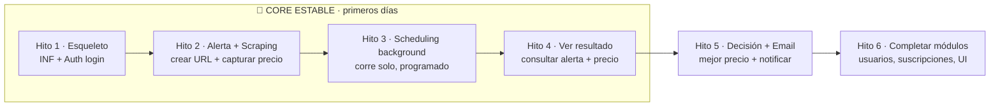

# Requerimientos · Fase 1

> Desglose accionable del [Alcance 1](../08-alcance-1-preguntas.md). Cada requerimiento tiene ID, prioridad y notas. Pensado para **ver resultados en pocos días** priorizando un *vertical slice* funcional.

## Leyenda de prioridades

| Prioridad | Significado |
|-----------|-------------|
| 🔴 **P0** | Crítico. Base del *vertical slice* de punta a punta. **Primeros días.** |
| 🟡 **P1** | Necesario para **cerrar** la Fase 1. |
| 🟢 **P2** | Deseable. Puede diferirse sin romper la fase. |

Estado: `⬜ pendiente` · `🟦 en curso` · `✅ hecho`

## Leyenda de *Track* (separación de tareas)

| Track | Significado |
|-------|-------------|
| 🖥️ **BE** | Backend (API, workers, datos) |
| 🎨 **FE** | Frontend (React PWA) |
| ⚙️ **INFRA** | Infraestructura / DevOps |
| 🔗 **FE+BE** | Requiere ambos coordinados |

> **Todas** las tablas incluyen la columna **Track** para separar tareas de frontend/backend/infra.

---

## ✅ Definition of Done (DoD) — global y obligatorio

> Aplica a **todo** requerimiento. Un ítem **no está "hecho"** hasta cumplir esto:

1. **🧼 Datos limpios (crítico):** **todo dato almacenado queda saneado y normalizado** — sin espacios sobrantes (trim + colapsar internos), sin **caracteres de control/invisibles/no imprimibles**, sin anomalías de formato, Unicode normalizado (NFC), precios parseados a numérico, fechas en **UTC**, emails/etiquetas normalizados. **Objetivo: que el análisis sea siempre congruente.** (Ver [RNF-6](#11--no-funcionales-rnf).)
2. **Validación en dos capas:** FE valida por UX; **BE es la autoridad** (nunca se confía solo en el frontend).
3. **Calidad:** pasa lint + tipos; **tests unitarios** de la funcionalidad y **E2E** de flujos críticos en verde.
4. **Seguridad:** escaneos (INF-9) sin hallazgos críticos; sin secretos en el repo.
5. **Observabilidad:** logs con `transactionId`; errores manejados; estados del job registrados cuando aplique.
6. **Datos/esquema:** si hay cambios de modelo, incluye **migración** (Alembic) y respeta el saneamiento del punto 1.
7. **Documentación mínima** actualizada (endpoint/entidad/flujo tocado).

---

## 0 · Infraestructura y base del proyecto (INF)

| ID | Requerimiento | Prioridad | Track | Estado | Notas |
|----|---------------|-----------|-------|--------|-------|
| INF-1 | **Polyrepo**: cada pieza (frontend, API, workers/scraper…) en **su propio repositorio** | 🔴 P0 | ⚙️ INFRA | ⬜ | No monorepo. Requiere estrategia de contratos/tipos compartidos (OpenAPI / paquete "contracts") |
| INF-2 | `docker-compose` local que orquesta todas las imágenes (API, workers, PostgreSQL, NoSQL, cola) | 🔴 P0 | ⚙️ INFRA | ⬜ | Referencia imágenes de cada repo; mismas imágenes portables a nube |
| INF-3 | Configuración por entorno (12-factor, `.env`, pydantic-settings) | 🔴 P0 | ⚙️ INFRA | ⬜ | Nada hardcodeado; secretos fuera del código |
| INF-4 | **Migraciones de BD versionadas (Alembic)** | 🔴 P0 | 🖥️ BE | ⬜ | Esquema versionado; recrear/upgrade/downgrade reproducible |
| INF-5 | Logging estructurado + manejo de errores central **con `transactionId` (correlation ID) rastreable end-to-end** | 🟡 P1 | 🖥️ BE | ⬜ | Se propaga por API y workers async; base de INF-8 |
| INF-6 | Lint + tipos + tests unitarios (ruff, mypy, pytest / eslint, vitest) | 🟡 P1 | 🔗 FE+BE | ⬜ | Calidad desde el inicio (en ambos stacks) |
| INF-7 | Pipeline reproducible para desplegar a Oracle/GCP free tier | 🟢 P2 | ⚙️ INFRA | ⬜ | Valida portabilidad al final de la fase |
| INF-8 | **Observabilidad/monitoreo** con **plataforma gratis en prod** (OpenTelemetry + Sentry free; Grafana Cloud opc.) | 🟡 P1 | 🖥️ BE | ⬜ | Vendor-neutral (reemplazable). Consume el `transactionId` de INF-5 |
| INF-9 | **Análisis de seguridad / vulnerabilidades** en desarrollo: SAST (Bandit/Semgrep), deps (pip-audit/npm audit + Trivy), secretos (Gitleaks), Dependabot por repo | 🟡 P1 | ⚙️ INFRA | ⬜ | Corre en CI de cada repo |
| INF-10 | **Framework de pruebas E2E robustas** (Playwright; alt. Cypress) | 🟡 P1 | 🔗 FE+BE | ⬜ | Reutiliza Playwright ya presente para scraping |
| INF-11 | **CI por repositorio**: en cada push/PR corre build + lint + tipos + tests + escaneos de seguridad (INF-9) como *quality gates* | 🟡 P1 | ⚙️ INFRA | ⬜ | GitHub Actions (o similar); bloquea merge si falla |
| INF-12 | **CD por repositorio**: build de imagen Docker + publicación a un registry + despliegue a free tier (Oracle/GCP) | 🟢 P2 | ⚙️ INFRA | ⬜ | Automatizado; puede empezar semi-manual y madurar |
| INF-13 | Estrategia de **versionado y tags** de imágenes + gestión de secretos en CI/CD | 🟢 P2 | ⚙️ INFRA | ⬜ | Secretos vía el gestor del CI, nunca en el repo |
| INF-14 | **Modelo de datos base ya definido e implementado** — relacional (PostgreSQL) **y** no relacional (NoSQL) — como prerequisito de los módulos | 🔴 P0 | 🖥️ BE | ⬜ | Entidades núcleo migradas antes de construir features. Ver [doc 03](../03-modelo-datos.md) |
| INF-15 | **Topología de despliegue definida** (dónde vive cada pieza): **Frontend** (PWA) en hosting estático/CDN gratis (Cloudflare Pages / Netlify / Vercel, o servido por nginx en la VM); **Backend** (API + workers) + **PostgreSQL** + **NoSQL** + **Redis (cola)** en **una VM free tier** (Oracle Cloud principal, GCP alterno) vía Docker Compose; **SMTP** y **observabilidad** (Sentry/Grafana) como servicios externos | 🟡 P1 | ⚙️ INFRA | ⬜ | ⏳ **Decisión pendiente** (provider de VM y host del frontend — a revisar). Sin lock-in (INF-2/RNF-2) |

## 1 · Autenticación y cuentas (AUTH)

| ID | Requerimiento | Prioridad | Track | Estado | Notas |
|----|---------------|-----------|-------|--------|-------|
| AUTH-1 | **Admin sembrado** (seed) al instalar, credenciales por env | 🔴 P0 | 🖥️ BE | ⬜ | Resuelve el primer admin |
| AUTH-2 | Login con usuario/contraseña → **JWT** | 🔴 P0 | 🔗 FE+BE | ⬜ | Contraseñas con hash (bcrypt/argon2) |
| AUTH-3 | Middleware de autorización por rol (admin / usuario / incógnito) | 🔴 P0 | 🖥️ BE | ⬜ | Protege módulos; se apoya en AUTH-10 |
| AUTH-4 | Reset de contraseña: solicitud → **email con código de 6 dígitos** | 🟡 P1 | 🔗 FE+BE | ⬜ | Depende de NOT-1 (envío email) |
| AUTH-5 | Reset: código **válido 15 min** + **throttle 15 min** entre solicitudes | 🟡 P1 | 🖥️ BE | ⬜ | Mensaje "espere hasta cierta hora" |
| AUTH-6 | **Estrategia de tokens**: access **~15 min** (stateless) + refresh **~7 días** con **rotación y revocación** (cookie `httpOnly`) | 🔴 P0 | 🔗 FE+BE | ⬜ | Óptimo para alta demanda: mínima exposición + no golpea BD por request |
| AUTH-7 | **Complejidad de contraseña** validada al **crear usuario** y al **hacer reset** | 🟡 P1 | 🔗 FE+BE | ⬜ | Longitud mín., mayús/minús/número/símbolo; validación en FE (UX) y BE (autoridad) |
| AUTH-8 | **Registro de auditoría**: quién ejecutó la acción y cuándo | 🟡 P1 | 🖥️ BE | ⬜ | Solo actor + timestamp de la acción; **sin histórico completo** por ahora |
| AUTH-9 | **Logout** + invalidación/expiración de sesión | 🟡 P1 | 🔗 FE+BE | ⬜ | Revoca el refresh token |
| AUTH-10 | **Modelo de datos de roles y permisos (RBAC)** + **árbol de accesos** evaluado en login para validar acceso a cada funcionalidad | 🔴 P0 | 🖥️ BE | ⬜ | **Estructura dinámica** (tablas `rol`, `permiso`, `rol_permiso`) **sembrada con los 3 roles**; el rol **incógnito** queda **definido pero inactivo** en Fase 1 (se retoma en Fase 2). UI de gestión de roles: después |
| AUTH-11 | Bloqueo/backoff por **intentos fallidos** de login (anti fuerza bruta) | 🟢 P2 · **Opcional** | 🖥️ BE | ⬜ | Nice-to-have; puede no entrar en Fase 1 |

## 2 · Gestión de usuarios — módulo solo-admin (USR)

| ID | Requerimiento | Prioridad | Track | Estado | Notas |
|----|---------------|-----------|-------|--------|-------|
| USR-1 | Modelo de usuario: nombres, apellidos, fecha nac., género, email, teléfono (opc.) | 🔴 P0 | 🖥️ BE | ⬜ | + rol + hash contraseña |
| USR-2 | **Módulo de gestión de usuarios accesible SOLO por admin** | 🟡 P1 | 🔗 FE+BE | ⬜ | Con formularios en el sistema |
| USR-3 | Crear / editar / desactivar cuentas (admin) | 🟡 P1 | 🔗 FE+BE | ⬜ | No hay auto-registro |
| USR-4 | Módulo "Modificar mi información" (usuario edita su perfil) | 🟢 P2 | 🔗 FE+BE | ⬜ | |

## 3 · Alertas (ALE)

| ID | Requerimiento | Prioridad | Track | Estado | Notas |
|----|---------------|-----------|-------|--------|-------|
| ALE-1 | **Modelo de datos de Alerta** con campos: Título de alerta, Nombre producto/servicio, Etiquetas/categorías (múltiples), URLs (**1..N**), Observaciones, **`estado` (activa/inactiva)**, + metadata: `creado_en` (fecha+hora) y `creado_por` | 🔴 P0 | 🖥️ BE | ⬜ | Ver [doc 03](../03-modelo-datos.md) |
| ALE-2 | Crear alerta **modo URL directa** con **una o muchas URLs** | 🔴 P0 | 🔗 FE+BE | ⬜ | IA (modo tema) → Fase 2 |
| ALE-3 | **Etiquetas múltiples normalizadas** (minúscula, **sin tildes**) para facilitar filtros/búsquedas futuras | 🟡 P1 | 🖥️ BE | ⬜ | Normalización en BE al guardar |
| ALE-4 | **Alertas inmutables**: no se editan. Al guardar, **modal de confirmación** advirtiendo que la acción es **definitiva** ("¿está seguro de su configuración?") | 🔴 P0 | 🔗 FE+BE | ⬜ | BE rechaza modificaciones; la *config* de la alerta no cambia (su **schedule** sí es editable, ver SCH-4) |
| ALE-5 | Consultar alertas: **todos ven todas (solo lectura)** | 🟡 P1 | 🔗 FE+BE | ⬜ | Sin edición para nadie |
| ALE-6 | Wizard/formulario de **creación** de alerta | 🟡 P1 | 🎨 FE | ⬜ | Solo alta (no edición) |
| ALE-7 | **Preview minimalista del sitio** al pegar cada URL (recuadro a la derecha) | 🟢 P2 | 🎨 FE | ⬜ | Vista previa ligera del enlace |
| ALE-8 | Al crear la alerta, **generar automáticamente un *schedule* por defecto** (hora específica, corre todos los días N veces) → el scraping del producto **inicia ese mismo día** en background | 🔴 P0 | 🖥️ BE | ⬜ | Enlaza con SCH-1/SCH-2; luego el admin puede ajustarlo (SCH-4) |
| ALE-9 | Ciclo de vida: **pausar/reactivar** alerta (cambia `estado`). **No se elimina.** Al pausar (`inactiva`), los workers **dejan de lanzar su schedule** | 🟡 P1 | 🔗 FE+BE | ⬜ | Único cambio permitido sobre una alerta creada; su config sigue inmutable |

## 4 · Programación / scheduling (SCH)

| ID | Requerimiento | Prioridad | Track | Estado | Notas |
|----|---------------|-----------|-------|--------|-------|
| SCH-1 | **Modelo de datos de programación por alerta** (schedule ↔ alerta). Config por defecto: **2×/día** (una diurna, una nocturna) | 🔴 P0 | 🖥️ BE | ⬜ | Se crea un schedule por defecto al dar de alta la alerta (ALE-8) |
| SCH-2 | Scheduler **100% background** en la operación normal (sin botón para el flujo cotidiano) | 🔴 P0 | 🖥️ BE | ⬜ | Encola trabajos según SCH-1; **solo alertas con `estado=activa`** (ALE-9) |
| SCH-3 | Ejecución **escalonada** dentro de las ventanas horarias | 🔴 P0 | 🖥️ BE | ⬜ | Reparte carga; horas distintas por alerta |
| SCH-4 | **Módulo de administración de schedules (admin)**: ver **todos** los schedules con su configuración, estado, última/próxima corrida | 🟡 P1 | 🔗 FE+BE | ⬜ | Cada schedule asociado a una alerta |
| SCH-5 | Admin **edita cualquier schedule** (frecuencia, hora, pausar), **sin importar quién lo creó** | 🟡 P1 | 🔗 FE+BE | ⬜ | Puede pausar todos si desea; la config de la alerta sigue inmutable |
| SCH-6 | **Límite máx 2 corridas/día por alerta** | 🟡 P1 | 🖥️ BE | ⬜ | Respeta rate limiting; tope duro |
| SCH-7 | **Ventanas horarias parametrizables**: por defecto **04:00–06:00** y **18:00–20:00**, configurables por **variables de entorno** | 🟡 P1 | 🖥️ BE | ⬜ | Valores fáciles de cambiar sin tocar código |
| SCH-8 | **Lanzamiento manual de un schedule para pruebas (solo admin)** | 🟡 P1 | 🔗 FE+BE | ⬜ | Excepción a SCH-2, exclusiva del admin para testing |
| SCH-9 | **Vista de progreso en tiempo real**: al abrir un schedule en ejecución, ver la **etapa de la tarea background por sitio** (leído → persistido → analizado → ok/mal) | 🟡 P1 | 🔗 FE+BE | ⬜ | Consume las etapas observables del job (SCR-16) |
| SCH-10 | Corre **sin la PC encendida** (desplegado en free tier) | 🟡 P1 | ⚙️ INFRA | ⬜ | Ver INF-7 |

## 5 · Scraping / ingesta (SCR)

| ID | Requerimiento | Prioridad | Track | Estado | Notas |
|----|---------------|-----------|-------|--------|-------|
| SCR-1 | **Cola de trabajos + workers** background | 🔴 P0 | 🖥️ BE | ⬜ | Redis + runner (ver [doc 04](../04-stack-tecnologico.md)) |
| SCR-2 | Fetcher **HTTP-first** (httpx) | 🔴 P0 | 🖥️ BE | ⬜ | |
| SCR-3 | **Extractor genérico** JSON-LD / schema.org / `og:price` | 🔴 P0 | 🖥️ BE | ⬜ | Sin scraper por sitio |
| SCR-4 | Fetcher **fallback Playwright** cuando el precio requiere JS | 🟡 P1 | 🖥️ BE | ⬜ | Solo cuando HTTP no basta |
| SCR-5 | Respeto a **robots.txt** + `Crawl-delay` | 🟡 P1 | 🖥️ BE | ⬜ | Política [doc 07](../07-consideraciones-legales.md) |
| SCR-6 | **Rate limiting** + backoff ante 403/429 | 🟡 P1 | 🖥️ BE | ⬜ | User-agent honesto |
| SCR-7 | Reintentos idempotentes (no duplicar historial) | 🟡 P1 | 🖥️ BE | ⬜ | `hash_captura` |
| SCR-8 | **Modelo de reintentos controlados**: máx **3** (parametrizable), con espera de **10–15 min** entre intentos, tras agotar HTTP + Playwright. Al agotarse → marcar el sitio como "sin precio hoy" + log con `transactionId` | 🟡 P1 | 🖥️ BE | ⬜ | Re-encola el sitio fallido, no bloquea la corrida del resto |
| SCR-9 | **Fallback #2**: extracción por **Microdata / RDFa / meta** + **heurística regex** de precio | 🟡 P1 | 🖥️ BE | ⬜ | Gratis; complementa lo genérico |
| SCR-10 | **Fallback #4**: **interceptar XHR/JSON interno** (vía Playwright) — el precio suele venir de una API oculta | 🟡 P1 | 🖥️ BE | ⬜ | Gratis; alta estabilidad |
| SCR-11 | **Registro de adaptadores por dominio**: extractor específico **persistido** y **reutilizado automáticamente** en futuras corridas del mismo sitio; se **consulta ANTES** de la cascada genérica | 🟡 P1 | 🖥️ BE | ⬜ | "Scraping sin re-trabajo": aprende una vez, reutiliza siempre |
| SCR-12 | **Constructor manual de adapters (admin)**: UI que ayuda a crear el extractor de un sitio (probar selectores, ver preview) y **guardarlo** (SCR-11) | 🟡 P1 | 🔗 FE+BE | ⬜ | Camino B: sin IA en Fase 1. Asistencia IA → Fase 2 |
| SCR-13 | **Fallback final #7**: al agotar todas las estrategias, **notificar al admin por email** para que construya el adapter (SCR-12) | 🟡 P1 | 🖥️ BE | ⬜ | Solo email en Fase 1; SMS opcional/futuro por costo |
| SCR-14 | **Resumen de corrida por alerta** (sitios ok/fallidos, `transactionId`, duración, nº snapshots) almacenado en **NoSQL** (solo consulta) | 🟡 P1 | 🖥️ BE | ⬜ | Reusa el store documental; mantiene PostgreSQL liviano. Insumo del panel de salud |
| SCR-15 | **Guardar HTML/JSON crudo SOLO cuando falla toda la extracción** de un sitio, disponible para el admin como insumo del constructor de adapters (SCR-12) | 🟡 P1 | 🖥️ BE | ⬜ | En NoSQL/blob; no se guarda crudo en corridas exitosas (ahorro de espacio). Retención acotada |
| SCR-16 | **Máquina de estados granular del job** de scraping: registrar **la mayor cantidad de estados posible, cada uno con su hora** (timestamp). Ej.: `encolado → resolviendo adapter → descargando(HTTP) → render Playwright → extrayendo → normalizando → convirtiendo moneda → validando → persistiendo → analizando(mejor precio) → completado/fallido` (por sitio). Almacenada en **NoSQL** (solo consulta) | 🟡 P1 | 🖥️ BE | ⬜ | Cuanto más detalle con su hora, mejor. Alimenta la vista de progreso en tiempo real (SCH-9) |
| SCR-17 | **Módulo de detalle del scraper (admin)**: panel técnico con adapters guardados/rotos, **tasa de éxito por sitio**, sitios "sin precio", últimas corridas y sus etapas (SCR-16) | 🟢 P2 | 🔗 FE+BE | ⬜ | Diagnóstico técnico; complementa la observabilidad (INF-8) |

## 6 · Procesamiento y decisión (PRO)

| ID | Requerimiento | Prioridad | Track | Estado | Notas |
|----|---------------|-----------|-------|--------|-------|
| PRO-1 | Normalizador: precio, stock, moneda, título, timestamp | 🔴 P0 | 🖥️ BE | ⬜ | + descripción útil si existe |
| PRO-2 | Guardar snapshot en PostgreSQL (append-only) | 🔴 P0 | 🖥️ BE | ⬜ | Base del historial; **histórico por sitio** para el comparador (VIS-3) |
| PRO-3 | **Proveedor de tasa de cambio parametrizable** (USD→COP), obtenida por una **tarea background liviana**; **tasa + fecha/hora almacenadas en NoSQL** (solo lectura) | 🟡 P1 | 🖥️ BE | ⬜ | Interfaz reemplazable; tasa diaria |
| PRO-4 | Guardar precio original **y** convertido a COP | 🟡 P1 | 🖥️ BE | ⬜ | Cuando el sitio no está en COP |
| PRO-5 | Validador: descartar **solo lo realmente inválido** (precio ≤ 0, HTML de error). Un **desplome anómalo NO se descarta**: se notifica **marcado** para validación manual (ver NOT-5) | 🟡 P1 | 🖥️ BE | ⬜ | El usuario final decide; no filtramos oportunidades reales |
| PRO-6 | **Motor de decisión**: estrategia **"mejor precio móvil" GLOBAL de la alerta** (mínimo entre **todos** los sitios). Implementado con **patrón Strategy** para cambiar el algoritmo con bajo impacto | 🟡 P1 | 🖥️ BE | ⬜ | Opción A: notifica al romper el mejor precio disponible en cualquier sitio |

## 7 · Suscripciones (SUB)

| ID | Requerimiento | Prioridad | Track | Estado | Notas |
|----|---------------|-----------|-------|--------|-------|
| SUB-1 | Modelo de suscripción `{alerta, email, estado}`. Un usuario puede suscribir **varios correos**; por defecto se suscribe el **correo de su cuenta** | 🟡 P1 | 🖥️ BE | ⬜ | Asocia correos (no necesariamente cuentas) a una alerta |
| SUB-2 | Módulo "Suscribirse a una alerta" (precarga el correo de la cuenta; permite agregar más) | 🟡 P1 | 🔗 FE+BE | ⬜ | |
| SUB-3 | **Baja / unsubscribe** mediante **enlace en cada email** → da de baja automáticamente de esa alerta | 🟡 P1 | 🔗 FE+BE | ⬜ | Buena práctica de privacidad; enlace en la plantilla (NOT-2) |

## 8 · Notificaciones email (NOT)

| ID | Requerimiento | Prioridad | Track | Estado | Notas |
|----|---------------|-----------|-------|--------|-------|
| NOT-1 | Envío de email vía **SMTP propio** | 🟡 P1 | 🖥️ BE | ⬜ | Base de AUTH-4 y NOT-2 |
| NOT-2 | **Plantilla única** de novedad (cambia solo info del producto) | 🟡 P1 | 🖥️ BE | ⬜ | Imágenes, links, precio |
| NOT-3 | Disparo del email desde el motor de decisión (PRO-6) | 🟡 P1 | 🖥️ BE | ⬜ | Al romper el mejor precio |
| NOT-4 | **Log de notificaciones enviadas en NoSQL** | 🟢 P2 | 🖥️ BE | ⬜ | Base del módulo futuro por suscriptor |
| NOT-5 | **Marca de "desplome anómalo"** en el email cuando el precio cae de forma sospechosa: badge + texto "valida manualmente" (no se descarta, ver PRO-5) | 🟡 P1 | 🖥️ BE | ⬜ | El usuario decide; solo lo advertimos |

## 9 · Consulta / estadísticas / comparador (VIS)

| ID | Requerimiento | Prioridad | Track | Estado | Notas |
|----|---------------|-----------|-------|--------|-------|
| VIS-1 | Ver detalle de alerta + último precio por sitio | 🔴 P0 | 🔗 FE+BE | ⬜ | Cierra el *vertical slice* |
| VIS-2 | **Histórico de precios** (línea de tiempo por sitio) | 🟡 P1 | 🔗 FE+BE | ⬜ | El "Consumo" |
| VIS-3 | **Comparador en el detalle de la alerta**: gráficos **por sitio comparados entre sí**, mostrando precios y su **fluctuación** en el tiempo | 🟡 P1 | 🔗 FE+BE | ⬜ | Requisito confirmado en PRO-1; opción A notifica global pero el detalle compara por sitio |
| VIS-4 | Estadísticas: mínimo/máximo/promedio, mejor momento | 🟢 P2 | 🔗 FE+BE | ⬜ | |

## 10 · Frontend PWA (FE)

| ID | Requerimiento | Prioridad | Track | Estado | Notas |
|----|---------------|-----------|-------|--------|-------|
| FE-1 | App base React + Vite + TS + shadcn/ui | 🔴 P0 | 🎨 FE | ⬜ | |
| FE-2 | Login + manejo de sesión JWT | 🔴 P0 | 🎨 FE | ⬜ | |
| FE-3 | **Menú de módulos solo para usuarios con cuenta** | 🟡 P1 | 🎨 FE | ⬜ | Guard por rol |
| FE-4 | Pantallas: crear/consultar alerta, suscribirse | 🟡 P1 | 🎨 FE | ⬜ | Formularios/wizard |
| FE-5 | Pantalla de gestión de usuarios (admin) | 🟡 P1 | 🎨 FE | ⬜ | |
| FE-6 | Pantalla de administración de schedules (admin) | 🟡 P1 | 🎨 FE | ⬜ | SCH-4/5/8/9 |
| FE-7 | Andamiaje **i18n** (español activo; inglés futuro) | 🟢 P2 | 🎨 FE | ⬜ | |
| FE-8 | PWA instalable | 🟢 P2 | 🎨 FE | ⬜ | Progresiva, fases futuras |

## 11 · No funcionales (RNF)

| ID | Requerimiento | Prioridad | Track | Estado | Notas |
|----|---------------|-----------|-------|--------|-------|
| RNF-1 | Diseño **modular/desacoplado** (interfaces reemplazables) | 🔴 P0 | 🖥️ BE | ⬜ | IA, tasa cambio, estrategia, notif. |
| RNF-2 | Portabilidad a la nube sin lock-in | 🟡 P1 | ⚙️ INFRA | ⬜ | |
| RNF-3 | Preparado para **crecimiento (potencialmente exponencial)** a costo mínimo | 🟡 P1 | 🖥️ BE | ⬜ | Cola, batching, escalonado |
| RNF-4 | Privacidad de emails de suscriptores | 🟡 P1 | 🔗 FE+BE | ⬜ | No exponer en UI; permitir baja |
| RNF-5 | Fiabilidad de corrida diaria > 95% por alerta | 🟢 P2 | 🖥️ BE | ⬜ | Métrica objetivo |
| RNF-6 | **Capa de saneamiento/normalización de datos** aplicada a **TODO dato antes de persistir** (scrapeado y de usuario): trim + colapsar espacios, quitar caracteres de control/invisibles/no imprimibles, Unicode NFC, precios→numérico, fechas→UTC, emails/etiquetas normalizados | 🔴 P0 | 🔗 FE+BE | ⬜ | Autoridad en BE; FE valida por UX. Base del DoD #1: análisis congruente |

---

## Orden sugerido de construcción (para ver resultados pronto)

> **Objetivo del núcleo (core estable):** entrar → crear alerta por URL → capturar precio → **que corra solo, programado en background** → ver el precio. **Recién con el core estable** se agregan notificaciones (decisión: Punto 2 de la revisión).

- **Hito 1 (🔴 P0):** INF-1..4, INF-14, AUTH-1..3, AUTH-6, AUTH-10, USR-1, FE-1..2 → *puedo entrar al sistema con roles.*
- **Hito 2 (🔴 P0):** ALE-1..2, ALE-4, ALE-8, SCR-1..3, PRO-1..2 → *creo una alerta (inmutable) por URL y el sistema captura su precio.*
- **Hito 3 (🔴 P0):** SCH-1..3 → *corre solo, en background, programado por alerta.*
- **Hito 4 (🔴 P0):** VIS-1 → *veo el precio capturado en la UI.* ✅ **core estable completo.**
- **Hito 5 (🟡 P1):** PRO-3..6, NOT-1..5, SUB-1..3, SCH-4..9, SCR-4..16 → *detecta mejor precio, avisa por email; scraping robusto observable; admin gestiona schedules.*
- **Hito 6 (🟡/🟢):** USR-2..4, ALE-3/5/6/7/9, VIS-2..4, FE-3..8, AUTH-4/5/7/8/9/11 → *módulos completos y pulido.*

---

## Fuera de alcance de la Fase 1 (para fases futuras)

- 🚫 **Modo B · descubrimiento con IA (Gemini)** → Fase 2.
- 🚫 **Precio objetivo** definido por el usuario ("avísame si baja de $X") → Fase futura (complementa la estrategia automática de mejor precio).
- 🚫 **Asistencia con IA al constructor de adapters (SCR-12)** → Fase 2. Idea: **evaluar la API de Claude** para generar el algoritmo del extractor mucho más rápido a partir del HTML del sitio.
- 🚫 **Extractor automático con IA por request (#5)** y **notificación al admin por SMS** → Fase 2/futuro (SMS por costo de pasarela).
- 🚫 **Validación de que las URLs de una alerta correspondan al mismo producto** → Fase 2 (con IA). En Fase 1 **se confía en el usuario**.
- 🚫 **Doble opt-in (confirmación de suscripción por email)** → Fase futura.
- 🚫 **Módulo para usuario incógnito** → se retira de Fase 1; se abordará de otra manera más adelante.
- 🚫 Módulo "notificaciones enviadas al suscriptor X" → Fase 2 (aunque el log NoSQL se empieza en NOT-4).
- 🚫 **Acciones basadas en stock / metadata** (nombre, disponibilidad, etc.): en Fase 1 solo se **almacenan y muestran**; el **único disparador** de notificación es el **precio** (mejor precio móvil).
- 🚫 **Notificación "vuelve a stock"** → Fase futura.
- 🚫 Otros canales de notificación (Telegram/Slack).
- 🚫 Conversión multi-moneda más allá de USD→COP.
- 🚫 Predicción/estacionalidad de precios; comparación avanzada entre sitios.
- 🚫 PWA offline avanzada; i18n inglés completo.
