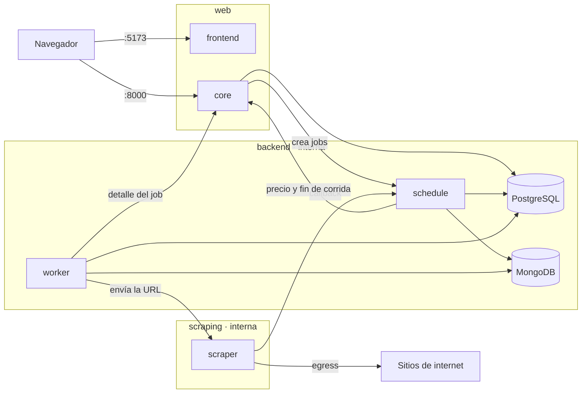

# Guía · Entorno local completo (docker-compose)

> Cómo levantar en un solo equipo todas las piezas que existen hoy, conectadas entre sí (INF-2). El código vive en [`infra/local/`](../../infra/local/); esta guía explica qué hace y cómo usarlo. La vista que implementa está en [`architecture.md`](../architecture/architecture.md#vista-de-despliegue).

> **Estado (2026-11-25):** levantado con las imágenes locales (`up --no-build --wait`). Las 7 piezas quedan sanas en unos 25 s y la red se comporta como en el diseño:
> - **Alcanzan su destino:** equipo → `core` y `frontend`; `core` → `schedule`; `worker` → `core` y `scraper`; `scraper` → `schedule`.
> - **Bloqueadas:** `scraper` → `core` y `scraper` → `db`; `schedule` → internet.
>
> **Sin probar todavía:** un ciclo de captura completo (ver limitaciones) y `--build` desde cero.

## Requisitos

- Docker con Compose v2.
- Los repos de servicios clonados **junto a** `architecture` (en la misma carpeta): `core-service`, `schedule-service`, `scraper-service` y `foundit-web-app`. Si están en otro lugar, define `IFI_REPOS_DIR` en `.env`.
- `scraper-service` y `foundit-web-app` necesitan la rama que trae su `Dockerfile` (hoy `feat/INF-2-scraper-docker` y `feat/INF-2-web-docker`, mientras no lleguen a `main`).
- Imágenes base usadas, todas con versión fijada: `postgres:16`, `mongo:8.0`, `python:3.12.16-slim-bookworm`, `mcr.microsoft.com/playwright/python:v1.65.2-noble`, `node:24.16.0-slim` y `ghcr.io/astral-sh/uv:0.13.8`. Si no las tienes, el primer `up --build` las descarga.

## Pasos

Desde `infra/local/`:

1. Genera el `.env` con valores de prueba aleatorios. No sobrescribe uno existente ni muestra los valores:

   ```bash
   ./gen-env.sh
   ```

2. Construye y levanta, esperando a que todo quede sano:

   ```bash
   docker compose up -d --build --wait
   ```

3. Abre la interfaz en <http://127.0.0.1:5173>. La API de `core` responde en <http://127.0.0.1:8000/api/health>.

4. Para apagar. **Borra las dos bases**, porque viven en `tmpfs`:

   ```bash
   docker compose down
   ```

**Para probar una captura ahora:** la primera corrida sale al crear la alerta. Para probar una corrida programada, pon en `SCHEDULE_RUN_START_TIMES` una hora cercana (hora de Bogotá) y recuerda que se suma el desfase del job y que el máximo es de 2 corridas al día (DEC-36).

## Qué levanta

| Servicio | Qué es | Redes | Puerto en el equipo |
|---|---|---|---|
| `frontend` | React (build) servido por Node | `web` | `127.0.0.1:5173` |
| `core` | FastAPI | `web`, `backend` | `127.0.0.1:8000` |
| `schedule` | FastAPI de `schedule-service` | `backend`, `scraping` | ninguno |
| `worker` | Motor de `schedule` (misma imagen, `python -m schedule_service.worker`) | `backend`, `scraping` | ninguno |
| `scraper` | FastAPI + Playwright (Chromium) | `scraping`, `egress` | ninguno |
| `db` | PostgreSQL 16, esquemas `core` y `schedule`, un rol por servicio | `backend` | ninguno |
| `mongo` | MongoDB 8.0, base `schedule` | `backend` | ninguno |

**Aún fuera del entorno:**
- `notify` y su SMTP de prueba: el repo todavía no tiene código.
- `auth`: no es parte del ejercicio. `core` usa un usuario fijo (`FIXED_USER_ID`).

## Quién habla con quién



- **Las redes `backend` y `scraping` son internas:** no tienen salida a internet y Docker no publica puertos desde ellas.
- **El scraper no comparte red con `core` ni con las bases.** Es una capa más sobre el anti-SSRF (SCR-18). Además, solo puede devolver resultados a `http://schedule:8000` (`SCRAPER_CALLBACK_ALLOWLIST`), y `schedule` solo puede entregarlos a `http://core:8000` (`SCHEDULE_CALLBACK_ALLOWLIST`).
- **Solo se publican `frontend` y `core`**, siempre en `127.0.0.1` y nunca en `0.0.0.0`, porque la API no tiene autenticación en el ejercicio.

## Orden de arranque

Lo garantiza `depends_on: condition: service_healthy`:

1. `db` y `mongo`. Al iniciar con datos vacíos, `db` ejecuta [`10-ifoundit.sh`](../../infra/local/docker/postgres-init/10-ifoundit.sh): corre `provision-roles.sql` como administrador y luego cada `schema.sql` **con el rol de su servicio**. `mongo` reutiliza el init de `schedule-service`. Los dos toman los scripts de [`docs/data/scripts`](../data/scripts/), en solo lectura.
2. `scraper` y `schedule`.
3. `worker`, cuando `schedule` y `scraper` están sanos.
4. `core`, cuando `db` y `schedule` están sanos.
5. `frontend`, cuando `core` está sano.

## Seguridad del entorno

- **Todos los contenedores** corren con `read_only`, `cap_drop: ALL`, `no-new-privileges` y límites de memoria, CPU y procesos.
- **Credenciales:** solo valores de prueba que genera `gen-env.sh` (permisos `600`). El `.env` está ignorado por git; [`.env.example`](../../infra/local/.env.example) no lleva valores.
- **Bases sin persistencia:** viven en `tmpfs` y nada sobrevive a un `down`.

## Limitaciones conocidas

- **El ciclo completo aún no cierra:** `core` todavía no expone `POST /api/internal/prices` ni `/api/internal/run-completed`. El compose ya los tiene configurados, pero hoy `schedule` recibirá 404 al entregar y lo reintentará según su outbox.
- **Las capturas reales salen a internet:** el scraper consulta los sitios de verdad. Para desarrollar, usa fixtures y los perfiles `stubs` de cada repo (sección 2 de `CLAUDE.md`).
- **Cada servicio conserva su propio `compose.yaml`** para trabajar aislado. Este entorno no los reemplaza: los compone.
