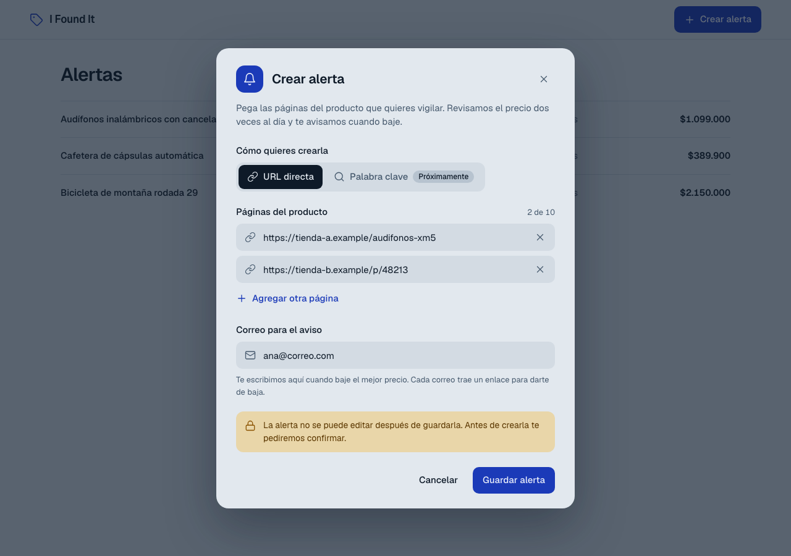
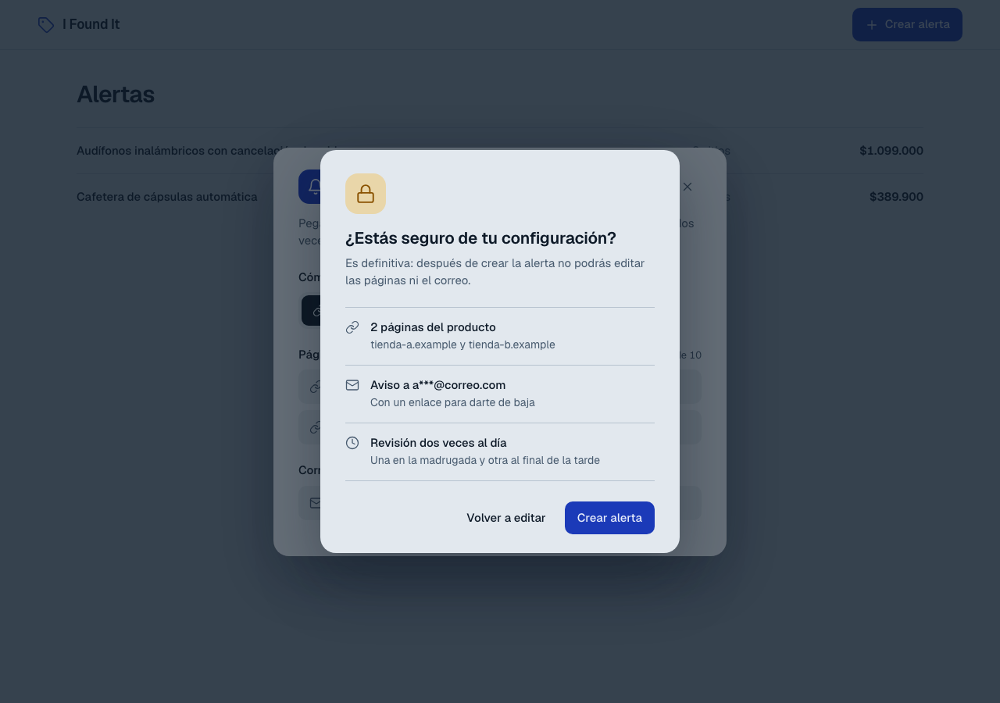
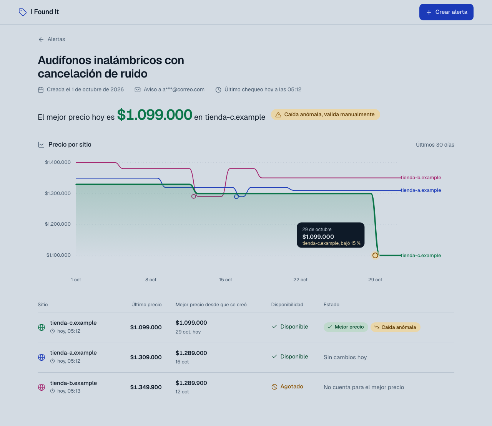
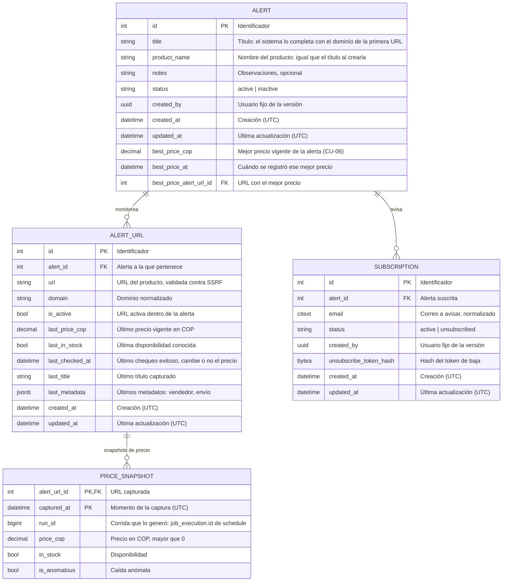
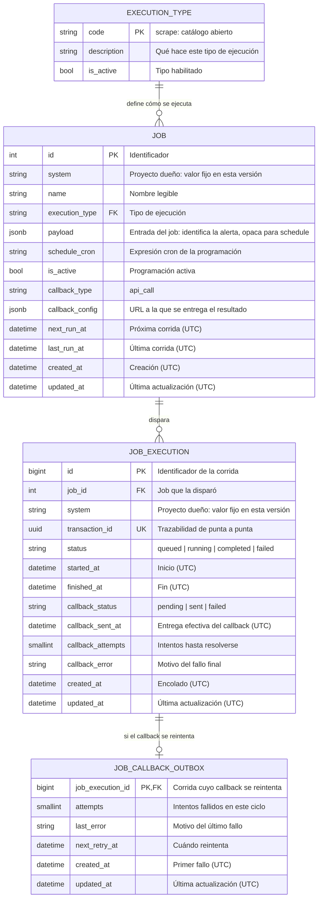
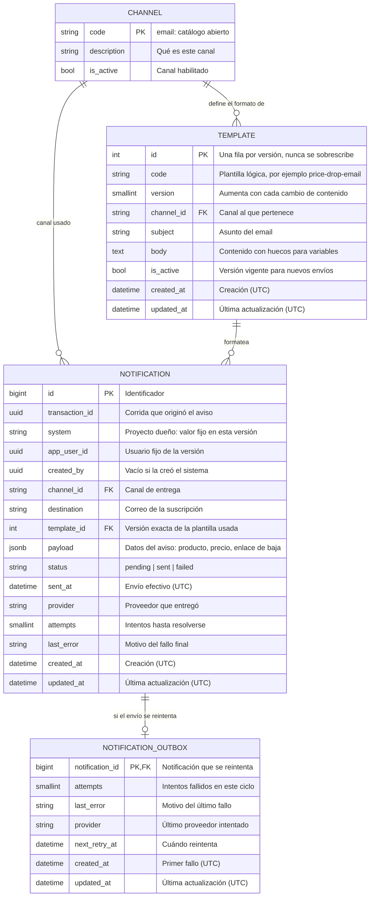
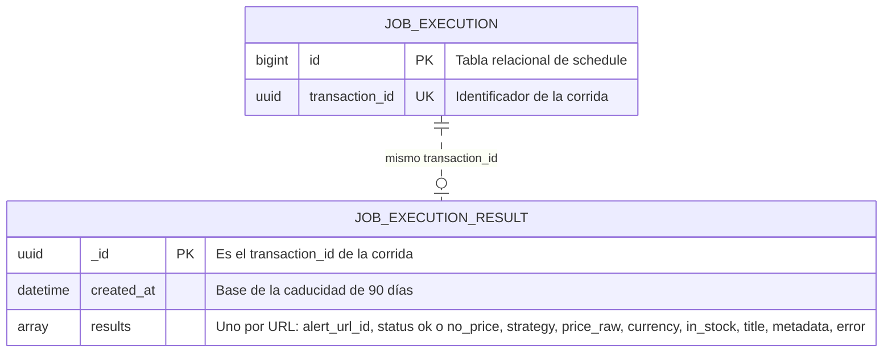

1. [Contexto](#contexto)
2. [Plantilla de alcance del corte vertical](#plantilla-de-alcance-del-corte-vertical)
   1. [Funcionalidad priorizada](#1--funcionalidad-priorizada)
   2. [Actor principal](#2--actor-principal)
   3. [Capa de presentación prevista](#3--capa-de-presentación-prevista)
   4. [Endpoint(s) requeridos](#4--endpoints-requeridos)
   5. [Servicio(s) de aplicación o negocio](#5--servicios-de-aplicación-o-negocio)
   6. [Regla de negocio principal](#6--regla-de-negocio-principal)
   7. [Repositorio o componente de persistencia](#7--repositorio-o-componente-de-persistencia)
   8. [Tabla(s) o colección(es) involucradas](#8--tablas-o-colecciones-involucradas)
   9. [Validaciones mínimas](#9--validaciones-mínimas)
   10. [Qué sí se implementaría](#10--qué-sí-se-implementaría)
   11. [Qué queda fuera del alcance](#11--qué-queda-fuera-del-alcance)
   12. [Riesgo técnico principal](#12--riesgo-técnico-principal)

---

## Contexto

Este entregable ejemplifica, con algunos casos de uso, el **corte vertical** en la construcción de software: cada funcionalidad se construye de punta a punta (pantalla, servicio, regla de negocio y persistencia) y no capa por capa. Lo hace aplicando **atributos de calidad** (seguridad, confiabilidad, rendimiento, mantenibilidad) y **arquitecturas mantenibles** (servicios desacoplados, estrategias reemplazables y contratos explícitos).

El ejemplo es la construcción de un «sistema» que hace **scraping** sobre ciertas páginas web para establecer el precio de un producto y **seguirlo día a día**. El usuario registra las URLs y un correo; el sistema captura el precio de forma programada, guarda y analiza el historial, lo muestra en un dashboard y avisa por correo cuando baja el mejor precio.

---

## Plantilla de alcance del corte vertical

### 1 · Funcionalidad priorizada

La funcionalidad priorizada es **el recorrido completo de una alerta**: desde que el usuario la crea hasta que ve el resultado en el dashboard. Se agrupa en cuatro bloques.

**1 · Crear la alerta (CU-02, CU-03).** El usuario elige el modo de creación (hoy solo «URL directa»; «Palabra clave» con LLM queda preparado pero deshabilitado), pega de 1 a 10 URLs, escribe el correo al que se le avisará y confirma en un modal que advierte que la acción es definitiva. La alerta es inmutable. Al guardarse, el sistema crea por debajo su agendamiento: **2 veces al día**, dentro de las ventanas 04:00–06:00 y 18:00–20:00. La primera corrida es inmediata, cuenta dentro de esas 2 y puede quedar fuera de las ventanas. El usuario no vuelve a intervenir.

**2 · Capturar con el scraper y guardar (CU-04, CU-05).** El scraper toma el trabajo de `schedule`, valida cada URL contra SSRF, la descarga y prueba una **cascada de estrategias** hasta obtener un precio: JSON-LD u `og:price`, luego microdata o regex, luego Playwright y por último la interceptación del XHR interno. Entrega el resultado a `schedule` (nunca a `core`), que lo reenvía a `core` por un callback. `core` normaliza, descarta lo inválido y guarda un snapshot en PostgreSQL **solo cuando cambia el precio o el stock**.

**3 · Analizar el resultado (CU-06, CU-10, CU-11).** Con lo guardado, `core` calcula el **mejor precio vigente** entre las URLs de la alerta y marca las caídas anómalas. Cuando el mejor precio baja, `notify` envía un email al correo registrado, con un enlace para darse de baja de esa alerta.

**4 · Mostrar en el dashboard (CU-07, CU-08).** El usuario ve la lista de alertas y, al abrir una, su dashboard: último precio por URL, mejor precio, marca de anomalía, histórico (el precio vale hasta el siguiente cambio) y un comparador con una serie por URL. El correo se muestra siempre enmascarado.

### 2 · Actor principal

Hay **dos actores principales**: el **usuario común** (humano), que crea la alerta, consulta el dashboard y, como destinatario de un correo, se da de baja (CU-02, CU-07, CU-08 y CU-11); y el **Sistema** (automático), que programa, captura, procesa, analiza y notifica sin que nadie lo dispare (CU-03, CU-04, CU-05, CU-06 y CU-10).

El **Sistema** lo componen las cuatro piezas de la sección 5: `core`, `schedule`, `scraper` y `notify`.

En esta versión **no hay sesión**: el usuario común usa un usuario fijo de la versión. Quien recibe el correo y se da de baja (CU-11) puede no ser quien creó la alerta.

### 3 · Capa de presentación prevista

Frontend en **React + Vite + TypeScript** con shadcn/ui, `react-hook-form` + `zod` para los formularios, **TanStack Query** para los datos del servidor y **Recharts** para el comparador. La validación del frontend es solo de experiencia de uso; **la autoridad es el backend**.

**Crear una alerta (CU-02).** Un modal con el modo de creación (URL directa activo y «Palabra clave» deshabilitada), de 1 a 10 páginas del producto, el correo para el aviso y la advertencia de que la alerta no se puede editar.

**Confirmar la alerta (CU-02).** Al pulsar «Guardar alerta» se abre una confirmación con el resumen: las páginas, el correo enmascarado y la frecuencia de revisión. Es definitiva: después no se pueden editar las páginas ni el correo.

**Dashboard de una alerta (CU-07, CU-08).** Muestra el mejor precio vigente con su advertencia si la caída es anómala, un gráfico de líneas con una curva por sitio (histórico y comparador) y la tabla de sitios con el último precio, el **mejor precio de cada sitio desde que se creó la alerta**, la disponibilidad y el estado. En el gráfico, un círculo marca el mejor precio de cada sitio y un detalle señala la caída anómala. El correo aparece enmascarado.

Son maquetas con datos de ejemplo (sitios `*.example`), de estilo minimalista: tonos pizarra sin blanco, la fuente Geist e iconos de línea. La lista de alertas y la página pública de baja siguen el mismo estilo y no se dibujan aquí.

Todas las pantallas tendrán estados de carga, error y vacío visibles.

Los casos de uso **CU-03 a CU-06 y CU-10 no tienen capa de presentación**: son backend puro.

### 4 · Endpoint(s) requeridos

Catálogo de los endpoints que resuelven los requerimientos de backend, con su operación y ruta.

| # | Operación y ruta | De → a | CU | Requerimientos |
|---|---|---|---|---|
| 1 | `POST /api/alerts` | Frontend → `core` | CU-02 | *Crear alerta por URL*, *Suscripción al correo*, *Suscribirse a una alerta*, *Selector de modo de creación* |
| 2 | `GET /api/alert-modes` | Frontend → `core` | CU-02 | *Selector de modo de creación* |
| 3 | `GET /api/alerts` | Frontend → `core` | CU-07 | *Consultar alertas* |
| 4 | `GET /api/alerts/{alert_id}` | Frontend → `core` | CU-07 | *Detalle de la alerta* |
| 5 | `GET /api/alerts/{alert_id}/price-history` | Frontend → `core` | CU-08 | *Histórico de precios*, *Comparador entre sitios* |
| 6 | `POST /api/subscriptions/{subscription_id}/unsubscribe` | Frontend → `core` | CU-11 | *Baja por enlace* |
| 7 | `POST /schedule/internal/jobs` | `core` → `schedule` | CU-03 | *Programar la captura al crear la alerta*, *API de jobs* |
| 8 | `GET /schedule/internal/jobs/{job_id}` | `core` → `schedule` | CU-03 | *API de jobs* |
| 9 | `POST /schedule/internal/pull` | `scraper` → `schedule` | CU-04 | *El scraper entrega a schedule* |
| 10 | `GET /api/internal/job-detail` | `schedule` → `core` | CU-04 | *El scraper entrega a schedule* |
| 11 | `POST /api/internal/prices` | `schedule` → `core` | CU-05 | *Normalizador de precio*, *Historial de precios*, *Validador de precio*, *Reintentos idempotentes* |
| 12 | `POST /notify/notifications` | `core` → `notify` | CU-10 | *Aviso al bajar el mejor precio* |

Reglas del catálogo:
- **Las alertas no se editan ni se borran** (requerimiento *Alerta inmutable*): por eso no existen las operaciones `PUT`, `PATCH` ni `DELETE` sobre `/api/alerts`.
- **Hay requerimientos de backend sin endpoint.** Son tareas que un servicio hace por dentro, sin que nadie las llame desde fuera:

  | Qué hace por dentro | Requerimientos | Pieza |
  |---|---|---|
  | Programar las corridas: 2 al día, franjas horarias, reparto entre alertas y ejecución en segundo plano | *Programación por alerta*, *Ejecución en segundo plano*, *Ejecución escalonada*, *Máximo de corridas al día*, *Franjas horarias* | `schedule` |
  | Extraer el precio de la página: las 4 estrategias en cadena y los reintentos | *Descarga HTTP*, *Extractor genérico*, *Extracción con navegador*, *Reintentos controlados*, *Extracción por microdata y regex*, *Interceptar la llamada interna*, *Cascada de estrategias de extracción* | `scraper` |
  | Calcular el mejor precio | *Motor de mejor precio* | `core` |
  | Enviar el email: SMTP, plantilla y advertencia de caída anómala | *Envío de email*, *Plantilla de aviso*, *Advertencia de caída anómala* | `notify` |

  Los demás requerimientos de backend sin endpoint son reglas o datos (por ejemplo *Modelo de alerta* o *Saneamiento de datos*) y se aplican dentro de los servicios de la sección siguiente.
- **Errores con un mismo formato:** toda respuesta de error tiene la forma `{ "error": "<código_estable>", "message": "<texto>", "details": [...] }`, sin detalles internos del sistema.
- **Sesión y acceso:** en esta versión no hay sesión ni token entre servicios: ningún endpoint valida autenticación ni autorización. Por eso la versión corre solo en local, y `schedule` no tiene ninguna ruta pública.

#### Contrato detallado

Cada pieza que expone endpoints (`core`, `schedule` y `notify`) publicará su **contrato Swagger (OpenAPI)**, donde quedan resumidas todas sus operaciones: rutas, cuerpos, respuestas y errores. El `scraper` no expone endpoints: solo consume el de `schedule`.

### 5 · Servicio(s) de aplicación o negocio

El sistema se compone de **4 piezas**, cada una un servicio independiente con su propio repositorio: `core`, `schedule`, `scraper` y `notify`. Dentro de cada pieza se agrupan los servicios de aplicación y de negocio que la componen. La última columna cita los requerimientos por su nombre, y los nombres técnicos (`AlertService`, etc.) son propuesta.

#### `core` · alertas, precios y análisis

FastAPI y PostgreSQL. Es el dueño del negocio.

| Servicio | Qué hace | CU | Requerimientos |
|---|---|---|---|
| **Alertas** `AlertService` | Crea la alerta con sus URLs y su correo; si algo falla, no se guarda nada. Después la alerta no se puede cambiar. También la consulta y la lista | CU-02, CU-07 | *Modelo de alerta*, *Crear alerta por URL*, *Alerta inmutable*, *Consultar alertas*, *Suscripción al correo*, *Suscribirse a una alerta*, *Detalle de la alerta* |
| **Modos de creación** `AlertSource` | Permite cambiar la forma de crear una alerta sin tocar el resto. Hoy solo funciona «URL directa»; «palabra clave con LLM» llegará después | CU-02 | *Selector de modo de creación* |
| **Política de URLs** `UrlPolicy` | Al crear la alerta, rechaza direcciones peligrosas (por ejemplo, redes internas) para que el sistema nunca las visite | CU-02 | *Protección anti-SSRF* |
| **Suscripciones** `SubscriptionService` | Guarda si el correo está activo o dado de baja y procesa la baja con el enlace del email | CU-11 | *Suscripción al correo*, *Baja por enlace* |
| **Detalle del job** `JobDetailService` | Le dice a `schedule` qué URLs tiene que visitar cada alerta | CU-04 | *El scraper entrega a schedule* |
| **Ingesta de precios** `PriceIngestService` | Recibe el precio capturado, lo limpia y lo convierte a número, descarta lo inválido (precio cero o página de error), marca las caídas sospechosas y guarda el precio solo si cambió. Procesa juntas todas las URLs de una alerta: si una es inválida, las demás se guardan igual | CU-05 | *Normalizador de precio*, *Historial de precios*, *Validador de precio*, *Reintentos idempotentes*, *Saneamiento de datos* |
| **Análisis de precio** `BestPriceStrategy` | Calcula cuál es el mejor precio vigente entre todas las URLs de la alerta y decide si hay que avisar | CU-06 | *Motor de mejor precio* |
| **Consulta de precios** `PriceHistoryService` | Entrega el historial de cada URL y los datos del gráfico comparador | CU-08 | *Histórico de precios*, *Comparador entre sitios* |
| **Cliente de agendamiento** `SchedulerClient` | Le pide a `schedule` que programe las corridas de la alerta | CU-03 | *Programar la captura al crear la alerta*, *API de jobs* |
| **Cliente de notificación** `NotifierClient` | Le pide a `notify` que envíe el aviso. Si no responde, reintenta unas pocas veces con el mismo identificador de transacción | CU-10 | *Aviso al bajar el mejor precio* |

#### `schedule` · agendamiento y ejecución

FastAPI y APScheduler. Es un motor de tareas programadas **genérico**: no conoce el negocio de las alertas y no tiene ninguna ruta pública.

| Servicio | Qué hace | CU | Requerimientos |
|---|---|---|---|
| **Gestión de jobs** `JobService` | Crea y consulta los jobs (tareas programadas): cuándo corren, qué hacen y a quién entregan el resultado | CU-03 | *API de jobs*, *Acción del job*, *Callback del job* |
| **Agendamiento** `SchedulerEngine` | Decide cuándo corre cada job: 2 veces al día, dentro de las franjas horarias y repartidas para no saturar | CU-03 | *Programación por alerta*, *Ejecución en segundo plano*, *Ejecución escalonada*, *Máximo de corridas al día*, *Franjas horarias* |
| **Ejecución de corridas** `ExecutionService` | Dispara el job a su hora y registra cada corrida con su estado y su identificador de transacción | CU-03, CU-04 | *Ejecución en segundo plano* |
| **Entrega de trabajo** `PullService` | Cuando el scraper pregunta si hay trabajo, le entrega el pendiente; en la misma llamada recibe su estado y su resultado | CU-04 | *El scraper entrega a schedule* |
| **Entrega del resultado** `CallbackService` | Envía el resultado a `core`. Si falla, lo reintenta desde su propia cola de reintentos. Hoy solo soporta la acción «llamar a un endpoint» | CU-05 | *Acción del job*, *Callback del job* |

#### `scraper` · captura del precio

Sin endpoints propios ni base de datos (usa httpx y Playwright). Nunca llama a `core`: solo habla con `schedule`.

| Servicio | Qué hace | CU | Requerimientos |
|---|---|---|---|
| **Trabajador de captura** `ScrapeWorker` | Pregunta a `schedule` si hay trabajo y le informa el estado y el resultado | CU-04 | *Cola de trabajos y workers*, *El scraper entrega a schedule* |
| **Descarga** `Fetcher` | Descarga cada URL y la revalida contra direcciones peligrosas en cada descarga y en cada redirección | CU-04 | *Descarga HTTP*, *Protección anti-SSRF* |
| **Extracción** `ExtractionStrategy` | Busca el precio probando estrategias en orden, de la más simple a la más pesada: datos estructurados (JSON-LD, `og:price`), microdata o expresión regular, navegador (Playwright) e interceptar la llamada interna (XHR). Se detiene en la primera que lo encuentra | CU-04 | *Extractor genérico*, *Extracción por microdata y regex*, *Extracción con navegador*, *Interceptar la llamada interna*, *Cascada de estrategias de extracción* |
| **Reintentos** `RetryPolicy` | Si ninguna estrategia funciona, reintenta hasta 3 veces con espera; si se agotan, marca el sitio «sin precio hoy» | CU-04 | *Reintentos controlados* |

#### `notify` · notificaciones

FastAPI. Es **genérico y multicanal**: no conoce el negocio de las alertas.

| Servicio | Qué hace | CU | Requerimientos |
|---|---|---|---|
| **Notificaciones** `NotificationService` | Recibe el pedido de aviso (si llega repetido, no lo duplica), crea la notificación y deja el envío en cola | CU-10 | *Aviso al bajar el mejor precio* |
| **Notificar por canal** `ChannelSender` | Envía el aviso por el canal elegido. Hoy: **notificar por email**. Otros canales, como **notificar por SMS**, se agregarían sin tocar lo demás | CU-10 | *Envío de email* |
| **Plantillas** `TemplateService` | Arma el contenido del aviso: producto, precio, advertencia «valida manualmente» si la caída es anómala y enlace para darse de baja | CU-10 | *Plantilla de aviso*, *Advertencia de caída anómala* |
| **Reintento de envío** `OutboxWorker` | Si el envío falla, lo reintenta desde su cola de reintentos | CU-10 | *Envío de email* |

**Transversal a las cuatro piezas:** toda llamada entre piezas lleva el mismo identificador de transacción, para seguir una corrida de punta a punta.

### 6 · Regla de negocio principal

> **Capturar y analizar el precio y el stock de un elemento concreto.**

Esta versión se centra en resolver un caso de uso específico, pero para lograrlo los demás casos de uso deben estar funcionando: hay que crear la alerta, programar la captura, guardar y mostrar el resultado. Por eso esta es la regla de la que se derivan todas las demás.

El «elemento concreto» es un producto vigilado por una alerta, que tiene de 1 a 10 URLs (sitios). La captura se hace **por URL**; el análisis se hace por URL y por alerta.

**Reglas derivadas**

**Captura** (CU-04)

| ID | Regla | Requerimientos |
|---|---|---|
| R1 | La unidad de captura es la **URL**. Una alerta con N URLs genera N capturas independientes: si una falla, las demás continúan | *El scraper entrega a schedule* |
| R2 | Cada alerta se captura **hasta 2 veces al día**, dentro de las franjas horarias configuradas | *Programación por alerta*, *Máximo de corridas al día*, *Franjas horarias* |
| R3 | Una URL peligrosa (red interna, esquema no permitido, credenciales embebidas) se rechaza al crear la alerta y **de nuevo en cada descarga y redirección** | *Protección anti-SSRF* |
| R4 | El precio se busca con estrategias en orden, de la más simple a la más pesada; **gana la primera** que devuelve un precio válido. Si ninguna funciona tras 3 reintentos, la URL queda «sin precio hoy» y **no se guarda nada** | *Extractor genérico*, *Extracción por microdata y regex*, *Extracción con navegador*, *Interceptar la llamada interna*, *Reintentos controlados*, *Cascada de estrategias de extracción* |

**Validación** (CU-05)

| ID | Regla | Requerimientos |
|---|---|---|
| R5 | El precio guardado es un **número positivo en COP**. Un precio ≤ 0, una página de error o una moneda distinta de COP se descartan | *Normalizador de precio*, *Validador de precio* |
| R6 | Todo texto capturado (título, metadatos) se sanea y se trata como **texto**, nunca como HTML ni como instrucción | *Saneamiento de datos* |

**Almacenamiento** (CU-05)

| ID | Regla | Requerimientos |
|---|---|---|
| R7 | Solo se guarda un snapshot cuando **cambia el precio o el stock** respecto del último. El historial de snapshots es de solo añadir, y repetir una corrida no duplica datos | *Historial de precios*, *Reintentos idempotentes* |
| R8 | Todo chequeo exitoso actualiza la **fecha del último chequeo**, cambie o no el precio. Así el histórico se reconstruye: el precio vale hasta el siguiente cambio | *Historial de precios*, *Histórico de precios* |

**Análisis** (CU-06)

| ID | Regla | Requerimientos |
|---|---|---|
| R9 | Una caída sospechosa de precio **se guarda y se marca como anómala**; no se descarta. La primera captura de una URL nunca es anómala | *Validador de precio* |
| R10 | El **mejor precio** de la alerta es el mínimo entre los últimos precios de sus URLs. Con una sola URL, es su precio vigente | *Motor de mejor precio* |
| R11 | Una URL **sin stock no cuenta** para el mejor precio, porque ese precio no se puede comprar | *Motor de mejor precio* |

**Aviso** (CU-10, CU-11)

| ID | Regla | Requerimientos |
|---|---|---|
| R12 | Se avisa **solo cuando el mejor precio baja** respecto del anterior, y solo a suscripciones **activas**: la primera captura no avisa, y un precio igual o más alto tampoco. Una caída anómala se avisa con la advertencia «valida manualmente», y cada email trae el enlace para darse de baja. Un aviso no se duplica aunque se repita el pedido, y si falla, el análisis y los snapshots no se revierten | *Aviso al bajar el mejor precio*, *Advertencia de caída anómala*, *Suscripción al correo*, *Baja por enlace* |

**Presentación y generales** (CU-07, CU-08)

| ID | Regla | Requerimientos |
|---|---|---|
| R13 | El dashboard muestra, por URL, el último precio, el stock, la fecha del último chequeo y la marca de anomalía, y el mejor precio de la alerta; el correo se muestra siempre enmascarado. La **alerta es inmutable**: lo capturado cambia día a día, pero su configuración no, y toda la corrida se rastrea con el mismo `transactionId` en todas las piezas | *Detalle de la alerta*, *Privacidad del correo*, *Alerta inmutable*, *Trazabilidad de la corrida* |

### 7 · Repositorio o componente de persistencia

**Conclusión:** PostgreSQL 16 para los datos del negocio, MongoDB para el resultado de cada corrida, SQLAlchemy 2 con Alembic para acceder a ellos, un pool de conexiones por pieza, bloqueos de fila donde hay concurrencia y un repositorio por entidad.

#### Motor y herramientas

| Qué | Elección | Por qué |
|---|---|---|
| Base relacional | **PostgreSQL 16** | Los datos son relacionales (alerta → URLs → snapshots de precio) y necesitan transacciones y bloqueos de fila |
| Base documental | **MongoDB**, solo en `schedule` | El resultado de cada corrida es de forma libre y caduca a los 90 días |
| Acceso | **SQLAlchemy 2** (sesión asíncrona) | Parametriza todas las consultas y evita escribir SQL a mano |
| Migraciones | **Alembic** (*Migraciones de base de datos*) | Esquema versionado, con su propia historia de revisiones por pieza |

`core`, `schedule` y `notify` usan PostgreSQL, cada una solo con sus propias tablas y sin claves foráneas hacia las de otra pieza: se referencian únicamente por identificadores (por ejemplo, `run_id` en el snapshot). `schedule` usa además MongoDB. El `scraper` no tiene base de datos.

#### Conexiones

Cada una de esas piezas abre un único pool de conexiones por proceso (un engine de SQLAlchemy o un cliente de MongoDB), con un tamaño configurable por entorno (*Configuración por entorno*). **No es una conexión única**, porque una sola serializaría todas las peticiones. Cada petición toma una conexión del pool, abre **una transacción por caso de uso** y la devuelve al terminar:

- Crear una alerta: la alerta, sus URLs y su suscripción.
- Procesar un callback de precios: todas las URLs de la corrida y el mejor precio.
- Dar de baja una suscripción.

#### Bloqueos

Dentro de esas transacciones, el aislamiento es el de PostgreSQL por defecto (`READ COMMITTED`), con bloqueos de fila explícitos donde hay concurrencia:

| Dónde | Bloqueo | Para qué |
|---|---|---|
| Procesar un callback de precios (CU-05, CU-06) | `SELECT … FOR UPDATE` sobre la fila de `alert` y luego sobre sus `alert_url`, siempre en ese orden y por id | Una alerta se procesa de a una corrida a la vez: dos corridas o reintentos simultáneos no se pisan. El orden fijo evita bloqueos mutuos (deadlocks) |
| Tomar trabajo pendiente de una cola: jobs vencidos en `schedule`, envíos en `notification_outbox`, entregas en `job_callback_outbox` | `SELECT … FOR UPDATE SKIP LOCKED` | Varios trabajadores toman tareas sin repetirlas ni esperarse |
| Insertar un snapshot, una notificación, una corrida o un resultado | Ninguno: restricciones únicas e `INSERT … ON CONFLICT DO NOTHING` | Idempotencia natural. Claves: `(alert_url_id, captured_at)` en `price_snapshot`; `(transaction_id, app_user_id, channel)` en `notification`; `transaction_id` en `job_execution`; `_id` = `transaction_id` en MongoDB |
| Dar de baja una suscripción | `UPDATE … WHERE status = 'active'` (bloqueo de fila implícito) | Repetir la baja no cambia nada |

No se usan bloqueos de tabla, `SERIALIZABLE` ni bloqueo optimista: las filas con escritura concurrente las serializa el bloqueo de `alert`, y todo lo demás son inserciones o datos inmutables. Cada bloqueo espera como máximo 5 segundos; si vence, la petición responde un error temporal y `schedule` reintenta el callback desde su cola de reintentos.

#### Acceso por entidad

Esas transacciones las ejecutan los servicios de la sección 5, y para tocar los datos usan repositorios: **uno por entidad** (tabla o colección). Los servicios nunca escriben SQL: hablan con la interfaz del repositorio, cuya implementación con SQLAlchemy es un adaptador intercambiable (*Interfaces reemplazables*). Todos los repositorios de un caso de uso comparten su transacción mediante una unidad de trabajo (`UnitOfWork`).

| Pieza | Entidad | Tabla o colección | Repositorio | Lo usan | Operaciones principales |
|---|---|---|---|---|---|
| `core` | `Alert` | `alert` | `AlertRepository` | Alertas, Ingesta de precios, Análisis de precio | Crear; leer; leer con bloqueo; actualizar el mejor precio |
| `core` | `AlertUrl` | `alert_url` | `AlertUrlRepository` | Alertas, Ingesta de precios | Crear junto con la alerta; leer con bloqueo; actualizar último precio, stock y chequeo |
| `core` | `Subscription` | `subscription` | `SubscriptionRepository` | Alertas, Suscripciones, Cliente de notificación | Crear; leer las activas; marcar la baja |
| `core` | `PriceSnapshot` | `price_snapshot` | `PriceSnapshotRepository` | Ingesta de precios, Consulta de precios | Insertar si no existe; leer el histórico por URL |
| `schedule` | `Job` | `job` | `JobRepository` | Gestión de jobs, Agendamiento | Crear; consultar; tomar los vencidos; actualizar la próxima corrida |
| `schedule` | `JobExecution` | `job_execution` | `JobExecutionRepository` | Ejecución de corridas, Entrega de trabajo | Crear la corrida; actualizar su estado |
| `schedule` | `JobCallbackOutbox` | `job_callback_outbox` | `JobCallbackOutboxRepository` | Entrega del resultado | Encolar; tomar pendientes; marcar enviado |
| `schedule` | `JobExecutionResult` | `job_execution_result` (MongoDB) | `JobExecutionResultRepository` | Entrega de trabajo | Guardar por `_id` (repetir no duplica); leer |
| `notify` | `Notification` | `notification` | `NotificationRepository` | Notificaciones | Crear (idempotente); actualizar el estado |
| `notify` | `NotificationOutbox` | `notification_outbox` | `NotificationOutboxRepository` | Reintento de envío | Encolar; tomar pendientes; borrar al resolver |
| `notify` | `Template` | `template` | `TemplateRepository` | Plantillas | Leer la versión vigente |
| `notify` | `Channel` | `channel` | `ChannelRepository` | Notificar por canal | Leer los canales habilitados |

Las consultas son siempre parametrizadas y las relaciones se cargan de forma explícita para evitar el problema N+1 (por ejemplo, una alerta con sus URLs en una sola consulta).

### 8 · Tabla(s) o colección(es) involucradas

Tablas y colecciones que usan los casos de uso de esta versión, agrupadas por pieza. **Hay 3 diagramas relacionales (PostgreSQL) y 1 no relacional (MongoDB).**

#### Relacional · `core`

Lo que usan CU-02 (crear la alerta), CU-05 (guardar el precio), CU-06 (mejor precio), CU-07 y CU-08 (dashboard e histórico) y CU-11 (baja).

#### Relacional · `schedule`

Lo que usan CU-03 (programar la captura), CU-04 (entrega de trabajo al scraper) y CU-05 (entrega del resultado a `core`).

#### Relacional · `notify`

Lo que usa CU-10 (notificar al correo registrado).

#### No relacional · MongoDB (`schedule`)

Una sola colección: el resultado que el scraper entrega en cada corrida (CU-04), de forma libre y con caducidad de 90 días. Su forma es una propuesta.

#### Referencias entre piezas

Las piezas no comparten claves foráneas: se enlazan solo por identificadores.

| Desde | Hacia | Identificador |
|---|---|---|
| `price_snapshot.run_id` | `job_execution.id` | La corrida que generó el registro |
| `job.payload` | `alert.id` | El job identifica a su alerta |
| `notification.transaction_id` | `job_execution.transaction_id` | El aviso nace de esa corrida |
| `job_execution_result._id` | `job_execution.transaction_id` | El resultado de esa corrida |
| `created_by`, `app_user_id` | Usuario fijo de la versión | Un identificador configurado por entorno |

### 9 · Validaciones mínimas

- **Sin autenticación ni autorización**, ni del usuario ni entre servicios: la versión es local.
- **El frontend guía al usuario** (`zod` con `react-hook-form`): muestra el error junto al campo antes de enviar. **El backend es la autoridad:** repite las reglas (`pydantic`) y responde 422 con el formato común de errores.
- **Todo texto se sanea en el backend** (*Saneamiento de datos*), y los logs no llevan el correo completo, el token ni el texto capturado.

#### Frontend y backend

| Qué se valida | Frontend | Backend |
|---|---|---|
| URLs de la alerta (CU-02) | De 1 a 10; formato `http://` o `https://`; avisa si hay repetidas | De 1 a 10; se normalizan y se eliminan las repetidas |
| URL peligrosa (CU-02) | — | Solo `http` o `https`, puerto 80 o 443 y sin credenciales; rechaza las IP privadas o reservadas. Si una falla, 422 y no se guarda nada |
| Correo (CU-02) | Obligatorio, formato válido, hasta 254 caracteres | El mismo formato; se normaliza (minúsculas, Unicode NFC) |
| Modo y campos de más (CU-02) | «Palabra clave» deshabilitada | Solo `url` (si no, 422 `mode_not_available`); rechaza campos fuera del contrato, como `created_by` |
| Envío (CU-02) | Modal de confirmación; botón deshabilitado mientras envía | Todo o nada: alerta, URLs y suscripción en una transacción |
| Identificadores (CU-07, CU-08, CU-11) | Los toma del enlace | Enteros positivos; si no existe, 404 |
| Datos mostrados (CU-07, CU-08) | El texto capturado siempre como texto, nunca como HTML; estado vacío si no hay capturas | Correo enmascarado (`a***@dominio.com`) y texto ya saneado |
| Baja (CU-11) | Solo envía al pulsar el botón | Token en tiempo constante; misma respuesta si es inválido, no existe o ya estaba dada de baja |

#### Solo backend

- **Callback de precios** (`POST /api/internal/prices`, CU-05): cada URL debe pertenecer a la alerta, o se rechaza todo con 422. El precio debe ser un número mayor que 0, en COP y que quepa en la base; si no, esa URL se descarta y las demás siguen. Una captura de fecha futura se rechaza y una más vieja que el último chequeo se ignora. Repetir el `transaction_id` no duplica nada.
- **Crear el job** (`POST /schedule/internal/jobs`, CU-03): cron válido que no supere 2 corridas al día, y callback solo hacia `core`.
- **Pedir el aviso** (`POST /notify/notifications`, CU-10): canal y plantilla existentes y activos, y correo de destino válido. Una llamada repetida no duplica el aviso.
- **Captura** (CU-04): la URL se revalida en cada descarga y redirección, con límites de tiempo y de tamaño de respuesta. Lo extraído se trata como texto y nunca se ejecuta.
- **Email** (CU-10): lo capturado que va al mensaje, como el título, se escapa al armar la plantilla.

### 10 · Qué sí se implementaría

Se implementan los 9 casos de uso de esta versión, descritos en la sección 1:

1. **CU-02** · Registrar una alerta
2. **CU-03** · Programar la captura
3. **CU-04** · Capturar el precio
4. **CU-05** · Procesar y almacenar
5. **CU-06** · Analizar el mejor precio
6. **CU-07** · Ver el dashboard de una alerta
7. **CU-08** · Ver histórico y comparar sitios
8. **CU-10** · Notificar al correo registrado
9. **CU-11** · Darse de baja de una alerta

### 11 · Qué queda fuera del alcance

Todo lo que se omite respecto a la versión original del proyecto:

- **Autenticación y autorización:** sesión (login, tokens, cierre de sesión), roles, permisos y token entre servicios.
- **Usuarios:** alta, edición, desactivación y anonimización de cuentas, perfil propio, y gestión de roles y permisos.
- **Administración y supervisión:** pantallas de schedules (ver, editar, lanzar a mano, seguir el progreso), panel técnico del scraper y estadísticas por sitio.
- **Alertas:** etiquetas, asistente de creación, vista previa del sitio, pausar y reactivar.
- **Scraping avanzado:** adapters por dominio y su constructor, `robots.txt`, límite de tasa, email al administrador y guardado del HTML crudo.
- **Precios:** conversión de moneda (solo COP) y estadísticas de mínimo, máximo y promedio.
- **Notificaciones:** log en NoSQL y otros canales, como SMS.
- **Búsqueda por palabra clave con LLM:** solo queda el selector deshabilitado.
- **Jobs avanzados:** acciones distintas de llamar a un endpoint (scripts, mensajes a un tópico) y editar o borrar jobs.
- **Frontend extra:** internacionalización, aplicación instalable (PWA) y las pantallas de usuarios y roles.
- **Infraestructura:** despliegue en la nube, CI/CD y observabilidad. La versión corre solo en local.

### 12 · Riesgo técnico principal

**Hacer scraping sobre tiendas que protegen sus páginas.** Muchas tiendas tienen normas o filtros de seguridad (detección de bots, límites de peticiones, bloqueos, captchas, contenido que solo carga con JavaScript) que impiden extraer el precio de forma sencilla. Cuando eso pasa, la captura **tarda más o no se puede hacer**. Es la limitante técnica principal de esta versión, porque todo lo demás depende de obtener el precio.

Efectos:
- **Más tiempo:** hace falta pasar a estrategias más pesadas (navegador, interceptar la llamada interna) y a reintentos con espera.
- **Sin dato:** la URL queda «sin precio hoy», el historial tiene huecos y el mejor precio y el aviso no se actualizan.

Cómo se enfrenta:
- **Cascada de estrategias** de la más simple a la más pesada, con reintentos (R4). Si una URL falla, las demás de la alerta continúan (R1).
- **No se eluden las protecciones:** no se saltan captchas ni bloqueos. Si una tienda no permite scrapear, ese sitio queda sin precio.
- **El riesgo se materializa con tiendas reales.** Con las páginas de prueba no aparece, así que al pasar a sitios reales hay que implementar y cumplir `robots.txt` y el límite de tasa, que hoy no están implementados.
