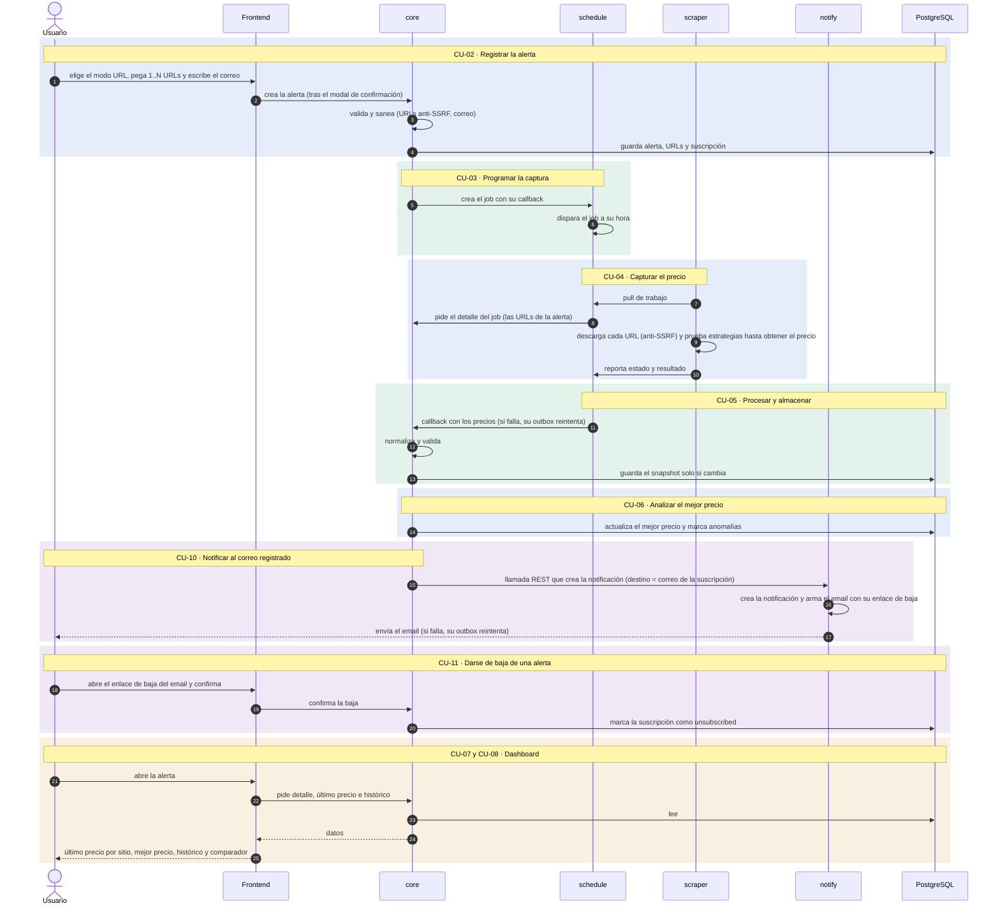
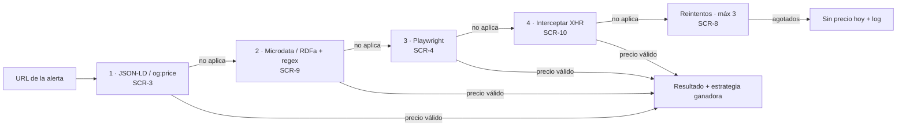

# Requerimientos · Versión del ejercicio

> **Estado: especificación, sin implementar.** El documento original [`docs/deliverables/requerimientos.md`](../docs/deliverables/requerimientos.md) **no se modifica**. Aquí cada requerimiento conserva su ID original y se anota si entra, y con qué ajuste, en esta versión.
> 🆕 marca una propuesta mía pendiente de tu aprobación.

**Leyenda:** ✅ entra tal cual · 🔧 entra con ajuste · ⛔ fuera de esta versión · 🆕 requerimiento nuevo de esta versión (prefijo `EJ-`, no existe en el original)

**Capa** (emoji junto al nombre del requerimiento): 🖥️ backend · 🎨 frontend · 🎨🖥️ ambos, según el *Track* del documento original; en los requerimientos nuevos (`EJ-`) la asigno yo.
**API:** 🔌 marca los requerimientos que se resuelven con un endpoint, con su operación y ruta. Las rutas base (`/api/*`, `/api/internal/*`, `/schedule/internal/*`, `/notify/*`) y los endpoints `prices`, `job-detail`, `pull` y `jobs` vienen del [doc 02](../docs/02-arquitectura.md); el resto del path es propuesta 🆕. En esta versión los endpoints públicos no exigen sesión (CU-01 omitido).

## Tabla de contenido

1. [Premisas de esta versión](#1--premisas-de-esta-versión)
2. [Flujo por casos de uso](#2--flujo-por-casos-de-uso)
3. [Casos de uso](#3--casos-de-uso)
   - [CU-02 · Registrar una alerta con URLs](#cu-02--registrar-una-alerta-con-urls)
   - [CU-03 · Programar la captura](#cu-03--programar-la-captura)
   - [CU-04 · Capturar el precio de un sitio](#cu-04--capturar-el-precio-de-un-sitio)
   - [CU-05 · Procesar y almacenar](#cu-05--procesar-y-almacenar)
   - [CU-06 · Analizar el mejor precio](#cu-06--analizar-el-mejor-precio)
   - [CU-07 · Ver el dashboard de una alerta](#cu-07--ver-el-dashboard-de-una-alerta)
   - [CU-08 · Ver histórico y comparar sitios](#cu-08--ver-histórico-y-comparar-sitios)
   - [CU-10 · Notificar al correo registrado](#cu-10--notificar-al-correo-registrado)
   - [CU-11 · Darse de baja de una alerta](#cu-11--darse-de-baja-de-una-alerta)
4. [Fuera de esta versión](#4--fuera-de-esta-versión)
5. [Decisiones](#5--decisiones)

---

## 1 · Premisas de esta versión

- **Se omiten CU-01 (sesión) y CU-09 (supervisión).** No hay login, ni roles, ni pantallas de administración.
- **Un usuario fijo de la versión.** Donde el modelo pide `created_by` o `app_user_id` (obligatorios y sin FK), se usa un `uuid` constante configurado por entorno. **No cambia el esquema.**
- ⚠️ **Sin login ni token entre servicios no hay control de acceso:** cualquiera que alcance las APIs, incluidas las internas, puede crear alertas, y cada alerta hace que el sistema descargue URLs y envíe correos. **Esta versión no se expone a internet**: corre solo en local (`docker-compose`, puertos en `127.0.0.1`). Es una condición, no una sugerencia.
- **Desarrollo con fixtures guardados**, no contra sitios reales (regla del proyecto): uno por estrategia de extracción y uno que las haga fallar todas, servidos por un servidor local. Antes de scrapear un sitio real hay que cumplir SCR-5 y SCR-6 (robots.txt y límite de tasa).
- **Los correos no salen a internet en desarrollo ni en pruebas:** se entregan a un servidor SMTP de prueba, desechable y local. Enviar a un SMTP real requiere tu aprobación, y sus credenciales van por variables de entorno.
- ⚠️ **El correo es dato personal y no se verifica que su dueño lo haya autorizado** (no hay cuentas). Por eso, mientras la política de Habeas Data siga pendiente (D21), **solo se usan correos de prueba**. A futuro convendría confirmar el correo antes de activar la suscripción (doble confirmación); queda anotado, no se implementa.
- **Se aplica la [DoD global](../docs/deliverables/requerimientos.md)** del original: saneamiento (RNF-6), validación en dos capas, tests, migración si cambia el modelo y logs con `transactionId`.
- **Requerimientos transversales que se mantienen:** los de la tabla siguiente.

| ID | Requerimiento | Qué hace |
|----|---------------|----------|
| INF-1 | Un repositorio por pieza | Cada pieza (`core`, `schedule`, `scraper`, `notify` y el frontend) vive en su propio repositorio. |
| INF-2 | Entorno local con docker-compose | Levanta todas las piezas y sus bases de datos en local. |
| INF-3 | Configuración por entorno | Nada va fijo en el código: los valores que cambian y los secretos llegan por variables de entorno. |
| INF-4 | Migraciones de base de datos | El esquema de cada pieza se versiona y se puede recrear de forma reproducible. |
| INF-5 | Trazabilidad de la corrida | El mismo `transactionId` cruza `core`, `schedule`, `scraper` y `notify`, y sus logs. |
| INF-14 | Modelo de datos base | Las tablas y colecciones de la versión existen antes de construir las funciones. |
| RNF-1 | Interfaces reemplazables | Los servicios van detrás de interfaces para poder cambiarlos sin tocar el resto. |

---

## 2 · Flujo por casos de uso

Cada recuadro es un caso de uso.

---

## 3 · Casos de uso

### CU-02 · Registrar una alerta con URLs

**Descripción.** El usuario elige el modo de creación, pega **una o varias URLs** (1..N, máximo 10), escribe el correo al que se le avisará y confirma. El sistema guarda la alerta (inmutable), sus URLs y la suscripción.

| ID | Requerimiento original (resumen) | Qué hace | ¿Entra? | API (operación y ruta) | Ajuste en esta versión |
|----|----------------------------------|----------|:-------:|------------------------|------------------------|
| ALE-1 | 🖥️ Modelo de alerta | Define los datos de una alerta: título, producto, estado y quién la creó. | 🔧 | — | `title` y `product_name` **siguen obligatorios en la base** (decisión cerrada). Como el formulario solo pide URLs y correo, los completa el sistema con el dominio de la primera URL. El nombre real del producto se lee del sitio (`alert_url.last_title`) y se muestra en el dashboard. Sin cambio de esquema |
| ALE-2 | 🎨🖥️ Crear alerta por URL | El usuario crea la alerta pegando una o varias URLs. | 🔧 | 🔌 `POST /api/alerts` | Campo repetible, **mínimo 1, máximo 10**. Sin duplicados tras normalizar. Cada URL se valida contra SCR-18 |
| ALE-4 | 🎨🖥️ Alerta inmutable | Tras crearla, la alerta no se edita; antes de guardar se pide confirmar. | ✅ | Sin rutas `PUT` / `PATCH` / `DELETE` | El modal advierte que la acción es definitiva |
| SUB-1 | 🖥️ Suscripción al correo | Guarda el correo que recibirá los avisos de la alerta. | 🔧 | 🔌 `POST /api/alerts` (mismo cuerpo) | El correo se escribe **en el mismo formulario** y crea la `subscription` junto con la alerta, en una sola transacción. `created_by` = usuario fijo. `unsubscribe_token_hash` se genera al crear (lo usa CU-10) |
| SUB-2 | 🎨🖥️ Suscribirse a una alerta | Permite indicar ese correo al crear la alerta. | 🔧 | 🔌 `POST /api/alerts` (mismo cuerpo) | No hay módulo aparte: el correo va en el alta, sin precarga de cuenta |
| SCR-18 | 🖥️ Protección anti-SSRF | Rechaza URLs peligrosas (redes internas, esquemas raros) antes de guardarlas. | 🔧 | — (se valida dentro de `POST /api/alerts`) | Aquí solo la validación **al crear**; la autoridad está en el fetcher (CU-04) |
| FE-1 | 🎨 App base React + Vite + TS + shadcn/ui | Base de la aplicación web que usa el usuario. | ✅ | — | |
| FE-4 | 🎨 Pantallas de alertas | Pantalla donde se crea la alerta. | 🔧 | — (consume `POST /api/alerts`) | Una pantalla de alta: modo, URLs, correo y modal |
| RNF-6 | 🎨🖥️ Saneamiento de datos | Limpia y normaliza todo dato antes de guardarlo. | ✅ | — | Correo normalizado (trim, NFC, minúsculas) y URLs saneadas |
| RNF-4 | 🎨🖥️ Privacidad del correo | Nunca muestra el correo completo en pantalla. | ✅ | — | El correo nunca se muestra completo en la UI (enmascarado) |
| RNF-7 | 🎨🖥️ Habeas Data | Cuida los datos personales según la ley de Habeas Data. | 🔧 | — | Solo correos de prueba hasta cerrar la política (D21) |
| **EJ-1** 🆕 | 🎨🖥️ **Selector de modo de creación** | Selector de modo: URL directa hoy, palabra clave con LLM más adelante. | 🆕 | 🔌 `POST /api/alerts` (campo `mode`) · `GET /api/alert-modes` | `url` activo; `keyword` (palabra clave + LLM) preparado pero deshabilitado. Detalle abajo |

**Criterios de aceptación** 🆕
- Con 1 a 10 URLs válidas y un correo válido se crea la alerta (`active`), sus URLs y la suscripción, **o nada**.
- La alerta se guarda con `title` y `product_name` no vacíos.
- Una URL con esquema distinto de `http`/`https`, con un puerto distinto de 80 o 443, con credenciales o que resuelve a una IP privada o reservada → 422 con el índice de la URL fallida; ninguna se guarda.
- 0 URLs o más de 10 → rechazado. URLs repetidas tras normalizar → se deduplican.
- Correo vacío, con formato inválido o enorme → rechazado.
- El modal de confirmación aparece antes de enviar; cancelar no crea nada; el botón se deshabilita mientras se envía.
- No existe ninguna ruta para editar o borrar la alerta.
- El correo no aparece completo en la pantalla ni en los logs.

**EJ-1 · Selector de modo de creación.** Prepara el cambio futuro «buscar por palabra clave usando un LLM» **sin implementarlo ahora**. En el original, ALE-2 ya dice «IA (modo tema) → Fase 2».

| Aspecto | Especificación |
|---------|----------------|
| Interfaz | Selector «Modo» **siempre visible**: **URL directa** (activo) y **Palabra clave** (deshabilitado, rótulo «Próximamente») |
| API | Campo `mode`, por defecto `url`. Con `keyword` responde 422 `mode_not_available` |
| Disponibilidad | Se decide por configuración (`ALERT_CREATION_MODES`, por defecto `url`), no por código |
| Diseño | `AlertSource` (Strategy): `UrlAlertSource` hoy; `KeywordLlmAlertSource` después. El proveedor de IA va detrás de **otra** interfaz (RNF-1) |
| Persistencia | El modo **no se guarda** en esta versión (sin cambio de esquema). Si hace falta luego, será una migración |

Restricciones ya conocidas para cuando se active (no se implementan ahora):
- La salida del LLM es **dato no confiable**: se valida contra un esquema y **cada URL se verifica**, porque un LLM puede inventarlas. Además pasa por SCR-18.
- El contenido scrapeado nunca se concatena a un prompt como instrucción: va delimitado como dato.
- **No se usa ninguna API de pago sin tu aprobación.**
- Los correos de usuarios no se envían a la herramienta de IA.

---

### CU-03 · Programar la captura

**Descripción.** Al crearse la alerta, `core` le pide a `schedule` un job con su callback. Ese job dispara la captura a su hora, sin intervención del usuario.

| ID | Requerimiento original (resumen) | Qué hace | ¿Entra? | API (operación y ruta) | Ajuste en esta versión |
|----|----------------------------------|----------|:-------:|------------------------|------------------------|
| ALE-8 | 🖥️ Programar la captura al crear la alerta | Al crear la alerta, deja programado su scraping automático. | ✅ | 🔌 `POST /schedule/internal/jobs` | `core` crea el job en `schedule` después de guardar la alerta. La consistencia entre ambas escrituras sigue abierta (D7) |
| SCH-1 | 🖥️ Programación por alerta | Define cuántas veces al día corre cada alerta (2). | ✅ | — (cron del job al crearlo) | Cada alerta corre **2 veces al día**, una diurna y una nocturna (decisión 8) |
| SCH-2 | 🖥️ Ejecución en segundo plano | Ejecuta las corridas solas, en segundo plano. | ✅ | — | |
| SCH-3 | 🖥️ Ejecución escalonada | Reparte las corridas en horas distintas para no sobrecargar. | ✅ | — | Con pocas alertas casi no se nota, pero se conserva |
| SCH-6 | 🖥️ Máximo de corridas al día | Impide que una alerta corra más de 2 veces al día. | ✅ | — | Tope duro. La corrida inicial al crear la alerta (ALE-8) cuenta dentro del tope 🆕 |
| SCH-7 | 🖥️ Franjas horarias | Define las franjas horarias en que pueden correr los jobs (por defecto 04:00–06:00 y 18:00–20:00). | ✅ | — | Por variables de entorno |
| SCH-11 | 🖥️ `schedule` solo interno | Mantiene `schedule` accesible solo para otros servicios. | ✅ | — (regla: sin ruta pública) | Sin ruta pública |
| SCH-12 | 🖥️ API de jobs | Permite a `core` crear y consultar jobs en `schedule`. | 🔧 | 🔌 `POST /schedule/internal/jobs` · `GET /schedule/internal/jobs/{job_id}` | Solo **crear y consultar**; actualizar y eliminar quedan fuera (no hay pausar, ALE-9) |
| SCH-13 | 🖥️ Acción del job | Define qué hace un job al dispararse (llamar a un endpoint). | 🔧 | — | Solo `api_call`; `python_script` y `topic_message` fuera |
| SCH-14 | 🖥️ Callback del job | Indica a `schedule` a qué URL entregar el resultado. | ✅ | — (`schedule` llama a `POST /api/internal/prices`) | `core` indica la URL a la que `schedule` entrega el precio |

**Criterios de aceptación** 🆕
- Al crear la alerta existe **un job por alerta** con su callback configurado; si falla su creación, la alerta queda detectable como «sin schedule» (según D7).
- La captura corre sola, sin botón, dentro de las ventanas configuradas.
- Ninguna alerta corre más de 2 veces al día.
- Las pruebas controlan el reloj o la ventana (inyectados) en vez de esperar al horario real.
- El callback de un job solo puede apuntar a `core`.
- `schedule` no tiene ninguna ruta pública.

---

### CU-04 · Capturar el precio de un sitio

**Descripción.** El scraper toma el trabajo de `schedule` y, por cada URL de la alerta, la valida de nuevo contra SSRF, la descarga y aplica una **cascada de estrategias de extracción**: prueba la primera y, si no aplica a ese sitio, pasa a la siguiente, hasta obtener un precio válido. Cada estrategia es una adaptación de una forma de hacer scraping. Entrega el resultado a `schedule`, nunca a `core`.

| ID | Requerimiento original (resumen) | Qué hace | ¿Entra? | API (operación y ruta) | Ajuste en esta versión |
|----|----------------------------------|----------|:-------:|------------------------|------------------------|
| SCR-1 | 🖥️ Cola de trabajos y workers | Encola los trabajos de scraping y los reparte entre workers. | ✅ | — (el worker usa `POST /schedule/internal/pull`) | Redis sigue «a confirmar» (B2) |
| SCR-2 | 🖥️ Descarga HTTP | Descarga la página de la URL con una petición HTTP. | ✅ | — | Base de las estrategias 1 y 2 |
| SCR-3 | 🖥️ Extractor genérico | Lee el precio de los datos estructurados de la página (JSON-LD, `og:price`). | ✅ | — | **Estrategia 1** |
| SCR-9 | 🖥️ Extracción por microdata y regex | Busca el precio en microdata o con una expresión regular. | ✅ | — | **Estrategia 2**. Las regex llevan timeout (anti-ReDoS) |
| SCR-4 | 🖥️ Extracción con navegador | Abre la página en un navegador cuando el precio depende de JavaScript. | ✅ | — | **Estrategia 3**. Solo cuando HTTP no basta |
| SCR-10 | 🖥️ Interceptar la llamada interna | Captura la respuesta interna (XHR) con la que la página carga el precio. | ✅ | — | **Estrategia 4** |
| **EJ-2** 🆕 | 🖥️ **Cascada de estrategias de extracción** | Prueba las estrategias en orden hasta obtener un precio. | 🆕 | — | Detalle abajo |
| SCR-8 | 🖥️ Reintentos controlados | Reintenta hasta 3 veces un sitio que falló. | 🔧 | — | Máx. 3 (parametrizable) con espera de 10–15 min, **tras agotar las 4 estrategias**; re-encola solo el sitio fallido. Al agotarse: «sin precio hoy» + log con `transactionId`. **No hay email al admin** (SCR-13 fuera) |
| SCR-18 | 🖥️ Protección anti-SSRF | Vuelve a validar la URL en cada descarga y en cada redirección. | ✅ | — (el fetcher valida en cada descarga) | Es la **autoridad**. También en el navegador de Playwright: se bloquea toda request a destinos no permitidos |
| SCR-20 | 🖥️ El scraper entrega a schedule | Entrega el resultado a `schedule`, nunca directamente a `core`. | ✅ | 🔌 `POST /schedule/internal/pull` · `GET /api/internal/job-detail` | Entrega el resultado a `schedule`, con un precio por URL |

**EJ-2 · Cascada de estrategias** 🆕

| Aspecto | Especificación |
|---------|----------------|
| Diseño | Interfaz `ExtractionStrategy` (patrón Strategy en cadena): cada una responde con un resultado o con «no aplica» |
| Orden | Configurable; por defecto 1 → 2 → 3 → 4, de la más barata a la más pesada. Playwright solo se lanza si las HTTP no bastaron |
| Corte | Se detiene en la **primera** que devuelve un precio numérico positivo; un resultado sin precio cuenta como «no aplica» |
| Resultado | Incluye la **estrategia ganadora**, para logs y pruebas |
| Extensión | Agregar una estrategia es una clase nueva y una línea de configuración, sin tocar las demás. El adapter por dominio (SCR-11) sería una más al inicio de la cadena: **no se implementa en esta versión** |

**Criterios de aceptación** 🆕
- Con un fixture por estrategia gana la esperada: JSON-LD → la 1; microdata o regex sin JSON-LD → la 2; precio que solo aparece al ejecutar JavaScript → la 3; precio que llega por una API interna → la 4.
- Con un fixture donde las cuatro fallan: hasta 3 reintentos, luego «sin precio hoy» y ningún snapshot.
- La cascada se detiene en la primera que acierta (Playwright no se lanza si alcanzó la 1).
- El resultado trae la estrategia ganadora.
- Una URL a una IP interna, o que redirige a una, se rechaza en el fetcher aunque haya pasado la validación del alta; el navegador de Playwright tampoco puede llegar a destinos no permitidos.
- Si una URL falla, **las demás de la misma alerta siguen** y esa queda marcada «sin precio».
- El scraper reporta solo a `schedule`; ninguna llamada va a `core`.

⚠️ **Playwright ejecuta JavaScript de terceros.** Corre en un contenedor aislado, sin secretos ni acceso a la red interna; el contenido que devuelve es dato no confiable y se sanea (RNF-6).

---

### CU-05 · Procesar y almacenar

**Descripción.** `schedule` entrega los precios a `core` por el callback; `core` los normaliza, descarta lo inválido y guarda un snapshot en PostgreSQL solo cuando el precio o el stock cambian.

| ID | Requerimiento original (resumen) | Qué hace | ¿Entra? | API (operación y ruta) | Ajuste en esta versión |
|----|----------------------------------|----------|:-------:|------------------------|------------------------|
| PRO-1 | 🖥️ Normalizador de precio | Convierte lo extraído en datos limpios: precio numérico, moneda, stock y título. | ✅ | 🔌 `POST /api/internal/prices` | Con sitios en COP no se necesita conversión |
| PRO-2 | 🖥️ Historial de precios | Guarda cada snapshot de precio en PostgreSQL, solo de añadir. | ✅ | 🔌 `POST /api/internal/prices` | |
| PRO-5 | 🖥️ Validador de precio (descarte) | Descarta precios inválidos (cero, negativos, páginas de error). | ✅ | 🔌 `POST /api/internal/prices` | Descarta lo realmente inválido: precio ≤ 0, HTML de error o moneda distinta de COP |
| SCR-7 | 🖥️ Reintentos idempotentes | Evita duplicar el historial si se repite una corrida. | ✅ | 🔌 `POST /api/internal/prices` | Entra aunque sea P1: el snapshot se inserta solo si cambia el precio o el stock |
| RNF-6 | 🎨🖥️ Saneamiento de datos | Sanea el título y los metadatos antes de guardarlos. | ✅ | — | |

**Criterios de aceptación** 🆕
- Repetir la misma corrida con el mismo precio **no** duplica el snapshot.
- Un precio ≤ 0 o una página de error no se guarda.
- Una moneda distinta de COP se descarta y no se guarda.
- El precio guardado es numérico, en COP, con el título saneado.
- El `transactionId` es el mismo en los logs de todos los servicios.

---

### CU-06 · Analizar el mejor precio

**Descripción.** Con los snapshots guardados, `core` calcula el mejor precio vigente de la alerta entre todas sus URLs y marca las caídas anómalas.

| ID | Requerimiento original (resumen) | Qué hace | ¿Entra? | API (operación y ruta) | Ajuste en esta versión |
|----|----------------------------------|----------|:-------:|------------------------|------------------------|
| PRO-6 | 🖥️ Motor de mejor precio | Calcula el mejor precio vigente entre todas las URLs de la alerta. | ✅ | — (proceso interno de `core`) | Calcula y guarda el mejor precio vigente entre **todas las URLs** de la alerta. Cuando el mejor precio baja, **pide el aviso a `notify`** (CU-10) |
| PRO-5 | 🖥️ Validador de precio (marca) | Marca como anómala una caída sospechosa de precio. | ✅ | — (proceso interno de `core`) | Una caída anómala **se marca** en el dato; no se descarta |

**Criterios de aceptación** 🆕
- El mejor precio de la alerta es el mínimo entre los últimos precios vigentes de sus URLs activas y con stock, y se actualiza en la misma transacción que el snapshot.
- Una caída sospechosa se guarda con la marca de anomalía.
- Una URL sin stock no cuenta para el mejor precio.
- Con una sola URL, el mejor precio es su precio vigente.
- Cuando el mejor precio **baja**, el motor pide el aviso a `notify` (CU-10) **después** de confirmar la transacción del snapshot y el mejor precio.

---

### CU-07 · Ver el dashboard de una alerta

**Descripción.** El usuario abre una alerta y ve el último precio por sitio, el mejor precio y las marcas de anomalía.

| ID | Requerimiento original (resumen) | Qué hace | ¿Entra? | API (operación y ruta) | Ajuste en esta versión |
|----|----------------------------------|----------|:-------:|------------------------|------------------------|
| VIS-1 | 🎨🖥️ Detalle de la alerta | Muestra el detalle de la alerta y el último precio de cada URL. | ✅ | 🔌 `GET /api/alerts/{alert_id}` | Es el núcleo del dashboard |
| ALE-5 | 🎨🖥️ Consultar alertas | Lista las alertas para poder abrirlas. | 🔧 | 🔌 `GET /api/alerts` | Lista simple para llegar al dashboard; sin permisos por rol |
| FE-4 | 🎨 Pantallas de consulta | Pantallas de la lista y del dashboard de la alerta. | 🔧 | — (consume los `GET`) | Lista de alertas y dashboard de la alerta |
| RNF-4 | 🎨🖥️ Privacidad del correo | Muestra el correo siempre enmascarado. | ✅ | — (el correo sale enmascarado) | Enmascarado en el detalle |

**Criterios de aceptación** 🆕
- El detalle muestra, por URL: último precio, stock, título capturado, fecha del último chequeo y si es anómalo; y el mejor precio de la alerta.
- Una alerta sin capturas todavía muestra un estado vacío claro, no un error.
- Los estados de carga y error son visibles.

---

### CU-08 · Ver histórico y comparar sitios

**Descripción.** El usuario ve cómo cambió el precio de cada URL en el tiempo y compara los sitios entre sí.

| ID | Requerimiento original (resumen) | Qué hace | ¿Entra? | API (operación y ruta) | Ajuste en esta versión |
|----|----------------------------------|----------|:-------:|------------------------|------------------------|
| VIS-2 | 🎨🖥️ Histórico de precios | Muestra cómo cambió el precio de cada URL en el tiempo. | ✅ | 🔌 `GET /api/alerts/{alert_id}/price-history` | Línea de tiempo escalonada |
| VIS-3 | 🎨🖥️ Comparador entre sitios | Compara en un gráfico los precios de las URLs entre sí. | ✅ | 🔌 `GET /api/alerts/{alert_id}/price-history` | Gráfico con una serie por URL. Con 1 sola URL muestra una serie, sin comparación |
| VIS-4 | 🎨🖥️ Estadísticas (mín., máx., promedio) | Estadísticas de mínimo, máximo y promedio. | ⛔ | — | Opcional si alcanza el tiempo 🆕 |

**Criterios de aceptación** 🆕
- El histórico se reconstruye desde los snapshots: el precio vale hasta el siguiente cambio o hasta el último chequeo.
- Con 2 o más URLs, el comparador muestra todas las series en el mismo gráfico con su fluctuación.
- El gráfico es accesible (descripción textual o tabla equivalente).

---

### CU-10 · Notificar al correo registrado

**Descripción.** Cuando el mejor precio de una alerta baja, `core` se la entrega a `notify` mediante una **llamada REST**, y `notify` arma el email y lo envía al correo escrito al crear la alerta. Cada email trae un enlace para darse de baja.

| ID | Requerimiento original (resumen) | Qué hace | ¿Entra? | API (operación y ruta) | Ajuste en esta versión |
|----|----------------------------------|----------|:-------:|------------------------|------------------------|
| NOT-1 | 🖥️ Envío de email | Envía el email por el servidor SMTP. | 🔧 | — (worker de `notify`) | En desarrollo y pruebas, a un SMTP de prueba desechable y local; el SMTP real solo con tu aprobación, con credenciales por entorno |
| NOT-2 | 🖥️ Plantilla de aviso | Da formato al email de aviso (producto, precio, enlaces). | ✅ | — | Imágenes, links y precio; incluye el enlace de baja |
| NOT-3 | 🖥️ Aviso al bajar el mejor precio | Pide el aviso cuando baja el mejor precio. | 🔧 | 🔌 `POST /notify/notifications` | `core` llama a `notify` **por REST** (decisión 10) con `destination` = correo de la suscripción. Se notifica cuando el mejor precio **baja** respecto del vigente anterior; la primera captura no avisa (decisión 6). Contrato en la sección siguiente |
| **EJ-3** 🆕 | 🖥️ **Semillas de `notify`** | Deja listos el canal de email y la plantilla del aviso. | 🆕 | — | `channel` = `email` y la plantilla del aviso (NOT-2) deben existir antes de enviar; se siembran con la migración de `notify` |
| NOT-5 | 🖥️ Advertencia de caída anómala | Añade «valida manualmente» al email si la caída es anómala. | ✅ | — | Badge y texto «valida manualmente» |
| SUB-3 | 🎨🖥️ Baja por enlace | Incluye en cada email el enlace para darse de baja. | ✅ | — (el enlace apunta a la página de baja, CU-11) | Pasa a ser necesaria: el correo lo escribe cualquiera y no se verifica su dueño. En la base solo vive el hash del token (cómo se arma el enlace: decisión 13) |
| SUB-1 | 🖥️ Suscripción al correo | Solo se avisa a las suscripciones activas. | ✅ | — | Solo se avisa a las `active`; una `unsubscribed` no recibe más |
| RNF-4, RNF-7 | 🎨🖥️ Privacidad del correo | Protege el correo: no aparece completo en logs ni en pantalla. | ✅ | — | Sin correo completo en logs ni en la UI; `notification_log` ya no guarda el destino |
| NOT-4 | 🖥️ Log de notificaciones en NoSQL | Guarda un registro de los avisos enviados en NoSQL. | ⛔ | — | P2; la fila `notification` ya registra el estado |

**Criterios de aceptación** 🆕
- Cuando el mejor precio baja, se crea una notificación por cada suscripción `active` de la alerta, con su correo como destino.
- Un precio igual o más alto no avisa; la primera captura tampoco.
- Una caída anómala llega con la advertencia «valida manualmente».
- El email trae un enlace de baja; al usarlo la suscripción pasa a `unsubscribed` y no recibe más. Un token inválido o ya usado recibe una respuesta uniforme.
- Si el envío falla, se reintenta (outbox de `notify`) y **no** bloquea ni revierte el análisis ni el snapshot.
- Repetir el mismo callback, o la misma llamada REST, no genera avisos duplicados.
- Si `notify` no responde a la llamada, `core` reintenta de forma acotada con el mismo `transaction_id`; si se agota, queda en el log con ese `transactionId` (limitación declarada, decisión 12).
- Una suscripción `unsubscribed` no genera aviso: `core` no llama a `notify`.
- En desarrollo y pruebas ningún correo sale a internet: llegan al SMTP de prueba local.

**Contrato `core` → `notify`** 🆕 (transporte confirmado: REST + JSON, como ya prevé el [doc 02](../docs/02-arquitectura.md))

| Aspecto | Especificación |
|---------|----------------|
| Llamada | `POST /notify/notifications` (ruta bajo `/notify/*`, la del doc 02) |
| Cuerpo | `transaction_id`, `system`, `app_user_id` (usuario fijo), `channel` (`email`), `destination` (correo de la suscripción), `template` (plantilla del aviso) y `payload` (datos de negocio: alerta, URL, precio nuevo y anterior, marca de anomalía, enlace de baja) |
| Respuesta | **202** con el id y `status: pending`. La llamada solo **crea** la notificación; el envío del email es asíncrono dentro de `notify` (su worker y su outbox) |
| Idempotencia | Llave natural `(transaction_id, app_user_id, channel)`, que ya es `UNIQUE` en `notification`. Repetir la llamada devuelve **200** con la notificación existente y no crea otra |
| Errores | **4xx**: error del contrato; `core` no reintenta y lo deja en el log. **5xx o sin respuesta**: `core` reintenta |
| Reintentos | `core` reintenta de forma acotada (hasta 3 intentos con espera creciente). **Todos los reintentos usan el mismo `transaction_id`**, así la llave de idempotencia evita duplicar el aviso. El reintento del **envío del email** es responsabilidad de `notify`, con su outbox |
| Momento | `core` llama **después** de confirmar el snapshot y el mejor precio, fuera de esa transacción: si la llamada falla, el análisis no se revierte |
| Datos | El `payload` no lleva el correo completo más allá del `destination`; ningún log guarda el correo |

---

### CU-11 · Darse de baja de una alerta

**Descripción.** El destinatario abre el enlace de baja que trae cada email y confirma; su suscripción pasa a `unsubscribed` y deja de recibir avisos de esa alerta. No requiere sesión. La alerta sigue existiendo y siendo monitoreada.

| ID | Requerimiento original (resumen) | Qué hace | ¿Entra? | API (operación y ruta) | Ajuste en esta versión |
|----|----------------------------------|----------|:-------:|------------------------|------------------------|
| SUB-3 | 🎨🖥️ Baja por enlace | Permite al destinatario dejar de recibir avisos de una alerta. | 🔧 | 🔌 `POST /api/subscriptions/{subscription_id}/unsubscribe` | Es el requerimiento que cubre la baja (P1, FE+BE en el original). Aquí se especifica el flujo completo: página pública y confirmación |
| SUB-1 | 🖥️ Suscripción al correo | Cambia la suscripción a «dada de baja» sin borrarla. | ✅ | — (la baja cambia el estado de la fila) | La baja solo cambia el estado; no borra la fila |
| FE-4 | 🎨 Pantallas | Página pública donde se confirma la baja. | 🔧 | — (página pública de baja; consume el `POST`) | Una página pública mínima de confirmación, sin menú ni sesión |
| RNF-4, RNF-7 | 🎨🖥️ Privacidad del correo | La página no muestra el correo completo. | ✅ | — | La página no muestra el correo completo |

**Enlace y token** (decisión 13)
- Token = HMAC(secreto del entorno, id de la suscripción); `unsubscribe_token_hash` guarda su SHA-256. `core` puede recalcular el token al armar cada aviso, sin guardarlo en claro.
- El token solo permite darse de baja de **esa** suscripción. Rotar el secreto invalida los enlaces ya enviados.
- Abrir el enlace (GET) **no cambia nada**: muestra la confirmación. La baja ocurre al pulsar el botón (POST). Así un escáner de correo que precargue enlaces no da de baja a nadie sin querer.

**Criterios de aceptación** 🆕
- Con un token válido, al confirmar la suscripción pasa a `unsubscribed` y no recibe más avisos.
- Repetir la baja sobre una suscripción ya dada de baja responde igual que la primera vez.
- Un token inválido, alterado o de otra suscripción recibe una respuesta uniforme, sin revelar si la suscripción existe.
- Abrir el enlace sin pulsar el botón no cambia el estado.
- La verificación del token es de tiempo constante.
- La página no muestra el correo completo y no se guarda el token en logs.
- Tras la baja, la alerta sigue activa y visible en el dashboard.

---

## 4 · Fuera de esta versión

| Grupo | IDs originales | Motivo |
|-------|----------------|--------|
| Sesión, cuentas y autenticación entre servicios (CU-01) | AUTH-1..21, USR-*, FE-2, FE-3 | Se omite el login y también el token entre servicios: ningún endpoint valida autenticación ni autorización |
| Supervisión (CU-09) | SCH-4..9, FE-6, SCR-14, SCR-16, SCR-17 | Se omite la administración |
| Alertas, resto | ALE-3, ALE-6, ALE-7, ALE-9 | Etiquetas, wizard, preview y pausar |
| Notificación, resto | NOT-4, PRO-3, PRO-4 | Log en NoSQL; sitios solo en COP, sin conversión |
| Scraping, resto | SCR-5, SCR-6, SCR-11, SCR-12, SCR-13, SCR-15, SCR-19 | robots.txt, límite de tasa, adapters por dominio y su constructor, email al admin, HTML crudo. **SCR-5 y SCR-6 son obligatorios antes de scrapear un sitio real** |
| Frontend extra | FE-5, FE-7, FE-8, FE-9 | Usuarios, i18n, PWA, roles |
| Infraestructura de despliegue | INF-7..13, INF-15 | La versión corre solo en local |
| Búsqueda por palabra clave con LLM | (ALE-2, «modo tema») | Solo queda el switch preparado (EJ-1) |

---

## 5 · Decisiones

**Cerradas**

| # | Decisión | Resultado |
|---|----------|-----------|
| 1 | URLs por alerta | **1..N**, como el original |
| 2 | Máximo de URLs por alerta | **10** |
| 3 | Switch de modo | Se agrega EJ-1; la búsqueda por palabra clave con LLM queda para otro momento |
| 4 | ¿El correo solo se registra o también se notifica? | **También se notifica**: entra CU-10 |
| 5 | `title` y `product_name` en la base | **Siguen obligatorios** (`NOT NULL`). El sistema los completa con el dominio de la primera URL |
| 6 | ¿Cuándo se notifica? | Cuando el mejor precio **baja** respecto del vigente anterior; la primera captura no avisa |
| 7 | ¿Qué sitios? | **No se fijan sitios.** Se usa la cascada de estrategias (EJ-2): cada sitio se resuelve con la primera estrategia que aplique. Fixtures: uno por estrategia y uno que falle todas |
| 8 | Frecuencia del agendamiento | Cada alerta corre **2 veces al día** (SCH-1, SCH-6, SCH-7). La corrida inicial al crear la alerta cuenta dentro de ese tope 🆕 |
| 9 | Selector del modo | **Visible**, con «Palabra clave» deshabilitado; la disponibilidad la define `ALERT_CREATION_MODES` |
| 10 | Comunicación `core` → `notify` (D12, el transporte) | **Llamada REST** que crea la notificación; el envío del email es asíncrono dentro de `notify`. Contrato en CU-10 |
| 12 | Fallo de la llamada REST (resto de D12) | **Cada pieza reintenta lo suyo con su outbox:** `notify` reintenta el envío del email (`notification_outbox`); `core` **no** crea outbox. `core` reintenta la llamada de forma acotada, **siempre con el mismo `transaction_id`**. **Limitación declarada:** si se agota, el aviso se pierde y queda en el log con ese `transactionId` |
| 13 | Enlace de baja con solo el hash guardado | **Token = HMAC(secreto del entorno, id de la suscripción)**; la base guarda su SHA-256. El requerimiento que cubre la baja es SUB-3 (CU-11) |
| 16 | Semántica del «mejor precio» | El **mínimo vigente** entre los últimos precios de las URLs de la alerta que tienen stock. Se avisa cuando baja respecto del anterior; si sube y vuelve a bajar, avisa otra vez |
| 19 | Forma del resultado del scrape en `job_execution_result` | Un documento por corrida con, por URL: `alert_url_id`, estado (`ok` o `no_price`), estrategia ganadora, `price_raw`, moneda, stock, título, metadatos y error |
| 22 | ¿El stock cuenta para el mejor precio? | **Una URL sin stock no cuenta**: ese precio no se puede comprar |
| 23 | Moneda distinta de COP | **Se descarta** y no se guarda: la versión solo trabaja en COP |

**Abiertas**

| # | Decisión | Propuesta |
|---|----------|-----------|
| 11 | **Correo como destino** (D16): el original dice que no hay mecanismo para avisar a un correo distinto al de la cuenta, pero `notification.destination` ya existe | Llevar el correo de la suscripción como `destination`. Ojo: `UNIQUE (transaction_id, app_user_id, channel)` choca si una alerta tuviera varios correos con el mismo usuario fijo; hoy el formulario pide uno solo |
| 14 | Doble confirmación del correo antes de activar la suscripción | No en esta versión; se anota como mejora |
| 15 | Consistencia `core`↔`schedule` (D7) y cola (B2) | Siguen abiertos del original |
| 17 | **Cómo muestra el dashboard un sitio «sin precio».** Ese estado vive en el resultado de `schedule` (Mongo, TTL 90 días); `alert_url` solo guarda el último chequeo exitoso | Derivarlo sin cambiar el esquema: se muestra la fecha del último chequeo exitoso y se marca «sin datos recientes» si pasaron más de 24 h 🆕 |
| 18 | **Umbral de la «caída anómala»** (PRO-5). En lo que revisé no hay un valor definido | Parámetro por entorno; el valor lo defines tú |
| 20 | **Hallazgos de modelo de datos** (`alert_url` sin `UNIQUE (alert_id, url)` ni límites de longitud; el agendamiento solo tiene `schedule_cron`, sin corrida inicial ni escalonado) | Agregar el `UNIQUE` y los límites en la migración de esta versión; `core` fija hora y minuto dentro de la ventana y `next_run_at = ahora` para la primera corrida |
| 21 | **Stock desconocido.** `in_stock` es obligatorio en la base y un sitio puede no informarlo | Si el scraper no lo informa, se guarda como disponible |
